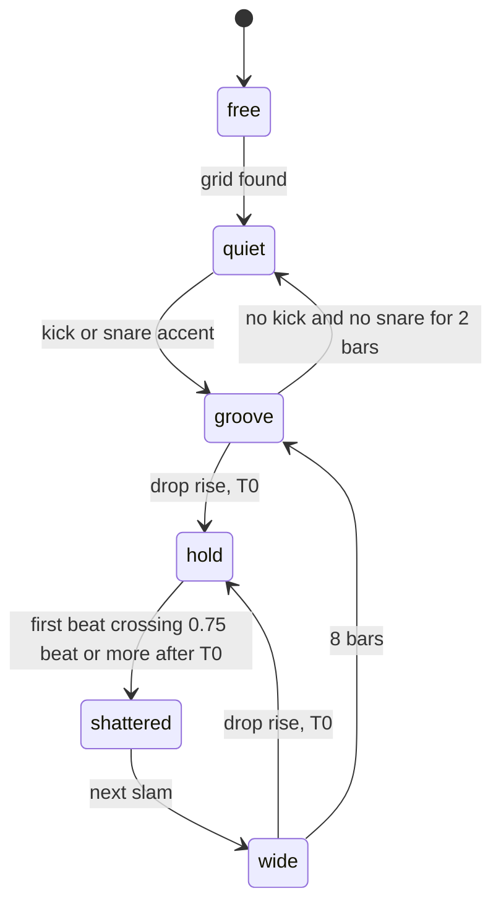
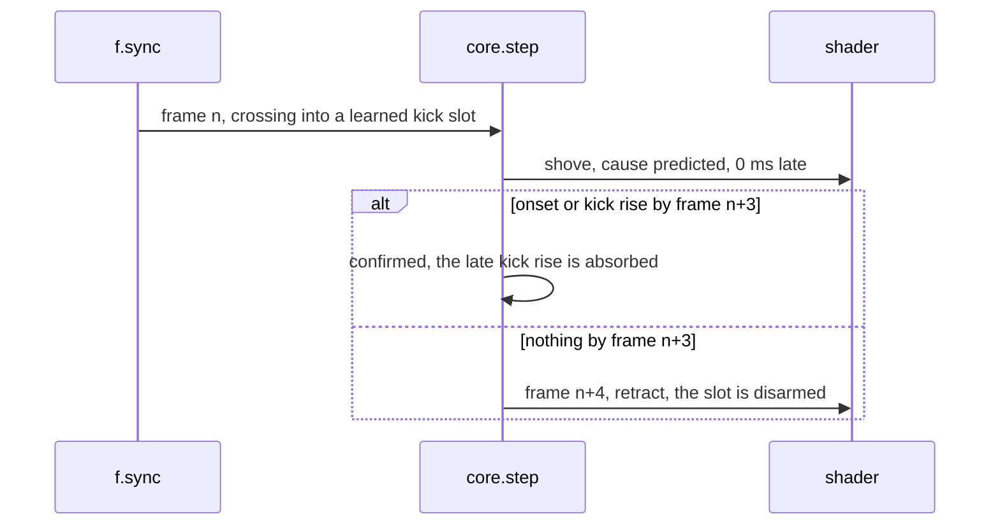
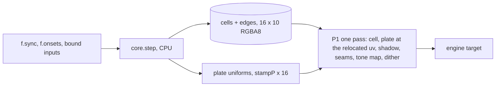
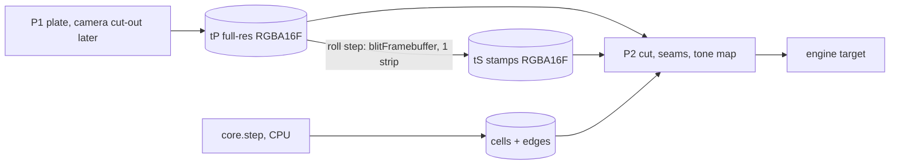
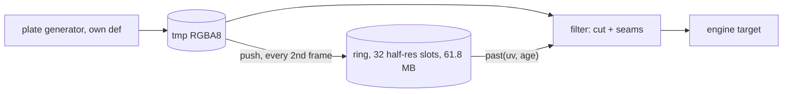

# Design — Amen Shatter (W4-S2: a 16 × 10 lattice cut on the breakbeat, and the plate)
## TL;DR
- One new native `native/amen-shatter` and one built-in `builtin:amen-shatter`. Every variant shares one pure CPU core: the 16th clock, the bar-phase histogram, the predicted kick shove, the slice table, the roll and the drop recipe. The core writes two 16 × 10 tables per frame. The variants differ only in how the plate reaches the cut.
- **A (recommended, simplest):** one full-screen pass, no FBO. The plate is a GLSL function evaluated at the relocated UV. Seams, shadows and the tone map are analytic in the same pass. A stamp is a frozen set of plate parameters. ≈ 1.2–1.8 ms; 2.0–3.1 ms in a slow session (computed).
- **B:** the plate in its own HDR target, then the cut pass. Stamps are `blitFramebuffer` strip copies. ≈ 1.6–2.3 ms; 2.7–3.9 ms slow (computed). Camera-ready.
- **C (rejected):** plate generator + filter + history ring (the time-machine shape). ≈ 1.7–2.5 ms; 2.9–4.2 ms slow. The ring cannot hold a stamp for a bar, `src` is RGBA8, and the plate needs the cut's state.
- The plate: new and dedicated, inside the native. Two creative lines cannot hold as worded (free mode by confidence < .5; C3 against the seam light): see `## Decision needed`.
## Freshness
- 2026-11-15, system-designer. Brief `W4-S2-DESIGN-SHATTER`, source commit `0049fc5` + the uncommitted creative spec.
- Inputs: `agents/creative-director/creative_amen_shatter.md` (TL;DR, §1–§3, §6, §8, Signal gaps; §4, §5 and §7 came with the same read); `thoughts/spec_dnb_wave4.md` §3–§5; `agents/research/research_dnb_wave4.md` §2 (L49–L82), §4; `agents/audio-dsp/dsp_dnb_wave4.md` §2–§5 (L39–L120); `agents/STATE.md` HEAD.
- Code read at `0049fc5`, under `web/src/`: `scenes/history.ts` L1–L156; `gl/scene.ts`; `gl/post.ts`; `frame.ts`; `gl/live.ts` L1–L60, L262–L400; `gl/engine.ts` L60–L107, L135–L221; `scenes/builtin.ts` L425–L463; `scenes/lasers.ts` L520–L624; `scenes/camera.ts` L1–L60; grep hits in `audio/sync.ts`, `bind.ts`, `fx/types.ts`. Also `agents/system-designer/design_rave_lasers.md` L1–L34, L120–L143 (the format, the bloom cost).
- Not read: `thoughts/spec_veejay_wizard.md` §4, §7. The roadmap notes rest on STATE HEAD and the wave-4 spec.
- No web source was used. Every cost is computed from the anchors in §1; none is measured. Split artifact (Write cap 5 KB): this file, then `design_amen_shatter.2.md` … `.11.md`. The lead joins them in numeric order.
## §1 Problem and constraints
- Problem: show the plate as a permutation of its 160 cells that changes only on drum hits, grid crossings and the drop recipe. Add thin HDR seam light, shadows and stamps. Stay at billed +flash p95 ≤ 5 ms at 1728 × 1117 (R2), slow sessions included (× 1.6–1.7, brief).
- Fixed by the inputs:
  - Acceptance: R1–R7 (`spec_dnb_wave4.md` §5), C1–C16 (creative §8), N1–N9 (creative §6). No analyser change: every gap has a scene-side path (dsp §3).
  - Contract: `Native` / `NativeDef` stay frozen (`web/src/gl/scene.ts:7`, `:13`), and so does `FrameInput` (`web/src/frame.ts:7`). The flash gate stays as is (`web/src/gl/post.ts:46`).
  - Stack: WebGL2 + `twgl.js` (installed). No new dependency (spec §4). Licence: own code, credit "VeeJay Wizard". The donors are look references, rewritten by analogy and never pasted (research §4: ISF-Files MIT, gl-transitions MIT, TD palette proprietary).
- Non-goals: a new detector; an automatic downbeat in `sync.ts` (dsp §3 G1.3, an SDLC §4 change); the camera cut-out in S3 (creative §2.4); cutting an arbitrary scene (no C-row asks for it).
- Facts that shape the design:
  - **F1** The layer chain is RGBA8: `shots` and `temps` are `renderTarget()` without `hdr` (`gl/engine.ts:97–99`). A native that wants HDR keeps it inside and tone-maps itself (`scenes/lasers.ts:585`, `:544`).
  - **F2** A lone generator on layer 0 (normal, opacity 1, res 1) draws straight into the scene target: one pass (`gl/live.ts:348`, `:358`). A generator + one filter is two passes.
  - **F3** The history ring holds 32 slots at ½ stage: 64 frames at stride 2, against 82.8 frames for a bar at 174 BPM (102.9 at 140, derived); 61.8 MB (research §2.3; `scenes/history.ts:12–18`, `:147`).
  - **F4** 1728 / 16 = 108 px, but 1117 / 10 = 111.7 px: a row is not a whole number of pixels.
  - **F5** Grid confidence is not a validity gate: on right grids its p50 is .32–.41, and it is ≥ .6 on 14–33 % of frames. `bpm` is 0 without a grid (dsp §4; `audio/sync.ts:8`, `:134`).
- Cost anchors (billed p95; a normal session unless noted):
  - **M1** one simple full-res pass: 0.71 ms (stars), 1.01 ms (superformula). **M2** a heavy one-pass generator: 2.35–2.40 ms (grad-map, tiny-planet). Both from STATE HEAD, wave 2.
  - **M3** one half-float full-res pass ≈ 1 ms (research §2.3). **M4** `own/bloom` as a pass: + 3.3 ms (`design_rave_lasers.md` L137).
  - **M5** the lasers' 5-target HDR pipeline in a slow session: 2.94 ms loud, 4.47–4.55 ms at the drop (STATE HEAD).
## §2 Variants
### §2.0 Shared by A, B and C: the core (no GL)
- One file, `web/src/scenes/shatter.ts`: the pure core and the native (the `createRig` / `laserState()` precedent, `scenes/lasers.ts:107`, `:598`). Tests in `shatter.test.ts`. The native joins `fx/catalog.ts`; the built-in is one JSON literal in `scenes/builtin.ts`. The native exposes `shatterState()`: the state that `step` returns.
- **The plate (decision):** new and dedicated. No existing generator has the tier palettes (creative §2.5), the × 1.3 ring spacing, the beat-locked ring phase and the T0 shockwave, and none was measured against P1–P4. It lives inside the native as `plate()` + `PlateP`, not as a catalog generator: its palette, shockwave and push-in follow the cut's state (see Variant C).
```ts
export const COLS = 16, ROWS = 10
/** The 16th slot of a beat position (dsp §5 a): the scene clock, and the label of a hit. */
export const slotOf = (beat: number) => ((Math.round(4 * beat - 0.4) % 16) + 16) % 16
/** EMA slot histograms, tau 4 bars. rho = argmax over r in {0, 4, 8, 12} of K[r] + K[r+10] + S[r+4] + S[r+12], each
 *  normalised to its max; null while hits < 6 (dsp §3 G1.1). Bar slot = (slot - rho) mod 16. */
export interface Hist { k: Float32Array; s: Float32Array; hits: number }
export function barPhase(h: Hist): number | null
/** out[c + 16 * r] = the plate cell shown at screen cell (c, r): bands (layout = their 4 heights), then strips, then cell swaps. */
export function compose(bands: Int8Array, layout: readonly number[], strips: Int8Array, swaps: readonly number[], out: Uint8Array): void
export interface ShatterIn {
  beat: number; bpm: number; conf: number; dt: number; onset: boolean // f.sync read raw (dsp §4), f.dt, f.onsets.length > 0
  kick: number; snare: number; hats: number // bound floats, release 0: the core finds the rises
  build: number; drop: number; bass: number; sub: number; seams: number
  burst: number; kickFlare: number; snareFlare: number // [F]: after the flash gate
}
export type Cause = 'kick' | 'predicted' | 'retract' | 'snare' | 'hats' | 'ghost' | 'slam' | 'roll' | 'drop' | 'shatter' | 'quiet'
export interface Move { kind: 'shove' | 'crack' | 'tick' | 'ghost' | 'slam' | 'stamp' | 'home' | 'shatter'; cause: Cause; slot: number }
export interface PlateP { phase: number; sheen: number; bright: number; scale: number; pal: number } // pal: 0 = C, 1 = A, 2 = B
export interface ShatterState { // shatterState(): the harness's CPU truth
  frame: number; slot: number; rho: number | null; mode: 'free' | 'locked'; tier: 'quiet' | 'groove' | 'wide'; recipe: 'none' | 'hold' | 'shattered'
  src: Uint8Array; bands: Int8Array; strips: Int8Array // the slice table (160); 4 column offsets; 16 row offsets
  stamps: Int32Array; moves: readonly Move[] // 16: the frame a column was stamped on, -1 = live; this frame's moves, with causes
  pending: number; plate: PlateP; hair: number; shock: number // s left to confirm a predicted shove; the live plate; hairline opacity; s since T0
}
export interface Shatter { step(x: ShatterIn, cells: Uint8Array, edges: Uint8Array, stampP: Float32Array): ShatterState }
export function createShatter(seed: number): Shatter
```
- GPU tables written by `step`: two 16 × 10 RGBA8 NEAREST textures read with `texelFetch`; 1,280 bytes uploaded per frame.
  - `cells`: source column, source row, smear (a signed length along the slice's axis), flags (stamped).
  - `edges`: the level (0–255) of the cell's right edge and of its top edge, and one meta byte for each: type (band / strip / cell), the side that casts the shadow, fringe.
- The core owns every seam number; the shader only draws. An edge is a seam when the two cells across it are not neighbours on the plate. Its level is 25 % at rest, then the flare of its own hit (`kickFlare`, `snareFlare` or `burst`, × `seams`), then a fade after a slam.
- ⚠️ Assumption, needs confirmation: the line where a wrapped slice meets its own other end is a seam too. Creative §2.3 defines a seam by offsets only; without light, the wrap reads as an error.
- `stampP`: 16 frozen `PlateP` records. Only A reads it.
- **Clock.** `slot = slotOf(beat)`. A crossing = the slot changed since the last frame; a frame that skips slots runs them in order. A beat crossing = a crossing into a slot with `slot % 4 == 0`. It comes 8.6 ms before the grid line at 174 BPM (derived): inside C10's ± 1 frame.
- **Mode (deviation D1).** `locked` while `bpm > 0`, `free` otherwise (dsp §4). Creative §4 says confidence < .5. By F5 that keeps a right grid in free mode on more than half of its frames. Confidence only sets the hairline opacity (signal 2).
- **Grid break.** `bpm` 0 ↔ > 0, a beat jump (|Δbeat − dt · bpm / 60| > .25) or a tempo change (> 2 % from the histogram's start) empties the histogram and the predictions (creative §4). ⚠️ Assumption, needs confirmation: both thresholds.
- **Hits.** A rise = a float input that crosses .5 upward between two frames (dsp §2.2: 100 % of drained hits). Its slot is the current `slot`: the −0.4 bias already absorbs the detector lag (dsp §5 a).
- **Kick prediction** (signal 3, dsp §3 G8.1):
  - K1: on the crossing into a learned, armed kick slot the shove fires (cause `predicted`); `pending` = 50 ms (3 frames at 60 fps).
  - K2: `onset` or a kick rise while pending confirms it.
  - K3: with no confirm, the shove is undone on the 4th frame (cause `retract`). The slot is disarmed until a kick rise lands on it.
  - K4: a kick rise in a slot visit that already fired is absorbed: no second move, no toggle. In a visit that has not fired, it is a detected shove or a ghost (cause `kick`).
- **Time windows are in seconds**, so a 120 Hz display behaves the same. C4 and C5 are checked at 60 fps (the display rate is an assumption, research §2.3).
- **Seed.** Slice choice = f(drum, bar slot, seed + phrase index). No clock and no `Math.random` (C14). ⚠️ Assumption, needs confirmation: `seed` is a `long` input with a fixed default; the per-entry change of the plate centre (creative §5) waits for the S3 verdict.
- **Tier and recipe.** `bpm` = 0 returns any state to `free`; a `drop` rise enters `hold` from `quiet` too.

- The roll is an overlay on `groove` and `wide`: off, 8ths (`build` ≥ .15) or 16ths (`build` ≥ .40, or the snare density), hysteresis .05. `free` runs one-shots only, and its hold is 350 ms (creative §3.3, §4).
- **A predicted shove, frame by frame** (the amber flare follows `kickFlare`, the detected kick, about 2 frames later; a retracted shove never flares):

- **Inputs and binds** (the built-in repeats them): the triggers `kick`, `snare`, `hats` (attack 0, release 0); `build` (.2 / .5 s); `drop` (attack 0); `bass` ← `band6` (30 / 300 ms; ⚠️ Assumption, needs confirmation: `band8` reads the same in dsp §2.1); `sub` (80 / 600 ms); `seed`; `seams` (a gain, default 1).
- **Flash inputs:** `flash: ['burst', 'kickFlare', 'snareFlare']`, with `burst` ← `drop`, `kickFlare` ← `kick` (release .15 s) and `snareFlare` ← `snare` (release .18 s). `burst` comes first, so a same-frame tie goes to the drop (the lasers' order, `scenes/lasers.ts:549`).
- **Flash rules.** A move is never gated; a refused flare leaves the seam at 25 % (creative §3). The hats flare is not an input: the core caps it at .5, so it never spends the shared budget of 3 per second (`gl/post.ts:15`). The shatter flare rides `burst`: one gate onset at T0, still ≈ .55–.77 at the shatter (the `drop` source decays with τ 1 s, dsp §2.1); the core scales it to full.
- **Tests.** Vitest on the core alone: `slotOf`; `barPhase` at 4 rotations; `compose` (a permutation of 160 after every step); K1–K4; C4, C6–C11, C13 and C14 on synthetic hit streams. The harness reads `shatterState()` each frame for C5 and for the pixel rows (C2, C3, C12, C15).
### Variant A — one pass, the plate inline (simplest; recommended)
- Summary: a generator native with no FBO. One full-screen fragment shader finds the pixel's cell, reads the tables, evaluates the plate at the relocated UV, adds the seams and shadows, then tone-maps and dithers into the bound target (F2: one pass).

- **Shifts: an offset texture.** `cell = floor(gl_FragCoord.xy * vec2(16, 10) / res)`: the pixel centre picks the cell, so every seam sits on a pixel boundary (C2). `uv' = uv + (source − cell) / vec2(16, 10)`, wrapped. The plate is a function, so a shift of 223.4 px (2 rows, F4) is exact: no resample, no blur. Per pixel: 4 `texelFetch` (own cell, own edges, the edges of the left and of the lower neighbour) and 0 picture reads.
- **Rejected forms:** a uniform table (`vec4[160]` of the 224 fragment uniform vectors that WebGL2 guarantees, with dynamic indexing); instanced cell quads (the same fill, plus a VAO and blended seam and shadow geometry: no gain while the picture is a pure cell permutation).
- **Plate:** `plate(uv, PlateP)` in GLSL. The core disc; rings in closed form (ring index = log base 1.3 of the radius, minus the phase: no loop); two sheen lobes from a dot product; a 3-stop field; grooves; grain. The 3 palettes are constants mixed by `pal`. The drop's shockwave is 3 more ring terms driven by `shock`.
- **Smear:** analytic. On the move frame and the next one, `plate` widens each ring and rim edge by the smear length × |edge normal · axis| and lowers its peak by the same ratio. No extra evaluation, no noise.
- **Seams at HDR:** in linear light, inside the pass. Core = a 1.5–2.5 px profile on the distance to the lattice line, 2–4 × white × level. Halo = an exponential tail tinted by type. Fringe = the same profile read at ± 2.5 px for R and B. Shadow = × (1 − .35 · tail) on the side the meta byte names. Hairline = 1 px × `hair`. Then the lasers' max-channel tone map and dither (`scenes/lasers.ts:73–76`, `:544–546`). No bloom pass (M4): the bloom of a straight line is this 1-D profile.
- **Roll: frozen parameters.** No pixel is stored. On a roll step the core copies the live `PlateP` into `stampP[head]`; the shader draws that column from the plate-centre strip with the frozen record. A stamp lives for any length, so F3 does not apply. At 16ths each stamp's `phase` is ¼ spacing further (creative §3.2), because the phase follows the beat.
- **Drop recipe:** all in the core. T0 clears the offsets and the stamps, sets `pal` to 2 in one frame and starts `shock`. `scale` runs 1.00 → 1.06 to the end of the hold, which is known at T0 (the first beat crossing ≥ 0.75 beat later). The shatter writes ± 4 columns and ± 4 rows; `burst` lights every edge. The drop frame costs what any frame costs.
- **Reuse:** the native contract; the flash gate; `fullscreenProgram` (`gl/engine.ts:61`); the lasers' tone map, its CPU mirror `tone()` and its dither (own); `HASH` from `scenes/points.ts` (research §4 lists it under MIT webgl-noise: the header stays). Not reused: `ring` / `past()` (F3), `own/bloom` (M4).
- **Cost:** one pass between M1 and M2: 4 tiny fetches, about 1 log, 1 exp, 1 sqrt and 10 smoothsteps. **≈ 1.2–1.8 ms; slow session (× 1.7) ≈ 2.0–3.1 ms.** Flat: no move, roll or drop frame costs more. ⚠️ Assumption, needs confirmation: computed, with no in-house anchor for this shader; the spike measures it first. CPU: 160 cells and a 1.3 kB upload per frame.
- **Acceptance:** C2 and C13 hold by construction: the shader can only draw whole cells and light on lattice lines. C3: the relocation conserves luma exactly; the seam light is the open point (Decision 3). P4's HDR share is read from the output: luma above `tone(1)`.
- **Leaves open:** the camera cut-out = 2 more reads at `uv'` (`cam.tex`, `cam.mask`, as `scenes/camera.ts:30–35`) and one `users.use()`; not built. Tiles: no size-dependent resource. A move to B keeps the core, the tables and the tests.
- **Risks:** A-1 an analytic plate may read as flat shapes (N6). A-2 a stamp freezes parameters, not pixels: a camera person would stay live inside a stamp. A-3 the analytic smear is not a true motion blur. **Effort: M** (core M, shader S).
### Variant B — the plate in an HDR target
- Summary: the same native and core. P1 draws the plate into `tP` (full-res RGBA16F). P2 is A's pass with `texture(tP, uv')` in place of `plate(uv')`.

- **Shifts:** the same offset texture. `tP` is read NEAREST at the exact offset; LINEAR would blur every row shift (F4).
- **Smear:** 4 LINEAR taps along the axis in the moved cells: reads, not plate evaluations.
- **Seams at HDR:** as A; the plate arrives in HDR from `tP`.
- **Roll: a frozen strip copy.** On a roll step `gl.blitFramebuffer` copies the plate-centre strip of `tP` into column `head` of the persistent `tS` (`renderTarget(true, true)`; native WebGL2, no shader, 1/16 of the frame). Stamped columns read `tS`. Any life; the pixels are real, a camera person included.
- **Drop recipe:** as A; the plate uniforms go to P1.
- **Cost:** A's shader split in two, plus M3. P1 ≈ 0.8–1.2 ms, P2 ≈ 0.8–1.1 ms: **≈ 1.6–2.3 ms; slow ≈ 2.7–3.9 ms** (computed). + 30.9 MB: two 1728 × 1117 RGBA16F targets. A bloom pass on top (M4, + 3.3 ms) breaks R2.
- **Leaves open:** the camera cut-out is one more draw into `tP` before the cut. Cutting another scene later = `kind: 'filter'` and `src` in place of `tP`.
- **Risks:** B-1 the margin is ≈ 1.1 ms in a slow session. B-2 two stage-size targets to fit for tiles and to free (the lasers' T-LC row). B-3 the 2–3 px ring edges are sampled: they stay crisp only while the NEAREST read stays exact. **Effort: M+.**
### Variant C — generator + filter + history ring (rejected)
- Summary: the time-machine shape (`scenes/builtin.ts:431–449`): a plate generator def, then `native/amen-shatter` as a `kind: 'filter'` that cuts `src` and keeps a `ring` for the stamps.

- **Shifts:** the offset texture over `src`. **Seams:** added in display space. The plate's HDR is clipped at the RGBA8 boundary (F1), so P4's HDR share is lost before the cut.
- **Roll: the history ring.** `past(uv, age)` with a growing age fails on three counts (F3). 64 frames < one bar: C9's ≥ 12 stamps need 62 frames at 174 BPM and 77 at 140. A stamp is ½ res beside full-res live strips. `past()` mixes 2 slots. B's strip target would replace the ring, and then nothing of the template is left.
- **Drop recipe:** the palette by tier, the shockwave and the hold's push-in are plate state driven by the cut's state. Two nodes share no state through the layer chain; a module-level channel would cross-talk between the two shots and the tiles.
- **Cost:** plate ≈ 0.7–1.1 ms + filter ≈ 0.8–1.1 ms + push ≈ 0.2 ms: **≈ 1.7–2.5 ms; slow ≈ 2.9–4.2 ms** (computed).
- **What it would buy:** the cut as an editor effect over any generator or the camera layer (spec §3 names them as possible sources). Creative §2.4 narrows the source to the plate.
- **Risks:** C-1 HIGH: C9, C10 and the §2.5 palette cannot hold. **Effort: L.**
## §3 Comparison
| | A — one pass | B — plate target | C — filter + ring |
|---|---|---|---|
| Shifts | offset texture, analytic plate | offset texture, NEAREST read | offset texture over `src` |
| Passes / targets | 1 / none | 2 / two RGBA16F (30.9 MB) | 2 + push / ring (61.8 MB) |
| Seams | linear HDR, analytic | linear HDR, analytic | display space, plate clipped |
| Roll | frozen parameters | strip `blitFramebuffer` | ring: < 1 bar, ½ res |
| Drop recipe | uniforms, one owner | uniforms, one owner | no path for the plate state |
| Cost, normal (computed) | 1.2–1.8 ms | 1.6–2.3 ms | 1.7–2.5 ms |
| Cost, slow session | 2.0–3.1 ms | 2.7–3.9 ms | 2.9–4.2 ms |
| Camera cut-out later | 2 reads in the pass | 1 draw into `tP` | a layer under the filter |
| Other sources later | no | yes (`src`) | yes |
| Main risk | plate look (N6) | margin, 2 targets | C9, C10, §2.5 fail |
| Effort | M | M+ | L |
## §4 Recommendation
Pick **A**. It is the only variant with no target, no resample and no state shared between nodes, and it has the widest margin: ≥ 1.9 ms in a slow session, against ≥ 1.1 ms for B. The creative plate is analytic by its own definition (a disc, rings, lobes, a graded field). Evaluated at the relocated UV it is exact where a texture needs care (F4), and a stamp becomes five frozen numbers instead of a stored strip. Everything that the acceptance rows measure lives in the pure core, and B shares that core unchanged. So if the S3 stills show a flat plate (A-1), or the camera cut-out must freeze inside stamps (A-2), B is one added pass and not a redesign. C is rejected: the ring cannot hold a bar, and the plate cannot follow the cut's state.
Levers, in the order to pull:
- **L1** the `seams` gain, the halo width and peak, the shadow strength: C3 and C12 against the look (Decision 3).
- **L2** prediction off, or its confirm window (50 ms). Shoves then fire on the detected rise: within 2 frames on 27 / 80 / 39 % of kicks (dsp §2.2).
- **L3** the histogram tau (4 bars) and the accent threshold (.5).
- **L4** smear: analytic → 2 plate taps in the moved cells (computed: up to + 55 % of the pass on move frames, and those frames set the p95).
- **L5** the hats flare cap (.5).
- **L6** `nudge` (the sync `lead`) against the display latency (dsp §3 G8.1).
- **L7** Variant B, if A-1 or A-2 bites.
- **L8** the ghost distance (half the tier distance), if the tile test of C12 fails on relocation alone (Risk 4).
## Decision needed
1. **Variant:** A (recommended), B or C.
2. **D1:** `locked` = `bpm > 0`, not confidence ≥ .5 (creative §4 against F5). Without it the bar cycle runs on less than half of the right-grid frames. Note for the look: the hairlines rest at ≈ 3 % on a typical right grid (8 % × a p50 of .32–.41).
3. **C3 against the seam light.** Derived for GROOVE (mean .25, ≈ 12,000 px of seams): ± 3 % allows ≈ 1.2 luma · px per pixel of seam length. A 2 px white core adds ≈ 1.5; the shadow returns ≈ 0.7; a halo adds ≈ 16 × its peak. So C3 as written caps the halo peak at ≈ .03: no visible halo. Recommended ruling: C3 is measured at `seams` 0 (relocation only, exact), and C12 caps the seam light instead: a halo peak up to ≈ .35 keeps every 4 × 3 tile step under .10 (derived). The numbers are re-baselined after the S3 ok (the lasers' LR-4 precedent).
4. **The wrap line is a seam** (§2.0 assumption).
5. **Flash set:** `burst`, `kickFlare` and `snareFlare` gated; the hats flare capped and ungated.
6. **Seed:** a fixed `seed` input for S3.
7. **The plate:** new, dedicated, inside the native; no camera cut-out in S3.
## Risks (ranked; Variant A)
1. **C3 against the seam light** (Decision 3): an acceptance conflict, not an architecture one. Lever L1.
2. **Free mode by confidence** (Decision 2): without D1 the cycle, the roll and the prediction rarely run.
3. **A-1 the plate look:** an analytic plate must not read as flat shapes on black (N6, spec §4). Gate: the S3 stills. Lever L7.
4. **Tile flicker from relocation (C12):** a move can carry the bright core disc across a 4 × 3 tile boundary: a tile-mean step of ≈ .09–.18 (derived: the disc fills ≈ 33 % of a tile). The bar cycle makes ≤ 2 opposing pairs per bar per tile; each ghost adds one. No variant changes this. Lever L8.
5. **Prediction blips** on a wrong grid (Sub Focus: 19 % of the track, dsp §2.2) or in a fill: a predicted shove shows for 4 frames, then retracts; ≤ 2 per dropout (C4). Levers L2, L3.
6. **The cost is computed, not measured** (G-1). Gate: the spike's first number, on `dnb174-arr` and `dubstep140-arr`.
7. **Amen material:** the two-step template does not fit the Amen's kicks (dsp §4). The scene then runs on the no-histogram rules (creative §3.1). No such track is in the R1 set.
8. **A-2, A-3:** a stamp freezes parameters; the smear is analytic. Levers L7, L4.
9. **Governor scale < 1** softens 1 px hairlines and 2 px cores on the upscale. Low: the cost gives the governor no reason to scale.
## Signal-gap answers (creative SG1–SG5)
- **SG1 build ramp:** no design path without a detector. The roll follows `build` and the snare density only. R5 "the build reads as a ramp" stays UNKNOWN where `build` stays near 0 (Andy C, dsp §2.1). The fix is dsp §3 G7.2, an SDLC §4 change outside this epic.
- **SG2 roll density:** signal 6 is a pure rule in the core (≥ 2 snare rises within 3 slots). It fires rarely on the real tracks; S5 then comes from `dnb174-arr` (creative §7).
- **SG3 downbeat, velocity, ghosts:** `barPhase` in the core (dsp §3 G1.1); accent = a learned slot. It stays out of `sync.ts`. It is an exported pure function, so a later move there is a cut and paste.
- **SG4 drop lateness and misses:** T0 is the `drop` rise as it comes; the hold ends on a grid crossing. A missed drop runs no recipe. C10 and C11 are measured on detected drops only.
- **SG5 readable state:** `shatterState()` on the native instance (the `laserState()` path) returns the slice table, the stamp columns and this frame's moves with their causes. C5 is measured to the frame the scene draws. The display latency stays unmeasured (lever L6).
## Research gaps
- **G-1** No cost anchor exists for a pass with a 4-fetch table and a closed-form plate: all three costs are computed. Owner: the S3 spike.
- **G-2** dsp §3 G1.1 says rho is "defined on 68–86 %" of locked frames but states no rule beyond "≥ 6 hits". The planner takes the exact rule from `audio-dsp` (evidence `scratchpad/dsp/w4.log`).
- **G-3** How long "ring speed × 2" lasts after T0: creative §3.3 names no end. ⚠️ Assumption, needs confirmation: the WIDE tier.
- **G-4** `thoughts/spec_veejay_wizard.md` §4 and §7 were outside the brief. The roadmap notes ("Leaves open") rest on STATE HEAD and the wave-4 spec.
- **G-5** The display latency and the display rate (60 fps assumed) are unmeasured (dsp §5 d, research §2.3).
## Acceptance map (Variant A)
| Rows | How | Checked by |
|---|---|---|
| R1, C1, C16 | the S3 and S7 sheets (creative §7) | the user, creative-qa |
| R2 | one flat pass, 2.0–3.1 ms slow (computed) | the bench, both fixtures |
| R3, C12 | 3 gated flash inputs; the hats flare capped; frame and 4 × 3 tile means | harness |
| R4 | 10 binds, read through `Live.read` | live r-pass |
| R5, C10, C11 | the recipe in the core; mean offsets from `bands` and `strips` | Vitest; harness on detected drops |
| R6, C5 | K1–K4; `moves` with causes against the hit log | harness |
| R7 | `builtin:amen-shatter`: one layer, the native, no fx | `scenes/builtin.ts` |
| C2, C3, C13, C15 | whole cells and lattice-line light only; `compose` is a permutation; P4's HDR share from `tone(1)` | Vitest + pixels |
| C4, C6–C9, C14 | synthetic hit streams into `createShatter(seed).step`; C8 = the same with `beat` + 1, + 2, + 3 | Vitest |
## Skeptic response
- **rev 2, 2026-11-15, system-designer.** Reply to `agents/architecture-skeptic/skeptic_amen_shatter.md` §1. Verdicts: **accept 7 · accept-modified 4 · reject 0.** Variant A keeps its GPU shape. Every HIGH changes a core rule of design §2.0. The design file is not edited (brief). The rules below replace design L69, L71, L72, L74–L78, L80–L93 and the L94–L107 diagram where they differ.
- Read: the skeptic file (all); design L20–L133 and L180–L234; creative L60–L93 and L127–L143; STATE HEAD. Code references are the skeptic's, at `638eb67`; this response did not re-read them. Lead rulings applied as fixed: D1, C3 at `seams` 0, wrap line = seam, the gated flash set, the fixed S3 seed, the wall clock.
### HIGH findings
| ID | Verdict | Core-rule change | Proof |
|---|---|---|---|
| A-1 | accept-modified | Only a kick rise confirms a predicted shove. The confirm window is the slot visit, not 50 ms. A retract undoes that shove only. A prediction pause allows 1 false shove per kick dropout. Rules K1–K5. | Vitest V1–V3; the S3 retract rates |
| A-2 | accept | The core clock is the unwrapped slot index and never steps back. A frame fires at most 1 crossing. The break threshold is 1/8 beat. Rules M1–M4. | Vitest V4–V6 |
| A-3 | accept | Every rise detector starts from 0. `step` runs in a fixed order. A slam rule covers a null rho. C10 and C11 name their run type. Rules E1–E6. | Vitest V7–V9; one S6 cut-in run |
### A-1: kick prediction, rev 2 (deviation D2 from creative §3 signal 3 and C4)
- A slot visit = the frames from the crossing into a slot to the next crossing.
- **K1.** On the crossing into a learned, armed kick slot, with prediction not paused, the shove fires (cause `predicted`) and `pending` opens.
- **K2.** A kick rise while `pending` is open confirms the shove and is absorbed. A broadband onset confirms nothing: `ShatterIn.onset` is removed.
- **K3.** The next crossing with `pending` still open undoes the shove (cause `retract`). The retract subtracts that shove's band offsets and restores its A/B toggle. It touches no other move. The slot is disarmed until a kick rise lands on it. Prediction pauses.
- **K4.** The next kick rise in any slot resumes prediction. That rise fires its own move (a shove or a ghost, cause `kick`) and is never absorbed. A second kick rise inside a confirmed visit is absorbed, as before.
- **K5.** A home (slam, QUIET, T0) closes `pending` with no move. A grid break retracts an open `pending` at once.
- **Why the slot visit.** `slotOf` gives the right slot to 98–100 % of kicks (STATE HEAD L16; dsp §5 a per design L72). The label of a kick is the slot of the frame that shows its rise (design L72). So 98–100 % of kick rises land inside their own visit: from 8.6 ms before the grid line to 77.6 ms after it at 174 BPM (skeptic §2 L33). The 50 ms window ends 41 ms after an on-grid onset. At 33 ms after it only 27 % (Kanine) and 39 % (Andy C) of rises have landed (design L186). The visit is not a timed window, so no clock skews it.
- **Hats-only 8ths.** A hat gives no kick rise. A kick dropout shows 1 predicted shove and 1 retract; the pause blocks the other learned slot.
- **Rejected: a low-band confirm.** No artifact in this brief states that a low-band value rises earlier than the kick rise. A new source is a detector change (design L20, a non-goal).
- **Vitest.** V1: learn 8 bars of two-step, then run 2 bars with `onset` on every even slot, snares on and no kick rise → 1 `predicted`, 1 `retract` on the next crossing, 0 kept. V2: 8 bars with each kick rise 0–4 frames after its crossing (174 BPM, 60 fps) → 0 retracts; a rise in the next visit → 1 `retract` and 1 shove with cause `kick`. V3: a shove and its retract with no hit between them → `src` and `bands` equal the frame before the shove, and the next kick shove equals the same slot's shove one bar earlier (C6).
### C4 bound (proposed; the lead rules it)
- **Old:** "Every unconfirmed predicted shove retracts within 4 frames; ≤ 2 of them per kick dropout."
- **New:** "Every unconfirmed predicted shove retracts on the next slot crossing, ≤ 1 slot after it fired. ≤ 1 retract between two kick rises." The clause "0 moves without a trigger" stays.
- At 60 fps a false shove shows for 5–6 frames at 174 BPM (slot 86.2 ms) and for 6–7 frames at 140 BPM (107.1 ms). False-shove time per kick dropout falls from ≤ 8 frames (2 × 4) to ≤ 6 frames at 174 BPM and ≤ 7 at 140 BPM.
- On a right grid 98–100 % of detected kicks on learned slots confirm their prediction (the label rate above). S3 reports per track: retracts per predicted shove, and the share of retracts that a kick rise follows within 1 slot (the false ones). ⚠️ Assumption, needs confirmation: false retracts ≤ 5 % on Kanine. C5 stays the acceptance row.
- Costs. After a retract the next kick move fires on its rise, 27–38 ms late (STATE HEAD L16), once. A kick that the detector misses now retracts its shove; the broadband onset used to cover it. Lever L9 removes the pause: ≤ 2 retracts per kick dropout, as before.
### A-2: the monotonic clock, rev 2
- **M1.** `u` = round(4 · beat − 0.4), not wrapped. The core keeps `last`, the newest `u` that fired. A crossing = a frame with `u` > `last`. The core's slot is `last` mod 16, and a hit takes that slot as its label.
- **M2.** `u` ≤ `last` (a backward step under the break threshold): the frame fires no crossing, no stamp and no clock move. `last` stays, so no slot fires twice.
- **M3.** `u` > `last`: `last` = `u`, and the frame fires 1 crossing, into `u`. Skipped slots fire nothing (design L69 ran them in order; that rule is removed). So a frame makes ≤ 1 stamp and ≤ 1 predicted shove. At 60 fps and ≤ 180 BPM a slot lasts ≥ 5 frames, so a skip needs a frame gap > 83 ms. Every clock-driven transition compares slot indices (the hold end, QUIET after 32 slots, WIDE for 128, a tick's 1 slot), so a skipped slot loses only its own one-shot.
- **M4.** Grid break: `bpm` 0 ↔ > 0, a tempo change > 2 %, or |Δbeat − Δ`f.audioNow` · bpm / 60| > 1/8 beat (was .25; every same-tempo relock exceeds 1/8 by construction, `sync.ts:30`). A break empties the histogram and the predictions and sets `last` = `u` with no crossing. So a backward seek never freezes the clock.
- **Vitest.** V4: step `beat` by −0.03 on the frame after the crossing into slot 5 → 0 moves and 0 stamps until `beat` passes its old value; the crossing count of the run equals a control without the step. V5: a jump of −0.2 beat, then one of +0.2 beat → `hits` 0, `rho` null, no armed slot, 0 crossings and 0 stamps on that frame. V6: one frame that advances 3 slots with a matching Δ`f.audioNow` → 1 crossing, ≤ 1 stamp, `hits` kept; over a random walk of `beat` steps, ≤ 1 stamp per frame.
### A-3: cold entry and the drop recipe, rev 2
- **Scope.** In autopilot the recipe shows only on a cold cut-in (skeptic A-3: `arrange.ts:73`, `app.ts:368`). With LOCK (the app's scene lock) it shows on a run that stays on screen: the `drop` rise enters `hold` from `quiet`, `groove` or `wide` (design L80–L88, unchanged). No app rule changes.
- **E1.** Every rise detector starts from `prev` = 0: `kick`, `snare`, `hats`, `drop`. So a first frame with `drop` ≥ .5 is a rise, and T0 = the entry frame. `drop` = conf · e^(−t) stays ≥ .5 for ≤ 0.69 s (`arrange.ts:149`), so an entry inside that tail runs the recipe too. Accepted: an entrance on the drop.
- **E2.** Frame 1 has no previous frame: `last` = `u` with no crossing, and no break check.
- **E3.** `step` order on every frame: (1) clock and break; (2) mode: `bpm` > 0 → `locked`, and `free` → `quiet` happens here; (3) the `drop` rise → `hold`; (4) the crossing: retract, hold end, predicted shove, stamp; (5) hits; (6) compose. So a cold frame 1 with a grid enters `hold` on the locked rule, not on the 350 ms rule.
- **E4.** The mode at T0 fixes the hold end. Locked: the first beat crossing ≥ .75 beat after T0, kept as a slot index. Free: T0 + 350 ms on the wall clock. The push-in runs on the same measure. The histogram learns in every state.
- **E5.** Slam while rho is null (creative §3.1 L82, now a core rule): the 2nd snare rise since the last slam, shatter or entry slams. After 16 slots with no slam, the next kick or snare rise slams. So on a cold cut-in over two-step, `shattered` → `wide` comes 8–12 slots after the shatter. With rho null the bar slot is the raw slot; only the slam rule differs.
- **E6.** Run types for C10 and C11. Held run: LOCK on, the scene on screen and `locked` for ≥ 8 bars before T0; C10 and C11 as written. Cut-in run: a fresh scene at T0; C10 as written (frame 1 is whole); C11's "before" figure is the held run's, on the same fixture and seed.
- **Vitest.** V7: a fresh core, frame 1 with `drop` .8 and `bpm` 174 → `mode` `locked` and `recipe` `hold` on frame 1; `shattered` on the first beat crossing ≥ .75 beat later; then 4 bars of two-step → `wide` at the 2nd snare rise after the shatter, with `rho` still null. V8: the same with `bpm` 0 → `shattered` after 350 ms of `now`. V9: a held run of 8 bars of two-step, a `drop` rise, then 5 more bars → C11's ratio ≥ 1.8.
### A-4: the clock of every window, rev 2 (lead ruling: seconds run on the wall clock)
- `ShatterIn` loses `dt` and gains `now` and `audioNow`. The native reads `now` = `performance.now() / 1000` and passes it in (the `RigIn.time` precedent, `skeptic_rave_lasers.md` L24). The core stays pure.
- **Slot index (the audio clock, `f.sync.beat`):** the confirm window, a tick's life, the roll steps, QUIET after 2 bars, WIDE for 8 bars, the locked hold end and its push-in.
- **Wall clock (`now`):** the free hold (350 ms) and its push-in, `shock`, the shatter release (400 ms), the fringe (50 ms = 3 frames at 60 fps), the hats flare (60 ms), the seam fade after a slam, the hairline 500 / 1000 ms.
- **Δ`f.audioNow`:** the break residual only (M4). `beat` runs on that clock, so the residual is 0 across any frame gap: a 200 ms hitch no longer empties the histogram. ⚠️ Assumption, needs confirmation: the lead accepts this one non-wall clock. It is a consistency check, not a timed window.
- **Engine bind stage (unchanged):** the releases of `kickFlare`, `snareFlare`, `build`, `bass`, `sub`. No C-row measures them. **Frames:** the smear (the move frame + 1).
### MED findings
| ID | Verdict | Change | Proof |
|---|---|---|---|
| A-4 | accept (lead ruling) | No layer-clock value enters the core: the clock list above. | V10: the free hold lasts 350 ms and the shatter release 400 ms of `now` at 60 fps, at 120 fps and across one 200 ms gap; the gap keeps `hits`. |
| A-5 | accept | No core change. C12's tile rule takes the max step over the 4 grids offset by (0 or 216 px, 0 or 186 px). The harness runs C12 on 2 seeds: the S3 seed and one whose disc crosses the x = 864 border. The S3 sheet keeps the fixed seed. Risk 4 then counts a disc-band move at its full step, .09–.18. | The test-architect's C12 row; the S3 harness on both seeds |
| A-6 | accept | `barPhase` returns null unless the best score beats the runner-up by a margin. The core adopts a new candidate (a rotation or null) only after it has led for 16 crossings in a row, and only on a crossing into bar slot 0 (at once while rho is null). A null rho runs rule E5, so Risk 7's fallback is reachable. ⚠️ Assumption, needs confirmation: margin .5 on the 0–4 score; `audio-dsp` sets it (G-2). | V11: 32 bars each of kick 0 / snare 8 and of kicks 0 + 8 / snares 4 + 12, with ± 1 seeded ghost per bar → `rho` null on every frame. Two-step with the same ghosts → 1 adoption, 0 later changes, 1 slam per bar after it. |
| A-7 | accept-modified | A hit rise = a frame-to-frame increase ≥ .05 on `kick`, `snare` or `hats`. It replaces the .5 crossing: one rule, not two. Between hits the envelope only decays, and a drain 2 or more frames after the last one reads ≥ .13 above the frame before it (tau .12 s, `features.ts:14`; `sens` 1). `drop` keeps the .5 crossing (E1). | V12: `features.fill` with 2 snare hits 86.2 ms apart, 16 frame phases, `sens` 1.0 and 1.2 → 2 rises per pair in all 32 cases. |
### LOW findings
| ID | Verdict | Change | Proof |
|---|---|---|---|
| A-8 | accept-modified | Measure first: the S3 harness logs, per detected drop, the allowed onsets in [T0 − 1 s, T0] and `burst` on the shatter frame. If any drop reads `burst` 0, the fix stays in the core (lever L11): shatter seam level = max(scaled `burst`, the ungated cap .5), ≈ +.038 frame-mean (half of the figure in skeptic §2 L34). No slot reservation: it changes the shared budget of every scene (`live.ts:61–64`). | The S3 harness log |
| A-9 | accept | The shader reads 8 edge texels (its own and 7 neighbours'; the upper-right cell holds no stub) and 1 cell texel: 9 `texelFetch`, was 4. The halo of an edge uses the true distance to its segment, so a seam end gets a round cap. The cost joins the spike's first number (G-1). | One GROOVE still with a lit seam that ends on a resting line: no halo step within 16 px of the vertex. The test-architect sets the step bound. |
| A-10 | accept-modified | Risk 4 recount. A tick moves 1 cell = 7.5 % of a tile: its step is ≤ .075 + ≤ .018 of seam light (derived) < .10, so a tick makes no counted step. A retract is 1 opposing pair; K3 and K4 allow ≤ 1 between two kick rises. Predicted shoves keep moving the disc band: the alternative draws those kicks late (R6). Lever L10 if the count fails: ghosts skip the disc band. | CPU count on `shatterState()` and the seeded disc cells: opposing tile pairs per 1 s on two-step with a 1-bar kick fill, ≤ 3. |
| A-11 | accept | C2's permutation clause moves to the CPU: `compose` returns a permutation of 0–159 after every `step`. The pixel check keeps "seams on lattice lines ± 1 px" and takes a per-cell mean tolerance of .02, not block equality. | Vitest on `compose`; the test-architect's C2 wording |
### Research gaps
- **G-2 (open, wider).** The `barPhase` margin, checked against the 86–97 % right-phase rate (STATE HEAD L16). Owner: `audio-dsp`, from `scratchpad/dsp/w4.log`, before the `barPhase` step.
- **G-6.** The share of kick rises seen inside their own slot visit, per track. The 98–100 % figure reaches this response through STATE HEAD L16 and skeptic §2 L33; `dsp_dnb_wave4.md` was outside the brief. Owner: `audio-dsp`, same log. The S3 retract rates check it again.
- **G-7.** `f.audioNow` on `FrameInput`, and the clock of the bind stage: skeptic A-4 cites both; this response did not verify them. Owner: the planner, at `frame.ts` and `gl/live.ts`.
### Changes for the plan
1. Core rules rev 2 (K1–K5, M1–M4, E1–E6, the A-4 clock list, the A-6 and A-7 rules) replace design §2.0 L69, L71, L72, L74–L78, L80–L93 and the L94–L107 diagram.
2. Contracts: `ShatterIn` loses `dt` and `onset` and gains `now` and `audioNow`. `ShatterState.pending` = the slot of the open predicted shove, or −1 (was seconds).
3. Vitest V1–V12 run on the core alone, before any shader work. The test-architect maps them to matrix IDs.
4. Deviation D2 (creative §3 signal 3 and C4) is recorded with the lead's ruling on the C4 bound.
5. Test-architect: C4 as ruled; C12 = the max over 4 offset grids, on 2 seeds (A-5); C2 = `compose` in Vitest + a per-cell tolerance on pixels (A-11); the C10 and C11 run types (E6).
6. The S3 harness logs, per track: retracts per predicted shove and the false share (A-1); grid breaks per minute (M4); `burst` on the shatter frame with the allowed onsets in [T0 − 1 s, T0] (A-8).
7. The S3 sheet adds one cold cut-in sequence (entry frame, hold, shatter) and one GROOVE still for the vertex scan (A-9).
8. S6 adds one autopilot cut-in run (A-3) and the CPU tile-pair count on a kick-fill stream (A-10).
9. Shader: 9 `texelFetch` and segment-distance halos (A-9). The spike's first cost number includes them (G-1).
10. New levers after L8: **L9** no prediction pause; **L10** ghosts skip the disc band; **L11** the shatter seam floor at the ungated cap; **L12** rotate the histogram on a same-tempo relock, if the break log shows frequent resets.
11. `audio-dsp` closes G-2 and G-6 before the `barPhase` and prediction steps. The planner closes G-7.

## Lead rulings on the response (2026-11-15)
- **C4 bound ACCEPTED:** every unconfirmed predicted shove retracts on the next slot crossing (≤ 1 slot after it fired); ≤ 1 retract between two kick rises. The prediction pause stays (lever L9 kept in reserve).
- **Break residual on Δ`f.audioNow` ACCEPTED** (the audio clock is the right clock for beat phase; every other timed window stays on the wall clock).
- G-2 / G-6 → audio-dsp at the spike pre-step; G-7 (`f.audioNow` on `FrameInput`) → the planner.
