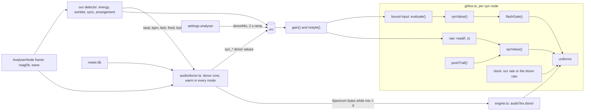
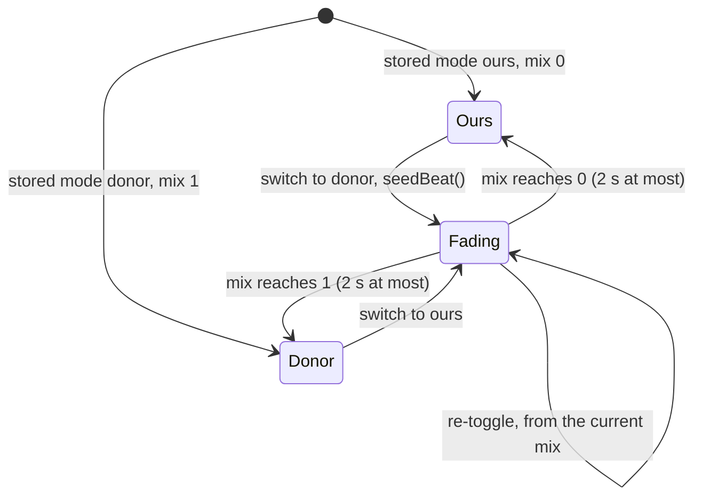
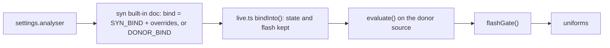
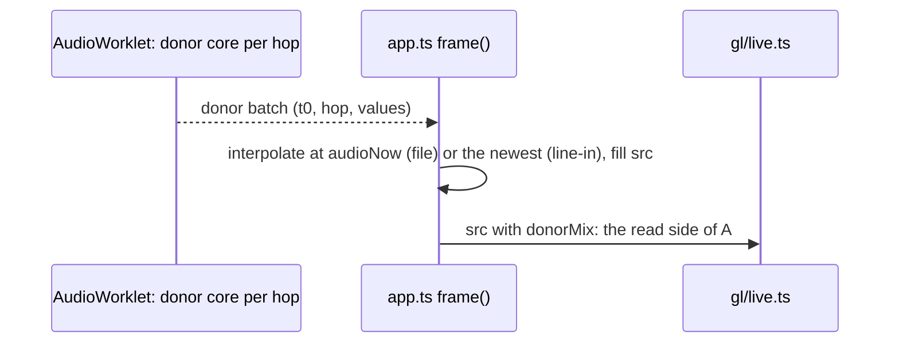

# Design — donor-mode audio analyser (Tier 3 S2, non-visual)


## TL;DR
- **Recommended: Variant A.** One pure module, `web/src/audio/donor.ts` (the audio-dsp prototype, productised), runs warm on the render tick. It writes every donor value into `src` under its donor name (`syn_BassLevel`, …). The mode is one persisted setting. It drives one number, `src.donorMix` (0 = ours … 1 = donor, a 2 s ramp).
- **SYN switches by name, with no mapping table.** One pure helper, `synValue(name, ours, s, w)`, crossfades a SYN value to `s[name]`. `gl/live.ts` calls it for bound inputs (before the flash gate), for raws and for the LevelTrail push. Clocks keep their position and take a donor rate.
- **R1 holds by construction.** The arrangement reads no donor value. No binding is rebuilt, so each `FlashState` and the scene's onset budget survive the switch. No shader recompiles.
- Variant B (rebind the bindings) has no crossfade and misses user-edited copies. Variant C (worklet core) is frame-rate independent, but it voids the S1 numbers and is L.
- **Part B:** P4 `kickAccent` rides along as the last step (additive, unbound). P6 stays backlog. Deviance hits are skipped. Three DSP questions (G1–G3) go to audio-dsp before S4.

## Freshness
- 2026-11-18, system-designer (Fable 5.2). **Code was read at master `ff21782`, not the brief's `2a1733a`:** adapter step 3 merged during this run (`f46c66c`). The design uses the merged SYN table (`web/src/fx/syn.ts:51–101`), not the brief's description of it.
- Inputs: `thoughts/spec_audio_donor_mode.md` (whole, R1–R7); `agents/audio-dsp/dsp_donor_mode_2026-11-18.md` §1, §A1–§A4, §B, §C; `agents/STATE.md` HEAD; `scratchpad/dsp-donor/donor-model.ts:1–80` and its exports.
- Code, under `web/src/`: `app.ts:290–420`; `bind.ts:1–164`; `fx/syn.ts:20–133, 268–284`; `fx/types.ts:14–32`; `clock.ts`; `gl/live.ts:188, 205–257, 320–326, 380–383`; `gl/post.ts:34–58`; `gl/engine.ts:103–123, 169–171`; `ui/SourcesTab.tsx:1–60`; greps of `audio/settings.ts`, `audio/meter.ts`, `scenes/calib.ts`.
- ⚠️ `graphify query` was not run: this run had no shell tool. The reads beyond the brief's ranges were found by narrow `Grep`.
- Terms. **Donor core:** `audio/donor.ts`. **Donor value:** a number the core writes into `src` under its donor name. **Donor source:** a donor value listed for binding (0..1). **Mode:** `settings.analyser`. **Mix:** `src.donorMix`. **SYN input:** a syn scene's float input that a SYN binding entry feeds.

## Constraints
- **Scope** (spec Goal 1–3, Non-goals): a second analyser next to ours. Ours stays the default. No MilkDrop level change. No donor binary or `script.js` runs. Every constant is ours.
- **R4 as amended:** the stats core runs in every mode from the first audio frame, at ≤ 0.5 ms main-thread p95. Measured: ≤ 31 µs p95 in Node (dsp §A3).
- **Structure comes from ours** (dsp TL;DR, §A1): the beat family reads our `sync` grid (kick fallback), PrimeBang is our `fired`, PrimeAndBang is our `build`.
- **Flash** (R6, I-FL1, dsp §C): an event-class donor value reaches light only through an input that `flashGate` gates (`gl/post.ts:46`).
- **Licensing:** no new dependency. The core is our code, written from names and docs. No donor code is copied, so THIRD_PARTY does not change.
- **Not built** (YAGNI): an analyser interface with two implementations, a worklet change, a second FFT, a per-scene mode, a doc migration.

## Variant A — by-name crossfade at the read point (the simplest)

### Summary
The donor core is always on. Its values are always in `src`, so our own scenes can bind them in either mode. The mode changes one thing: what a syn scene's `syn_*` names read. `gl/live.ts` crossfades each SYN value from our mapping to `s[name]` by the mix. The SYN table stays our mapping. Donor mode is "read the name itself".

### Diagrams




### Modules
| File (`web/src/`) | New / changed | Responsibility |
|---|---|---|
| `audio/donor.ts` (+ `.test.ts`) | new | The donor core, pure: band stats, Level, Hits, Presence, macros, beat family, Spectrum bytes; `DONOR_GROUPS` |
| `audio/settings.ts` | changed | The `analyser` field: default, parse, `patch` |
| `app.ts` | changed | One `update()` per frame between L406 and L409; the mix ramp; `seedBeat()` at switch-in; the Spectrum upload while mix > 0 |
| `bind.ts` | changed | `SOURCE_IDS` and `sourceGroups()` take `DONOR_GROUPS` |
| `fx/syn.ts` | changed | `synValue()`; clock entries gain `donor`; `syn_FadeInOut` becomes a raw; new `syn_PrimeBang` and `syn_PrimeAndBang`; `_synSpectrum` mixes the donor rgba; `pushTrail` records `synValue` |
| `fx/types.ts` | changed | `Clock.donor?`; the `'spectrum'` texture kind |
| `gl/live.ts` | changed | `w` once per render (0 for a library tile); four touch points (L321, L322, L324, L382); the `'spectrum'` texture |
| `gl/engine.ts` | changed | `audioTex.donor` (512×1 RGBA8) and its upload |
| `ui/SourcesTab.tsx`, `ui/Panel.tsx` | changed | The mode switch above the groups; a read-only "donor" hint on a `syn_*` input while the mode is donor |

The call site differs from dsp §A3 ("right after `energy.update`", L315). The core needs this frame's grid (L383) and arrangement (L348). It also needs the unscaled `dt`: heat scales `f.dt` at L409.

### Contracts
```ts
// audio/donor.ts
/** What the core takes from our analysis each tick. */
export interface DonorIn { beat: number; bpm: number; confidence: number; kick: boolean; fired: boolean; build: number; peakDb: number }
export interface Donor {
  /** One render tick on the analyser frame. Writes every donor value into `out`, with no allocation. `dt` is the
   *  unscaled frame time; the core clamps it to 0.1 s (a stalled tab must not jump the stats or the counts). */
  update(magDb: Float32Array, wave: Float32Array, dt: number, g: DonorIn, out: Sources): void
  /** At ours → donor: the beat count continues from ours (dsp §A4 rule 5). */
  seedBeat(n: number): void
  /** syn_Spectrum's rgba bytes (512 × 4), rebuilt by update(). */
  readonly spectrum: Uint8Array
}
export function createDonor(sampleRate: number, fftSize: number, seed?: number): Donor
/** The donor sources by group. bind.ts appends them to SOURCE_IDS and sourceGroups(). */
export const DONOR_GROUPS: readonly { label: string; ids: readonly string[] }[]

// audio/settings.ts: key `analyser` in localStorage `vjw.audio`; missing or bad → 'ours'; `v` stays 1; patch() takes it
export interface AudioSettings { /* … */ analyser: 'ours' | 'donor' }

// fx/syn.ts
/** One SYN value in the current mode: `ours` at w 0, `s[name]` at w 1. A count switches at w ≥ .5 (it must not
 *  slide). A name the core does not write returns `ours`. */
export function synValue(name: string, ours: number, s: Sources, w: number): number

// fx/types.ts
export interface Clock { u: string; rate: Rate; frame?: true; donor?: Rate }
```
- **Donor sources (31, each 0..1), in five groups:**
  - `donor levels`: `syn_Level`, `syn_BassLevel`, `syn_MidLevel`, `syn_MidHighLevel`, `syn_HighLevel`.
  - `donor hits`: the same five bands as `…Hits`.
  - `donor presence`: the same five bands as `…Presence`.
  - `donor macros`: `syn_Intensity`, `syn_FadeInOut`, `syn_BassExpoCurve`, `syn_PrimeBang`, `syn_InputLevel`.
  - `donor beat`: `syn_OnBeat`, `syn_ToggleOnBeat`, `syn_RandomOnBeat`, `syn_BPMSin`, `syn_BPMSin2`, `syn_BPMSin4`, `syn_BPMSin8`, `syn_BPMTri`, `syn_BPMTri2`, `syn_BPMTri4`, `syn_BPMTri8`.
- **Other keys in `src`, not listed in the UI:** `syn_BeatTime`, `syn_BPMTwitcher`, `syn_BPM` (counts), `syn_BPMConfidence`, `syn_PrimeAndBang`, and `donorMix`.
- **Raw names:** unchanged, plus `syn_FadeInOut`. `_synMix` is the Spectrum helper's weight; `live.ts` sets it to `w`.
- **Why the mix lives in `src`:** `s` already reaches every touch point, `pushTrail` included. A `FrameInput` field would change every test fixture.
- **Donor Time needs no source.** In our own scenes, a `clock` binding on a donor Level is the same thing (`bind.ts:141`).

### Reuse
- **Prototype** (`scratchpad/dsp-donor/donor-model.ts`): the `createDonor` body, `stats()`, `ease()` and the seeded LCG. `demo()` becomes test T1. Dropped: the env sweep knobs (`BASS_HI` = 150 and `HIT_Z` = 3 become constants), the `steps` counters, and the integrated Time (clock.ts steps it).
- **`energy.ts`, `features.ts`:** untouched. The core reads the same `magDb` (no second FFT). It fills `src` as `features.fill()` does (`app.ts:369`).
- **`clock.ts`:** unchanged. A SYN clock gets a second `Rate`.
- **`meter.ts`:** `meter.db` (the held peak, dBFS) feeds InputLevel.
- **SYN raws, `flashGate`, `sourceGroups()`:** unchanged. The Panel, the Sources tab and the calibration scene pick the new groups up by themselves.
- **Libraries / donors:** none. Licence: n/a.

### How SYN switches
| Kind (`fx/syn.ts:51–101`) | Names | Ours (unchanged) | Donor, as mix → 1 |
|---|---|---|---|
| binding (`:270`) | Level ×5, Hits ×5, Presence ×5, OnBeat, BPMConfidence, BPMSin / Tri ×8 | the doc's binding: `SYN_BIND` or a scene override | `s[name]`, crossfaded, then the same `flashGate` (`gl/live.ts:382–383`) |
| raw (`:275`) | ToggleOnBeat, RandomOnBeat, Intensity, BassExpoCurve, InputLevel | `read(f, s)` | `s[name]`, crossfaded (`gl/live.ts:322`) |
| raw, a count | BeatTime, BPMTwitcher, BPM | `read(f, s)` | `s[name]`, switched at mix ≥ .5 |
| clock (`:272`) | Time ×5, CurvedTime | rate L; .5 + .5·L | rate 2·L; 8·L³ (this is (2·L)³, and ≤ 8 because L ≤ 1). The position is kept (`gl/live.ts:321`) |
| value (`:276`) | FadeInOut | `#define 1.0` | the entry becomes `{ raw: () => 1 }`: a uniform that the donor value can feed |
| missing today | PrimeBang, PrimeAndBang | unsupported (`:268`) | `b('syn_PrimeBang', 0, 0)` and `b('build', 0, 0)`, the same in both modes |
| texture | Spectrum | the toy rows, r = g = b (`:127–130`) | `_synSpectrum` returns `mix(toy, donor rgba, _synMix)` |
| texture | LevelTrail | the node's ring of the 4 SYN levels (`:107–113`) | the same ring records `synValue(…)` |

- A Time clock reads the node's own `syn_*Level` input (`clock.ts:22`). That input already carries the donor Level, so only the factor changes.
- A scene override (a soft kick, a ride on a control) is ours. Donor mode bypasses an override on a `syn_*` input. A binding on a scene control keeps running in both modes: it is scene content, not the SYN table.

### Switch behaviour (R1)
1. **Persisted.** `analyser` is stored in `vjw.audio`. A stored `donor` starts with mix 1.
2. **No false drop.** `arrangement.update()` (`app.ts:348`) takes no donor value. The only link runs the other way: `fired` and `build` go into the core.
3. **No flash.** The mix moves at 1/2 per s. A bound input crossfades before `flashGate`, on the same `FlashState` and the same budget, because nothing is rebound. No shader recompiles: every kind is a `uniform float` in both modes.
4. **Counts.** `seedBeat(floor(sync.beat))` runs at switch-in. BeatTime does not jump, and BPMTwitcher jumps by ≤ 1 beat. At switch-out the jump is the divergence since the seed (kick-fallback steps, re-anchors).
5. **Clocks.** The position is kept. The rate switches at mix ≥ .5.
6. **Warm core** (R4 as amended). FadeInOut is already 1, and the 60 s stats are settled.
7. **Library tiles stay on ours** (`w` = 0 for an `own` instance, `gl/live.ts:188`). A one-frame bake in silence would bake FadeInOut = 0, which is a black tile (`fx/syn.ts:89`).

### Cost (R4)
- The core: ≤ 31 µs p95 in Node. This includes the CPU build of the Spectrum bytes (dsp §A3).
- Added by this design: one multiply-add per SYN value, and one 512×1 RGBA upload while mix > 0. The upload is in the size class of the four `setAudio` uploads (`gl/engine.ts:120–123`).
- The Chrome figure is an estimate (≤ 0.15 ms, dsp §A3). Harness H3 measures it.
- The Spectrum CPU state stays warm; only the upload is gated. Its per-bin min / max would cold-start otherwise, and that transient is not measured. This stays inside the measured cost (Decision 2).

### Flash path (R6)
- **Event class** (Hits ×5, OnBeat, PrimeBang): these are bound inputs in both modes. A scene lists them in `VJW_FLASH` (`fx/syn.ts:282–284`). `synValue` runs before the gate, so donor mode adds no ungated path for them.
- **Raws** stay ungated, as they are in ours today. The step class (ToggleOnBeat, RandomOnBeat, BeatTime, BPMTwitcher) steps once per beat. An upward crossing of a level needs a fall in between, so there are ≤ 1.83 crossings per s at 220 BPM (the BPM clamp, dsp §A1). ⚠️ Assumption, needs confirmation: H2 measures it.
- **Gate H2:** the 60 s flash audit of every syn built-in, with the mode on. A scene over 3/s gets the name added to its `VJW_FLASH`. This tightens ours too.
- **If the name is a raw:** let `VJW_FLASH` name a raw. The check at `:284` accepts it, and `gl/live.ts:322` gates it with a `FlashState` kept on the node. Build this only if H2 asks for it.
- **Spectrum r** is raw per frame in both modes (ours: the unsmoothed toy row). Donor mode adds no new class.
- **Our own scenes:** a donor source is a plain source. A ⚡ input gates it as it gates `kick`.

This differs from dsp §C, which makes ToggleOnBeat and RandomOnBeat bindings. Step 3 made them raws at full swing in ours (`fx/syn.ts:74–75`). Variant A keeps one kind per name in both modes, so the def never changes at the switch.

### Other acceptance
| ID | How |
|---|---|
| R2 | The core writes the 32 scalar names. The 6 clocks and the 2 textures follow them (40 names, dsp §1). T2 pins that every `syn_*` audio name in the scene files has a donor value, a donor rate or a donor texture. The 0..1 names are clamped. BeatTime steps by +1 (T1). |
| R3 | PASS on the prototype (dsp §A2). H4: the same replay imports the product core and must reproduce `scratchpad/dsp-donor/out/score-v2.txt`. |
| R5 | See `## Part B`. |
| R7 | Gates. `scenes/calib.ts:40` builds its rows from `sourceGroups()`, so the 5 donor rows appear (layout: G6). |

### Test seams
**Vitest (Node):**
- **T1** `audio/donor.test.ts`: a steady tone rests near .5. A band step fires one hit, and the hit decays. Silence gives Level 0, and FadeInOut falls to 0. BeatTime steps by +1, never by 2; it holds on a backward re-anchor; it falls back to kicks with no grid. `seedBeat` works. Every 0..1 name stays in 0..1 on noise. Level at 30 fps is within a tolerance of Level at 60 fps. A `dt` of 30 s acts as a 0.1 s tick.
- **T2** `fx/syn.test.ts`: `synValue` at w 0, .5 and 1, for a level, a count and an unknown name. The R2 pin. The donor clock rates through `clockStep`. `pushTrail` at w 1. No def outside `fx/syn/` declares an input named `syn_*`.
- **T3** `bind.test.ts`: the groups cover `SOURCE_IDS` exactly once. `gain()` works on a donor id.
- **T4** `audio/settings.test.ts`: `analyser` default, persist, repair.
- **T5** `gl/post.test.ts`: a crossfaded pulse train through one `FlashState` keeps ≤ 3 onsets per s.
- **T6** `scenes/calib.test.ts`: the donor rows.

**Harness (S6, runner evidence):**
- **H1** mid-track switches on a real track: 0 false drops, and the real drops fire.
- **H2** the flash audit in donor mode (above).
- **H3** `jsMs` p95, A/B: Δ ≤ 0.5 ms.
- **H4** the R3 parity replay.

### Open for the roadmap
Nothing is scaffolded. The core is pure TS, so Electron needs no change. The mode is a plain settings field, so MIDI and the set list (backlog 7, 9 in STATE HEAD) can drive it. The grid enters through `DonorIn`, so an external grid (Rekordbox, backlog 10) needs no core change.

### Risks
- **A1 MED, 30 fps.** The flux is per tick, and θ was tuned at 60 fps only (dsp §A3; `app.ts:293`). A z-score is scale-free, but the shape of the distribution is not. → G4.
- **A2 MED, Hits height.** Donor scenes test `step(0.99, …Hits)`. A donor hit peaks between .5 and 1. → G2.
- **A3 LOW, the Panel.** It shows our binding while the donor value drives. The hint covers it.
- **A4 LOW, listed Levels.** A donor Level rests at .57–.66, around the gate's ON line (.5). A Level listed in `VJW_FLASH` can spend the scene's onset budget. This errs toward less light. H2 reports it.
- **A5 LOW, small ones.** The count jump at switch-out (R1 item 4). `syn_FadeInOut` as a uniform breaks a scene that uses it in a constant expression; the syn compile check catches it. A SYN input that the user unbound stays static in donor mode.
- **A6 LOW, silence.** In donor mode, the scenes that read `syn_FadeInOut` (17 of the 88 folders, dsp §1) fade to black when no music plays, and the Time clocks stop. This is the donor's behaviour (Decision 5).
- **A7** ⚠️ Assumption, needs confirmation: only `parseSyn` declares inputs named `syn_*`. T2 pins it.

**Effort: M.** 2 new files, 9 changed (10 if G6 needs a layout change in `scenes/calib.ts`), plus tests.

## Variant B — rebind (the mode as bindings)

**Summary.** The donor core, the sources, the raws, the clocks and the textures are Variant A's. The difference is the bound inputs: `gl/live.ts` gets no mix for them. A `DONOR_BIND` table (`name → { source: name, amount 1, attack 0, release 0, min 0, max 1 }`) replaces a syn built-in's bindings while the mode is donor. `bindInto` rebinds, and it keeps `state` and `flash` (`gl/live.ts:253–255`).



| Item | Variant B |
|---|---|
| Module map | A's, minus the bound-input touch point in `gl/live.ts`. Plus `scenes/builtin.ts` (a mode-aware `bind`) and the path that rebuilds a built-in doc at a mode change (not researched: G-B) |
| Contract | A's, plus `DONOR_BIND` in `fx/syn.ts`. The mix stays, for the raws and the Spectrum helper |
| SYN switch | Bound inputs: a rebind. Raws, clocks, textures: as A |
| R1 | No false drop, as A. The flash state survives the rebind. **No crossfade:** a Level-class input steps. Both sides rest near .5, so the usual step is small; the worst case is 1. dsp §A4 rule 4 is unmet |
| R4, flash path | As A |
| Test seams | A's. T2 adds "`DONOR_BIND` covers `SYN_BIND`". The rebind needs a doc-level test |
| Reuse | A's, plus the existing rebind path |
| Gains | The Panel shows the real binding. The user can shape a donor value per scene |
| Risks | **HIGH:** a user-edited copy of a syn scene keeps its saved bindings, so it does not follow the mode (spec Goal 2). **MED:** two mechanisms for one switch. **MED:** the doc rebuild may re-bake library tiles; its seams are unknown |
| Roadmap | As A |
| Effort | M–L |

## Variant C — worklet core (audio clock)

**Summary.** The read side is Variant A's (`synValue`, the mix, the sources). The core moves into the AudioWorklet and runs per hop. A new message carries its values. The main thread interpolates them at the heard time, as `features.at()` does (`app.ts:329`).



| Item | Variant C |
|---|---|
| Module map | A's read side. The worklet and its message contract change. A main-thread interpolator is new. The Spectrum bytes stay on the analyser frame, so the core splits in two |
| Contract | A new worklet message kind. The beat family needs the grid, the kick and `fired`: either they are sent into the worklet, or the beat family stays on the main thread |
| SYN switch, R1, flash path | As A |
| R4 | No analysis on the main thread; the interpolation is small. Not measured |
| Gains | Hits do not depend on the frame rate (30 fps mode, late frames, a hidden tab). On a file, the values align with the heard time (A runs about 20 ms ahead, dsp §A3). P4 form (i) becomes cheap |
| Risks | **HIGH:** the S1 numbers are for the analyser frame on the render tick, so every constant is retuned and R3 is re-run. **HIGH:** it is "not the donor's model" (dsp §A3). **MED:** the worklet's band data and message contract are not researched (G-C) |
| Test seams | A's T2–T6. T1 runs on hop frames. A new interpolation test |
| Reuse | The prototype's formulas only. The replay harness needs a hop-based feed |
| Roadmap | As A |
| Effort | L |

## Research gaps
- **G1 (audio-dsp, before S4): the stats in silence.** The prototype feeds every frame into the 10 s and 60 s stats, also at −120 dB (`scratchpad/dsp-donor/donor-model.ts:62–64`). A pause (the file transport has one) would skew Level for about 10 s, and Presence and Intensity for about 60 s. Proposed clause for the core contract: the stats hold while not `music`. It needs one replay with an inserted pause.
- **G2 (audio-dsp, before S4): the Hits height.** A hit peaks at clamp(.5 + (z − θ)/2θ), so it reads ≥ .99 only at z ≥ 6. Donor scenes test `step(0.99, syn_HighHits)` (`web/src/fx/syn.ts:29–30`: the reason for our × 1.35). Which share of donor hits reaches .99?
- **G3 (audio-dsp, before the P4 step):** the 0..1 mapping of `kickAccent`. dsp §B gives r and CV, not the formula.
- **G4 (audio-dsp):** the hit rates at 30 fps (dsp §A3).
- **G5 (S6):** the Chrome cost. dsp has an estimate only.
- **G6 (planner):** the calibration layout with 31 more tiles, and the length of the Sources tab.
- **G-B, G-C:** only if Variant B or C is picked (see their tables).

## Part B — our detector (R5)
- **P4 kick accent: it rides along, as the last step of this epic.** dsp's condition is "the user must see it in the app first" (dsp §B). That needs the source to exist. Form (iii), with no worklet change: the donor core already sums bins 1–3 (30–150 Hz; at 48 kHz these are the 47–141 Hz of form (iii)). At a frame with `kick`, it holds that band's level in `src.kickAccent`; the value then decays like `kick`. The source is listed in the `drums` group and is bound nowhere. The R5 numbers exist: CV 0 → .21–.29, r .98–.99 (dsp §B). No pin moves. The step waits for G3.
- **P6 `g60`: backlog.** Its trigger is not met: a line-in offset ≥ 6 dB against files is not measured (dsp §B). It also moves `band0..31` (`web/src/bind.ts:64`), which every band binding reads.
- **Deviance-strength hits: skip for ours** (dsp §B: it inverts the drop / break order). The same signal is available as the donor Hits sources.
- In Variant C, P4 could use form (i) instead, because the worklet contract changes anyway.

## Comparison
| | A: by-name crossfade | B: rebind | C: worklet core |
|---|---|---|---|
| Where a donor value enters a SYN input | `gl/live.ts`, by name, before the gate | the doc's binding | as A |
| Core | main thread, render tick (as the donor) | as A | AudioWorklet, per hop |
| Crossfade at the switch (dsp §A4 rule 4) | yes, 2 s | no | yes |
| Flash state across the switch | untouched | kept by the rebind | untouched |
| User-edited syn scenes follow the mode | yes | no | yes |
| The Panel shows what drives | a hint | yes | a hint |
| S1 evidence (R3, cost) | reused as is | reused as is | void: retune and re-run |
| Frame-rate dependence | yes (G4) | yes (G4) | no |
| Files | 2 new, 9–10 changed | A + the doc path | A + the worklet + an interpolator |
| Effort | M | M–L | L |

## Decision needed (the lead)
1. **Variant:** A (recommended), B or C.
2. **Spectrum CPU state:** warm, with only the upload gated (default). Or gated too, as the R4 amendment says literally.
3. **Reactivity and AudioSpeed** (spec Goal 1): no R-ID covers them, and dsp §A1 marks both unmeasured. Default: one backlog line. Later they are two `update()` parameters and two settings numbers.
4. **Donor groups in the Sources tab and the Panel:** always listed (default: the core is warm). Or listed only while the mode is donor.
5. **Silence in donor mode:** keep the donor's fade to black and frozen clocks (default). Or hold FadeInOut at 1.
6. **Event-class gate:** the per-scene `VJW_FLASH` list plus the H2 audit (default). Or gate every event-class SYN input while mix > 0; this costs hits above 3 onsets per s in a scene that uses them for motion.
7. **Part B:** P4 rides along last, P6 stays backlog (default).
8. **G1–G3** go to audio-dsp before S4. They change constants and one clause of the core contract, not the architecture.

## Recommendation
Pick **Variant A**. It is the smallest change that meets R1–R7: one pure module, one settings field, one helper and four touch points in `gl/live.ts`, with no new abstraction. It is the only variant that gives the 2 s crossfade, leaves every flash state untouched and makes every syn scene follow the mode, edited copies included. It reuses the S1 evidence as it stands, because the core keeps the prototype's model, input and tick. Variant B buys a truthful Panel, but it loses the crossfade and the edited copies. Variant C buys frame-rate independence, but it voids the measured numbers and departs from the donor's own model, which is the point of the epic. The open risks of A are DSP constants (G1, G2, G4) and one flash audit (H2). None of them can change the module map.
