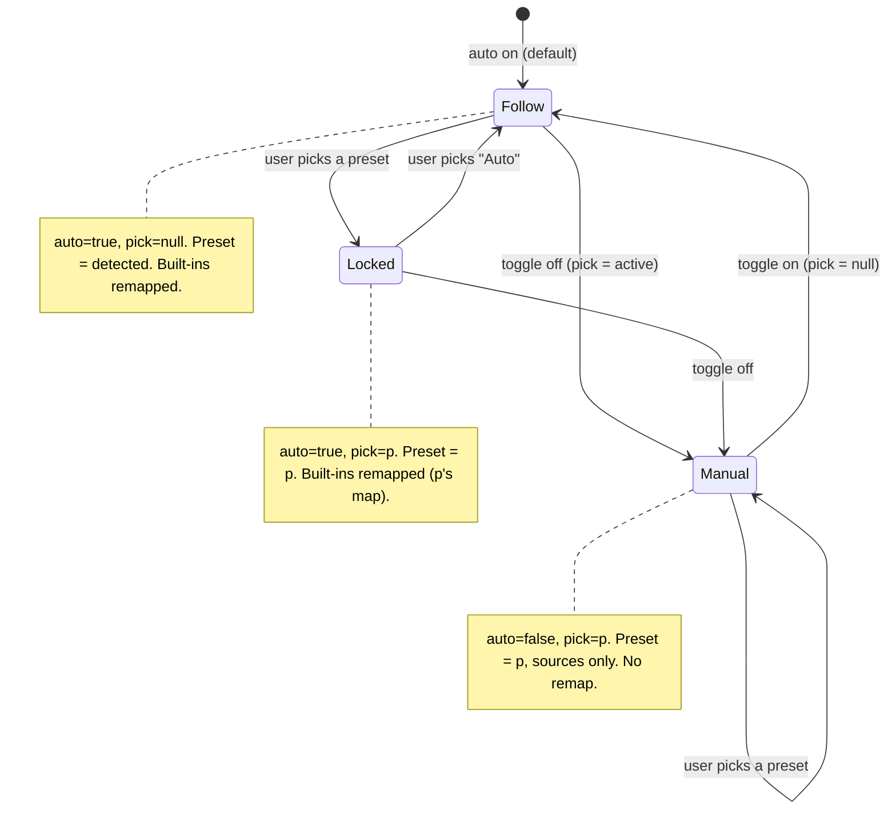
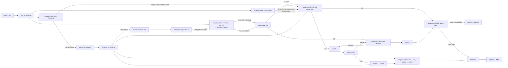

# Design: genre-aware audio reactivity (epic `audio-reactivity`, Stage 2c)

## TL;DR
- The two variants differ in one place: where the **sustained** detectors run (sub, reese, wobble and custom bands). In both, the **hits** (kick/snare/hats) run in the existing onset worklet: `createDetector` is reused on three Hz ranges of the 512-point FFT the worklet already computes, so hits add no latency.
- **Variant A (simplest):** the sustained sources run on the main thread, at frame rate. They read a second `AnalyserNode` (fftSize 8192) and the existing 1024 one.
  - It has the fewest moving parts.
  - Costs: line-in sustained lag is ≈85–102 ms (at or over the spec's ≤~85 ms). Quality depends on the frame rate. A kick is masked by holding sub/reese for ~200 ms.
- **Variant B (recommended):** the worklet also runs an IIR band bank. Each band has fast and slow followers, and their difference separates kicks from sustained bass (the differential envelopes of research §2). The worklet posts per-hop frames every 2 hops.
  - Sustained lag is ≈30–70 ms, and quality doesn't depend on the frame rate.
  - Vitest fixtures run the same pure code the worklet runs.
- **Shared core, the same in both:**
  - presets as code data;
  - a per-preset tempo range that restricts the ACF's candidate lags to the range's octaves. This also closes the DnB ⅔-tempo trap, which folding alone can't fix.
  - a rule-based style classifier with EMA, margin, dwell and min-hold;
  - Auto-style remaps the built-ins through a **styled `Sources` overlay**, picked per scene at render, so docs are never touched;
  - a build/drop heuristic with a confidence-gated `director.cut(peek())` that respects LOCK;
  - heat as a post pass plus a clock scale;
  - settings in localStorage `vjw.audio`;
  - a "Sources" tab whose meters are written by rAF.
- **One decision for the user:** Variant A or Variant B.

## Freshness
- 2026-10-28. Inputs, read in this run:
  - `thoughts/spec_audio_reactivity.md`, all of it (§1–§5).
  - `agents/research/research_audio_features.md` §1–§8.
  - `agents/research/research_audio_analysis.md` §2–§5.
  - `agents/planner/plan_pilot.md` drift notes S2.1–S2.3 and S5.1–S5.4.
  - `agents/planner/plan_effects.md` drift notes S1.2, S5.1, S5.2 and S6.1 (and S6.2 for `director.cut`).
  - Shipped code at `cp7-effects`, read-only:
    - `web/src/audio/{input,onset,onset.worklet,energy,tempo,sync}.ts`;
    - `web/src/bind.ts`, `app.ts`, `director.ts`, `scenes/builtin.ts`, `edit.ts`, `library.ts`, `ui/Panel.tsx`;
    - for the binding path: `gl/live.ts` (`render`, `bindAll`), `gl/engine.ts` (`render`, `drawScene`), `frame.ts`, `store.ts`.
  - `agents/STATE.md` HEAD (the roadmap items under "Key decisions"; the effects re-brief is pending).
- graphify was not used: this agent has no shell, so the files were read directly.

## Constraints
- **Scope:**
  - Spec §2.1 sources: `kick`, `snare`, `hats`, `sub`, `reese`, `wobble`, `build`, `drop`, and user bands. All of them go into the open `Sources` registry.
  - Spec §2.2 presets: Default, DnB, Dubstep/bass, Techno/house.
  - Spec §2.3 Auto-style (on by default).
  - Spec §2.4 build/drop behaviour.
  - Spec §2.5 Sources tab and persistence.
- **Two speeds (spec §2.1):**
  - Hits must add no latency.
  - Sustained sources may add ≤ ~85 ms.
  - Spec §2.6: the 8192 FFT is allowed only for the low end; 60A must still hold on the M4.
- **Acceptance:** spec §4.1–§4.7. §4.1 leaves the hit-accuracy number to design. It is set below as a `(default)`.
- **Non-goals (spec §3):** ML stems, MIDI/Link, multi-binding and formulas, the effects re-brief, hip-hop/trap presets.
- **Licensing:** any license is allowed (STATE key decision, session 3). **This design adds no dependency:**
  - fft.js is already in `web/package.json`;
  - Meyda (research §1) is not needed, because the few formulas used here are one-liners.
- **Contracts kept:**
  - `Sources = Record<string, number>`, and `evaluate()` reads an unknown id as 0 (plan_effects S1.2).
  - `WorkletMsg` (CP2) is extended additively; `FrameInput` (CP1) is unchanged.
  - **T1:** a file's onsets wait until audible; line-in applies them on arrival (plan_pilot S2.3).
  - (c) runs on `heard()` time (S5.3).
  - `director.cut(id)` exists (S6.2).
  - The panel's rule holds: no React re-render while a control moves (S5.2).
- **Facts from the code that shape this design:**
  - Onset strength saturates at 4.0 on kicks, claps and hats alike (plan_pilot S5.1, S5.2). A per-drum split must therefore come from **frequency band**, not strength.
  - Tempo:
    - The (c) ODF is the flux of bins 0–3 (0–330 Hz).
    - `tempo.ts` folds readings into [90, 180).
    - Its 128-centred prior is load-bearing against ⅔ errors (S5.1: without it, "174 → 116").
  - `sync` keeps its octave on merges: ×2/÷2 "stick" (S5.2). When a preset changes the tempo range, the running grid's octave has to be snapped.
  - Built-ins:
    - 20 of the 27 bind only `bass`, `onset`, `beat` and `lfo`. None binds `treb`/`mid`/`band*`.
    - The other 7 (four natives, the two native-only combos and the toy) read `FrameInput` or iChannel0 directly.
  - `store.hold` is true under Space (LOCK) **and** while the panel is open (plan_effects S5.1).

---

## Shared core (identical in A and B)

### C1 New sources (ids, values, conventions)
| id | kind | value 0..1 | speed |
|---|---|---|---|
| `kick`, `snare`, `hats` | hit | `clamp((strength − 1.5)/2.5) · exp(−age/τ)`, the `onset` formula of `bind.ts`. τ: kick and snare 0.12 s, hats 0.06 s `(default)`. A hit is an event and an envelope: an `event`-type input fires when the envelope crosses 0.5 (the existing `live.ts` rule). | fast |
| `sub`, `reese` | sustained | The kick-gated band envelope ÷ its running average ÷ 2. This is the `bass/mid/treb` convention: 1 ≈ average → 0.5. | ≤ 85 ms |
| `wobble` | sustained | `max(0, (g − ḡ)/ḡ)` of the wobble band's kick-gated envelope `g`. It is 0 at rest and rises when the filter opens, so it follows the LFO. | ≤ 85 ms |
| `wobbleDepth` | sustained | A ≈1 s EMA of `|g − ḡ|/ḡ`. | slow |
| `build` | arrangement | Tension in a build-up (C6). | slow |
| `drop` | arrangement | 1 at a drop, decaying with τ ≈ 1 s, × the drop's confidence. | event |
| `u:<id>` | custom | The normalised band × gain, gated at the threshold, smoothed with the user's attack/release (a dt-based one-pole, like `evaluate()`). | per band |

- Every value is multiplied by the user's `sens` (0–2, where 1 is neutral) and by the preset's `sens`.
- `SOURCE_IDS` gains the 9 fixed ids. The panel appends the custom ids from the settings.
- **Level independence:** ratios to running averages, as in `energy.ts` (research analysis §4), so line-in and file behave alike.

### C2 Hits: worklet, three band detectors on the existing FFT
- A new `audio/drums.ts` (pure) holds three `createDetector` instances over Hz→bin ranges of the worklet's existing 257 magnitudes. No new FFT.
- `(default)` bands, which presets may override: kick 40–150 Hz, snare/clap 1–5 kHz, hats 7–16 kHz. At 48 kHz the bins are 93.75 Hz wide.
- `DetectorOpts` gains `floor`. Today's module `FLOOR = 1` was calibrated as a sum over 257 bins (plan_pilot S2.1). A 2-bin kick band and a 96-bin hat band need their own floors, tuned on the fixtures.
- **Crosstalk `(default)`:** a snare in the same hop as a kick is dropped unless its strength is ≥ the kick's. A kick's click reaches 1–5 kHz.
- Each hit is posted at once as `{ kind: 'hit', drum, t, strength }`. `app.ts` drains hits through the same T1 rule as onsets.
- The (b) `onset` detector and the (c) bass ODF are untouched, so tempo and sync behave exactly as today.
- **Latency:** the same hop and message path as today's onsets, which were stamped 0.7–4.7 ms after the kick (plan_pilot S2.2). **Nothing is added.**

### C3 Presets and the tempo range
- `audio/presets.ts` is code data. It is not user-editable (YAGNI: the user tunes `sens` and adds custom bands instead).

| | Default | Drum & Bass | Dubstep / bass | Techno / house |
|---|---|---|---|---|
| `bpm` | `null`: today's fold [90, 180), prior 128 | 160–185 | 135–150 | 118–135 (spec defaults) |
| kick / snare / hats | 40–150 / 1k–5k / 7k–16k Hz | same | same | same |
| sub / reese / wobble band | 30–60 / 60–250 / 150–1500 Hz | same | 30–60 / **70–350** / 150–1500 | same as Default |
| `sens` | all 1 | all 1 | all 1 | all 1 (tuned on fixtures and the user's tracks) |
| `map` (Auto-style) | `{}` | `bass→reese, onset→kick, treb→hats` | `bass→wobble, onset→snare, treb→hats` | `onset→kick, treb→hats` |
| classifier prototype | — | kicks/beat ≈ 0.5, bass share high | kicks/beat ≈ 0.25–0.5, wobble high | kicks/beat ≈ 1 |

**Tempo range** (a change to `tempo.ts`, `setRange(bpm | null)`):
- **Candidates:** with a range set, the ACF picks only lags whose BPM is in `[lo/1.1, hi·1.1] × {½, 1, 2}`. The ±10% margin is a `(default)` knob. It also covers research §6's wider genre ranges, for example techno up to 150.
- **Fold and prior:** the reading folds into the window, and the prior is centred on √(lo·hi). `null` keeps today's behaviour exactly.
- **Why restrict instead of only folding (derived):**
  - In a DnB two-step (kick on 1 and on the "and" of 2), the kick-to-kick intervals are 2.5 and 1.5 beats. The 1.5-beat lag is a ⅔-tempo peak at 116 BPM, and today's 128-centred prior favours it.
  - No octave fold window that keeps 160–185 can fix that: it either keeps 116 or folds it to 232.
  - Under DnB the windows are 145–204 / 72–102 / 290–408, so 116 can't be a candidate. ⚠️ The 116 peak is derived, not measured; the §4.2 fixture settles it.
- **The ACF is always computed over the full 45–370 BPM lag span** (about today's 45–360). `families(windows)` returns each genre's evidence for the classifier: the prominence of the best lag in that window, mapped by today's `PROM_NONE`/`PROM_FULL`. The classifier therefore never depends on the active range, so there is no feedback loop.
- **Octave snap:** on a preset change, `app.ts` brings the sync grid into the new window with the existing `sync.double()`/`halve()`. Merges would otherwise keep a stale octave. The snap happens only on the change, so the user's later `[`/`]` presses are respected.

### C4 Style classifier and Auto-style
- **Features**, per frame and the same in both variants:
  - `T_g`: tempo-family evidence per genre, from `tempo.families()`.
  - `K`: kicks per beat over the last 8 s. Used only while `sync.confidence ≥ 0.3`, otherwise ignored.
  - `H`: hats per beat.
  - `W`: the raw `wobbleDepth`.
  - `B`: the bass share, (raw sub + raw reese) / total, using `f.energy.bands` for the total.
- **Score:** `S_g = T_g · (0.5 + 0.5·match_g)`, where `match_g` is the mean Gaussian closeness of (K, H, W, B) to the genre's prototype in `presets.ts`.
  - Tempo is necessary; the pattern features break overlaps. A 140 BPM techno track has 1 kick per beat, against dubstep's 0.25–0.5.
  - It is a hand-tuned heuristic, tuned on the fixtures (Research gaps 5).
- **No-flap `(default)` knobs:**
  - EMA of the scores, τ 4 s.
  - A challenger must lead the current genre by a margin of 0.15 for a **dwell of 16 s**.
  - **Min-hold of 32 s** after any switch.
  - Below a floor of 0.35, the current genre is kept.
  - **Frozen** in silence and during an arrangement "sparse" section (C6), since breakdowns lack drums.
  - Result: a 16-bar crossfade (30 s at 128 BPM) switches at most once.
- **State machine.** The persisted settings are `{ auto, pick }`; the classifier always runs, so the hint stays live.
  - Active preset = `pick ?? (auto ? detected ?? 'default' : 'default')`.
  - Remap = `auto ? PRESETS[active].map : none`.
  - The hint "looks like DnB" shows when `detected ≠ active`.


- **How this meets the spec:** Auto is on by default; a manual choice locks it until the user picks "Auto" again (§2.3); Off means scenes use their own bindings while the preset still sets the sources (§2.3).

### C5 Auto-style remap: a styled `Sources` overlay at evaluation time
- **`bind.ts`:** `restyle(src, from, to, w, out)`. `out` starts as a copy of `src`. Then, for each key k in `from ∪ to`, `out[k] = (1−w)·src[from[k] ?? k] + w·src[to[k] ?? k]`.
  - `w` ramps 0 → 1 over **2 s** `(default)` after the active map changes. This is the smooth switch, and Auto off is a fade to `{}`.
  - Aliasing is safe because the new sources share the old ones' scale: `kick` uses `onset`'s formula, and `reese`/`sub` use `bass`'s convention.
- **`engine.render(shot, f, src, styled, post)`:** `drawScene` gives `styled` to ids starting with `builtin:` and `src` to every other scene.
  - The panel's edited copy of a built-in keeps the built-in id, so it stays styled.
  - Untouched: `live.ts`, `evaluate()`, the docs, the library and exports.
- **Panel:** in a built-in's binding row, a dim "→ reese (auto-style)" sits next to the source select whenever the map rewrites that source.
- **Rejected: rewriting the docs.** It would clone and dirty them through `edit.ts`, leak into Save as and export, need an undo when Auto goes off, and need per-scene tables.
- **Known edges, accepted:**
  - Save as on a built-in creates a user scene, which reads its own `bass` again (spec §2.3: user scenes keep their bindings).
  - The 7 unbound built-ins don't change.
  - No built-in binds `treb`, so the spec's "hats → sparks" example appears only once the effects re-brief binds a sparkle parameter to `treb`/`hats`. The map is already there.

### C6 Build, drop, heat and the cut
- `audio/arrange.ts` is pure and runs once per frame. Its inputs:
  - `low`: raw sub + reese, kick-gated, from the features;
  - `high`: raw energy of the `f.energy.bands` at ≥ 4 kHz;
  - `total`;
  - this frame's kick hits;
  - `sync.beat` when confident.
- **Heuristic** (all `(default)` knobs):
  - **Groove `G`:** an EMA of `low` with τ 20 s, updated only outside sparse sections.
  - **`sparse`:** a 1 s EMA of `low` below `0.35·G`, while `total` is above the silence floor. An intro after silence counts as music; a stopped deck does not.
  - **`armed`:** sparse for ≥ 6 s (≈ 4 bars at 174).
  - **`build`:**
    - while sparse: `clamp(0.4·min(1, dur/16 s) + 0.6·riser)`, where `riser` = the log ratio of a 0.5 s EMA of `high` to a 4 s EMA, plus the slope of the snare/hat rate;
    - otherwise it decays with τ 1 s.
  - **A drop fires when armed and either:**
    - (a) the sustained low end comes back at ≥ 4× its sparse mean and ≥ 0.6·G, within 150 ms of a kick; or
    - (b) for kick-only drops such as techno's, a 2nd kick arrives within 1.2 beats with `low` ≥ 0.6·G.
  - A lone teaser kick without bass never fires.
  - **Confidence:** from the sparse duration, the return ratio, beat alignment (when sync is confident) and the build peak.
  - **Refractory:** 30 s. **Warm-up:** `G` needs 20 s of music.
- **Cut:** `if (fired ≥ 0.6 && !store.hold) director.cut(director.peek())`.
  - `prepare()` keeps `peek()` built, so the cut is instant.
  - `cut()` restarts the autopilot's 16-bar count from the drop.
  - `hold` covers both LOCK and an open panel.
  - Below 0.6, `drop` still pulses as a source; it just doesn't cut.
- **False-cut mitigation, all in the numbers above:**
  - arming needs ≥ 6 s of sparse;
  - the bass or the kick pattern must actually come back;
  - beat alignment;
  - 30 s refractory;
  - 20 s warm-up;
  - the confidence gate;
  - LOCK.
  - A DJ's bass swap looks like a drop and will cut. That is accepted: it marks a new track.
- **Heat** composes *on top of* scene bindings and never changes a binding's value:
  - `heat` = `build` smoothed with τ 0.5 s, falling to 0 within 1 s after a drop.
  - **Speed:** `app.ts` multiplies `f.dt` by `(1 + 0.5·heat)`, which speeds up layer clocks and natives' integrators.
  - **Brightness and strobe rate:** a new post pass in `engine.ts`, drawn after `copy`/`fade`. It is a constant-colour quad with fixed-function blending: multiply by `gain` = `1 + 0.25·heat + strobe`, then mix toward white by `flash`. No transition shader changes.
  - **Strobe** is a gentle beat pulse that goes from 1/4 to 1/8 notes as heat rises, with amplitude ≤ 0.15, × `sync.confidence`.
  - **The drop flash** peaks at 0.8 with τ 0.2 s.
  - ⚠️ Assumption, needs confirmation: these caps are conservative for photosensitivity. No research covers it (Research gaps 6), and STATE's backlog already flags the full-white strobe.

### C7 Settings and custom bands
- `audio/settings.ts`: `createSettings(kv)` uses the library's `Kv` seam, so it is tested without a browser. It stores JSON under localStorage `vjw.audio` `(default)`, small and synchronous like `vjw.stars`. `parseSettings` replaces any invalid field with its default; `onChange` follows the library's pattern.
- **Custom band validation `(default)`:**
  - 20 ≤ lo; hi ≥ 1.1·lo; hi ≤ 0.45·sampleRate;
  - gain 0–4, gate 0–1, attack and release 0–2 s;
  - a non-empty name of ≤ 24 characters;
  - **at most 8 bands**, which bounds the audio-thread cost.
- **The id** is `u:` + 6 random characters and never changes; renaming only changes the label. A removed band reads 0 in bindings (`evaluate()`'s unknown-id rule).
- **Sensitivity:** one user value per source, global across presets. It multiplies the preset's value (1 = the preset's default).

### C8 Panel "Sources" tab
- **Layout:**
  - The panel header gets two tabs, **Scene** (today's content) and **Sources**. Tab state is local React state.
  - The Sources tab shows:
    1. the preset picker (`Auto · Default · DnB · Dubstep/bass · Techno/house`), the Auto-style toggle, and "detected: DnB · 0.8" (or the hint);
    2. **Drums:** kick, snare and hats meters, each with a sens slider;
    3. **Bass:** sub, reese, wobble and wobbleDepth;
    4. **Arrangement (experimental):** build, a drop lamp and heat;
    5. **Custom:** one row per band (meter, gain, ×), then "+ Custom band", an inline form for name, from–to Hz, gain, threshold, attack and release.
- **Live meters without re-renders:**
  - `app.ts` exports its per-frame `src`; `Panel` already imports `director` from there.
  - The tab's single `useEffect` rAF loop writes each meter's CSS `--v`.
  - It stops on unmount. Nothing goes into React state.
- **The detected label** rides the 4×/s badge patch as `store.style`, and re-renders only its own small component (the `Gpu()` pattern).
- **Sliders are uncontrolled** (S5.2). On `input` they apply live; on `change` they persist.
- **The binding source select** groups its options as levels / drums / bass / arrangement / custom / band.
- **Known:** an open panel holds the autopilot, so there are no drop cuts while editing. That is today's behaviour, kept.

### C9 Shared contracts (TypeScript, module boundaries)
```ts
// audio/presets.ts
export type Genre = 'dnb' | 'dubstep' | 'techno'
export type PresetId = 'default' | Genre
export type Band = readonly [lo: number, hi: number] // Hz
export interface Preset {
  name: string
  bpm: Band | null // null = today's fold [90, 180), prior 128
  bands: Record<'kick' | 'snare' | 'hats' | 'sub' | 'reese' | 'wobble', Band>
  sens: Readonly<Record<string, number>> // missing = 1
  map: Readonly<Record<string, string>> // built-in source → new source while Auto-style is on
  proto?: { kickPerBeat: number; hatsPerBeat: number; wobble: number; bass: number } // classifier (genres only)
}
export const PRESETS: Readonly<Record<PresetId, Preset>>

// audio/settings.ts
export interface CustomBand { id: string; name: string; lo: number; hi: number; gain: number; gate: number; attack: number; release: number }
export interface AudioSettings { v: 1; auto: boolean; pick: PresetId | null; sens: Record<string, number>; custom: CustomBand[] }
export function parseSettings(x: unknown): AudioSettings
export function createSettings(kv: Pick<Storage, 'getItem' | 'setItem'>): {
  get(): AudioSettings
  patch(p: Partial<Pick<AudioSettings, 'auto' | 'pick' | 'sens'>>): void
  addBand(b: Omit<CustomBand, 'id'>): string | null // error message, or null once added
  removeBand(id: string): void
  onChange(cb: () => void): () => void
}
export const activePreset: (s: AudioSettings, detected: Genre | null) => PresetId

// audio/drums.ts (pure; runs in the worklet)
export type Drum = 'kick' | 'snare' | 'hats'
export interface Hit { drum: Drum; t: number; strength: number } // t = AudioContext time, s
export function createDrums(sampleRate: number, fftSize: number): {
  configure(bands: Record<Drum, Band>): void
  detect(mag: Float32Array, t: number): readonly Hit[] // reused array, 0–3 hits
}

// audio/onset.worklet.ts (CP2, additive; B adds 'feat' and bands, see Variant B)
export type WorkletMsg = /* existing 'onset' | 'odf' */ | { kind: 'hit'; drum: Drum; t: number; strength: number }
export type WorkletIn = { kind: 'config'; rev: number; drums: Record<Drum, Band> }

// audio/tempo.ts (changed)
export interface TempoSource { /* push, pushOdf, read as today */ setRange(bpm: Band | null): void; families(windows: readonly Band[]): number[] }

// audio/features.ts (main thread, pure; its *input* side differs per variant)
export interface Features {
  hit(h: Hit): void // after the T1 drain
  fill(out: Sources, dt: number, s: AudioSettings, p: Preset): void // kick snare hats sub reese wobble wobbleDepth u:*
  readonly raw: { sub: number; reese: number; wobbleDepth: number } // classifier and arrangement
}

// audio/style.ts
export interface StyleIn { families: Record<Genre, number>; kickPerBeat: number | null; hatsPerBeat: number | null; wobble: number; bass: number; freeze: boolean }
export interface StyleOut { detected: Genre | null; scores: Record<Genre, number>; confidence: number }
export function createStyle(opts?: Partial<StyleOpts>): { update(x: StyleIn, now: number): StyleOut }

// audio/arrange.ts
export interface ArrangeIn { low: number; high: number; total: number; kick: boolean; beat: number | null; now: number }
export interface ArrangeOut { build: number; drop: number; heat: number; sparse: boolean; fired: number | null } // fired = this frame's drop confidence
export function createArrangement(opts?: Partial<ArrangeOpts>): { update(x: ArrangeIn): ArrangeOut }

// bind.ts (changed)
export const SOURCE_IDS: readonly string[] // + kick snare hats sub reese wobble wobbleDepth build drop
export function restyle(s: Sources, from: Readonly<Record<string, string>>, to: Readonly<Record<string, string>>, w: number, out: Sources): Sources

// gl/engine.ts (changed)
export interface Post { gain: number; flash: number }
export function render(shot: Shot, f: FrameInput, s: Sources, styled: Sources | null, post: Post): void

// store.ts (+ field, patched at the 4×/s badge cadence only on change)
style: { active: PresetId; detected: Genre | null; confidence: number }
```

### C10 Test strategy (both variants; the variants differ only in what the fixtures run through)
- **Fixtures are synthesised in code** `(default)`: `web/src/audio/synth.ts` is a test-only helper with a seeded PRNG at 48 kHz. There are no binary assets and no ffmpeg in CI; ffmpeg stays a lead/scratchpad tool for optional real-track checks.
  - **Stems:**
    - kick: a sine sweep 150 → 45 Hz with a 180 ms decay, plus a 2 ms click;
    - snare: a 190 Hz tone plus 1–6 kHz noise;
    - clap;
    - hats: noise high-passed at 7 kHz, 40 ms long;
    - sub: a 45 Hz sine;
    - reese: two saws at 55 Hz, ±10 cents, low-passed;
    - wobble: a saw through a low-pass swept 150 Hz ↔ 1.5 kHz at 1/8 notes;
    - riser: noise with a rising high-pass and level;
    - pad.
  - **Patterns** (all return the truth onset times and the drop time):
    - DnB 174 two-step: kick on 1 and 2.5, snare on 2 and 4, hats on 8ths and 16ths;
    - dubstep 140 half-time: kick on 1, snare on 3, wobble;
    - techno 128 four-on-the-floor: clap on 2 and 4, open hats off the beat;
    - arrangement: 16 groove bars, an 8-bar breakdown (no kick or sub, a riser, a snare roll), then the drop;
    - `crossfade(a, b, 16 bars)` (equal power).
- **Mutation-sensitive, as S5.1 (11 mutants) and S5.2 (23) were:** every knob and branch of the following, when broken alone, must fail at least one test:
  - `drums.ts`;
  - the sustained DSP (B: `bands.ts`; A: `features.ts`);
  - `features.ts` normalisation and sens;
  - `style.ts`: EMA, margin, dwell, min-hold, floor, freeze, lock;
  - `arrange.ts`: arming, return ratio, kick-only path, refractory, warm-up, confidence gate;
  - the tempo `setRange` candidates, fold and prior, and `families`;
  - `restyle` (alias and fade);
  - `parseSettings`.
  - The planner enumerates the mutants per step.
- **How spec §4 is measured:**

| §4 | Automated (Vitest) | Manual (Chrome, the user's tracks) |
|---|---|---|
| 1 | The DnB mix (kick + snare + hats + reese + sub) runs through the worklet's pure code. **The F1 for each of kick, snare and hats is ≥ 0.70, with a ±30 ms tolerance `(default)`.** This sets spec §4.1's ⚠️ number. A crosstalk matrix: each stem played solo drives its own source (mean ≥ 0.3) and keeps the others ≤ 0.1 (knobs); for example, reese solo gives 0 kicks, and kick solo keeps reese low. | The meters follow their elements on a DnB track. |
| 2 | The DnB 174 two-step fixture with the DnB preset → `sync.bpm` reads 174 ± 1 within 10 s. 182 → 182, not 91. The Default-preset reading is logged for information. | 174 vs rekordbox. |
| 3 | Each genre (2 pattern variants each) is detected correctly within 20 s. A 16-bar crossfade switches ≤ 1 time and ends on B. A manual pick switches 0 times. A breakdown or silence switches nothing. | Representative tracks; one 16-bar mix. |
| 4 | `restyle` with Auto on/off and the fade. `drawScene` picks per id (a 2-line check through the engine seam, or by eye). | Fractal's `fold` follows the reese meter with Auto on and `bass` with Auto off. |
| 5 | The arrangement fixture: the drop fires ≤ 150 ms after the drop's first kick with confidence ≥ 0.6, and `build` ≥ 0.5 at the end of the breakdown. 3 min of groove give 0 drops. A teaser kick gives 0 drops; a 2-bar break gives no cut. App-level: a pure guard `shouldCut(fired, hold)`. | A flash plus a cut at the drop; Space → no cut. |
| 6 | A custom 40–60 Hz band: a 50 Hz sine reads ≥ 5× a 120 Hz sine. The settings round-trip; corrupt JSON gives the defaults. | Add, bind, see it move, reload. |
| 7 | Gates green; the mutation list above. | `?bench` 60A on the M4; `?debug` shows hits, drops and classifier scores. |

---

## Variant A — Hybrid: worklet hits + main-thread analysers (simplest)

**Summary:**
- The only worklet change is C2 (drums plus the `config` message).
- The sustained sources are computed on the main thread, once per rendered frame:
  - **sub, reese and low custom bands** from a new `AnalyserNode` (fftSize 8192, smoothing 0): 5.86 Hz bins, a Blackman window of 170.7 ms, and an 85.3 ms centre lag (research §5);
  - **wobble and high custom bands** from the existing 1024 analyser, which `app.ts` already reads every frame.
- Kick gating holds sub/reese for 200 ms after each kick hit, about the 8192 window length.



**Modules and files (under `web/src/`):**
- **New:**
  - `audio/presets.ts`, `audio/settings.ts` (+test), `audio/drums.ts` (+test), `audio/features.ts` (+test), `audio/style.ts` (+test), `audio/arrange.ts` (+test);
  - `audio/synth.ts` (a test helper, plus a ~15-line `analyserFrames(x, fftSize, fps)` that simulates the analyser in Node: Blackman α 0.16 → fft.js → dB, per research analysis §2);
  - `ui/Sources.tsx`.
- **Changed:**
  - `audio/input.ts`: `lowAnalyser` and `configure()`;
  - `audio/onset.worklet.ts`: drums, `config`;
  - `audio/onset.ts`: the `floor` option;
  - `audio/tempo.ts`;
  - `bind.ts`, `app.ts`, `gl/engine.ts`, `store.ts`, `ui/Panel.tsx`, `ui/panel.css`.

**Variant-specific contract:**
```ts
// audio/input.ts
export const lowAnalyser: AnalyserNode // fftSize 8192, smoothingTimeConstant 0, hub → it
export function configure(c: WorkletIn): void // queued until the worklet node exists
// audio/features.ts: A's input side
export function createFeatures(sampleRate: number): Features & {
  frame(lowDb: Float32Array /* 8192 analyser */, fastDb: Float32Array /* 1024 analyser */, sinceKick: number /* s */, dt: number): void
}
```

**Latency and batching:**
- Hits: no added latency (C2).
- Sustained on line-in: 85.3 ms window centre + 0–16.7 ms rAF ≈ **85–102 ms**, which is at or over the spec's "≤ ~85 ms".
  - Knob: 4096 brings it to ≈43–59 ms, but at 11.7 Hz bins research §5 says 40 Hz and 60 Hz can't be told apart.
  - Files: the analyser leads the audible sound by ≈ baseLatency + outputLatency (research analysis §5; T1 isn't applied to analyser data, as today), so files feel ≈40 ms earlier.
- Wobble: 10.7 ms + 0–16.7 ms.
- New messages: only hits (~10/s) and rare config messages.
- **Frame-rate dependence:** in mode `30`, the frame loop skips every other rAF, so the sustained sources are sampled at 30 Hz. An 11.6 Hz wobble (research §2) then gets ~2.6 samples per cycle.

**Acceptance:** §4.1–§4.7 are met as in C10. Two caveats:
- §4.1 "sustained ≤ ~85 ms" is borderline on line-in.
- The fixture tests run through an analyser *simulation*, not the platform node.

**Roadmap (STATE key decisions: Butterchurn next; editor → camera → clip mixer; MIDI/Link and Electron later):**
- Butterchurn reads its own `AnalyserNode` and computes its own bass/mid/treb (research analysis §4), so it is unaffected.
- Camera and clip layers bind the same open registry, and the post pass applies to any composite.
- Link can feed `sync`, and the classifier's tempo family can take Link's BPM.
- Electron runs the same Web Audio.
- Nothing here blocks the roadmap, and nothing is built for it.

**Risks:**
- The line-in sustained lag is at or over the spec bound.
- With four-on-the-floor kicks (2.13/s at 128 BPM) and a 200 ms hold, sub/reese are frozen ≈43% of the time, so they look steppy (derived).
- Wobble degrades in mode 30.
- The 8192 FFT runs on the main thread every frame. Bounds: 0.1–0.35 ms (research §8: Node/fft.js); Chrome's analyser is unmeasured ⚠️.
- The test fidelity depends on how well the simulation matches Chrome's analyser.

**Effort:** M (≈ 13–14 steps; the smaller of the two).

---

## Variant B — Worklet DSP: hits + IIR band bank in the worklet (recommended)

**Summary:**
- **The worklet body becomes a pure module.** The worklet's `process()` body moves into `audio/analysis.ts`, and `onset.worklet.ts` keeps ~20 lines of glue (mono mix → `block()` → `port.postMessage`).
- **On top of today's FFT path and C2's drums, `analysis.ts` runs `audio/bands.ts` per render quantum:**
  - a bank of up to 11 bands: sub, reese, wobble and ≤ 8 custom;
  - each band is two cascaded RBJ band-pass biquads with Q from its edges (≈12 dB/octave skirts; the configuration research §8 benchmarked);
  - each band has two followers: `e1` (fast attack ≈1 ms) and `e2` (attack ≈20 ms), with equal release.
- **Kick gating** by differential envelopes (research §2, the SPL transient designer): while `e1/e2 > TRANSIENT` (≈2, +6 dB), and for ≈60 ms after, the band's `held` output stops following `e2`.
  - A 2 ms kick attack trips the gate. A wobble's ≥ 40 ms rise does not, because `e2` keeps up (derived).
- **Per-hop frames** `[e2, held] × bands` are posted every **2 hops**.
- `features.ts` normalises them and derives `wobble` and `wobbleDepth` at hop rate (187.5 frames/s), so the result doesn't depend on the render frame rate.

```mermaid
flowchart LR
  IN["line-in / file"] --> HUB["hub (GainNode)"]
  HUB --> A1["AnalyserNode 1024 (existing)"]
  HUB --> WK["onset worklet = glue<br/>analysis.ts (NEW, pure):<br/>FFT 512 → onset, bass ODF, drums.ts<br/>IIR bank bands.ts: e1/e2/held per band"]
  SET["settings.ts + presets.ts"] -->|"config {rev, drum bands, bands}"| WK
  WK -->|"onset, odf (existing)"| Q["input.ts queues"]
  WK -->|"hit (immediate)"| Q
  WK -->|"feat {rev, t0, hop, values} every 2 hops"| Q
  Q -->|"T1 drain: hits; frames up to heard time"| FT["features.ts (NEW): normalise, wobble, hit envelopes, custom"]
  A1 -->|"dB per frame"| EN["energy.ts (existing)"]
  Q -->|odf| TP["tempo.ts (+setRange, families)"] --> SY["sync.ts"]
  EN --> SRC["Sources src (bind.ts)"]
  FT --> SRC
  TP -->|families| ST["style.ts"]
  FT -->|raw| ST
  ST --> ACT["active preset"]
  ACT -->|range| TP
  ACT -->|map| RS["restyle → styled"]
  FT -->|raw| AR["arrange.ts: build / drop / heat"]
  SY --> AR
  AR -->|"drop ≥ θ and !hold"| DR["director.cut(peek)"]
  SRC --> RS
  SRC --> ENG["engine.render: user ← src, built-in ← styled"]
  RS --> ENG
  AR -->|"gain, flash"| POST["post pass"]
  ENG --> POST --> CAN["canvas → REC"]
  SRC -.->|"rAF meters"| UI["Panel › Sources tab"]
  UI --> SET
```



**Modules and files (under `web/src/`):**
- **New:** everything in A's list except `analyserFrames`, plus:
  - `audio/bands.ts` (+test);
  - `audio/analysis.ts` (+test: whole fixtures through the exact worklet code).
- **Changed:** as in A, but `input.ts` gains `featQueue` and `configure()` instead of a second analyser, and `onset.worklet.ts` shrinks to glue.
- **Bundling:** the worklet chunk keeps bundling its imports as today (plan_pilot S2.2: one plain-JS IIFE). It now pulls in `analysis.ts`, `bands.ts` and `drums.ts`.

**Variant-specific contract:**
```ts
// audio/bands.ts (pure)
export interface BandSpec { id: string; lo: number; hi: number } // Hz
export function createBank(sampleRate: number): {
  configure(specs: readonly BandSpec[]): void // new coefficients; follower state kept per id → no jump
  process(x: Float32Array): void // one render quantum, mono
  read(out: Float32Array): void // per band, in spec order: [e2, held]
}
// audio/analysis.ts (pure; the worklet's body)
export function createAnalysis(sampleRate: number): {
  configure(c: WorkletIn): void
  block(chans: Float32Array[], frame: number, post: (m: WorkletMsg) => void): void
}
// onset.worklet.ts (CP2, additive)
export type WorkletMsg = /* 'onset' | 'odf' | 'hit' */ | { kind: 'feat'; rev: number; t0: number; hop: number; values: Float32Array } // hops × bands × 2
export type WorkletIn = { kind: 'config'; rev: number; drums: Record<Drum, Band>; bands: BandSpec[] } // rev: a batch maps to the band list it was made with
// audio/features.ts: B's input side
export function createFeatures(): Features & { push(m: Extract<WorkletMsg, { kind: 'feat' }>): void; at(t: number): void } // t = heard time: file → audioNow, line-in → newest
```

**Latency and batching:**
- Hits: no added latency (C2).
- Sustained, derived from research §5's IIR numbers: biquad and resonator rise ≈2–21 ms (sub, f0 42 Hz, Q 1.4 → τ ≈ 10 ms per stage), `e2` attack ≈20 ms, a batch wait ≤ 10.7 ms and rAF ≤ 16.7 ms. That is ≈ **30–70 ms**, under the ≤ 85 ms bound.
- Wobble: ≈20–45 ms.
- **Batching:**
  - `feat` every 2 hops is 93.75 messages/s with ≤ 44 floats each. Hits go out immediately (~10/s), and `odf` is unchanged (23.4/s).
  - Why 2 hops: 4 hops (21.3 ms) is longer than a 60 Hz frame, so line-in values would repeat on some frames; 8 hops would use up the lag budget.
  - Research analysis §2 warns about per-*quantum* messaging (375/s), not this rate. Batch every 4 hops if the profiler shows the message cost.
  - A SharedArrayBuffer is not used: it needs COOP/COEP headers, and none are set today.
- **T1 timing:** frames carry hop timestamps.
  - A file shows the newest frame ≤ `audioNow`, as its onsets do.
  - Line-in shows the newest frame. Its stamps run ahead of `audioNow` by the output latency (plan_pilot S2.3), so `≤ audioNow` would add ≈43 ms.
- **Config:** a preset or custom-band change sends `{ rev, … }`. The bank swaps coefficients and keeps follower state per id, so the change is smooth. In-flight batches with the old `rev` are mapped with the old band list.

**Acceptance:**
- §4.1–§4.7 are met as in C10, and §2.1's sustained ≤ 85 ms is met with margin.
- The §4.1, §4.2, §4.5 and §4.6 fixtures run through `analysis.ts`, the exact code the worklet executes. That makes the closest thing to the platform test plan_pilot S2.2 ran ad hoc in the scratchpad a permanent part of Vitest.

**Roadmap:** the same as A. In addition:
- Each band already computes a transient gate. A later "custom hit band" (a user band that emits events) is therefore a small step. It is not built now.
- An Electron build would run the same worklet.

**Risks:**
- More audio-thread code. A worklet error only reaches `onprocessorerror`, mitigated because the whole body is pure and tested in Vitest.
- Chrome's audio-thread cost is unmeasured ⚠️: research §8 measured Node V8, 0.15–0.34% of a core for 8–16 bands. Check `AudioContext.playbackStats.underrunEvents` (research §8) on the first step.
- IIR skirts are softer than FFT bins: about 12 dB/octave, against 5.86 Hz bins. A 50 vs 120 Hz test still separates them by ≈ −28 dB (derived from the RBJ band-pass response with Q 2.45, two stages).
- The `WorkletMsg`/`WorkletIn` contract grows.
- Moving `process()` into `analysis.ts` touches the onset/ODF path that tempo depends on. The existing tempo, sync and bench tests guard it.

**Effort:** M (≈ 15–16 steps; ~2 more than A).

---

## Considered and rejected
- **Hits on the main thread, as rAF flux on the 1024 analyser:**
  - analyser data has no timestamp, and reads are quantised to 16.7 ms (research analysis §2);
  - it can't follow T1;
  - it halves in mode 30;
  - the worklet already computes the FFT.
- **HPSS-lite, an 8192 FFT plus a past-only harmonic median (research §3):**
  - the median adds no look-ahead, but it passes a change only once half its length holds the new value: ≈ (l/2)·hop;
  - with l = 9 at hop 1024, plus the 85 ms window centre, that is ≈ 180 ms, over the ≤ 85 ms budget (derived).
- **ML stems:** a non-goal (spec §3; research §4: ≥ 7.8 s lag).
- **A SharedArrayBuffer ring:** COOP/COEP on every asset (research analysis §2) to save ≤ 100 messages/s.
- **Rewriting docs for the remap:** see C5.

## Comparison
| | A: analysers | B: worklet DSP |
|---|---|---|
| Hit latency | No added latency (same path) | No added latency (same path) |
| Sustained lag, line-in | ≈85–102 ms (at or over the bound) | ≈30–70 ms |
| Frame-rate independence | No (mode 30 halves sampling) | Yes (hop rate, 187.5/s) |
| Kick vs reese/sub split | 200 ms hold per kick hit (steppy with four-on-the-floor) | Differential envelopes per band (research §2), ≈60 ms hold |
| 40 vs 60 Hz precision | Sharp (5.86 Hz bins) | ≈12 dB/oct skirts (50 vs 120 Hz ≈ −28 dB) |
| Wobble at 11.6 Hz | OK at 60 fps, poor at 30 | Clean at any fps |
| Worklet change | Drums + config | Drums + bank + feat + config; body moved into pure `analysis.ts` |
| Main-thread cost | 8192 FFT per frame (0.1–0.35 ms ⚠️) | ≈0 |
| Audio-thread cost | +3 detectors on the existing FFT | + ≤ 11-band bank ≈ 0.25% of a core ⚠️ (Node figure) |
| Messages/s | +≈10 | +≈104 (feat 94 + hits) |
| Test fidelity | Through an analyser simulation | Through the exact worklet code |
| New deps | None | None |
| Effort | M (smaller) | M (+~2 steps) |

## Recommendation
**Variant B.** The spec's own two-speed contract is a ≤ ~85 ms extra lag for sustained sources, and A meets it only at the edge on line-in, which is the user's rig (rekordbox → USB card). A's quality also drops in the user-selectable 30 fps mode. B keeps sub, reese and wobble well inside the budget at any frame rate. It separates the kick from the reese with the documented differential-envelope primitive instead of a 200 ms freeze. It also makes the worklet body a pure module, so every acceptance fixture runs through the code that ships. The cost is about two extra plan steps and a larger worklet message contract; there are no new dependencies and the render cost doesn't change. Everything else (classifier, remap overlay, build/drop, heat, settings, the Sources tab) is shared, so choosing B doesn't change the user-facing design.

## Research gaps
1. **Chrome audio-thread cost** of an ≤ 11-band IIR bank plus 3 extra detectors. Research §8 is a Node V8 figure (⚠️ in the research itself). Applies to B. Measured at the first step through `playbackStats`, not guessed.
2. **Main-thread cost of reading an 8192 `AnalyserNode` every frame in Chrome.** Applies to A only. Unmeasured.
3. **Our tempo source on DnB two-step and dubstep half-time patterns:** the ⅔ and ½ peaks are derived from plan_pilot S5.1's prior note, not measured. The §4.2 fixture will show them.
4. **Build/drop detection:** no research artifact covers causal EDM structure or drop detection, so the C6 heuristic is ours. A researcher pass on published causal drop/section detectors would firm up the knobs.
5. **Genre classification from tempo and spectral features** (published feature sets and accuracies for DnB/dubstep/techno): not covered. The C4 rules are hand-tuned on synthetic fixtures.
6. **Photosensitive flash/strobe limits** (relevant to the heat strobe and the drop flash): not covered. C6's caps are a conservative ⚠️ assumption.
7. **Labelled real test tracks** (the user's own, with known BPM, drop times and genre): none are in the repo. The manual acceptance relies on the user's library.
8. **Per-drum band-flux accuracy on real full mixes:** research §1's numbers are drum-only or ML. A synthetic F1 says nothing about real tracks.

## Decision needed
1. **Variant A or Variant B?** Recommended: B. The question is where the sustained detectors (sub, reese, wobble, custom bands) run: on the main thread from a second 8192 analyser (A), or in the worklet as an IIR bank with differential envelopes (B).

Everything else is a `(default)` that the user can veto without answering:
- §4.1 hits: F1 ≥ 0.70 per drum at ±30 ms on the synthetic DnB mix.
- Remap maps as in C3. Built-ins only, including an edited built-in. A built-in saved with Save as reverts to its own bindings.
- The drop cut waits for the bass or the kick pattern to return (≤ 150 ms after the drop's first kick), at confidence ≥ 0.6. An open panel blocks the cut, as LOCK does.
- Heat: +25% brightness, +50% clock, a strobe of ≤ 0.15 amplitude at ≤ 1/8 notes, and a drop flash of 0.8.
- Classifier: dwell 16 s, min-hold 32 s, margin 0.15.
- Settings in localStorage `vjw.audio`; ≤ 8 custom bands.

## Ruling: kick vs sustained/modulated bass (2026-11-05)
**Inputs:** lead brief 2026-11-05 (TD S4.1 trace: `kick` p50 .66 on `dubstep140-arr` and through `dnb174-arr`'s build); C2 (L90–97) and C10 (L315–353) above; `research_audio_features.md` TL;DR, §1–§3; code read 2026-11-05: `web/src/audio/{drums,onset,analysis,bands,features,synth,arrange}.ts`, `drums.test.ts`, `bands.test.ts`, `acceptance.test.ts`, `web/scripts/make-fx.mjs` L44–54.

**Root cause (code + derived).** At 48 kHz, 40–150 Hz is **bin 1 alone** of the 512-point FFT (`drums.ts` L9–14), and the kick's ODF is that one bin's log flux.
- **Full-range bass:** its 55 and 110 Hz partials both sit in bin 1 and beat at 55 Hz, so the bin swings ≈2–3× from hop to hop. `synth.ts` L96–97 already names this for the reese. It is not the LFO: `wobble()` is a full-range 55 Hz saw at amp 0.5, and its sweep only sets the swing depth, which is why the storm pulses with it.
- **Empty band:** the log flux is level-independent (`drums.ts` L13), so in a breakdown, room tone, the riser's leak and the snare's 190 Hz body read as full flux. `arrange.ts` L3–4 already logs "~13 kicks a bar".
- The detector then fires at its 50 ms `minGap` (`onset.ts` L14), and `e^(−age/0.12)` (`features.ts` L14) holds `kick` at .66–1.
- The fixtures hid this. `pattern()` high-passes the reese at 300 Hz (`synth.ts` L96–98), so the bed test passes and the DnB groove looks clean. Even so, kick F1 is only 0.79 / 0.80 / 0.89 (`drums.test.ts` L54, L62).

**Decision: (d) a kick is a transient in the kick band's existing IIR gate that also carries the hop's power.**
1. **Trigger:** `tempo.ratio(0) ≥ TRANSIENT` (1.5). This is `bands.ts`'s differential-envelope gate (research §2) on 40–150 Hz, which `analysis.ts` already runs every quantum for the tempo ODF (L15–17, L86); the band is every preset's kick band (C3). It works on samples with a 200 ms peak-hold, so partials beating in-band read as one steady level (`bands.ts` L11–13): sustained material ≤ 1.30, a kick ≥ 1.65 (L88). A full-range reese and a 4.67/11.6 Hz wobble never trip it on their own bands (`bands.test.ts` L105–137).
2. **Confirm:** at that hop the kick bins hold ≥ `SHARE` of the hop's power. `drums.ts` computes it as Σ mag², with DC excluded so a line-in offset can't fake it. `SHARE` is a knob, start 0.2. Derived: fixture kicks ≈ 0.4–0.9; the riser, room tone and the snare's body ≲ 0.06. Those three do trip the ratio in an empty band, which is why the share check is needed.
3. **Post** at the first hop where both hold, keeping `minGap` 50 ms; `strength = min(4, ratio)`. Delete the kick's bin-1 `createDetector`. Snare and hats are unchanged.
4. **Crosstalk:** today's rule stays (a snare in a kick's hop is dropped unless it is at least as strong), with `ratio` as the kick's side. The band-passed body may trip a hop after the 3 kHz click. If the crosstalk matrix (`drums.test.ts` L69) shows that, widen the rule to ±1 hop: a snare then waits one hop (+5.3 ms).

**Rejected:**
- **(a) wide-band flux / sharpness:** all three false sources are wide-band flux (the wobble's 150 Hz–1.5 kHz sweep, the riser, the roll), and the bin-1 beating stays.
- **(b) ⅛-note IOI + beat grid:** the wobble is tempo-synced at ⅛, so one false kick per LFO cycle passes by construction. It also cuts real 16th and ghost kicks and ties hits to tempo lock.
- **(c) suppress while `reese`/`wobble`/`wobbleDepth` move:** these sources are main-thread, per-frame and themselves kick-gated (`features.ts` L62–67), so the logic is circular. The 1 s `wobbleDepth` lags, and the rule is blind in the build, which has no bass. Its "clears the bass envelope by a margin" half *is* (d)'s ratio.
- **HPSS / a 2048 kick FFT:** the harmonic median needs 43–80 ms of look-ahead (research §3); on the 512 FFT, HPSS would call the beating percussive. A 2048 FFT splits the partials at the cost of ≈21 ms more lag, and it still fires on an empty band.

**What it does:**
- **DnB groove:** every kick trips the gate. `features.ts` L62–63 already relies on the same gate (on the reese band) to catch "every kick, the FFT detector's misses too". The groove stays clean, and F1 should hold or rise from 0.79.
- **Dubstep wobble:** the sweep moves the in-band level ≈ +25 % over ≈ 40 ms, a ratio of ≈ 1.1–1.2 (derived ⚠️; test 5 pins it). That gives 0 kicks between real kicks, and `kick` idles at 0. S1.10's "classifier reads `dubstep140-arr` as techno" likely has the same cause (kicks per beat inflated): check it in the same run, but don't tune for it.
- **Riser + snare roll:** the share is ≪ `SHARE`, so 0 kicks. The roll still drives `snare`.

**Cost:**
- Worklet CPU ≈ 0. The ratio is already computed; the share adds 256 multiply-adds per 5.33 ms hop, and one log1p bin goes away. That is less than one band chain (research TL;DR: 16 chains ≈ 9 µs per quantum).
- Latency: kicks may land up to 1 hop later than today, from the band-pass rise and because the share needs the body inside the window. That is still within ±30 ms and one frame. This supersedes C2's "Nothing is added" (L97).

**Ceilings (⚠️ real tracks, queue #4):**
- An equal 16th double kick at ≳ 150 BPM: the 2nd kick reads ≈ 1.39, because `gf` holds for 200 ms (derived). Knob: the kick band's gate release.
- A square-LFO wobble whose filter closes below its fundamental can jump > 1.5× in band. Knob: a kick-only threshold.
- A loud 40–150 Hz bass stab reads as a kick. A kick that is no louder in band than the bass under it can be missed, as today.

**Acceptance (Vitest, through `createAnalysis(SR).block()` in 128-frame quanta; `hitsOf` in `drums.test.ts` and `acceptance.test.ts` moves onto it):** both arr fixtures are built the way `make-fx.mjs` L46–54 builds them: `arrangement({ genre })`, plus the gated `wobble()` for Dubstep, peak-scaled.
- (1) Groove and drop: kick hits per bar, averaged over each section, = truth ±10 % (DnB 2, Dubstep 1); F1 ≥ 0.70 at ±30 ms (log the value).
- (2) Breakdown (truth 0): ≤ 1 kick in its 8 bars, and 0 in the 4 roll bars.
- (3) Storms: no two kicks closer than an ⅛ note, anywhere.
- (4) `createFeatures` `kick` sampled at 60 Hz: p50 ≤ 0.1 over the Dubstep groove and drop and over the DnB breakdown (today .66).
- (5) 4 s beds give 0 kicks: a full-range `reese(n, 0.15)` (no `hp`) + `sub` + room tone; `wobble()` at 4.67 and 11.6 Hz + `sub` + room tone.
- Regression: §4.1 F1, the crosstalk matrix, §4.3 and §4.5 (5/5) stay green.
- Mutants (C10): the kick threshold, `SHARE` and `minGap` each fail ≥ 1 test when broken alone.

**Size: M**, one `frontend-coder` step: `drums.ts` (the kick path; C9's `detect` gains `kickRatio`), `analysis.ts` (passes `tempo.ratio(0)`), both test harnesses plus the tests above, and comment fixes at `drums.ts` L13 and `arrange.ts` L3–4. `WorkletMsg` and `Hit` are unchanged.
