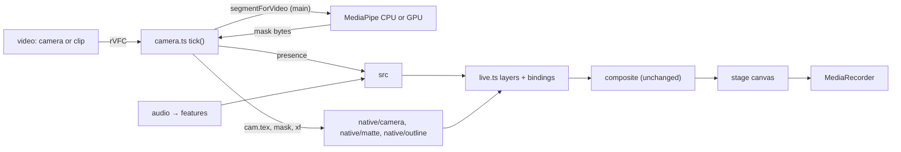
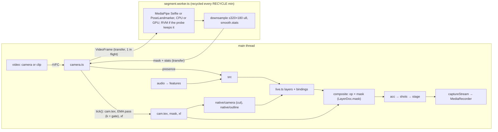
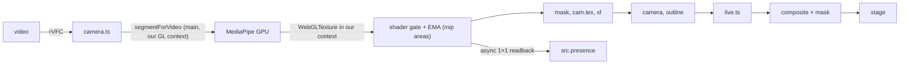

# Design — Stage 3: camera scene (in-browser person mask)

## TL;DR
- **Pure web, one path for Mac and Windows** (spec §2). The camera is a `<video>` (a device or the user's clip). A **segmentation worker** gets each frame as a transferred `VideoFrame` and returns a ≤64 KB mask plus stats. The main thread smooths it (EMA + a global strobe gate) into one stage-aligned mask. The worker is recycled before MediaPipe's long-session GL leak (#6352) bites.
- **Engine:** `native/camera` (`cut` for fx chains); a per-layer `mask` field (person/background), applied as per-pixel opacity in the composite and exact for all 4 blends; `native/outline`; `own/negative.fs`; a `presence` source; 3 starred built-ins that keep their TD layers when there is no camera.
- **Step 1 is a browser probe** (`?camprobe`) on the M4 and the Windows PC; it reports the GPU. It compares MediaPipe Selfie (<2 m) with the PoseLandmarker full-body mask (≤4 m), on CPU and GPU, hosted in the worker, on main, or in our GL context (RVM on WebGPU if it wires). It judges end-to-end late frames, mask fps, latency, GPU/CPU agreement, a 75 min soak and a sheet from the user's DJ clip.
- **Recommendation: Variant B** (worker + layer mask). Runner-up: A (main thread, nodes only). 4 CPs, 9 coder steps (CP3 optional), 1 probe ruling.

## Freshness
- 2026-11-05, system-designer. Inputs:
  - `thoughts/spec_camera.md` §1–§5 (final: pure web, Mac + Windows unchanged, native helpers a non-goal, path C a note).
  - `agents/research/research_camera.md` §1–§4, §6, §8–§10 (§5 Electron and §7 Apple Vision are now out of scope).
  - `agents/research/research_camera_xplat.md` TL;DR, §1–§6, §8–§9: Windows GPU bugs, PoseLandmarker, RVM runtimes, OBS smoothing, the shortlist.
  - `design_td_look.md` L111–201 (D1–D5) and L420–452 (sources rest at 0; the bass class binds `reese`); `design_milkdrop.md` L384–409 (judge GPU paths by end-to-end late frames).
  - Code: `gl/scene.ts` L7–9; `gl/live.ts` L91–111 (composite), L289–320 (`direct` L297); `doc.ts` L8–12; `edit.ts` L65; `milkdrop/native.ts` L24–36; `scenes/history.ts` L12–49; `audio/input.ts` L96–126; `bind.ts` L26–60; `app.ts` L170–175, L347–354, L385; `recorder.ts` L38; `gl/engine.ts` L16, L22, L80–94; `quality.ts` L17, L25; `ui/Overlay.tsx` L42–52; `ui/Panel.tsx` L469.

## Constraints
- **Scope (spec §2):**
  - One camera (≥720p30; capture cards count), picked like the audio input.
  - The mask is computed in Chrome by the same code on Mac and Windows, ≥24 fps, without costing the 60 fps render.
  - Blocks: `native/camera`, a layer mask with feather, 2–3 looks (negative, outline glow, history-ring trails).
  - 3 starred built-ins with 2c/2d bindings; graceful under strobes; framing after the mask works.
- **Non-goals (spec §3):** native helpers and OS SDKs (no Swift/Vision, no Electron addon, no DirectML, no Maxine), multi-camera, hands, depth, pose skeletons, NDI, raw-camera recording, face effects. Face *detection* for framing is in scope.
- **Acceptance (spec §4):**
  1. Camera + mask + 1 TD effect: 0 late frames over 60 s at 1728×1117. Mask ≥24 fps; ≤100 ms camera-to-screen.
  2. On the user's DJ-booth clip: no full-frame flicker, a continuous silhouette, hands on the decks kept. A sheet from each machine.
  3. The permission flow, device switching and a clean no-camera fallback.
  4. Nothing leaves the machine; models are local and their licences are in `web/THIRD_PARTY.md`.
  5. Gates green; WCAG flash cap.
- **Deployment:**
  - The visuals most likely run on a Windows PC in Chrome, GPU unknown (spec §2).
  - `getUserMedia` needs a secure context and `localhost` is one (research §4), so the PC serves the app on its own localhost. ⚠️ Assumption, needs confirmation: `npm run build && npm run preview` there (Node ≥ 20.19).
  - On dual-GPU laptops WebGL defaults to low power. The fix: Windows Graphics settings → Chrome → High performance (xplat §1).
  - WebGPU needs a D3D12 adapter (xplat §2).
- **Path C:** OS and vendor camera effects are camera devices only: no code, no dependency, no mask (xplat §9). That covers macOS Portrait/Studio Light, Continuity Camera + Center Stage, Windows Studio Effects and NVIDIA Broadcast.
- **Licences:** any licence is allowed (CLAUDE.md). Each one is recorded; permissive wins when options are equal.

## Shared decisions (all variants)

### D1 Camera source and texture
- **`camera/camera.ts` mirrors `audio/input.ts` L96–126:**
  - Functions: `listCameras` (`videoinput`, labelled only), `allowCameras`, `selectCamera(id | 'off')`, a saved id, `devicechange`.
  - Constraints: `deviceId: {exact}`, ideal 1280×720 (1920×1080 while framing is on), ideal 30 fps.
- **A clip file is a camera source too** (file input → object URL, muted, looping). The probe and rehearsals feed the user's DJ-booth clip through this path.
- **One hidden `<video>` attached to the document;** `requestVideoFrameCallback` marks new frames (research §3). ⚠️ rVFC on a detached video is unverified.
- **`tick(now)` runs once per rAF in `app.ts`, before `render()`,** so both shots of a fade read the same textures. Each tick:
  - uploads the newest frame into `cam.tex` (RGBA8, `texImage2D(VideoFrame | video)`), switching to `texSubImage2D` while the size holds, per the `milkdrop/native.ts` L28–34 rule (the probe A/Bs both);
  - runs the D2 passes when a mask arrived;
  - updates `presence`.
- **Stage mapping:** one `xf` (vec4: scale.xy, offset.xy) maps stage uv to camera uv: cover-fit, mirror (a global setting, default off ⚠️ Assumption), and later the framing crop (D9). Every consumer samples through `xf`, so image and mask always line up.
- **Refcount `use(mask: boolean): () => void`:**
  - Camera natives take it in `create()` and release in `dispose()`; masked layers take it in `buildLayer`/`freeLayer`.
  - Segmentation runs only while a mask user is live. Prepare-ahead builds the next scene a fade early, so the mask is warm at the cut.
  - The stream stays open while a camera is selected, because reopening is slow and blinks the light.

### D2 Mask: smoothing, feather, strobe, long sessions
- **Per mask: the gate** (pure TS, `camera/smooth.ts`). `gate(g, area) → k` is this mask's EMA weight:
  - `area > AREA_MAX` (.6, ⚠️ a knob set on the clip): k = 0, hold. A DJ behind decks never fills 60% of a wide shot, so a flooded mask is never shown. This is the "never flash the whole frame" guarantee.
  - `|area − g.area| / max(g.area, .02) > JUMP` (.5): hold for up to `HOLD` (6) masks (≈250 ms), then accept at `SLOW` (.15) until it settles: a real entry or exit. Alternating strobe frames reset the count, so they are always held.
  - Otherwise k = `KEEP` .85, OBS background-removal's default mask EMA (xplat §6). `g.area` follows with the same k.
- **Per pixel** (GPU, one pass at mask res, only when k > 0):
  - `ema = mix(ema, raw, k)` in an RG16F ping-pong. Without `HALF`: RGBA8 and k ≥ .25, because an 8-bit EMA stalls.
  - Consumers read `m = smoothstep(.5 − f, .5 + f, ema)`, with one global `feather` f (.15).
- **Not built** (named levers, each with a sheet trigger): per-pixel hysteresis (chatter); motion-weighted k (hands lag); joint-bilateral upsampling as in Meet (blocky edges); OBS's skip of near-identical frames at PSNR 35 (mask rate short); a low-light pre-pass such as SGLLIE (53 KB, MIT; xplat §5) (dark frames fail).
- **Camera strobe limiter (WCAG):**
  - A room strobe filmed full-frame would pass through the camera layer at the strobe rate. The shared flash cap gates bindings, not content (td_look D2).
  - `native/camera` scales rgb by `min(1, ref / mean)`. `mean` is this frame's mean luma (a top-mip read, no CPU readback). `ref` is a 1×1 slow EMA (τ ≈ 1 s), updated per camera frame while a camera user is live.
  - It dims flash frames and never boosts. Input `limit` (0..1, default 1) blends it.
- **`ALIGN`** (default on): the frame sent to segmentation is kept (`VideoFrame.clone()`) and uploaded when its mask returns, so the silhouette never trails the hands, and the image runs at the mask rate. Off: the newest frame shows at once, and the mask lags one inference.
- **Long sessions:**
  - The problem: MediaPipe's GPU delegate grows its GL handle tables without bound in VIDEO mode, and the page turns sluggish after ≈60 min (#6352, open; `mask.close()` doesn't help; xplat §1). A DJ set runs for hours.
  - The segmenter host is recycled every `RECYCLE` min (30 ⚠️, set by the soak), make-before-break: the new instance initialises beside the old one and takes over at its first mask, while the gate holds.

### D3 `presence` source
- **Yes:** `src.presence = clamp(g.area / PRESENCE_FULL)` (.08 ⚠️, calibrated on the clip), set in `app.ts` beside `src.build`/`src.drop` (L347).
  - It rests at 0 (nobody or no camera), like every sustained source since the 2026-11-05 ruling.
  - It joins `SOURCE_IDS` and gets a `camera` group (`bind.ts` L26–42). No Auto-style map touches it.
- **Use:** person layers bind `opacity ← presence` (attack .3, release 1.5), so the DJ fades in when found and out when lost. No `motion` source until a scene asks.

### D4 Looks (new code)
| Block | Kind | Inputs → default binding (td_look D1 policy) |
|---|---|---|
| `native/camera` | generator | `cut` none/person/background: rgb·m, alpha m, black outside, for chains ending in add/screen. `limit` 1; `gain` 1. No audio binding: zoom or shake would split image from mask. |
| `native/outline` | generator | Mask iso-line at constant px width (`abs(m − .5) / fwidth(m)`). `width` ← sub .05/.4 1.5→4 px; `glow`⚡ ← kick 0/.2 0→1; hue step ← snare (event). Scenes follow it with `own/bloom`. |
| `own/negative.fs` | ISF filter | `amount`⚡ ← snare 0/.15 0→1 (`VJW_FLASH`); usable on any layer. |
- **A cut-out over graphics uses the layer mask with `cut` none.** A cut layer in `normal` blend would darken a wide feather to rgb·m², because the composite multiplies by alpha again (`live.ts` L109).
- **Trails** reuse the ring natives (`rgba-delay`, `time-machine`, `slit-scan`), `own/trails.fs` and `Comet Tails`, with the cut-out person as `src` (td_look D3). A multi-ghost "echo" is the upgrade if the sheet wants one.

### D5 Built-in scenes (starred)
| Scene | L0 (also the fallback) | L1 | L2 |
|---|---|---|---|
| `dj-over-tunnel` (person over TD) | tunnel → light-tunnel → radial-blur (their D1 bindings) | `native/camera`; mask person; normal; opacity ← presence | `native/outline` → bloom; add; opacity ← presence |
| `dj-inside` (TD inside the silhouette) | spectrum → td-feedback (res .5, opacity .5) | swarm or reaction-diffusion; mask person; normal | outline → bloom; add |
| `dj-ghost` (glitch/trail sprite) | tunnel → edge-rings | camera cut person → rgba-delay (spread ← reese, rotate ← snare) → negative → bloom; screen; opacity ← presence | — |
- **An empty mask** (no camera, or nobody in frame) leaves L0 playing; the camera layer itself draws black. ⚠️ Assumption, needs confirmation: this reads spec §4.3 "falls back cleanly" as better than black.
- **Bindings** follow the 2d policy: drums, sub and build/drop direct; the bass class via `reese`; ⚡ inputs share the ≤3/s budget.

### D6 Budget
Target: 60 fps at 1728×1117 on the Mac, and at the real output size on the PC.

| Item | Where | Cost |
|---|---|---|
| Camera upload (720p), per camera frame | main + GPU | ⚠️ probe (research §3 has only a 2016 Android figure) |
| `VideoFrame` post, ≤64 KB mask upload, EMA pass, 1×1 ref | main + GPU, per mask | target ≤.5 ms main p95 |
| `native/camera` draw | GPU | ≈ one pass (td_look D5: a full-res half-float pass ≈1 ms); lever: layer `res` .5 |
| Outline + bloom | GPU | ≈.3 + .6–1 ms (td_look D5) |
| Segmentation | worker CPU, or a worker GL context | ⚠️ probe. The only desktop browser figures (legacy runtime, GTX 1070): Selfie 185–225 fps, GHUM + mask 112–123 (xplat §3) |
- **Memory:**
  - `cam.tex` 3.7 MB (8.3 at 1080p); mask state <1 MB.
  - MediaPipe WASM ≈14.6 MB plus the model: Selfie .25, Pose lite 5.8 / full 9.4 MB. RVM fp16 7.5 MB.
  - Worker heap ⚠️ unmeasured. A ring scene adds 61.8 MB (existing ≤2-ring cap).
- **Late frames:** late = >1.5 × the refresh median (`quality.ts` L17; design_milkdrop L393), judged end to end and never by the per-scene GPU timer.

### D7 Privacy, permissions, fallback, REC
- **Off by default.** The camera opens only after a pick in the overlay next to "Audio input…" (`ui/Overlay.tsx` L42–52): Off / devices / Video file…. A saved camera reopens at Start like audio. ⚠️ Assumption, needs confirmation.
- **Local only:** WASM and models are self-hosted (`web/public/models/` and the package's `wasm/`; no CDN; `FilesetResolver` gets a local base, research §1). The CP2 close checks that DevTools shows localhost requests only.
- **Errors never throw in the render loop:**
  - `NotAllowedError` → "allow the camera in Chrome and in the OS privacy settings" (macOS TCC, research §4; Windows wording is G9).
  - `NotReadableError` → "in use by another app".
  - `track.onended` → black, mask empty, presence 0.
- **REC** records the stage canvas (`recorder.ts` L38), so the composite is recorded as shown; the raw camera is not (a non-goal). Takes contain the DJ's image and stay local downloads.

### D8 Licences (`web/THIRD_PARTY.md`)
- **Shipped:** `@mediapipe/tasks-vision` 1.2.2 plus the ruled model (Selfie, PoseLandmarker lite/full, multiclass, `deeplab_v3`), all Apache-2.0 (research §1; xplat §1, §8).
- **Probe-only until shipped:**
  - Runtimes: `onnxruntime-web` 1.31.1 (MIT) or `@litertjs/core` 2.6.0 (Apache-2.0).
  - RVM mobilenetv3, **GPL-3.0** for code and weights: allowed, and recorded.
  - `ldenoue/rvm-webgpu` has no licence file: reference only, not copied.
  - Probe models stay git-ignored.

### D9 Framing (CP3)
- The target is the mask box (`stats.box`, whose top ≈ the head). If PoseLandmarker wins, its head landmarks give the face box for free; they stay internal, with no skeleton visuals (spec §3).
- The crop: box + headroom, at the stage aspect, zoom 1–2, a 5% dead zone, then a critically damped follow (τ ≈ 1 s) clamped to the frame. It writes `xf`, so every consumer crops together.

### D10 Tests
- **Node (Vitest):**
  - `smooth.ts` `stats` (empty, full, edge boxes) and `presence` (rests at 0, clamps).
  - `gate`: a one-frame flood or vanish is held; `AREA_MAX` always holds; a sustained change enters at `SLOW` after `HOLD`, then `KEEP`; an alternating strobe never accumulates.
  - `frameStep` (CP3) and the f32→u8 quantize.
  - The `doc.ts` `mask` parse, and the `setMask` inverse (the `setBlend` row, `edit.test.ts` L127).
- **Browser only:** permissions and device switching; `VideoFrame` lifetime (no camera stall); the recycle swap (no gap); self-hosted init with no network; fps, latency, late frames and the soak (probe and CP closes); the WCAG luma trace and the sheet on the clip.

## Variant A — Lean: main thread, nodes only (simplest)
**Summary.** MediaPipe runs on the main thread (the probe picks the delegate); its mask is read back as bytes and uploaded. Masks feed nodes only: `native/camera` `cut`, a `native/matte` filter for any other layer, and `native/outline`. No worker, no doc change.


**Modules (`web/src/`).**
- New: `camera/camera.ts`, `camera/segment.ts` (MediaPipe on main), `camera/smooth.ts` + test, `camera/natives.ts` (camera, matte, outline), `fx/own/negative.fs`.
- Edits: `app.ts`, `bind.ts`, `scenes/builtin.ts`, `ui/Overlay.tsx`, the catalog.

**Contracts.**
```ts
export interface Mask { tex: WebGLTexture; w: number; h: number; id: number; area: number }
export function segment(src: HTMLVideoElement, t: number): Mask | null // main thread, sync
// native/matte: kind 'filter', inputs { mode: long 0 person | 1 background }; out rgb·m, alpha m (premultiplied)
```
**Acceptance.**
- §4.1 holds only if main-thread inference fits; CPU inference counts in full on every camera frame (Meet: 8.3 ms on a 2018 MBP, research §1; the PC is unknown).
- §4.2–§4.5 come from D2, D7 and D8.

**Roadmap:** a worker later changes `segment.ts` only.

**Risks.**
1. Inference on an unknown Windows main thread → late frames.
2. The matte's premultiplied output darkens a wide feather to rgb·m² in `normal` blend (`live.ts` L109), and `multiply` turns black outside it.
3. The #6352 leak lives in the page. Whether `close()` + recreate frees MediaPipe's tables is unknown, so a reload may be the only reset.
4. The GPU delegate's sync readback stalls the main thread.

**Effort:** M (6 new files incl. the test + 5 edits).

## Variant B — Segmentation worker + layer mask (recommended)
**Summary.** A dedicated worker hosts the model; the main thread only moves frames out and bytes in. Masks are a per-layer field applied as per-pixel opacity in the composite; the camera's `cut` stays for fx chains.


**Modules.**
- New: Variant A's files minus `native/matte`, plus `camera/segment.worker.ts`, the only place a model lives.
- Edits, all on the `setBlend` path: `doc.ts` (`mask?`), `edit.ts` (`setMask`), `gl/live.ts` (composite uniform, `direct` exclusion, mirror), `ui/Panel.tsx` (a select beside Blend, L469).

**Contracts.**
```ts
// main ⇄ worker
type ToWorker = { type: 'init'; model: ModelId; delegate: 'CPU' | 'GPU'; base: string } // self-hosted URLs
  | { type: 'frame'; id: number; frame: VideoFrame }                                    // transferred; the worker closes it
type FromWorker = { type: 'ready'; info: string } | { type: 'error'; msg: string }
  | { type: 'mask'; id: number; w: number; h: number; data: Uint8Array; ms: number; stats: MaskStats } // ≤320×180, transferred
export interface MaskStats { area: number; cx: number; cy: number; box: [number, number, number, number] }
// doc.ts: optional, so old scenes parse unchanged
export type MaskMode = 'person' | 'background'
export interface LayerDoc { /* …as today */ mask?: MaskMode }
// live.ts composite: op *= none ? 1 : person ? m : 1 − m, with m = texture(uMask, uv * xf.xy + xf.zw).r
```
- **A model is one function in the worker:** `(frame: VideoFrame) => Promise<{ data, w, h }>`, with no class hierarchy.
  - Selfie gets the frame pre-scaled to its input (`createImageBitmap(frame, {resizeWidth, resizeHeight})`). PoseLandmarker gets the full frame, since it crops its own person region (xplat §4).
  - Any returned mask is area-downsampled to ≤320×180 before posting (G4, G5).
  - VIDEO mode with a monotonic clock: a looping clip's media time jumps back, and VIDEO mode keeps state only across monotonic stamps (research §2).
- **Recycle:** create a new `Worker` and init it, then `terminate()` the old one at the new one's first mask. All the old GL handles die with it.
- **If MediaPipe won't run in a worker (G1):** the same module runs on main behind the same messages (A's transport, B's engine), and the recycle degrades to `close()` + recreate.

**Reuse:** the composite's blend table (`live.ts` L92–110: the mask multiplies `op`, which every mode already applies); the `setBlend` doc/edit/live/panel/undo path; the ring natives, `own/bloom` and `flashGate`.

**Acceptance.**
- §4.1: inference runs off the main thread. Main-thread work is one post, a ≤64 KB upload and one small pass (target ≤.5 ms p95).
- §4.2 comes from D2 + `ALIGN`; §4.3–§4.5 from D7, D8 and the gates.

**Roadmap:** framing writes `xf`. Electron later runs the same page (research §5). Another model is one more function. Multi-camera (a non-goal) would make `cam` an array.

**Risks.**
1. G1: MediaPipe in a worker is undocumented (research §1, #5292). A module worker has no `importScripts`, so a classic worker may be needed ⚠️. The fallback is hosting on main.
2. An unclosed `VideoFrame` starves the camera's buffer pool. The worker closes each frame; main closes its clone after upload.
3. A GPU delegate in the worker is a second GL context; its readback blocks only the worker.

**Effort:** M/L (6 new files + 9 edits).

## Variant C — GPU-resident, zero copy
**Summary.** MediaPipe's GPU delegate runs on our stage canvas: a second `getContext` returns ours (research §3, option 1), and its mask texture is used as is. The gate runs in a shader on mip-level areas, and `presence` comes from an async 1×1 readback. Layer mask as in B; no worker.


**Contracts:** `Mask { tex }` from `MPMask.getAsWebGLTexture()`, plus a guard that saves and restores whatever MediaPipe changes (the probe's diff list).

**Acceptance:** §4.1 holds only if the inference GPU time plus our frame fits 16.6 ms on the PC's GPU, every camera frame.

**Risks.**
1. Foreign GL state in our context: FBO, program, units, pixel-store, `alpha:false` (research §3).
2. Inference runs in our command stream; on an integrated GPU it adds to the frame directly.
3. #6352 leaks into our own context, and only a reload clears it. The NVIDIA offset (#5428) applies too.
4. A GLSL gate isn't Node-testable.

**Effort:** M; the fewest files and the most risk.

## Comparison
| | A lean | B worker (rec.) | C zero copy |
|---|---|---|---|
| Main-thread cost per camera frame | the inference (≈ms) | post + upload (≤.5 ms target) | the inference graph + guard |
| GPU contention with the render | GPU delegate: same thread | GPU delegate: own context; CPU: none | same command stream |
| #6352 leak over a long set | page-level; reload | recycle the worker, no gap | in our context; reload |
| Exact for 4 blends and any generator | no (rgb·m² fringe; multiply) | yes | yes |
| Doc / panel change | none | `LayerDoc.mask` (setBlend pattern) | as B |
| Gate testable in Node | yes | yes | no (GLSL) |
| Effort | M | M/L | M |
| The probe must show | main inference ≤2 ms p95 on both machines | the worker inits (G1) | a short GL diff, 0 late |

## Recommendation
**Variant B.**
- The show machine is an unknown Windows PC, so inference must not share the main thread with a 60 fps render. With the CPU delegate it doesn't share the GPU either.
- A DJ set outlives MediaPipe's GL leak, and only a worker can be swapped live without a gap.
- The bytes contract makes stats, the gate, presence and framing plain Node-tested TS.
- The layer mask is per-pixel opacity that every blend already applies, so it is exact where A's node isn't, for ≈30 lines on the `setBlend` pattern.
- If MediaPipe won't run in a worker, B keeps its engine and hosts the model on main.

**Runner-up: A**, if the lead wants the smallest diff and the probe shows main-hosted inference ≤2 ms p95 with 0 late frames on both machines.

## CP0 — the probe (step 1, run on both machines)
**Page:** `?camprobe`, a dev page beside `?bench`.
- Source: the user's DJ clip (file picker) or the live camera.
- It holds HEAVY through the director, as `?bench` does (`app.ts` L385). After `render()` it draws camera + mask as an overlay (upload, EMA pass, one masked draw), so the GPU work is real before CP1.
- It runs unattended and downloads `camprobe-<os>-<gpu>-<date>.json` and a sheet PNG. The user copies them from the PC into `scratchpad/cam/`.

**Reports:**
- UA/OS.
- GPU: `WEBGL_debug_renderer_info` (ANGLE names the GPU and backend; xplat §1), plus WebGPU adapter info (absent on a D3D11-only adapter; xplat §2).
- Float and half-float render targets in the worker's context (#6296: the GPU postprocessor aborts without them).
- Cores, `deviceMemory`, DPR, stage size, refresh (median rAF Δ).
- Camera `getSettings()` and `getCapabilities()` (exposure/iso, xplat §5).
- Whether rVFC gives `captureTime` on a local track (research §3: WebRTC only).

**Arms.** HEAVY is the starred own scene with the highest plain-`?bench` GPU time on the M4 (the lead names it); the same scene runs on both machines.

| Arm | Host | Model / delegate | Run |
|---|---|---|---|
| base-0, base-cam | — | HEAVY alone; HEAVY + camera, no mask | 60 s each |
| W-selfie-cpu / -gpu | worker | Selfie landscape 144×256, CPU / GPU | 60 s each |
| W-pose-cpu / -gpu | worker | PoseLandmarker lite, `outputSegmentationMasks` | 60 s each |
| M-cpu | main | the better worker model, CPU | 60 s |
| M-same | main, our context | Selfie GPU on `stage` (Variant C) + GL state diff | 60 s |
| W-rvm (S0.3) | worker | RVM mobilenetv3 fp16, WebGPU, recurrent states on the GPU | 60 s, if wired |
| sheet only | worker | Selfie square, multiclass, `deeplab_v3`, Pose full | sheet frames |
- **Not an arm:** the cross-context copy (MediaPipe on its own canvas, then `texImage2D(canvas)`, the MilkDrop path). W-*-gpu does the same GPU work off the main thread.

**Measures per 60 s arm:**
- **Timing:** mask fps (min over 1 s windows, and the median); inference ms p50/p95 (worker clock); our main-thread ms p95 per camera frame; late frames and the governor scale at the end; init and first-mask time; ALIGN on vs off.
- **Agreement** (the NVIDIA one-texel offset, #5133/#5428, xplat §1): GPU vs CPU masks of the same clip frames, per model, as IoU and centroid Δ in mask texels.
- **Latency** (live camera): a large ms clock on the page, the camera facing the screen, 5 OS screenshots per mode (raw; masked with ALIGN on; masked with ALIGN off). Glass-to-glass = the clock − the clock seen in the picture (median).
- **Quality sheet:** the 8 clip moments the user marks (steady, low light, strobe on, strobe off, hands on decks, fast move, someone behind, walk-out) × every arm and sheet-only model, each mask after D2 smoothing, overlaid on its frame.
- **Soak** (PC, the leading arm; run without, then with the recycle): 75 min on the clip, with mask fps and inference ms logged per minute. The user notes the tab's and the worker's memory in Chrome's Task Manager at 0/30/60/75 min. #6352 shows as ≈1.2 MB/min growth and sluggishness after ≈60 min.

**Pass (per arm, per machine):**
- **K1** mask ≥24 fps in every 1 s window.
- **K2** main-thread p95 ≤1 ms (worker) / ≤2 ms (main).
- **K3** 0 late frames over 60 s and 1.00×, relative to base-0 on that machine. If base-0 is already late: no worse than base-0, and the machine finding goes to the lead.
- **K4** glass-to-glass ≤100 ms, with base-cam reported beside it.
- **K5** (M-same) a GL diff short enough for a save/restore guard; non-camera pixels identical.
- **K6** the lead's sheet verdict: no full-frame flicker, a continuous silhouette, hands kept → pass / marginal / fail.
- **K7** GPU agrees with CPU: IoU ≥ .95 and centroid Δ < 1 texel. Otherwise the GPU delegate is off for that vendor.
- **Soak:** inference p95 at 75 min ≤1.2× minute 1, with no late-frame growth. Otherwise `RECYCLE` = half the minute where growth starts.

**Default pick:**
- One model + runtime for both OSes (spec §2): the best K6 among arms passing K1–K4 and K7 on both machines.
- Ties break in order: MediaPipe over RVM (Apache-2.0, smaller, the only published desktop fps; xplat §3), then worker over main, then CPU over GPU (no render contention, no #5428/#6352), then the smaller model.
- The delegate may differ per machine (a saved setting; default from the ruling). ALIGN stays on if K4 holds with it.
- Expectation, not a pick: the shot decides. A tight half-body shot suits Selfie (<2 m). A DJ at 2–3 m suits PoseLandmarker (≤4 m), if it still finds a pose with the legs hidden behind the decks (⚠️ xplat §4).

**Kill:**
- No arm passes K1–K3 on the PC → back to design with the numbers. Levers: 540p capture, layer `res`, the PSNR skip, or a 15 fps mask (a spec change).
- No arm passes K6 → the user tries more light on the DJ, a closer camera, or OS effects via the picker; then the ruling.

## Checkpoints (one coder per step, ~45 min each)
**CP0 Probe**
- **S0.1 (M)** `camera.ts` core (D1: device and clip source, rVFC, `cam.tex`, the ALIGN clone) + `segment.worker.ts` with MediaPipe Selfie on CPU (self-hosted WASM and models) + the masked overlay. Check: a cut-out DJ on the clip, on the M4.
- **S0.2 (M)** the other MediaPipe arms (GPU, PoseLandmarker, M-cpu, M-same with its GL diff, sheet-only models) + the worker recycle + `?camprobe` (report, runner, metrics, agreement, latency clock, soak log, JSON and sheet export).
- **S0.3 (M, time-boxed)** RVM in the worker:
  - first ORT-Web WebGPU with the official fp16 ONNX, states kept on the GPU via IO binding;
  - if an op is missing (G7), LiteRT.js after `ldenoue/rvm-webgpu` (reference only);
  - if neither wires within the box, RVM is dropped and logged.
- **R0 (lead + user):** both machines + the soak; the lead reviews the sheet. Then a **system-designer probe ruling**: model, runtime, delegate per machine, host, ALIGN, `RECYCLE`, gate knobs.

**CP1 Mask in the engine**
- **S1.1 (M)** `smooth.ts` (stats, gate, presence) + tests; the EMA pass and the limiter `ref` in `tick`; `presence` in `bind.ts` and `app.ts`; delete the losing arms.
- **S1.2 (M)** `native/camera` (cut, limit, gain, `xf`) + the `use()` refcount + the overlay camera picker (Off / devices / Video file…, errors, switching, saved id).
- **S1.3 (M)** `LayerDoc.mask`: parse, `setMask` + inverse, composite + `direct` exclusion, live mirror, Panel select, undo; tests.
- **Close (lead):** 60 s of camera + mask + one TD effect on the clip, 0 late on the M4; a device switch; no camera.

**CP2 Looks + scenes**
- **S2.1 (S)** `native/outline` + `own/negative.fs` (bindings, `VJW_FLASH`).
- **S2.2 (S)** the 3 built-ins (starred) + `THIRD_PARTY.md`.
- **Close (lead; the user on the PC):** §4.1–§4.5 on both machines: 60 s 0 late, mask ≥24 fps, ≤100 ms; the sheet; a WCAG luma trace over the clip's strobe section; permissions; no camera; a localhost-only network log; gates.

**CP3 Framing (optional, later)**
- **S3.1 (S/M)** `frameStep` + tests; the `xf` crop from the mask box (or Pose head landmarks); a toggle; 1080p capture while on.

**Count:** 4 CPs, 9 coder steps (S3.1 optional), 1 probe ruling.

## Research gaps
- **G1** MediaPipe in a dedicated worker: CPU/GPU delegates, `VideoFrame` input, module vs classic worker (research §1, #5292).
- **G2** No browser fps on M-series, Intel iGPU, AMD or RTX for any candidate; no Tasks Vision 1.x desktop figure (xplat §3).
- **G3** Camera-to-screen latency of webcams and capture cards in Chrome; rVFC `captureTime` on local tracks (research §3–§4).
- **G4** Costs of `new VideoFrame(video)` + transfer, the `createImageBitmap` resize and `texImage2D` at 720p (research §3); the mask size MediaPipe returns for a given input.
- **G5** PoseLandmarker: mask resolution, and whether a pose (hence a mask) is found with the legs hidden behind decks (xplat §1, §4).
- **G6** Whether 1.2.2 fixes #5428 (NVIDIA offset) and #6352 (leak) (xplat §1).
- **G7** RVM op coverage on ORT-Web WebGPU (xplat §2).
- **G8** Low-light, coloured-light and strobe quality is unpublished for every model (research §2, xplat §5); only the clip answers.
- **G9** Windows' camera-privacy wording for the error text: not in research.
- **G10** A face detector, only if both the mask box and Pose head landmarks fail for framing.

## Decision needed
1. Variant: **B** (worker + layer mask), A or C?
2. Mask in the engine: a `LayerDoc.mask` field (default), or nodes only (`native/matte`)?
3. ALIGN: does the image wait for its mask (default; the probe may flip it), or does the newest image show?
4. RVM (GPL-3.0) in the probe if it wires within S0.3's time box (default yes)?
5. Long sets: recycle the worker every `RECYCLE` min, make-before-break (default 30, set by the soak)?
6. No-camera fallback: the built-ins keep their TD layers playing (default), or literal black?
7. Does a saved camera reopen at Start like audio (default), or take one click per session?
8. Windows: does the PC serve the app on its own localhost via `npm run build && npm run preview` (default)?
9. Acceptance size on the PC: its real output size (default) instead of 1728×1117?
10. Framing (CP3) from the mask box or Pose head landmarks, with no face model (default), after CP2?

**The user provides:**
- The DJ-booth clip: ≥60 s, ≥720p30, MP4 or WebM, ideally from the show camera, with the 8 sheet moments marked: steady light, low light, strobe on/off, hands on the decks, fast moves, someone walking behind.
- The `?camprobe` run on the Windows PC, including the 75 min soak, returning the JSON, the sheet and the latency screenshots.
- No Swift helper or native path: the final scope dropped them.
