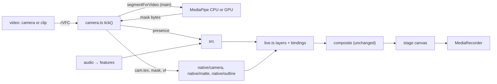
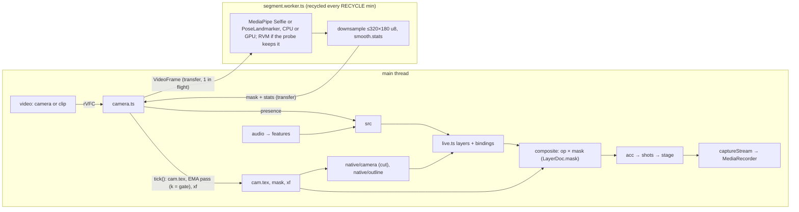
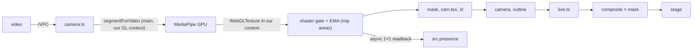
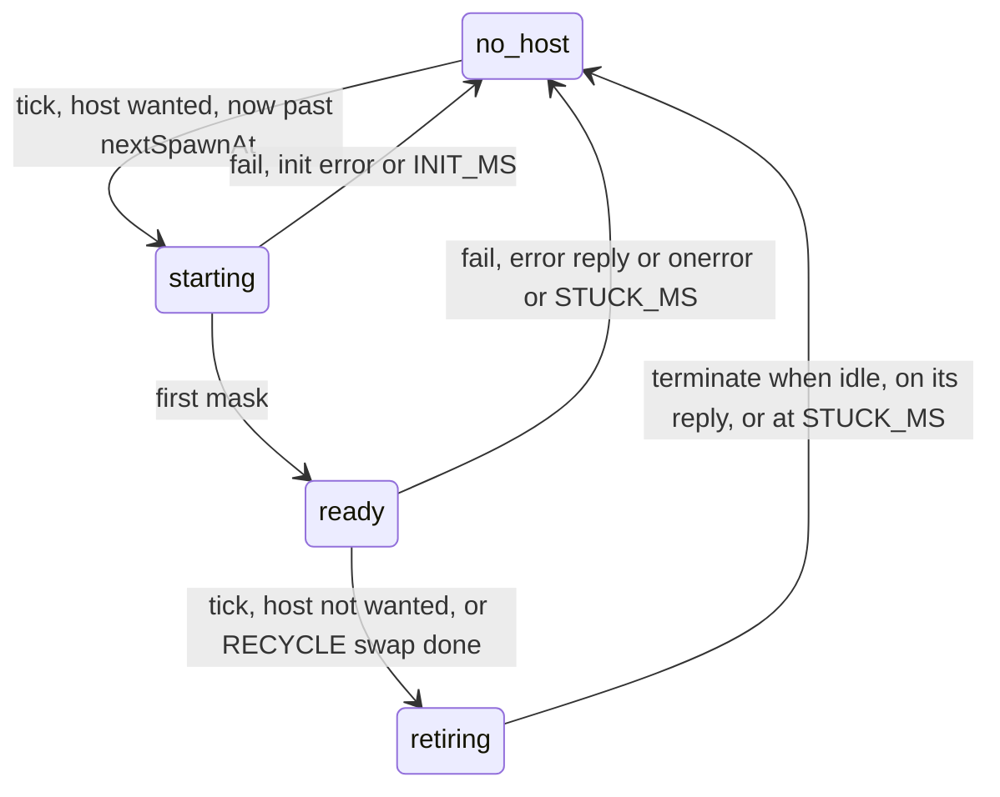

# Design — Stage 3: camera scene (in-browser person mask)

## TL;DR
- **Pure web, one path for Mac and Windows** (spec §2). The camera is a `<video>` (a device or the user's clip). A **segmentation worker** gets each frame as a transferred `VideoFrame` and returns a ≤64 KB mask plus stats. The main thread smooths it (EMA + a global strobe gate) into one stage-aligned mask. The worker is recycled before MediaPipe's long-session GL leak (#6352) bites.
- **Engine:** `native/camera` (`cut` for fx chains); a per-layer `mask` field (person/background), applied as per-pixel opacity in the composite and exact for all 4 blends; `native/outline`; `own/negative.fs`; a `presence` source; 3 starred built-ins that keep their TD layers when there is no camera.
- **Step 1 is a browser probe** (`?camprobe`) on the M4 and the Windows PC; it reports the GPU. It compares MediaPipe Selfie (<2 m) with the PoseLandmarker full-body mask (≤4 m), on CPU and GPU, hosted in the worker, on main, or in our GL context (RVM on WebGPU if it wires). It judges end-to-end late frames, mask fps, latency, GPU/CPU agreement, a 75 min soak and a sheet from the user's DJ clip.
- **Recommendation: Variant B** (worker + layer mask). Runner-up: A (main thread, nodes only). 4 CPs, 9 coder steps (CP3 optional), 1 probe ruling.

## Freshness
- 2026-11-05, system-designer. Inputs:
  - `thoughts/spec_camera.md` §1–§5 (final: pure web, Mac + Windows unchanged, native helpers a non-goal, path C a note).
  - `agents/research/research_camera.md` §1–§4, §6, §8–§10 (§5 Electron and §7 Apple Vision are now out of scope).
  - `agents/research/research_camera_xplat.md` TL;DR, §1–§6, §8–§9: Windows GPU bugs, PoseLandmarker, RVM runtimes, OBS smoothing, the shortlist.
  - `design_td_look.md` L111–201 (D1–D5) and L420–452 (sources rest at 0; the bass class binds `reese`); `design_milkdrop.md` L384–409 (judge GPU paths by end-to-end late frames).
  - Code: `gl/scene.ts` L7–9; `gl/live.ts` L91–111 (composite), L289–320 (`direct` L297); `doc.ts` L8–12; `edit.ts` L65; `milkdrop/native.ts` L24–36; `scenes/history.ts` L12–49; `audio/input.ts` L96–126; `bind.ts` L26–60; `app.ts` L170–175, L347–354, L385; `recorder.ts` L38; `gl/engine.ts` L16, L22, L80–94; `quality.ts` L17, L25; `ui/Overlay.tsx` L42–52; `ui/Panel.tsx` L469.

## Constraints
- **Scope (spec §2):**
  - One camera (≥720p30; capture cards count), picked like the audio input.
  - The mask is computed in Chrome by the same code on Mac and Windows, ≥24 fps, without costing the 60 fps render.
  - Blocks: `native/camera`, a layer mask with feather, 2–3 looks (negative, outline glow, history-ring trails).
  - 3 starred built-ins with 2c/2d bindings; graceful under strobes; framing after the mask works.
- **Non-goals (spec §3):** native helpers and OS SDKs (no Swift/Vision, no Electron addon, no DirectML, no Maxine), multi-camera, hands, depth, pose skeletons, NDI, raw-camera recording, face effects. Face *detection* for framing is in scope.
- **Acceptance (spec §4):**
  1. Camera + mask + 1 TD effect: 0 late frames over 60 s at 1728×1117. Mask ≥24 fps; ≤100 ms camera-to-screen.
  2. On the user's DJ-booth clip: no full-frame flicker, a continuous silhouette, hands on the decks kept. A sheet from each machine.
  3. The permission flow, device switching and a clean no-camera fallback.
  4. Nothing leaves the machine; models are local and their licences are in `web/THIRD_PARTY.md`.
  5. Gates green; WCAG flash cap.
- **Deployment:**
  - The visuals most likely run on a Windows PC in Chrome, GPU unknown (spec §2).
  - `getUserMedia` needs a secure context and `localhost` is one (research §4), so the PC serves the app on its own localhost. ⚠️ Assumption, needs confirmation: `npm run build && npm run preview` there (Node ≥ 20.19).
  - On dual-GPU laptops WebGL defaults to low power. The fix: Windows Graphics settings → Chrome → High performance (xplat §1).
  - WebGPU needs a D3D12 adapter (xplat §2).
- **Path C:** OS and vendor camera effects are camera devices only: no code, no dependency, no mask (xplat §9). That covers macOS Portrait/Studio Light, Continuity Camera + Center Stage, Windows Studio Effects and NVIDIA Broadcast.
- **Licences:** any licence is allowed (CLAUDE.md). Each one is recorded; permissive wins when options are equal.

## Shared decisions (all variants)

### D1 Camera source and texture
- **`camera/camera.ts` mirrors `audio/input.ts` L96–126:**
  - Functions: `listCameras` (`videoinput`, labelled only), `allowCameras`, `selectCamera(id | 'off')`, a saved id, `devicechange`.
  - Constraints: `deviceId: {exact}`, ideal 1280×720 (1920×1080 while framing is on), ideal 30 fps.
- **A clip file is a camera source too** (file input → object URL, muted, looping). The probe and rehearsals feed the user's DJ-booth clip through this path.
- **One hidden `<video>` attached to the document;** `requestVideoFrameCallback` marks new frames (research §3). ⚠️ rVFC on a detached video is unverified.
- **`tick(now)` runs once per rAF in `app.ts`, before `render()`,** so both shots of a fade read the same textures. Each tick:
  - uploads the newest frame into `cam.tex` (RGBA8, `texImage2D(VideoFrame | video)`), switching to `texSubImage2D` while the size holds, per the `milkdrop/native.ts` L28–34 rule (the probe A/Bs both);
  - runs the D2 passes when a mask arrived;
  - updates `presence`.
- **Stage mapping:** one `xf` (vec4: scale.xy, offset.xy) maps stage uv to camera uv: cover-fit, mirror (a global setting, default off ⚠️ Assumption), and later the framing crop (D9). Every consumer samples through `xf`, so image and mask always line up.
- **Refcount `use(mask: boolean): () => void`:**
  - Camera natives take it in `create()` and release in `dispose()`; masked layers take it in `buildLayer`/`freeLayer`.
  - Segmentation runs only while a mask user is live. Prepare-ahead builds the next scene a fade early, so the mask is warm at the cut.
  - The stream stays open while a camera is selected, because reopening is slow and blinks the light.

### D2 Mask: smoothing, feather, strobe, long sessions
- **Per mask: the gate** (pure TS, `camera/smooth.ts`). `gate(g, area) → k` is this mask's EMA weight:
  - `area > AREA_MAX` (.6, ⚠️ a knob set on the clip): k = 0, hold. A DJ behind decks never fills 60% of a wide shot, so a flooded mask is never shown. This is the "never flash the whole frame" guarantee.
  - `|area − g.area| / max(g.area, .02) > JUMP` (.5): hold for up to `HOLD` (6) masks (≈250 ms), then accept at `SLOW` (.15) until it settles: a real entry or exit. Alternating strobe frames reset the count, so they are always held.
  - Otherwise k = `KEEP` .85, OBS background-removal's default mask EMA (xplat §6). `g.area` follows with the same k.
- **Per pixel** (GPU, one pass at mask res, only when k > 0):
  - `ema = mix(ema, raw, k)` in an RG16F ping-pong. Without `HALF`: RGBA8 and k ≥ .25, because an 8-bit EMA stalls.
  - Consumers read `m = smoothstep(.5 − f, .5 + f, ema)`, with one global `feather` f (.15).
- **Not built** (named levers, each with a sheet trigger): per-pixel hysteresis (chatter); motion-weighted k (hands lag); joint-bilateral upsampling as in Meet (blocky edges); OBS's skip of near-identical frames at PSNR 35 (mask rate short); a low-light pre-pass such as SGLLIE (53 KB, MIT; xplat §5) (dark frames fail).
- **Camera strobe limiter (WCAG):**
  - A room strobe filmed full-frame would pass through the camera layer at the strobe rate. The shared flash cap gates bindings, not content (td_look D2).
  - `native/camera` scales rgb by `min(1, ref / mean)`. `mean` is this frame's mean luma (a top-mip read, no CPU readback). `ref` is a 1×1 slow EMA (τ ≈ 1 s), updated per camera frame while a camera user is live.
  - It dims flash frames and never boosts. Input `limit` (0..1, default 1) blends it.
- **`ALIGN`** (default on): the frame sent to segmentation is kept (`VideoFrame.clone()`) and uploaded when its mask returns, so the silhouette never trails the hands, and the image runs at the mask rate. Off: the newest frame shows at once, and the mask lags one inference.
- **Long sessions:**
  - The problem: MediaPipe's GPU delegate grows its GL handle tables without bound in VIDEO mode, and the page turns sluggish after ≈60 min (#6352, open; `mask.close()` doesn't help; xplat §1). A DJ set runs for hours.
  - The segmenter host is recycled every `RECYCLE` min (30 ⚠️, set by the soak), make-before-break: the new instance initialises beside the old one and takes over at its first mask, while the gate holds.

### D3 `presence` source
- **Yes:** `src.presence = clamp(g.area / PRESENCE_FULL)` (.08 ⚠️, calibrated on the clip), set in `app.ts` beside `src.build`/`src.drop` (L347).
  - It rests at 0 (nobody or no camera), like every sustained source since the 2026-11-05 ruling.
  - It joins `SOURCE_IDS` and gets a `camera` group (`bind.ts` L26–42). No Auto-style map touches it.
- **Use:** person layers bind `opacity ← presence` (attack .3, release 1.5), so the DJ fades in when found and out when lost. No `motion` source until a scene asks.

### D4 Looks (new code)
| Block | Kind | Inputs → default binding (td_look D1 policy) |
|---|---|---|
| `native/camera` | generator | `cut` none/person/background: rgb·m, alpha m, black outside, for chains ending in add/screen. `limit` 1; `gain` 1. No audio binding: zoom or shake would split image from mask. |
| `native/outline` | generator | Mask iso-line at constant px width (`abs(m − .5) / fwidth(m)`). `width` ← sub .05/.4 1.5→4 px; `glow`⚡ ← kick 0/.2 0→1; hue step ← snare (event). Scenes follow it with `own/bloom`. |
| `own/negative.fs` | ISF filter | `amount`⚡ ← snare 0/.15 0→1 (`VJW_FLASH`); usable on any layer. |
- **A cut-out over graphics uses the layer mask with `cut` none.** A cut layer in `normal` blend would darken a wide feather to rgb·m², because the composite multiplies by alpha again (`live.ts` L109).
- **Trails** reuse the ring natives (`rgba-delay`, `time-machine`, `slit-scan`), `own/trails.fs` and `Comet Tails`, with the cut-out person as `src` (td_look D3). A multi-ghost "echo" is the upgrade if the sheet wants one.

### D5 Built-in scenes (starred)
| Scene | L0 (also the fallback) | L1 | L2 |
|---|---|---|---|
| `dj-over-tunnel` (person over TD) | tunnel → light-tunnel → radial-blur (their D1 bindings) | `native/camera`; mask person; normal; opacity ← presence | `native/outline` → bloom; add; opacity ← presence |
| `dj-inside` (TD inside the silhouette) | spectrum → td-feedback (res .5, opacity .5) | swarm or reaction-diffusion; mask person; normal | outline → bloom; add |
| `dj-ghost` (glitch/trail sprite) | tunnel → edge-rings | camera cut person → rgba-delay (spread ← reese, rotate ← snare) → negative → bloom; screen; opacity ← presence | — |
- **An empty mask** (no camera, or nobody in frame) leaves L0 playing; the camera layer itself draws black. ⚠️ Assumption, needs confirmation: this reads spec §4.3 "falls back cleanly" as better than black.
- **Bindings** follow the 2d policy: drums, sub and build/drop direct; the bass class via `reese`; ⚡ inputs share the ≤3/s budget.

### D6 Budget
Target: 60 fps at 1728×1117 on the Mac, and at the real output size on the PC.

| Item | Where | Cost |
|---|---|---|
| Camera upload (720p), per camera frame | main + GPU | ⚠️ probe (research §3 has only a 2016 Android figure) |
| `VideoFrame` post, ≤64 KB mask upload, EMA pass, 1×1 ref | main + GPU, per mask | target ≤.5 ms main p95 |
| `native/camera` draw | GPU | ≈ one pass (td_look D5: a full-res half-float pass ≈1 ms); lever: layer `res` .5 |
| Outline + bloom | GPU | ≈.3 + .6–1 ms (td_look D5) |
| Segmentation | worker CPU, or a worker GL context | ⚠️ probe. The only desktop browser figures (legacy runtime, GTX 1070): Selfie 185–225 fps, GHUM + mask 112–123 (xplat §3) |
- **Memory:**
  - `cam.tex` 3.7 MB (8.3 at 1080p); mask state <1 MB.
  - MediaPipe WASM ≈14.6 MB plus the model: Selfie .25, Pose lite 5.8 / full 9.4 MB. RVM fp16 7.5 MB.
  - Worker heap ⚠️ unmeasured. A ring scene adds 61.8 MB (existing ≤2-ring cap).
- **Late frames:** late = >1.5 × the refresh median (`quality.ts` L17; design_milkdrop L393), judged end to end and never by the per-scene GPU timer.

### D7 Privacy, permissions, fallback, REC
- **Off by default.** The camera opens only after a pick in the overlay next to "Audio input…" (`ui/Overlay.tsx` L42–52): Off / devices / Video file…. A saved camera reopens at Start like audio. ⚠️ Assumption, needs confirmation.
- **Local only:** WASM and models are self-hosted (`web/public/models/` and the package's `wasm/`; no CDN; `FilesetResolver` gets a local base, research §1). The CP2 close checks that DevTools shows localhost requests only.
- **Errors never throw in the render loop:**
  - `NotAllowedError` → "allow the camera in Chrome and in the OS privacy settings" (macOS TCC, research §4; Windows wording is G9).
  - `NotReadableError` → "in use by another app".
  - `track.onended` → black, mask empty, presence 0.
- **REC** records the stage canvas (`recorder.ts` L38), so the composite is recorded as shown; the raw camera is not (a non-goal). Takes contain the DJ's image and stay local downloads.

### D8 Licences (`web/THIRD_PARTY.md`)
- **Shipped:** `@mediapipe/tasks-vision` 1.2.2 plus the ruled model (Selfie, PoseLandmarker lite/full, multiclass, `deeplab_v3`), all Apache-2.0 (research §1; xplat §1, §8).
- **Probe-only until shipped:**
  - Runtimes: `onnxruntime-web` 1.31.1 (MIT) or `@litertjs/core` 2.6.0 (Apache-2.0).
  - RVM mobilenetv3, **GPL-3.0** for code and weights: allowed, and recorded.
  - `ldenoue/rvm-webgpu` has no licence file: reference only, not copied.
  - Probe models stay git-ignored.

### D9 Framing (CP3)
- The target is the mask box (`stats.box`, whose top ≈ the head). If PoseLandmarker wins, its head landmarks give the face box for free; they stay internal, with no skeleton visuals (spec §3).
- The crop: box + headroom, at the stage aspect, zoom 1–2, a 5% dead zone, then a critically damped follow (τ ≈ 1 s) clamped to the frame. It writes `xf`, so every consumer crops together.

### D10 Tests
- **Node (Vitest):**
  - `smooth.ts` `stats` (empty, full, edge boxes) and `presence` (rests at 0, clamps).
  - `gate`: a one-frame flood or vanish is held; `AREA_MAX` always holds; a sustained change enters at `SLOW` after `HOLD`, then `KEEP`; an alternating strobe never accumulates.
  - `frameStep` (CP3) and the f32→u8 quantize.
  - The `doc.ts` `mask` parse, and the `setMask` inverse (the `setBlend` row, `edit.test.ts` L127).
- **Browser only:** permissions and device switching; `VideoFrame` lifetime (no camera stall); the recycle swap (no gap); self-hosted init with no network; fps, latency, late frames and the soak (probe and CP closes); the WCAG luma trace and the sheet on the clip.

## Variant A — Lean: main thread, nodes only (simplest)
**Summary.** MediaPipe runs on the main thread (the probe picks the delegate); its mask is read back as bytes and uploaded. Masks feed nodes only: `native/camera` `cut`, a `native/matte` filter for any other layer, and `native/outline`. No worker, no doc change.


**Modules (`web/src/`).**
- New: `camera/camera.ts`, `camera/segment.ts` (MediaPipe on main), `camera/smooth.ts` + test, `camera/natives.ts` (camera, matte, outline), `fx/own/negative.fs`.
- Edits: `app.ts`, `bind.ts`, `scenes/builtin.ts`, `ui/Overlay.tsx`, the catalog.

**Contracts.**
```ts
export interface Mask { tex: WebGLTexture; w: number; h: number; id: number; area: number }
export function segment(src: HTMLVideoElement, t: number): Mask | null // main thread, sync
// native/matte: kind 'filter', inputs { mode: long 0 person | 1 background }; out rgb·m, alpha m (premultiplied)
```
**Acceptance.**
- §4.1 holds only if main-thread inference fits; CPU inference counts in full on every camera frame (Meet: 8.3 ms on a 2018 MBP, research §1; the PC is unknown).
- §4.2–§4.5 come from D2, D7 and D8.

**Roadmap:** a worker later changes `segment.ts` only.

**Risks.**
1. Inference on an unknown Windows main thread → late frames.
2. The matte's premultiplied output darkens a wide feather to rgb·m² in `normal` blend (`live.ts` L109), and `multiply` turns black outside it.
3. The #6352 leak lives in the page. Whether `close()` + recreate frees MediaPipe's tables is unknown, so a reload may be the only reset.
4. The GPU delegate's sync readback stalls the main thread.

**Effort:** M (6 new files incl. the test + 5 edits).

## Variant B — Segmentation worker + layer mask (recommended)
**Summary.** A dedicated worker hosts the model; the main thread only moves frames out and bytes in. Masks are a per-layer field applied as per-pixel opacity in the composite; the camera's `cut` stays for fx chains.


**Modules.**
- New: Variant A's files minus `native/matte`, plus `camera/segment.worker.ts`, the only place a model lives.
- Edits, all on the `setBlend` path: `doc.ts` (`mask?`), `edit.ts` (`setMask`), `gl/live.ts` (composite uniform, `direct` exclusion, mirror), `ui/Panel.tsx` (a select beside Blend, L469).

**Contracts.**
```ts
// main ⇄ worker
type ToWorker = { type: 'init'; model: ModelId; delegate: 'CPU' | 'GPU'; base: string } // self-hosted URLs
  | { type: 'frame'; id: number; frame: VideoFrame }                                    // transferred; the worker closes it
type FromWorker = { type: 'ready'; info: string } | { type: 'error'; msg: string }
  | { type: 'mask'; id: number; w: number; h: number; data: Uint8Array; ms: number; stats: MaskStats } // ≤320×180, transferred
export interface MaskStats { area: number; cx: number; cy: number; box: [number, number, number, number] }
// doc.ts: optional, so old scenes parse unchanged
export type MaskMode = 'person' | 'background'
export interface LayerDoc { /* …as today */ mask?: MaskMode }
// live.ts composite: op *= none ? 1 : person ? m : 1 − m, with m = texture(uMask, uv * xf.xy + xf.zw).r
```
- **A model is one function in the worker:** `(frame: VideoFrame) => Promise<{ data, w, h }>`, with no class hierarchy.
  - Selfie gets the frame pre-scaled to its input (`createImageBitmap(frame, {resizeWidth, resizeHeight})`). PoseLandmarker gets the full frame, since it crops its own person region (xplat §4).
  - Any returned mask is area-downsampled to ≤320×180 before posting (G4, G5).
  - VIDEO mode with a monotonic clock: a looping clip's media time jumps back, and VIDEO mode keeps state only across monotonic stamps (research §2).
- **Recycle:** create a new `Worker` and init it, then `terminate()` the old one at the new one's first mask. All the old GL handles die with it.
- **If MediaPipe won't run in a worker (G1):** the same module runs on main behind the same messages (A's transport, B's engine), and the recycle degrades to `close()` + recreate.

**Reuse:** the composite's blend table (`live.ts` L92–110: the mask multiplies `op`, which every mode already applies); the `setBlend` doc/edit/live/panel/undo path; the ring natives, `own/bloom` and `flashGate`.

**Acceptance.**
- §4.1: inference runs off the main thread. Main-thread work is one post, a ≤64 KB upload and one small pass (target ≤.5 ms p95).
- §4.2 comes from D2 + `ALIGN`; §4.3–§4.5 from D7, D8 and the gates.

**Roadmap:** framing writes `xf`. Electron later runs the same page (research §5). Another model is one more function. Multi-camera (a non-goal) would make `cam` an array.

**Risks.**
1. G1: MediaPipe in a worker is undocumented (research §1, #5292). A module worker has no `importScripts`, so a classic worker may be needed ⚠️. The fallback is hosting on main.
2. An unclosed `VideoFrame` starves the camera's buffer pool. The worker closes each frame; main closes its clone after upload.
3. A GPU delegate in the worker is a second GL context; its readback blocks only the worker.

**Effort:** M/L (6 new files + 9 edits).

## Variant C — GPU-resident, zero copy
**Summary.** MediaPipe's GPU delegate runs on our stage canvas: a second `getContext` returns ours (research §3, option 1), and its mask texture is used as is. The gate runs in a shader on mip-level areas, and `presence` comes from an async 1×1 readback. Layer mask as in B; no worker.


**Contracts:** `Mask { tex }` from `MPMask.getAsWebGLTexture()`, plus a guard that saves and restores whatever MediaPipe changes (the probe's diff list).

**Acceptance:** §4.1 holds only if the inference GPU time plus our frame fits 16.6 ms on the PC's GPU, every camera frame.

**Risks.**
1. Foreign GL state in our context: FBO, program, units, pixel-store, `alpha:false` (research §3).
2. Inference runs in our command stream; on an integrated GPU it adds to the frame directly.
3. #6352 leaks into our own context, and only a reload clears it. The NVIDIA offset (#5428) applies too.
4. A GLSL gate isn't Node-testable.

**Effort:** M; the fewest files and the most risk.

## Comparison
| | A lean | B worker (rec.) | C zero copy |
|---|---|---|---|
| Main-thread cost per camera frame | the inference (≈ms) | post + upload (≤.5 ms target) | the inference graph + guard |
| GPU contention with the render | GPU delegate: same thread | GPU delegate: own context; CPU: none | same command stream |
| #6352 leak over a long set | page-level; reload | recycle the worker, no gap | in our context; reload |
| Exact for 4 blends and any generator | no (rgb·m² fringe; multiply) | yes | yes |
| Doc / panel change | none | `LayerDoc.mask` (setBlend pattern) | as B |
| Gate testable in Node | yes | yes | no (GLSL) |
| Effort | M | M/L | M |
| The probe must show | main inference ≤2 ms p95 on both machines | the worker inits (G1) | a short GL diff, 0 late |

## Recommendation
**Variant B.**
- The show machine is an unknown Windows PC, so inference must not share the main thread with a 60 fps render. With the CPU delegate it doesn't share the GPU either.
- A DJ set outlives MediaPipe's GL leak, and only a worker can be swapped live without a gap.
- The bytes contract makes stats, the gate, presence and framing plain Node-tested TS.
- The layer mask is per-pixel opacity that every blend already applies, so it is exact where A's node isn't, for ≈30 lines on the `setBlend` pattern.
- If MediaPipe won't run in a worker, B keeps its engine and hosts the model on main.

**Runner-up: A**, if the lead wants the smallest diff and the probe shows main-hosted inference ≤2 ms p95 with 0 late frames on both machines.

## CP0 — the probe (step 1, run on both machines)
**Page:** `?camprobe`, a dev page beside `?bench`.
- Source: the user's DJ clip (file picker) or the live camera.
- It holds HEAVY through the director, as `?bench` does (`app.ts` L385). After `render()` it draws camera + mask as an overlay (upload, EMA pass, one masked draw), so the GPU work is real before CP1.
- It runs unattended and downloads `camprobe-<os>-<gpu>-<date>.json` and a sheet PNG. The user copies them from the PC into `scratchpad/cam/`.

**Reports:**
- UA/OS.
- GPU: `WEBGL_debug_renderer_info` (ANGLE names the GPU and backend; xplat §1), plus WebGPU adapter info (absent on a D3D11-only adapter; xplat §2).
- Float and half-float render targets in the worker's context (#6296: the GPU postprocessor aborts without them).
- Cores, `deviceMemory`, DPR, stage size, refresh (median rAF Δ).
- Camera `getSettings()` and `getCapabilities()` (exposure/iso, xplat §5).
- Whether rVFC gives `captureTime` on a local track (research §3: WebRTC only).

**Arms.** HEAVY is the starred own scene with the highest plain-`?bench` GPU time on the M4 (the lead names it); the same scene runs on both machines.

| Arm | Host | Model / delegate | Run |
|---|---|---|---|
| base-0, base-cam | — | HEAVY alone; HEAVY + camera, no mask | 60 s each |
| W-selfie-cpu / -gpu | worker | Selfie landscape 144×256, CPU / GPU | 60 s each |
| W-pose-cpu / -gpu | worker | PoseLandmarker lite, `outputSegmentationMasks` | 60 s each |
| M-cpu | main | the better worker model, CPU | 60 s |
| M-same | main, our context | Selfie GPU on `stage` (Variant C) + GL state diff | 60 s |
| W-rvm (S0.3) | worker | RVM mobilenetv3 fp16, WebGPU, recurrent states on the GPU | 60 s, if wired |
| sheet only | worker | Selfie square, multiclass, `deeplab_v3`, Pose full | sheet frames |
- **Not an arm:** the cross-context copy (MediaPipe on its own canvas, then `texImage2D(canvas)`, the MilkDrop path). W-*-gpu does the same GPU work off the main thread.

**Measures per 60 s arm:**
- **Timing:** mask fps (min over 1 s windows, and the median); inference ms p50/p95 (worker clock); our main-thread ms p95 per camera frame; late frames and the governor scale at the end; init and first-mask time; ALIGN on vs off.
- **Agreement** (the NVIDIA one-texel offset, #5133/#5428, xplat §1): GPU vs CPU masks of the same clip frames, per model, as IoU and centroid Δ in mask texels.
- **Latency** (live camera): a large ms clock on the page, the camera facing the screen, 5 OS screenshots per mode (raw; masked with ALIGN on; masked with ALIGN off). Glass-to-glass = the clock − the clock seen in the picture (median).
- **Quality sheet:** the 8 clip moments the user marks (steady, low light, strobe on, strobe off, hands on decks, fast move, someone behind, walk-out) × every arm and sheet-only model, each mask after D2 smoothing, overlaid on its frame.
- **Soak** (PC, the leading arm; run without, then with the recycle): 75 min on the clip, with mask fps and inference ms logged per minute. The user notes the tab's and the worker's memory in Chrome's Task Manager at 0/30/60/75 min. #6352 shows as ≈1.2 MB/min growth and sluggishness after ≈60 min.

**Pass (per arm, per machine):**
- **K1** mask ≥24 fps in every 1 s window.
- **K2** main-thread p95 ≤1 ms (worker) / ≤2 ms (main).
- **K3** 0 late frames over 60 s and 1.00×, relative to base-0 on that machine. If base-0 is already late: no worse than base-0, and the machine finding goes to the lead.
- **K4** glass-to-glass ≤100 ms, with base-cam reported beside it.
- **K5** (M-same) a GL diff short enough for a save/restore guard; non-camera pixels identical.
- **K6** the lead's sheet verdict: no full-frame flicker, a continuous silhouette, hands kept → pass / marginal / fail.
- **K7** GPU agrees with CPU: IoU ≥ .95 and centroid Δ < 1 texel. Otherwise the GPU delegate is off for that vendor.
- **Soak:** inference p95 at 75 min ≤1.2× minute 1, with no late-frame growth. Otherwise `RECYCLE` = half the minute where growth starts.

**Default pick:**
- One model + runtime for both OSes (spec §2): the best K6 among arms passing K1–K4 and K7 on both machines.
- Ties break in order: MediaPipe over RVM (Apache-2.0, smaller, the only published desktop fps; xplat §3), then worker over main, then CPU over GPU (no render contention, no #5428/#6352), then the smaller model.
- The delegate may differ per machine (a saved setting; default from the ruling). ALIGN stays on if K4 holds with it.
- Expectation, not a pick: the shot decides. A tight half-body shot suits Selfie (<2 m). A DJ at 2–3 m suits PoseLandmarker (≤4 m), if it still finds a pose with the legs hidden behind the decks (⚠️ xplat §4).

**Kill:**
- No arm passes K1–K3 on the PC → back to design with the numbers. Levers: 540p capture, layer `res`, the PSNR skip, or a 15 fps mask (a spec change).
- No arm passes K6 → the user tries more light on the DJ, a closer camera, or OS effects via the picker; then the ruling.

## Checkpoints (one coder per step, ~45 min each)
**CP0 Probe**
- **S0.1 (M)** `camera.ts` core (D1: device and clip source, rVFC, `cam.tex`, the ALIGN clone) + `segment.worker.ts` with MediaPipe Selfie on CPU (self-hosted WASM and models) + the masked overlay. Check: a cut-out DJ on the clip, on the M4.
- **S0.2 (M)** the other MediaPipe arms (GPU, PoseLandmarker, M-cpu, M-same with its GL diff, sheet-only models) + the worker recycle + `?camprobe` (report, runner, metrics, agreement, latency clock, soak log, JSON and sheet export).
- **S0.3 (M, time-boxed)** RVM in the worker:
  - first ORT-Web WebGPU with the official fp16 ONNX, states kept on the GPU via IO binding;
  - if an op is missing (G7), LiteRT.js after `ldenoue/rvm-webgpu` (reference only);
  - if neither wires within the box, RVM is dropped and logged.
- **R0 (lead + user):** both machines + the soak; the lead reviews the sheet. Then a **system-designer probe ruling**: model, runtime, delegate per machine, host, ALIGN, `RECYCLE`, gate knobs.

**CP1 Mask in the engine**
- **S1.1 (M)** `smooth.ts` (stats, gate, presence) + tests; the EMA pass and the limiter `ref` in `tick`; `presence` in `bind.ts` and `app.ts`; delete the losing arms.
- **S1.2 (M)** `native/camera` (cut, limit, gain, `xf`) + the `use()` refcount + the overlay camera picker (Off / devices / Video file…, errors, switching, saved id).
- **S1.3 (M)** `LayerDoc.mask`: parse, `setMask` + inverse, composite + `direct` exclusion, live mirror, Panel select, undo; tests.
- **Close (lead):** 60 s of camera + mask + one TD effect on the clip, 0 late on the M4; a device switch; no camera.

**CP2 Looks + scenes**
- **S2.1 (S)** `native/outline` + `own/negative.fs` (bindings, `VJW_FLASH`).
- **S2.2 (S)** the 3 built-ins (starred) + `THIRD_PARTY.md`.
- **Close (lead; the user on the PC):** §4.1–§4.5 on both machines: 60 s 0 late, mask ≥24 fps, ≤100 ms; the sheet; a WCAG luma trace over the clip's strobe section; permissions; no camera; a localhost-only network log; gates.

**CP3 Framing (optional, later)**
- **S3.1 (S/M)** `frameStep` + tests; the `xf` crop from the mask box (or Pose head landmarks); a toggle; 1080p capture while on.

**Count:** 4 CPs, 9 coder steps (S3.1 optional), 1 probe ruling.

## Research gaps
- **G1** MediaPipe in a dedicated worker: CPU/GPU delegates, `VideoFrame` input, module vs classic worker (research §1, #5292).
- **G2** No browser fps on M-series, Intel iGPU, AMD or RTX for any candidate; no Tasks Vision 1.x desktop figure (xplat §3).
- **G3** Camera-to-screen latency of webcams and capture cards in Chrome; rVFC `captureTime` on local tracks (research §3–§4).
- **G4** Costs of `new VideoFrame(video)` + transfer, the `createImageBitmap` resize and `texImage2D` at 720p (research §3); the mask size MediaPipe returns for a given input.
- **G5** PoseLandmarker: mask resolution, and whether a pose (hence a mask) is found with the legs hidden behind decks (xplat §1, §4).
- **G6** Whether 1.2.2 fixes #5428 (NVIDIA offset) and #6352 (leak) (xplat §1).
- **G7** RVM op coverage on ORT-Web WebGPU (xplat §2).
- **G8** Low-light, coloured-light and strobe quality is unpublished for every model (research §2, xplat §5); only the clip answers.
- **G9** Windows' camera-privacy wording for the error text: not in research.
- **G10** A face detector, only if both the mask box and Pose head landmarks fail for framing.

## Decision needed
1. Variant: **B** (worker + layer mask), A or C?
2. Mask in the engine: a `LayerDoc.mask` field (default), or nodes only (`native/matte`)?
3. ALIGN: does the image wait for its mask (default; the probe may flip it), or does the newest image show?
4. RVM (GPL-3.0) in the probe if it wires within S0.3's time box (default yes)?
5. Long sets: recycle the worker every `RECYCLE` min, make-before-break (default 30, set by the soak)?
6. No-camera fallback: the built-ins keep their TD layers playing (default), or literal black?
7. Does a saved camera reopen at Start like audio (default), or take one click per session?
8. Windows: does the PC serve the app on its own localhost via `npm run build && npm run preview` (default)?
9. Acceptance size on the PC: its real output size (default) instead of 1728×1117?
10. Framing (CP3) from the mask box or Pose head landmarks, with no face model (default), after CP2?

**The user provides:**
- The DJ-booth clip: ≥60 s, ≥720p30, MP4 or WebM, ideally from the show camera, with the 8 sheet moments marked: steady light, low light, strobe on/off, hands on the decks, fast moves, someone walking behind.
- The `?camprobe` run on the Windows PC, including the 75 min soak, returning the JSON, the sheet and the latency screenshots.
- No Swift helper or native path: the final scope dropped them.

## Ruling (R0-Mac, provisional)

**TL;DR**
- **Pick (Mac):** MediaPipe Selfie landscape 144×256, MediaPipe runtime, CPU delegate, worker host, ALIGN on, RECYCLE 30 min. CP1 can start on it.
- **What the Mac data grades:** K2 and K5 pass. K1 and K3 are instrument-limited. K4, K6 and K7 are UNKNOWN, and UNKNOWN is never PASS.
- **S1.2 keeps one runtime** (Selfie and PoseLandmarker lite, both delegates, the `align` flag, `?camprobe`). It prunes the main host, RVM with ORT-Web, and four sheet-only models.

**Basis.** 2026-11-15, system-designer, at `c46ad9a`. Evidence keys: **F** = `scratchpad/cam/s0.4-full.json`; **P** = `scratchpad/cam/camprobe-mac-ANGLE-Apple-ANGLE-Metal-Renderer-Apple-M-2026-11-07.json`; **S** = the `camprobe-soak-mac-…-2026-11-07.json` beside it; **H** = `scratchpad/cam/s0.5-harness.json`; **ST** = `agents/STATE.md` at `c46ad9a`. Plain `L…` is this file; `plan L…` is `agents/planner/plan_camera.md`. Every number is from the M4: Chrome 156, 1728×1117 @2, HEAVY held, 60 s per arm. The source is a looping clip with no person in it (`env.camSettings` null; ST L13).

### Grades (Mac arms; pass lines L321–L329)
| Arm | K1 fps, min1s / med | Inference ms, p50 / p95 | K2 main ms, p95 | K3 late | Ruling |
|---|---|---|---|---|---|
| base-0 / base-cam | — | — | — / 1.7 | 2 / 2 | keep: the baselines |
| W-synthetic | 20.7 / 29.4 | 0.2 / 0.4 | 1.6 | 5 | keep: the control |
| **W-selfie-cpu** | 21 / 29.2 (ST: 25) | 10.1 / 11.2 | 0.9 (ST: 0.9) | 4 (ST: 0) | **the pick** |
| W-selfie-cpu, ALIGN off | 19.9 / 29.5 | 11 / 12.2 | 0.1 | 1 | keep: the flag |
| W-selfie-gpu | 18.4 / 28.6 | 12.8 / 15.4 | 1.0 | 3 | keep: the PC delegate |
| W-pose-cpu | 19.3 / 28 | 17.4 / 20.2 | 1.1 | 5 | keep: the K6 runner-up |
| W-pose-gpu | 20.5 / 27.2 | 23.7 / 28.1 | 0.9 | 2 | keep: same model, same flag |
| W-rvm (from P) | 19.9 / 28.6 | 22.6 / 23.8 | 0.5 | 0 | prune |
| M-cpu | 21.7 / 29.6 | 6.3 / 7.3 | 7.9 (`mainTotalP95`) | 1 | prune |
| M-same | 21.4 / 28.7 | 10.6 / 13.3 | 14.1 (`mainTotalP95`) | 0 | prune |

- **Fields:** F `arms.<arm>.{maskFps, inferMs, mainMs, mainTotalP95, late}`; `scale` is 1 in every arm. "ST:" marks the S0.3 single-arm run (ST L34). ⚠️ The sheet-only arms differ by up to 36 % between F and P (Selfie square p50: 12.8 and 9.4 ms), so a smaller gap between two arms is a tie.
- **K1 is source-limited.** The control runs 0.2 ms inference and still reads min1s 20.7; every arm reads 18.4–21.7. ST L34 names the cause: the looping-clip decode plus the hidden 1px video (a visible element moved 18.9 → 26.3). The model is not the limit: the pick delivered 1440 masks against the control's 1446 (99.6 %), and its p95 is 11.2 ms against a 33.3 ms camera frame.
- **K2 passes for the pick:** 0.9 ms in two runs, a margin of 0.1 ms. The measure carries about ±0.5 ms of noise: the control does the same main-thread work and reads 1.6.
- **K3 is noise-limited** ⚠️. Late counts of 0–5 do not follow the load: M-same spends 14.1 ms on main and has 0, the control has 5, and base-0 alone has 2. The pick reads 0 (ST L34) and 4 (F).
- **UNKNOWN: K4, K6, K7.** No latency shots exist, and no frame has a person in it. For K7, `agreement.selfie.meanArea` is .0041 and `pose-lite`'s is 0: two empty masks give IoU 1 by construction, so the GPU delegate is not ruled in for Apple (L328). K5 passes (`M-same.glDiff` {} over 1498 samples), but M-same fails K2.

### 1. Model, runtime, delegate (Mac)
- **Pick: W-selfie-cpu.** MediaPipe Selfie landscape 144×256 (250 KB, ST L34; Apache-2.0, L333), MediaPipe runtime, CPU delegate. The PC delegate is unruled; it defaults to CPU until the PC run.
- **The pick's grades:** K1 source-limited (25 in S0.3, 21 in F); K2 PASS; K3 noise-limited (0 in S0.3, 4 in F); K4 and K6 UNKNOWN; K7 does not apply to a CPU arm.
- **Rule applied:** L331–L335, on the Mac arms only. K6 is unknown for every arm, so all arms tie on it, and the tie-break chain of L333 decides, in its own order:
  1. MediaPipe over RVM: W-rvm is out.
  2. Worker over main: M-cpu and M-same are out. Both also fail K2.
  3. CPU over GPU: the two -gpu arms are out. The GPU delegate also buys nothing on the M4 (Selfie 12.8 / 15.4 ms against 10.1 / 11.2; Pose 23.7 / 28.1 against 17.4 / 20.2), and its K7 is unknown.
  4. The smaller model: Selfie over PoseLandmarker lite. Selfie is also 1.7× faster at p50 (10.1 against 17.4 ms).
- ⚠️ The pick is a tie-break result, not a quality result. L335 expects PoseLandmarker to suit a DJ at 2–3 m.

### 2. Host, ALIGN, RECYCLE
- **Host: worker only, with no host flag.** `M-cpu.mainTotalP95` is 7.9 ms and `M-same.mainTotalP95` is 14.1 ms, against K2 ≤2 ms on main (L323; ST L35 grades K2 on this field). G1 is solved (ST L34: the `self.import` shim in dev, a classic worker in the build).
- **ALIGN: on** (the D2 default, L69). It costs 0.9 ms main p95 against 0.1 ms off (F).
  - The L334 condition "K4 holds" is UNKNOWN. Computed ⚠️: a mask returns in 11.2 ms p95, under one 16.7 ms display frame, so the aligned picture lands 1–2 display frames (17–33 ms) after the raw one.
  - The flag stays in the code. It is the K4 lever.
- **RECYCLE: 30 min, on for both delegates** (the D2 default, L72).
  - The soak rule L329 needs 75 min. S has 3 min: `soak.perMin[].inferP95` 11 / 11 / 12 ms, `late` 0 / 0 / 0, `maskFps` 30 / 30 / 30, with 2 swaps at 141–142 ms init and no gap (ST L35). That proves the make-before-break swap. It does not show where growth starts.
  - #6352 is a GPU-delegate leak (D2 L71). On the CPU pick, RECYCLE is insurance ⚠️ until a 75-min soak runs.

### 3. Gate knobs
| Knob | Ruled | Evidence and note |
|---|---|---|
| `AREA_MAX` | .6 | D2 L58. The one live sample reads area .38 at the laptop camera (ST L35), 63 % of the cap. ⚠️ A person who leans in can cross .6; the mask then holds, by design. |
| `JUMP` | .5, the relative form | D2 L59. The form is confirmed: an absolute .5 cannot trip on a .12-area vanish (ST L36). |
| `HOLD` | 6 masks | D2 L59. That is 205 ms at the measured 29.2 masks/s. The design's ≈250 ms is at 24. |
| `SLOW` | .15 | D2 L59. It needs the RG16F path; `env.floatRT` is true on the M4 (worker context, L296). Without half-float, the L62 floor k ≥ .25 overrides it. |
| `PRESENCE_FULL` | .08 | D3 L75. At area .38, `presence` saturates at 1. |

- **No default changes.** No person footage exists, so no evidence argues for one. `KEEP` .85 and `feather` .15 stay too (D2 L60, L63). ⚠️ All five knobs are retuned on the booth clip (Tier 2).

### 4. HEAVY numbers (M4)
| Number | Measured | Line that CP1 holds |
|---|---|---|
| Main-thread ms per camera frame, p95 (upload, EMA pass, masked draw) | 0.9 for the pick, in two runs. ALIGN-on worker arms: 0.5–1.6. The raw upload alone (`base-cam`): 1.7. | ≤1 ms (K2) |
| Inference in the worker, p50 / p95 | 10.1 / 11.2 ms. The p95 is 34 % of a 33.3 ms camera frame. Fake device and clip: 10–16 ms (ST L34). | p95 < 33.3 ms |
| Late frames and governor scale | base-0: 2. The pick: 4 (F), 0 (ST L34). `scale` is 1 in every arm. | No more late frames than the same-session base (L324); scale 1.00 |
| Start-up | `initMs` 202, `firstMaskMs` 51. Recycle swap init: 141–142 ms (ST L35). | — |

- **Not measured** ⚠️. The probe overlay draws only the upload, the EMA pass and one masked draw (L290). The limiter's top-mip read (D2 L67), the composite's mask sample and the billed GPU ms of `native/camera` get their first numbers in the S1.3 and S1.6 A/B runs. Layer `res` .5 is the lever (plan L155).
- **The live camera reads worse** ⚠️: worker 18.9 / 91.9 ms p50 / p95 at 1280×720@30 (ST L35), against 10.1 / 11.2 ms on the clip. The cause is unknown.
- **D1 L45 is amended.** The hidden 1px `<video>` is part of the K1 floor. The `<video>` must be attached in a form that holds the source rate: S0.3 measured a visible element at min1s 26.3 (ST L34). ⚠️ Which form the audience cannot see and Chrome still serves at the full rate is a research gap.
- **VideoFrame hygiene.** H `errors[4]` reads "A VideoFrame was garbage collected without being closed". One leak path exists (Variant B risk 2, L237). The CP1 line: 0 such warnings across a recycle, a mask user going on and off, and a camera switch.

### 5. S1.2: keep and prune
| Keep | Why |
|---|---|
| Selfie landscape on CPU, in the worker. The model is committed under `web/public/models/` (250 KB). | The pick. |
| The `delegate: 'GPU'` init field (rows W-selfie-gpu and W-pose-gpu). No settings UI yet. | The PC fallback, if a PC CPU misses the inference line. The PC's K7 also needs both delegates (L316). |
| PoseLandmarker lite, as a postinstall download, not committed | The K6 runner-up for a booth shot at 2–3 m (L335). Same runtime, no new dependency. Its 17.4 / 20.2 ms fits a camera frame. |
| The `align` flag | The K4 lever while K4 is unmeasured. |
| W-synthetic, base-0, base-cam | The control and the baselines: K3 is relative to base-0 (L324). W-synthetic is also the only deterministic flood and empty input for the gate (ST L36). |
| `?camprobe` with `&moments`, `&soak`, `&recycle`, Latency, the sheet and the agreement | The instrument of every re-check in item 6. It goes when R0 is final. |

| Prune | Evidence | Restore from |
|---|---|---|
| The main host: M-cpu, and M-same with its GL-state diff | K2: 7.9 and 14.1 ms against ≤2 ms | the S0.4 merge (after `b8e9673`) |
| W-rvm, ORT-Web 1.31.1, the RVM fp16 ONNX (7.5 MB) | Tie-break 1, and a second runtime. 22.6 / 23.8 ms, `initMs` 607 (P). | the S0.5 merge (after `76393cf`) |
| Multiclass | 150.9–165.4 ms p50: under 7 masks/s | the S0.4 merge |
| `deeplab_v3` | 38.2–39.5 ms p50: under the 30 fps source. 41.3–42 ms p95: at K1's 24 fps line. | the S0.4 merge |
| Selfie square | Same family as the pick, and no faster (9.4–12.8 ms p50). The 16:9 capture fits landscape (D1 L43). | the S0.4 merge |
| Pose full | Same family as the kept lite model. It adds no fallback dimension yet. | the S0.4 merge |

### 6. Re-check triggers (every ⚠️ above maps to a row)
| Trigger | Re-graded | May move | On a fail |
|---|---|---|---|
| The booth clip lands (U0.1) | The K6 sheet: 8 moments × Selfie and Pose lite, both delegates. K7 and the Pose timing, with a person in frame. K1 on a non-looping source. | The five gate knobs. The model, if Pose lite wins K6. Both are Tier 2. | No arm passes K6 → L339: more light, a closer camera, OS effects. Then restore W-rvm and grade it. |
| The PC run lands (U0.2–U0.4) | K1, K2, K3, K7, K4 from the latency PNGs, the 75-min soak (L329), `env.floatRT`, `env.webgpu`. | The PC delegate (a saved setting, L334). `RECYCLE`. | No arm passes K1–K3 → the L338 levers, in the listed order: 540p capture, layer `res`, the PSNR skip, a 15 fps mask (a spec change). K7 fails → GPU off for that vendor (L328). The worker does not start → restore the main host (L225), then back to design. |
| The first live run (the user, on the real camera) | K4 by eye (below). One `?camprobe` W-selfie-cpu arm on the live camera: `inferMs.p95` against 33.3 ms, `maskFps.min1s` against 24. | `ALIGN`. `AREA_MAX`. | p95 over 33.3 ms → the L338 levers, 540p capture first. The mask freezes when the user leans in → raise `AREA_MAX`. |
| A 75-min Mac soak (the lead, on a clip, unattended) | L329 on the CPU pick, without the recycle and then with it. | `RECYCLE`. | Growth → `RECYCLE` = half the minute where it starts. |
| The CP1 close (plan L178) | K1 and K3 in the app loop. | The `<video>` form. `ALIGN`. | A fail on the Mac → `ALIGN` off (late 1 against 4, F), then the L338 levers. |

- **K4 by eye** (the user, first live run, `native/camera` with `cut` person):
  1. Clap once, then wave a hand fast. The silhouette edge must stay on the hand. That is ALIGN on.
  2. If the picture feels late, open `?camprobe` on the live camera and press Latency. It cycles raw → ALIGN on → ALIGN off (plan L132). Late in raw too: the delay is the camera's or the OS's, and no setting here removes it. Late only with ALIGN on: the lead rules ALIGN off.
  3. If the camera can see the screen, the Latency PNGs of that press give the K4 number (L317).

### 7. Risks of ruling now (ranked, for the architecture-skeptic)
1. **HIGH: the live-camera path is unmeasured, and its one sample is bad.** Every graded number comes from a clip. The live sample reads 91.9 ms p95 (ST L35), 8× the clip's 11.2 ms. At that p95 a slow mask spans almost three camera frames, so the silhouette can stutter on the user's first run.
2. **HIGH: the quality is ungraded.** The model is a tie-break pick and the knobs are untuned defaults. On a far, dark or strobed booth shot the mask can flicker, freeze or lose the DJ. L335 already leans to Pose at 2–3 m. If both MediaPipe models fail K6, RVM returns only by a restore, and it needs WebGPU on the PC.
3. **MEDIUM: K1 and K3 are not clean passes.** min1s reads 18.4–21.7 in every arm. In F the five ALIGN-on worker arms average 3.8 late frames and the other five average 1.2; S0.3 and W-rvm read 0. If either effect is real in the app loop, the CP1 close fails (0 late, ≥24 fps in every window). The unclosed VideoFrame (H) may sit on the same path.
4. **MEDIUM: the PC is unknown.** The CPU pick rests on M4 speed. A PC that needs the GPU delegate meets K7 (#5133, #5428) and #6352, both unmeasured. The main-host fallback (L225) is pruned on Mac evidence alone.
5. **LOW: RECYCLE and ALIGN rest on defaults.** The soak covers 3 min of 75. K4 is a computed 1–2 frames on top of an unmeasured base.

### Research gaps (for the lead)
- The HEAVY scene id is not in the JSON or in the R0 inputs. The PC run must hold the same scene (L301).
- What `inferMs` covers (pre-scale, downsample, stats), and how long the live sample ran (ST L35).
- Which `<video>` state restores the full rVFC rate, and whether an element under the stage canvas counts as visible. `scratchpad/cam/s0.3-visible.json` may answer it (not an R0 input, so not read). `MediaStreamTrackProcessor`, an element-free path for live tracks, is unresearched.
- The size of PoseLandmarker lite, for the ≤10 MB commit budget (plan L149) if it is ever ruled. Also `soak.recycle` 2: a swap count or an interval? ST L35 reads 2 swaps.
## Skeptic response (R0-Mac)

**TL;DR**
- 12 findings: 8 accept, 4 accept-modified (K-1, K-2, K-4, K-11), 0 reject. No pick of the ruling moves. Changed contract and ruling lines are marked **rev 2**.
- K-1 (HIGH) closes by contract in S1.2b: one `fail()` path clears the busy mark and terminates the host; `tick()` holds the watchdog (1 s per frame, 10 s to the first mask) and the retry (at most 1 per 5 s); `cam.error` shows in the S1.4 overlay.
- K-3 closes with one rule: every mask consumer owns one `use(true)`; `use()` only counts, and `tick()` starts or stops the host. Hiding or removing the camera picture cannot blank a masked layer.

**Freshness.** 2026-11-15, system-designer, master `a3c1d35`. Read: `agents/architecture-skeptic/skeptic_camera_r0.md` (whole), this file L396–L512, `plan_camera.md` L47–L63 and L148–L178, `agents/STATE.md` HEAD. No source file was read: every `camera.ts`, `live.ts` and `camprobe.ts` line below is the skeptic's citation. Evidence keys F, L, V, H and ST are those of the ruling and the challenge. The ruling text is not edited: a row that says "→ rev 2" supersedes the named line. `T…` IDs are checks for the test-architect matrix.

### Findings
| ID | Verdict | Change | Step | Test |
|---|---|---|---|---|
| K-1 | accept-modified | § K-1 closure. The three asked items stand. Modified because the finding's own triggers (a wasm abort, a GPU context loss) fail on every frame. Item 1 then un-busies the slot 30 times a second, item 2 never fires because `inFlight` keeps changing, and with ALIGN on the image still freezes: it uploads only with its mask (camera.ts L398–L404, as cited). So a failed host is terminated, the image takes the raw path, and the respawn is rate-limited. | S1.2b, S1.4 | T1a–T1c |
| K-2 | accept-modified | Ruling L464 and L502 → rev 2: the live figure is L (8.6 / 10.2 ms p50 / p95, stage 640×360); the 91.9 ms figure has no artifact and is withdrawn; risk 1 is MEDIUM. Ruling L492 → rev 2: on a fail the first lever is ALIGN off (one flag), then the L338 levers. Modified: the live arm is a row of the CP1 gate record, UNKNOWN until the user runs it at the CP1 demo (agents may not open the camera). It does not block S1.2–S1.6. The number comes from the arm JSON, never from the status line. | CP1 close | T2: a 60 s live arm, fullscreen 1728×1117, HEAVY held: `inferMs.p95` ≤ 33.3 ms and `maskFps.min1s` ≥ 24 |
| K-3 | accept | § K-3 closure. | S1.6, S1.3 | T3a–T3c |
| K-4 | accept-modified | Two nested resets, not one. `resetMask()`: gate `area` and `held` to 0, mask empty, `presence` 0. `resetStream()` = `resetMask()` + every track `stop()` + `srcObject` null + `cam.live` false. Modified because one reset called from `stopModel` would close the stream when the last mask user leaves, against plan L52 ("the stream stays open while selected"). Callers: `resetMask` ← a host stop, and K-1 rule 4. `resetStream` ← the start of every `selectCamera`, and track `onended`. | S1.2b, S1.4, S1.6 | T4: a source that reads `presence` > 0, a mask user live, then Off. Within 1 s: `presence` 0, `readMask()` null, 0 live tracks. Re-select: the mask is back within 2 s. At S1.6, the same with Mask: person on a TD layer: the other layers still render and no layer is rebuilt. |
| K-5 | accept | Contract rev 2: `ref: WebGLTexture`, a 1×1 slow EMA (τ ≈ 1 s) of the frame's mean luma, in the format and on the ping-pong of the mask EMA. `tick` writes it and `native/camera` samples it. No CPU number exists. | S1.2b, S1.3 | T5: `grep readPixels` finds 0 lines in `web/src/camera` (outside `camprobe.ts`) and in `web/src/scenes/camera.ts`; the S1.3 torch check (`limit` 1 against 0) |
| K-6 | accept | Retire, then terminate. A host that leaves (a RECYCLE swap, a host stop) gets no new frame. It is terminated on its in-flight reply; an idle one at once. The 1-s timeout is the K-1 watchdog, not a second timer. Ruling L466 → rev 2: the 0-warnings line covers normal use; the K-1 fault runs are exempt, because a hung host cannot close its frame. | S1.2b | T6: fake device, `&recycle=1` for 3 min (2 swaps), plus 10 mask-user on/off cycles mid-flight: 0 "VideoFrame was garbage collected" lines in the page and worker consoles |
| K-7 | accept | Contract rev 2 on `selectCamera`: the last call wins. It uses a generation token, as `rvcGen` does. Each call begins with `resetStream()`. After each `await`, a superseded call stops its own tracks and resolves; its `AbortError` is dropped. | S1.4 | T7: `selectCamera(fakeId)` then `selectCamera(clipFile)` with no await; the reverse order; `'off'` last. The last pick plays, uploads continue, and no other track is live after 2 s. |
| K-8 | accept | Ruling L465 → rev 2: the D1 L45 amendment is withdrawn, and CP1 changes no `<video>` attachment. The K1 floor is unattributed; the first suspect is the loop wrap of the 6-s test clip. The control runs before any other camera work. CP1's K1 is graded on a source longer than window + setup (≥ 75 s). | S1.2a, CP1 close | T8: W-synthetic for 60 s on the fake device, element hidden. `min1s` ≥ `camSettings.frameRate` − 2 → the loop was the floor. Below 80 % of the rate → the element is, and the question returns to design. Between: repeat 3 times, take the median. |
| K-9 | accept | Ruling L458 → rev 2: K2 = p95, per camera frame, of the rVFC callback + `onMask` + the camera part of `tick`. The line stays ≤ 1 ms. `?camprobe` reports the sum as `mainMs` in every arm. A clip reading over 1 ms is re-graded on the live arm (L reads 0.20 + 0.30 ms) before any lever. The GL part of `tick` gets one timer query under `?bench` (`camGpuMs`); the scene budget (D6) applies to scene + `camGpuMs`. | S1.2b, S1.3 | T9: the clip arm reads the new `mainMs.p95` ≤ 1 ms; S1.3 reports `camGpuMs` p95 |
| K-10 | accept | S1.2a Done gains the preview run. The CP1 close runs on `npm run build && npm run preview`, not on the dev server. | S1.2a, CP1 close | T10: `:4173/?camprobe&clip=…&arms=W-selfie-cpu` for 60 s: the model inits, `inferMs` is within ± 20 % of 10.1 / 11.2 ms, the network is localhost only, 0 console errors |
| K-11 | accept-modified | No `warm` hook and no first-draw rule. `use()` becomes a pure counter. `tick()` alone starts and stops the host, and only while `cam.live` (K-3 rule 2). Modified because the first-draw rule still spawns on a tile bake (a tile draws) and on a `restructure`. A tile instance of `native/camera` takes no `use()`. ⚠️ Assumption, needs confirmation: a native can tell a tile at `create` or `draw`, as `native/plexus` runs N = 40 for tiles (`agents/STATE.md` L30). | S1.2b, S1.3 | T11 (S1.3): page load → Start with no camera selected: 0 `SegmentWorker` constructions. The same with a saved camera, a non-camera scene and the library open: 0. |
| K-12 | accept | S1.2a file list gains `scripts/models.mjs` (Pose lite only, 5.8 MB), `package.json`, `rvm.ts` (delete), `camprobe.ts`, `THIRD_PARTY.md` and `web/.gitignore` (`!public/models/selfie_segmenter_landscape.tflite`). Ruling L471 → rev 2: "committed in S1.2". A missing model is no longer silent (K-1 rule 5). | S1.2a | T12: `git ls-files web/public/models` lists the Selfie model; a fresh install downloads Pose lite at most |

### K-1 closure (CP1 contract rev 2; built in S1.2b, shown in S1.4)
1. **What clears the busy mark.** `slot.inFlight` is cleared and its `pending` clone is closed on five events: the `mask` reply (today), an `error` reply, worker `onerror`, the watchdog, and a host stop. The middle three call one function, `fail(why)`.
2. **`fail(why)`** sets `cam.error = why`, terminates that host at once, and sets `nextSpawnAt = max(now, lastSpawnAt + RETRY_MS)`. `tick` spawns a host when one is wanted, none exists and `now ≥ nextSpawnAt`. That is at once after a first failure: the mask is back in ≈ 0.25 s (`initMs` 202 + `firstMaskMs` 51, ruling L461). After that it is at most once per `RETRY_MS` = 5000 ms. While no host is ready, frames take the raw upload path (the `base-cam` path), so the image never waits on a failed host.
3. **Watchdog thresholds**, checked in `tick(now)`. A host whose oldest unanswered request is older than its limit → `fail('stalled')`. The limit is `STUCK_MS` = 1000 ms per frame once that host has returned a mask, and `INIT_MS` = 10 000 ms from its spawn until then. 1 s is 89× the clip p95 (11.2 ms, F), 98× the live p95 (10.2 ms, L) and 11× the worst p95 ever logged (91.9 ms, no artifact). 10 s is 40× the measured start (253 ms). The init needs its own limit: under a 1-s limit a slow first compile on the PC ⚠️ would respawn forever. Both are `[R0]` knobs; the PC run checks them against its `initMs` and its slowest inference. `ponytail:` a wall-clock limit; a main-thread stall over 1 s can fail a healthy host, at the cost of one ≈ 0.25 s mask hold.
4. **Mask during the outage.** The EMA holds the last mask. If no good mask arrives within `STUCK_MS` of `fail()`, `resetMask()` runs (K-4): person layers go empty and `presence` goes to 0, so no frozen ghost stays on screen. The next good mask sets `cam.error = null`.
5. **Where the error shows.** `cam.error: string | null` is a contract field. The S1.4 overlay prints it on the camera line, beside the `NotReadableError` text: "Camera mask stopped (reason), retrying". A failed model fetch reads "Model missing: run `node scripts/models.mjs`" (K-12). Nothing is thrown in the loop (D7). Each failure logs one `console.warn`. The main-UI switch (Decision 1) shows the same state.
6. **Tests** (S1.2b Done; the overlay text in S1.4). A probe-only `&fault=` field in the worker's init message injects the failure; it goes when `?camprobe` goes. Source: the fake device (no loop wrap), ALIGN on. "The image holds" = every 1 s window keeps ≥ 80 % of `camSettings.frameRate` image uploads.
   - T1a `fault=throw@100` (frame 100 throws once): masks resume within 1 s; the image holds; `cam.error` is set, then null.
   - T1b `fault=hang@100` (the first host stops answering at frame 100): the image stalls once, for ≤ 1.1 s; masks resume within 2 s.
   - T1c `fault=dead` (every host throws on every frame), and once more with the model file renamed: after the first failure the image holds; `cam.error` stays set; the mask is empty and `presence` is 0 within 2 s; at most 1 `SegmentWorker` construction per 5 s over 30 s.



### K-3 closure: the video on/off rule (CP1 contract rev 2; S1.6, S1.3, S1.4)
1. **One `use(true)` per mask consumer, owned by that consumer.** A layer holds one while `l.mask` is set. It is taken in `buildLayer`, and in `Live.setMask` on none → mode. It is released in `Live.setMask` on mode → none, and in `freeLayer`. A change person ↔ background takes and releases nothing. The release function is stored on the layer and is idempotent. A `native/camera` instance holds its own from `create` to `dispose` (S1.3; a tile instance holds none, K-11).
2. **`use()` only counts.** A host is wanted while mask users > 0 and `cam.live`. `tick()` is the one place that starts or retires it. A take and a release inside one task (boot warm-up, `restructure`) never reach `tick` and spawn nothing (K-11). `ponytail:` no linger; if a scene cut ever shows a mask gap, hold the stop for 1 s.
3. **Consequence.** Hiding, removing or re-adding the camera picture moves the count by one. While one masked layer exists, the count stays ≥ 1, the host keeps running and `cam.mask` stays valid. Masked layers do not blank (cases 1 and 2 of the finding). Removing the last mask user stops segmentation at the next `tick` (case 3).
4. **Two switches, two meanings.** *Video off* hides the camera picture only; the masks keep working. *Camera off* (`selectCamera('off')` → `resetStream()`) also empties the masks: person layers hide, background layers show in full, `presence` is 0. In both states `native/camera` adds nothing to the composite: alpha 0, not opaque black. ⚠️ Assumption, needs confirmation: normal blend honours layer alpha (read from the D4 note at plan L173). Every other layer, the bindings and the audio keep running. No layer is rebuilt and no `use()` is released, so "on" costs one frame (video), or one `getUserMedia` plus the host start (camera).
5. **Tests** (S1.6 Done). T3a: Mask: person on a TD layer, no camera layer → the worker gets `frame` messages and `readMask()` is non-null. T3b: add, then remove a `native/camera` layer → the TD layer keeps its mask and `camMask.model` stays `selfie`. T3c: on the only masked layer, set the mask to none, undo, redo, undo, then delete the layer → the mask-user count reads 0, 1, 0, 1, 0 (through the debug global, as `__src.presence` is read), and the worker gets no `frame` message within 1 s of each 0. One Vitest case pins the counter (take twice, release one handle twice → 1); it lands with the counter in S1.2b, in a file that imports without GL.

### CP1 contract, rev 2 (changes only; every export of plan L50–L60 that is not listed stands)
```ts
export const cam: { tex: WebGLTexture; mask: WebGLTexture; xf: Float32Array; ref: WebGLTexture; stats: MaskStats; live: boolean; video: boolean; error: string | null }
//   ref: 1×1 slow EMA of the mean luma, GPU only (K-5) · error: the last host failure, null after the next good mask (K-1) · video: Decision 1
export function tick(now: number): void          // as before, and the only place a host starts, retires or fails: watchdog + retry (K-1, K-6, K-11)
export function use(mask: boolean): () => void   // a pure counter; the release is idempotent; host wanted = mask users > 0 && cam.live (K-3, K-11)
export function selectCamera(id: string | 'off' | File): Promise<void>   // the last call wins; begins with resetStream() (K-4, K-7)
export const STUCK_MS = 1000, INIT_MS = 10_000, RETRY_MS = 5000          // [R0] (K-1)
// live.ts: a layer holds one use(true) while l.mask is set: buildLayer, Live.setMask (none ↔ mode), freeLayer (K-3)
```

### Ruling lines and §1b verdicts
- **Ruling lines at rev 2:** L458 (K-9), L464, L492 and L502 (K-2), L465 (K-8), L466 (K-6), L471 (K-12): the text is in the rows above. L504 and L509–L512: below.
- **L504 → rev 2.** K3 at the CP1 close is graded against a same-session base run (L460), not as an absolute 0. The ALIGN split (3.8 against 1.2 late frames) is one pass per arm and rules nothing.
- **L509–L512 → closed by the challenge §2.** HEAVY = `builtin:td-feedback`. `inferMs` = bitmap resize + model + mask copy + quantize + downsample. `soak.recycle` = a swap count. Pose lite = 5,777,746 B, 6.0 MB with Selfie. The `<video>` gap is replaced by T8.
- **§1b.** 1 → MEDIUM: accepted (K-2). 2 HIGH: agreed, and the detector is adopted: one free 720p clip with one person (≥ 75 s) → `scratchpad/cam/person.mp4`. It is the CP1 stand-in for `booth.mp4`. It gives the first person-in-frame numbers (area, `presence`, HOLD on entry, a non-degenerate K7 agreement). It cannot grade K6. 3 MEDIUM: agreed, re-attributed (K-8, L504). 4 MEDIUM: agreed, plus T10. 5 LOW: agreed, plus T6.

### Decision needed (lead)
1. **The main-UI switch.** Recommended (a): one flag `cam.video` (default true, not in the scene doc) that `native/camera` reads; the button flips it. The hidden layer keeps its `use()`, so "on" is instant; the cost is that the worker keeps running. The device picker with Off stays in the overlay (S1.4). Alternative (b), no new field: the button calls `selectCamera('off')` and `selectCamera(saved id)`; the masks then go empty by design. Not designed here: "video on" over a scene that has no camera layer. That is a global top layer, a new compositor path; open it as its own step if the user means it.
2. **The K-2 live arm.** Recommended: a CP1 gate-record row that stays UNKNOWN until the user's run. Alternative: a hard block on the CP1 close.

### Research gaps (for the lead)
- How `ui/Overlay.tsx` refreshes live status (for `cam.error`). Whether the panel already has a per-layer mute: if it has, Decision 1 (a) uses it and adds no flag. What a native that draws nothing does in the `direct` path of `live.ts`.
- Where the MediaPipe wasm fileset comes from when the postinstall is skipped, and whether it is committed (`agents/STATE.md` L29 names `web/public/mediapipe`). The frame rate of Chrome's fake device: T1 and T8 are written relative to `camSettings.frameRate` for that reason.

### Changes to fold into plan_camera
- **CP1 contract (plan L50–L60):** apply the rev 2 block. Demo line L62: "the camera layer goes black" becomes "the camera layer goes empty".
- **S1.2a (new; S1.2 splits in two, because it now carries 8 findings):** the ruling §5 prune; the K-12 file list and the `.gitignore` negation. Done += T8 (first, on the untouched tree), T10, T12.
- **S1.2b (the rest of S1.2; depends on S1.2a):** Goal += `fail()`, the watchdog and the retry (K-1); `resetMask()` and `resetStream()` (K-4); `ref` as a texture (K-5); retire-then-terminate (K-6); the summed `mainMs` and the `?bench` timer query (K-9); the pure counter with `tick`-owned start and stop (K-11); the probe-only `&fault=` field. Done += T1a–T1c, T4 (probe half), T5 (grep), T6, T9, the counter's Vitest case.
- **S1.3:** `native/camera` samples `cam.ref`; it draws alpha 0 when `!cam.live` or `!cam.video`; `create` takes `use(true)` except in a tile; no `warm` hook. Done += T11, `camGpuMs` p95, the T5 torch check.
- **S1.4:** `selectCamera` gets the generation token and begins with `resetStream()` (K-7, K-4); the overlay prints `cam.error` (K-1); the main-UI switch (Decision 1). Done += T7, the T1c overlay text.
- **S1.6:** `Live.setMask` takes `use(true)` on none → mode and releases on mode → none; the release function lives on the layer; `freeLayer` calls it (K-3). Done += T3a–T3c, T4 (panel half).
- **CP1 close (plan L178):** the source is `person.mp4` until `booth.mp4` exists. The run is on build + preview (K-10). K1 = ≥ 24 masks in every 1 s window, with no loop wrap inside a window (K-8). K3 = an ABAB pair against the same scene with the camera off: scale 1.00 in all four runs, and late(camera) − late(base) ≤ 2 per pair ⚠️ (the tolerance is base-0's own reading in F). The K-2 live arm (T2) is a gate-record row.
- **Lead step (new):** fetch the stock clip to `scratchpad/cam/person.mp4`; record its URL and licence beside it (a test asset, not shipped).
