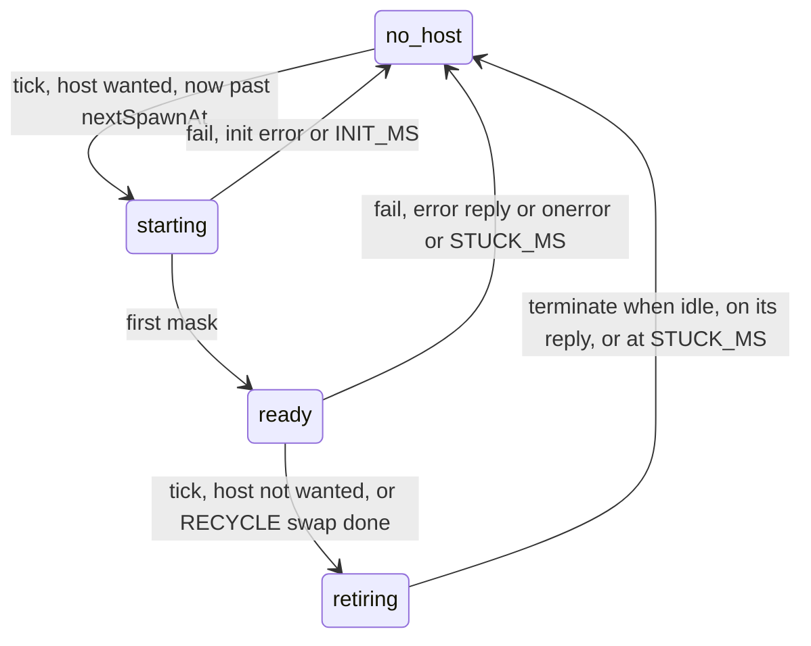

### K-1 closure (CP1 contract rev 2; built in S1.2b, shown in S1.4)
1. **What clears the busy mark.** `slot.inFlight` is cleared and its `pending` clone is closed on five events: the `mask` reply (today), an `error` reply, worker `onerror`, the watchdog, and a host stop. The middle three call one function, `fail(why)`.
2. **`fail(why)`** sets `cam.error = why`, terminates that host at once, and sets `nextSpawnAt = max(now, lastSpawnAt + RETRY_MS)`. `tick` spawns a host when one is wanted, none exists and `now ≥ nextSpawnAt`. That is at once after a first failure: the mask is back in ≈ 0.25 s (`initMs` 202 + `firstMaskMs` 51, ruling L461). After that it is at most once per `RETRY_MS` = 5000 ms. While no host is ready, frames take the raw upload path (the `base-cam` path), so the image never waits on a failed host.
3. **Watchdog thresholds**, checked in `tick(now)`. A host whose oldest unanswered request is older than its limit → `fail('stalled')`. The limit is `STUCK_MS` = 1000 ms per frame once that host has returned a mask, and `INIT_MS` = 10 000 ms from its spawn until then. 1 s is 89× the clip p95 (11.2 ms, F), 98× the live p95 (10.2 ms, L) and 11× the worst p95 ever logged (91.9 ms, no artifact). 10 s is 40× the measured start (253 ms). The init needs its own limit: under a 1-s limit a slow first compile on the PC ⚠️ would respawn forever. Both are `[R0]` knobs; the PC run checks them against its `initMs` and its slowest inference. `ponytail:` a wall-clock limit; a main-thread stall over 1 s can fail a healthy host, at the cost of one ≈ 0.25 s mask hold.
4. **Mask during the outage.** The EMA holds the last mask. If no good mask arrives within `STUCK_MS` of `fail()`, `resetMask()` runs (K-4): person layers go empty and `presence` goes to 0, so no frozen ghost stays on screen. The next good mask sets `cam.error = null`.
5. **Where the error shows.** `cam.error: string | null` is a contract field. The S1.4 overlay prints it on the camera line, beside the `NotReadableError` text: "Camera mask stopped (reason), retrying". A failed model fetch reads "Model missing: run `node scripts/models.mjs`" (K-12). Nothing is thrown in the loop (D7). Each failure logs one `console.warn`. The main-UI switch (Decision 1) shows the same state.
6. **Tests** (S1.2b Done; the overlay text in S1.4). A probe-only `&fault=` field in the worker's init message injects the failure; it goes when `?camprobe` goes. Source: the fake device (no loop wrap), ALIGN on. "The image holds" = every 1 s window keeps ≥ 80 % of `camSettings.frameRate` image uploads.
   - T1a `fault=throw@100` (frame 100 throws once): masks resume within 1 s; the image holds; `cam.error` is set, then null.
   - T1b `fault=hang@100` (the first host stops answering at frame 100): the image stalls once, for ≤ 1.1 s; masks resume within 2 s.
   - T1c `fault=dead` (every host throws on every frame), and once more with the model file renamed: after the first failure the image holds; `cam.error` stays set; the mask is empty and `presence` is 0 within 2 s; at most 1 `SegmentWorker` construction per 5 s over 30 s.

