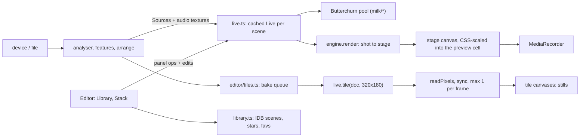
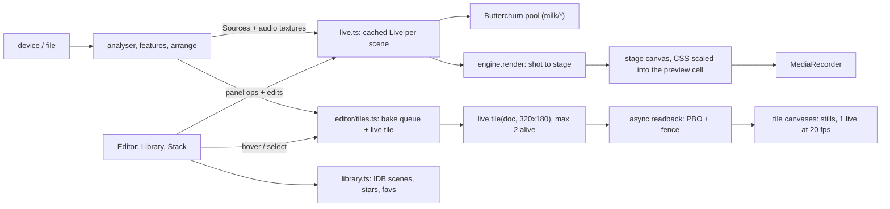
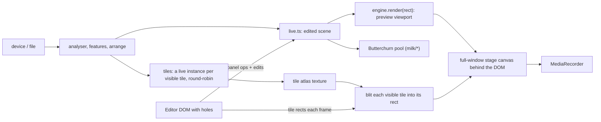

# Design — Effect editor (Stage 2b, epic `effect-editor`)

## TL;DR
- **Recommend Variant B.** A full-window editor (key `L`) CSS-scales the live stage into its preview cell. Render size, governor, bindings, Auto-style, flash gate and GPU hint stay exactly live, nothing is reallocated on enter/leave, and the autopilot is held.
- The library is DOM tiles: stills baked in-session by a small offscreen tile renderer in the same GL context (`live.tile()`), plus **one live tile** (hover/selected) read back asynchronously at 20 fps. Heavy natives take a size hint: a tile's ring is 1.8 MB instead of 62 MB, swarm/particles run 4096 points, and at most 2 tile instances are ever alive.
- The builder runs on the existing `panel` ops plus 5 mirrored ones. Undo = inverse steps recorded inside `panel`, so no scene restarts. Bool/event binding controls go into the shared `Param` (the E panel gets them too), with a rising-edge fix for bound events.
- New blocks: own ISF `bars` (4 shapes), the bundled `isf/Pixellate`, own `mosaic` and `led-grid`, a ported `ASCII Art`; all bound per the 2d policy; 3 new built-ins. No SceneDoc change; favourites in localStorage. **4 CPs / 14 steps.**
- Runner-up: **A** (B without the live tile). **C** (one backdrop canvas, every tile live) costs live-render-path surgery and scroll lag for a nicety.

## Freshness
- 2026-11-05, worktree at `3a697b6` (Stage 2d done; kick-fix step running, STATE HEAD).
- Inputs:
  - `thoughts/spec_effect_editor.md` (all, §1–§5)
  - `agents/research/research_effect_editor.md` §1–§7 (2026-11-04, code `62a540d`, pre-2d)
  - `agents/system-designer/design_effects.md` L60–130 (E1, E2)
  - `agents/planner/plan_td_look.md` L28–63 (CP1–CP4 contracts)
  - `agents/system-designer/design_td_look.md` L51–110 (binding policy), L420–452 (ruling)
  - `agents/STATE.md` HEAD
- The 2d delta was read from code by symbol, not re-researched:
  - `gl/live.ts` (Live L26–34, node L117–137, bindInto L142–158, run L205–236, render L266–310, mirrors L324–343, restructure/panel L362–431, prepare L435–442)
  - `gl/engine.ts` L16, L46, L80–135, L164–217
  - `edit.ts` exports · `doc.ts` L7–16, L94 · `ui/Panel.tsx` L17–26, L63–222 · `fx/types.ts` L5–14 · `fx/catalog.ts` L15–47 · `gl/scene.ts` L9
  - `scenes/history.ts` L22–24 · `scenes/points.ts` L18, L209, L303 · `scenes/particles.ts` L27 · `milkdrop/native.ts` L42, L85
  - `library.ts` L11–147 · `store.ts` L6–37 · `director.ts` L8–10, L112–117 · `app.ts` L64–107, L315–349

## Constraints
- **Scope (spec §2).**
  - §2.1: an editor screen in the same app (library | preview | builder), toggled by a hotkey and a bar button; autopilot paused; the preview runs on the current input with live bindings.
  - §2.2: a library of every block kind with previews, kind/category filters, name search, favourites, and try-a-block.
  - §2.3: a builder on SceneDoc v1 (≤4 layers; gen + 0..N fx; blend, opacity, speed, res).
    - Add by drag or button; reorder by drag; remove, duplicate, mute, solo.
    - Binding controls for every bindable param, bool included, with a live meter.
    - Undo/redo; GPU hint; save, save as, star, export/import; a thumbnail on save.
  - §2.4: Bars (4 shapes), the pixel family (4), ≥2 new built-ins.
- **Acceptance (spec §4.1–4.6)** is mapped per variant below.
- **Spec §5 open questions:** tile previews and MilkDrop → S6; layout and preview target → S1; DnD → S8; undo → S3; donor candidates → S7; category metadata → S5.
- **Non-goals (§3):** node graph; second-window output (must stay unblocked); MIDI learn; several or formula bindings per param; timeline; text layers; bulk ISF import; camera (Stage 3); clip mixer (Stage 4).
- **Performance (§2.6):**
  - a 60 fps preview on the M4 with the library open;
  - the edited scene within the pilot budget (60A, governor on; a built-in ≤5 ms GPU p95 at 1728×1117, `design_effects` E2 L119);
  - live output unchanged (`spec_veejay_wizard` §7.5).
- **Licensing:** any licence, recorded (CLAUDE.md, spec §6). Ports keep author/URL/licence headers (spec §2.4).
- **2d rules:**
  - every new effect binds 2c sources (STATE L55);
  - brightness-on-hit only through a 0..1 input in `VJW_FLASH` (`design_td_look` L64);
  - the bass class binds `reese` (L430).

## Shared decisions (all variants)

### S1. Editor mode vs live mode
- **Flag:** `UiSnapshot.editor: boolean` (`store.ts` fields are only ever added, L6).
- **Toggle:** key **`L`** plus a button in the Overlay bar. `app.ts` already uses E, Esc, ←/→, Space, T, B, F, Q and R. ⚠️ Assumption, needs confirmation: `L`.
- **Enter:**
  - Close the E panel, remember the hold, then `director.setHold(true)` (the `setPanel` pattern, app.ts L85–94).
  - The edited scene stays `store.edited`, the current one.
  - While `editor` is on, the global keydown returns early for every key except `L`, so ←/→/Space/T can't cut away from the edited scene.
  - The editor's own listener owns Esc, Cmd+Z, Shift+Cmd+Z, Delete and Alt+↑/↓. The global listener skips modifier chords (L99) and focused inputs (L100); Cmd+Z inside a text field stays the browser's.
- **Leave:** restore the hold, and **don't cut**.
  - The scene just built plays until the autopilot's next switch, which lands on the playlist slot it left (`director.ts` L117).
  - Unsaved edits stay in `edit.docs` (dirty), as with the panel. Mute/solo reset.
- **Preview = the live stage, CSS-scaled** into the preview cell with `transform: translate(x,y) scale(k)`, driven by a ResizeObserver on the cell.
  - A transform leaves `clientWidth` alone. So `measure()` (app.ts L66–67), `setOutput`, the governor, ring sizes, Auto-style, the flash gate and `gpuMs` stay exactly live, and entering or leaving reallocates nothing.
  - A separate target is ruled out: natives draw through the engine's one `gl` (engine.ts L16), and `temps` are sized to the shots (L97–99, L131–135). A second surface would cost a copy every frame, or Variant C's render surgery.
- **`prepare()`** (app.ts L321) drops `director.peek()` while editing. Otherwise an unused next scene would be built ahead, and a ring scene costs 62 MB. One condition.
- **GPU while editing:**
  - One scene and no fades under the hold: ≤5 ms p95, against ≈10–11 ms for a live fade (E2).
  - Tiles add ≤~1.5 ms per bake slice, or ≈.3 ms for B's live tile (S6).
  - Total ≤~7 ms of 16.7. The governor stays on and sees the real frame.
- **React:**
  - `editor/Editor.tsx` mounts beside Overlay and Panel in `#ui` (`main.tsx`); both of those render null while `editor` is on.
  - `Panel.tsx`'s module-private `Fx`, `Param` and `Gpu` get exported and reused in the builder, made larger by CSS.
  - New components: `Editor` (layout and keys), `Library`, `Stack`.

### S2. Builder ops on the existing `live` mirror
The §5 pattern holds (STATE L16): a pure `edit.ts` op changes the doc, then `restructure()` (live.ts L362–368) mirrors the same op on the built `Live`, building or freeing only what it touched.

| Op | `edit.ts` (pure, tested) | `Live` mirror | Inverse |
|---|---|---|---|
| add fx at `at` | `addFx(d, l, n, at = len)` | build `fx[at]`, splice at `at+1` | removeFx |
| remove fx | `removeFx` → the removed node | exists (L328) | addFx(node, i) |
| move fx | `moveFx(d, l, from, to)` | splice node objects | moveFx(to, from) |
| replace gen | `setGen(d, l, n)` → the old gen | free `nodes[0]`, build | setGen(old) |
| add / duplicate layer | `insertLayer(d, layer, at)`, false at 4 | build, splice | removeLayer(at) |
| remove layer | `removeLayer` → the layer, false at 1 | exists (L336) | insertLayer(layer, i) |
| move layer | `moveLayer(d, from, to)` | splice `Layer` objects | moveLayer(to, from) |
| blend / value / binding | exist; `setValue(…, undefined)` deletes the key | exist | the old one |
| mute / solo | none: preview-only, never saved | `mute(l, on)`: `ok = !l.muted && …` (L282) | – |
- `ok` already gates both the fast path and the clear (L286–292), so a muted layer 0 needs nothing else.
- `addLayer(gen)` stays, as sugar over `insertLayer`.
- Moving an fx across layers is skipped: the spec asks for reorder within a stack. Add it when asked.
- `Live.read(p, key)` returns a bound input's last value, for the meter (S4).

### S3. Undo/redo
```ts
// web/src/undo.ts — pure, tested
export interface Step { undo(): void; redo(): void; key?: string; t?: number }
export const edits: { record(s: Step): void; undo(): boolean; redo(): boolean; clear(): void }
```
- **Inverse steps, recorded inside `panel`** (live.ts L375). Each action records its inverse from S2's table at the point where it has the data (the old value, the removed node). That one choke point covers both the builder and the E panel.
  - Coalescing: a step whose `key` matches the top step's, within 1 s, only replaces the top's `redo`. One slider drag is one step.
  - `edits` clears when `store.edited` changes (another scene is opened, or Save as cuts to the new id).
- **Rejected: doc snapshots.** `Live` has no replace-doc path (research §6). A structural undo would then dispose and rebuild the scene: feedback, RD and swarm restart, and a 62 MB ring re-allocates on every undo. That is the restart §5 removed. The inverses are S2 ops that drag-insert and duplicate need anyway.
- **Try a block** (spec §2.2) = the add op plus a *pending* mark. There is no separate try state.
  - Enter, or any other edit, keeps it. Esc = `edits.undo()`. Clicking another tile swaps it.
  - An effect is appended to the selected layer.
  - A generator goes on top as a new soloed layer, or, at 4 layers, replaces the selected layer's gen.

### S4. Bool/event bindings and the meter (closes the 2a gap)
- **The gap:** `Panel.tsx` L180–191 renders `bool` and `event` inputs without `bind`. The engine already evaluates them (`y >= .5`, live.ts L271).
- **Fix, in the shared `Param`** (builder and E panel): bool and event get `bind(x.name, 0, 1)`.
  - Their binding block shows source, amount (sensitivity: on when the source reaches .5/amount), release (hold) and an *invert* box (min/max = 1/0).
  - Attack, min and max stay hidden.
- **Root cause for events:** a bound event writes `true` only on the rising edge.
  - Implementation: a `held` flag on `Bound`, via a pure `level(type, y, held)` in `bind.ts`, used in the loop at L267–272.
  - Today a bound ISF event, e.g. `isf/Circular Feedback Mask` (L88), fires on every frame while the envelope is ≥ .5.
  - The natives' own edge detectors (`points.ts` L209/L308, `history.ts` L97) stay correct under this, and may be deleted.
- **Meter:** `Live.read`. A single rAF loop in the editor writes `<meter>` values through refs, so React never re-renders per frame.
- `color` stays unbindable. `point2D` binds per component, as today.

### S5. Library data
```ts
// web/src/editor/blocks.ts — pure, tested
export type BlockKind = 'generator' | 'effect' | 'scene'
export interface Block { id: string; name: string; kind: BlockKind; group: Category | 'milkdrop' | 'other'
  tags: readonly string[]; credit: string; scene: SceneDoc /* what its tile renders */; node?: NodeDoc /* what an add inserts */ }
export function blocks(catalog: ReadonlyMap<string, EffectDef>, scenes: readonly SceneDoc[]): Block[]
export function filterBlocks(all: readonly Block[], q: { kind?: BlockKind; group?: string; tag?: string; text?: string; favs?: ReadonlySet<string> }): Block[]
// web/src/fx/types.ts, EffectDef gains:  tags?: readonly string[]   // the raw ISF CATEGORIES, kept by isf.ts
// web/src/library.ts, beside the stars:  favs(): ReadonlySet<string>; setFav(id: string, on: boolean): void   // localStorage 'vjw.favs'
```
- **Derived, never stored.** Blocks come from the catalog and from `library` (built-in and user scenes).
  - Transitions are excluded.
  - Toys inside scene docs become generator blocks; their NodeDoc is what an add inserts.
  - `milk/*` → group `milkdrop`.
  - A scene tile opens that scene (`director.cut`, which works off-playlist: L112–117). Scenes are never inserted into another scene (YAGNI).
- **What a tile renders:**
  - a generator: one bare layer;
  - an effect: `REF → effect`, with `REF = native/tunnel` ⚠️ (moving and colourful; the coder may pick a better one by look).
- **Search:** case-insensitive substring over name, credit and tags. All filters AND, as in Synesthesia (research §7).
- **Favourites:** a Set of block and scene ids under `vjw.favs`, on the `vjw.stars` pattern (`library.ts` L11, L29–34).
  - Separate from the playlist star.
  - Not in the export file (YAGNI).
- **Why `tags`:** the spec's filter wants ISF `CATEGORIES` (§2.2), but `isf.ts` reduces them to one of 4 and drops the raw value (research §2).
  - Adding `"Pixel"` to the pixel files' CATEGORIES then makes the family a single tag.
  - The alternative, a 5th `Category`, would ripple into the panel's grouping (`Panel.tsx` L25).

### S6. Tile renderer and heavy natives
- **`live.ts` exports `tile(doc: SceneDoc, w: number, h: number): Live`.** It is the same `create()`, kept outside `cache` so `prepare()` never frees it. It differs in three ways:
  - Its own temps at w×h. Today `run()` uses the shared `temps` at the shots' size (L296, research §1 L25).
  - Its own flash-onset list, so a tile never spends the preview's WCAG budget. A 160×90 px tile is also under WCAG's 341×256 area.
  - Natives are created at the tile size. Layers with `res` < 1 scale with the tile through their own `small` target.
- **Contract:** `NativeDef.create(gl, size?: readonly [number, number])` (`gl/scene.ts` L9). `size` is the stage it draws for; the default is the drawing buffer, as today.
  - Users of `size`: the ring (`history.ts` L24), scatter's grid (`points.ts` L303), and swarm/particles N (`size ? 4096 : N`, L18 / particles L27).
  - Every other native ignores it, and the live path is unchanged.

| Block (tile 320×180 ≈ 3% of 1728×1117) | Live (measured, STATE) | As a tile (⚠️ estimate) |
|---|---|---|
| ring natives: rgba-delay, time-machine, slit-scan | ring 61.8 MB; own cost ≈.7–.9 ms | ring 160×90×32 = **1.8 MB**, ≈.05 ms |
| swarm / particles | 65 536 pts (swarm +22.4 MB, p95 4.13) | **4096 pts** ≈.1 ms (TF ≈25 µs per 1k pts) |
| scatter | 121k pts (4 px cells of the stage) | 3600 pts |
| milk/* (Butterchurn, one context each) | pool of 2 (`native.ts` L42) | one pooled visualizer per milk layer, resized to the tile (L85) |
| RD, td-feedback (multi-pass ISF) | 4.6 / 3.0–4.4 ms | ≈.15–.2 ms |
| simple ISF | .1–1.5 ms | ≈.02–.05 ms |
- **At most 2 tile instances are alive** (the bake and B's live tile). Rings stay in single-digit MB, and milk adds a handful of contexts against Chrome's 16. A grid of 30 live heavy instances never exists.
- **Bake, per tile:**
  1. Build the instance.
  2. Render K frames at dt 1/60 on the live Sources and audio textures. K = 1 when no node is a native or has a persistent pass; else K = 90.
  3. Read back, then dispose.
- **Bake scheduling:**
  - ≤6 tile-frames per rAF, and none on the rAF after a late frame (dt > 20 ms).
  - Visible tiles go first (IntersectionObserver).
  - A shader def waits for `programAsync` (engine L46) before its first bake, so no blocking compile reaches the preview. Natives were already compiled at Start, since every native has a starred built-in.
- **Bake cache:** a `Map<id, ImageData>` for the session. A scene re-bakes its tile on save, which is spec §2.3's thumbnail on save. The full library is ≈150 tiles, about 15–25 s in the background ⚠️ (G2).
- **Frame hooks:**
  - `tiles.frame(f, src)` runs right before `render()` in the app's frame, editor only.
  - Readback rows come bottom-up, so tile canvases get CSS `scaleY(-1)`.
  - Hover waits 150 ms before going live, so sweeping the mouse doesn't churn milk visualizers.

### S7. New blocks
All four new blocks are ISF, not natives. None needs TF points or a `sampler2DArray`, which is what natives are for (plan_td_look CP2/CP3).
- Own files are written by analogy to the TD/MilkDrop quality bar, with donor refs in their header.
- Ports keep their headers (`donor/ISF-Files`, MIT ©2018, research §4).

| Block | Implementation | Key inputs | `VJW_BIND` (2d class, a/r) | `VJW_FLASH` |
|---|---|---|---|---|
| Bars | own `fx/own/bars.fs`, generator. Pass 1 `levels` (PERSISTENT FLOAT 128×1: log bands from `audioFFT`, release = smoothing); pass 2 draws. Refs: FFT Color Lines, FFT Filled Waveform (VIDVOX) | `shape` {line, circle, mirror, wave (`audio`)}, `bands` 8–128, `gap`, `thickness`, `gain`, `colorA/B`, `hue`, `glow`, `smoothing`, `spin` | glow←kick 0/.15 · hue←snare 0/.3 · thickness←sub .05/.4 · spin←bar saw · smoothing←build 1/2 | glow |
| pixelate | bundled `isf/Pixellate` (VIDVOX): add `VJW_BIND` + the tag | cell_size, shape | cell_size←kick 0/.2 (cell jump) | – |
| mosaic | own `fx/own/mosaic.fs`, filter, 1 pass. Ref: Triangle Mosaic (VIDVOX) | `shape` {square, hex, triangle, diamond}, `cell`, `jitter`, `outline`, `outlineColor` | cell←kick 0/.2 · jitter←reese .05/.4 (bass class; Auto → wobble) · outline←hats 0/.08 | – |
| LED grid | own `fx/own/led-grid.fs`, filter, 1 pass. No donor; refs: RGB/CMYK Halftone (zoidberg) | `cell`, `dot`, `gap`, `levels`, `off` (unlit floor), `glow`, `round` | dot←sub .05/.4 · glow←kick 0/.15 · levels←build 1/2 | glow |
| ASCII | port `ASCII Art.fs` → `fx/isf/` (VIDVOX, from Shadertoy `lssGDj`, see G3) + `VJW_BIND` + the tag | size, gamma, tint (bool), tintColor | size←kick 0/.2 · gamma←build 1/2 · tint left unbound (the user's bool test) | – |
- All four pixel files carry CATEGORIES `"Pixel"`. Ranges and a/r get tuned on the arr fixtures, as in CP4 of 2d.
- **Built-ins (3; the spec asks ≥2):** one Bars scene, one LED-grid scene and one ASCII scene, with mosaic in one of them.
  - Each ≤5 ms GPU p95 (E2), starred, bound per the policy; composed by look in S4.4.
  - `isf/Pixellate` already plays in `pixel-strobe`.

### S8. Drag and drop
- **Native HTML5 DnD, no dependency.**
  - Tiles are `draggable`, with `dataTransfer` type `application/x-vjw-block` = the block id.
  - Layer and fx rows are drop targets. Each computes the insert index from pointer Y against row midpoints and shows an insert line. Reorder uses the same events.
- **Keyboard path:** a `+` button on every tile (adds to the selected layer, or as a new layer), and Alt+↑/↓ to move the selected layer or fx. Native DnD has no keyboard drag (MDN, research §5).
- **Existing drop handlers:**
  - The document's audio drop returns early when a drop carries no files (research §5).
  - The Panel, with its JSON drop, is unmounted in the editor.
- **Rejected:**
  - `@dnd-kit/core` + `sortable`: MIT, ≈18 kB gz, last release 2024-12.
  - `@dnd-kit/react`: pre-1.0.
  - pragmatic-drag-and-drop: Apache-2.0, native DnD underneath; its a11y package is flagged deprecated ⚠️.
  - Add one if animated sorting is asked for.

### S9. Storage and migration
- **SceneDoc v1 is unchanged.** Every op yields what `parseScene` (`doc.ts` L94) already accepts: ≤4 layers, any fx count, a binding on any input key, bool and event included. So there's no migration and no `v` bump, and `LibraryFile` and the export stay as they are.
- **New:** localStorage `vjw.favs`.
- **Session-only:** the tile cache, `edits`, mute/solo.
- **Later:** persist thumbnails in an IDB store `thumbs` (DB `vjw` v2, `library.ts` L121) once the first-open bake annoys.

### S10. Test strategy (spec §4.6)
- **Vitest, pure:**
  - `edit.ts`: insert-at, moves, `setGen`, the insert/remove return values, the limits 1 and 4.
  - Every S2 op: apply → inverse → `toEqual` the original doc.
  - `edits`: undo/redo, redo cleared by a new step, coalescing by key within 1 s.
  - `blocks`: every non-transition def once, the milk group, toys from scenes, user scenes. `filterBlocks`: kind, group, tag, text, fav, ANDed.
  - Favourites through the kv stub: a reload keeps them; a corrupt value → empty.
  - `isf.ts` keeps `tags`.
  - `level()` edge.
  - `ringSize` and the scatter grid at tile size.
- **Browser, one check per step (the lead's Playwright pattern):**
  - Enter/leave: no realloc, the autopilot resumes.
  - A scene built end to end.
  - A bool bound to `kick` toggles.
  - Undo works through every op.
  - Every tile kind bakes.
- **CP close-outs:**
  - 60 s late-frame run with the library open, the bake running and the live tile on a ring native, then on swarm → 0 late.
  - 60 s live-mode run on `dnb174-arr` and `dubstep140-arr` → 0 late (§7.5 unchanged).
  - The new blocks' reaction check, plus a contact sheet.

## Variant A — Stills only (the simplest that meets §4)
**Summary.** S1–S10, with stills-only tiles.
- The bake reads back synchronously: `readPixels` into a CPU array, at most 1 per rAF, before `render()`, so it waits mostly on the tile's own work.
- Hovering shows the still. A click tries the block live in the big preview (S3).

- **Files (`web/src/`):**
  - New: `undo.ts`, `editor/{Editor,Library,Stack}.tsx`, `editor/{blocks,tiles}.ts`, `editor/editor.css`, `fx/own/{bars,mosaic,led-grid}.fs`, `fx/isf/ASCII Art.fs`.
  - Edited: `edit.ts`, `gl/{live,scene}.ts`, `scenes/{history,points,particles,builtin}.ts`, `fx/{types,isf}.ts`, `fx/isf/Pixellate.fs`, `library.ts`, `store.ts`, `app.ts`, `main.tsx`, `ui/{Panel,Overlay}.tsx`, THIRD_PARTY.
- **Contracts:** S2–S6, plus `tiles: { frame(f: FrameInput, s: Sources): void; get(id: string): ImageData | undefined; invalidate(id: string): void; onChange(cb: () => void): () => void }`.
- **Reuse:** the `panel` ops and mirrors, `Fx`/`Param`/`Gpu`, the `vjw.stars` pattern, `programAsync`, `renderTarget`, and ISF-Files (MIT) per S7. No new npm dependency.
- **Acceptance:**
  - 4.1: S1.
  - 4.2: S5 and the stills.
  - 4.3: S2–S4, plus the existing `panel.save/saveAs/toggleStar`.
  - 4.4: S7.
  - 4.5: S1 (one held scene) and the bake budget.
  - 4.6: S10.
  - **Deviation:** spec §2.2's default "the hovered tile animates live" is not met; the try in the preview stands in for it.
- **Roadmap:**
  - The stage stays the only output and the editor never owns it, so a second window (via `captureStream` or Electron) isn't blocked.
  - A camera (Stage 3) is one more native generator block.
  - The scene tiles are Stage 4's clip browser.
  - Electron keeps IDB and localStorage.
- **Risks:** the sync `readPixels` cost on ANGLE-Metal is unknown (G1). The library feels static.
- **Effort:** L (13 steps).

## Variant B — Stills + one live tile (recommended)
**Summary.** A, plus the hovered or selected tile runs a `tile()` instance every frame.
- It is read back **asynchronously** every 3rd frame (20 fps): `PIXEL_PACK_BUFFER` + `fenceSync`, polled with `clientWaitSync(…, 0)`, then `getBufferSubData` (the MDN pattern, research §3).
- Bakes use the same path, so nothing stalls.
- When the hover leaves, the tile's last live frame becomes its still.

- **Files, reuse:** as A. No new npm dependency.
- **Contracts:** A's `tiles`, plus `hover(id: string | null): void`.
- **Acceptance:** as A, and spec §2.2's live hovered tile is met. For 4.5, the live tile adds ≈.1–.3 ms per frame (S6), and the bake stays within ≤6 tile-frames per rAF.
- **Roadmap:** as A. The async readback also serves a later tile recording or thumbnail export.
- **Risks:**
  - G1: fence latency on ANGLE-Metal. The live tile lags ≥1 frame, which is invisible at 20 fps. Fallback: A's sync path before `render()`.
  - Milk churn on hover: covered by the 150 ms delay.
- **Effort:** L (14 steps; about 30 lines more than A).

## Variant C — One backdrop canvas, every visible tile live
**Summary.** The stage stays full-window behind an editor DOM with transparent holes (webgl2fundamentals' multiple views, research §3). Each frame:
- The edited scene renders into the shots at the preview rect's size and is copied into that rect.
- Visible tiles keep live `tile()` instances, updated round-robin at about 10 fps each.
- Each tile's last frame is blitted from an atlas into its rect, scissored to the library's scroll box.
- Milk tiles stay stills: each needs its own context, and 25 visible would pass Chrome's 16.

- **Files:** A's, plus `gl/engine.ts` (a destination rect for `render()`; `setOutput` gives the shots a size separate from the canvas). `editor/tiles.ts` gains the atlas and the per-frame rects (`getBoundingClientRect` of each visible tile).
- **Contracts:** `render(shot, f, src, styled, post, rect?: readonly [x: number, y: number, w: number, h: number])`; `setOutput(w, h, scale, shots?: readonly [number, number])`.
- **Acceptance:** as B, with every visible non-milk tile slowly live (spec §2.2's "slowly refreshing" option).
- **Roadmap:** as A. The backdrop could host a multi-view monitor later, which no spec stage asks for.
- **Risks:**
  - It changes the live render path, which is §7.5's regression surface.
  - Canvas tiles lag DOM scrolling by a frame, so they swim.
  - About 30 live instances to build, feed and free while scrolling.
  - The preview renders at the preview's size, so the GPU hint and the governor no longer read the live cost.
- **Effort:** L+ (~17 steps).

## Comparison
| | A: stills | **B: stills + 1 live** | C: backdrop |
|---|---|---|---|
| Hovered tile animates (spec §2.2 default) | no; try in the preview | **yes, 20 fps** | every visible tile ~10 fps; milk stills |
| Live-path change | `tile()`, size hint, event edge, mute | same | + `render(rect)`, `setOutput` split |
| Readback | sync, ≤1 per frame | async, never stalls | none |
| Tile instances alive | 1 | ≤2 | ~30 |
| Preview at live size; GPU hint honest | yes | yes | no |
| Scrolling | DOM-native | DOM-native | the canvas lags a frame |
| Unknowns | G1 (sync) | G1 (async) | scroll sync; live-path regression |
| Effort | L, 13 steps | L, 14 steps | L+, ~17 steps |

## Recommendation
**Variant B.** It is A, the simplest thing that meets §4, plus the one `(default)` that A drops: the hovered tile animates live. That costs about 30 lines and one readback probe, and it makes every readback in the system stall-free.

The design leans on what already exists:
- The live stage is the preview, through a CSS transform. The budget, bindings, Auto-style, flash gate and GPU hint come along as the live ones, for free.
- The builder runs on the `panel` ops and the §5 per-op mirror. Undo is inverse steps recorded at that one choke point, so nothing ever restarts.
- Tiles reuse `create()` with a size hint. That turns the brief's 62 MB-per-ring problem into 1.8 MB and caps the system at 2 tile instances.

C's all-live grid is not worth surgery on the live render path plus scroll lag.

**Runner-up: A.** Take it only if the G1 probe shows async readback misbehaving on ANGLE-Metal.

## Checkpoints for the planner (Variant B: 4 CPs / 14 steps, one coder per step)
**CP1: Builder core, no new screen (S1.1–S1.3).**
- **Frozen contracts:** S2's `edit.ts` signatures; `undo.ts`; `bind.ts` `level()`; and on `Live`: `addFx(l, at?)`, `moveFx`, `setGen`, `addLayer(at?)`, `moveLayer`, `mute`, `read`.
- **Demo:** in the E panel, bind the strobe's bool to `kick` and it toggles on kicks. An event bound to `snare` fires once per hit.
- S1.1: `edit.ts` ops + `undo.ts` + Vitest (pure).
- S1.2: the `Live` mirrors, and `panel` actions recording inverse steps. Browser check: E-panel structural edits still don't restart the scene.
- S1.3: the bool/event bind UI in `Param`, the event rising edge, and the `Live.read` meter (E panel first).

**CP2: Editor screen + builder (S2.1–S2.4).**
- **Frozen contracts:** `UiSnapshot.editor`; `Fx`/`Param`/`Gpu` exported.
- **Demo:** `L` opens the editor. Build a scene, reorder, bind, undo, Save as and star it. `L` again, and it plays in the autopilot.
- S2.1: the `editor` flag, `L` + the bar button, hold/restore, the key guard, `prepare` without peek, and the layout with the stage CSS-scaled; Overlay and Panel hidden.
- S2.2: `Stack`.
  - Layers: select, add/duplicate/remove, mute/solo, blend/opacity/speed/res.
  - Fx rows, and params through `Fx`, with meters, `Gpu` and node errors.
  - Keys: Cmd+Z, Shift+Cmd+Z, Delete, Alt+↑/↓.
- S2.3: native DnD reorder of layers and fx. Until CP3, the add buttons use today's picker lists (Panel L23–26).
- S2.4: the editor header: New (one layer of `native/spectrum`), open, Save / Save as / star, export/import.

**CP3: Library + tiles (S3.1–S3.3).**
- **Frozen contracts:** `blocks.ts`, `EffectDef.tags`, `library.favs/setFav`, `tile()`, `NativeDef.create(gl, size?)`, `tiles.ts`.
- **Demo:** with the library open, filters, search and favourites survive a reload; every tile shows a still; the hovered tile moves; Esc takes a tried effect back; 0 late frames.
- S3.1: `blocks.ts`, `tags` in `isf.ts`, favourites, and the `Library` grid with placeholders. A tile click, drag or `+` adds the block; try = pending + Esc.
- S3.2: `tile()` (own temps, own flash list), the size hint in history/points/particles, and the bake queue with async readback and `programAsync` gating. Probes G1 and G2.
- S3.3: the live tile (hover/select, 20 fps); its last frame becomes the still; a scene re-bakes on save. CP close-out: the 60 s late-frame run with the library open.

**CP4: New blocks (S4.1–S4.4).** It depends on nothing in CP1–3, so the lead may run it first.
- **Frozen contracts:** S7's inputs and `VJW_BIND`.
- **Demo on `dnb174-arr`:** the bars' glow pulses on kicks (≤3/s), mosaic jitters on the reese, the LED dots swell on the sub, and the ASCII cells jump on kicks.
- S4.1: `own/bars.fs`.
- S4.2: `isf/Pixellate` binding + tag, and `own/mosaic.fs`.
- S4.3: `own/led-grid.fs` and the `ASCII Art` port.
- S4.4: 3 built-ins, THIRD_PARTY, the reaction check and a contact sheet. CP close-out: a 60 s live run on both arr fixtures.

## Research gaps
- **G1:** the cost and latency of sync `readPixels` vs async PBO+fence readback at 320×180 on Chrome 156 / ANGLE-Metal. Research §3 found no number. S3.2 measures it, and the result decides B vs A.
- **G2:** the full-library bake time, and the memory of ~150 tile canvases (≈34 MB estimated). S3.2 measures both.
- **G3:** the licence line on Shadertoy `lssGDj`, the source of the ASCII Art port (research §4 ⚠️). Any licence is allowed, but the header must name it. The S4.3 coder reads it off the page, or the researcher if the lead prefers.
- **G4:** whether `native/tunnel` reads well as the source under effect tiles. Judged by look in S3.2.

## Decision needed
1. Variant: **B** (rec.) / A / C.
2. Undo: inverse steps recorded in `panel` (rec.), or doc snapshots with a scene rebuild on structural undo.
3. Try = add + pending mark + Esc/undo, with no separate try state (rec.).
4. Mute/solo: preview-only, not saved in the doc (rec.).
5. Editor key: `L` (rec.).
6. Thumbnails: session-only (rec.), or persisted in IDB now.
7. ASCII: port the donor `ASCII Art.fs` (rec.), or write our own glyph shader.
8. CP order: 1→4 (rec.), or CP4 (blocks) first for new looks in the autopilot sooner.
