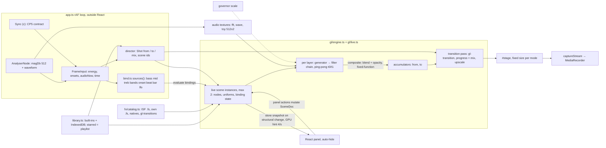
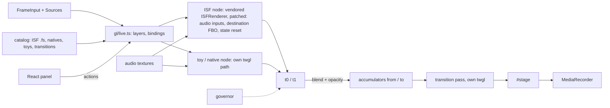
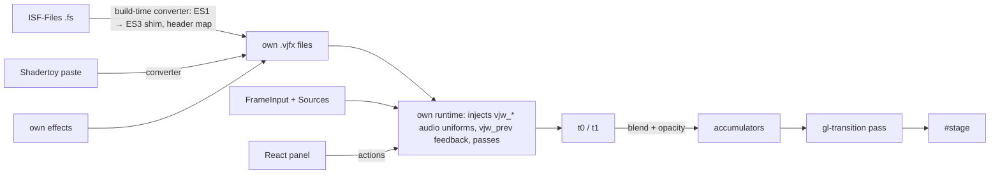

# Design — Stage 2a "Many effects" (epic `effects`)

## TL;DR
- A scene becomes a **`SceneDoc` (JSON v1)**: up to 4 layers, each a generator, a filter chain, a blend mode and an opacity. Built-ins use the same format. Every effect node exposes ISF-style typed `inputs`, and any numeric input can carry one **binding** (source → amount → attack/release → range). Bindings are evaluated per frame in the loop, never in React.
- **Compositor:** two scene accumulators (from/to) plus two shared ping-pong temps. Blend modes use fixed-function GL blending, and the engine's old crossfade pass becomes a **gl-transitions pass** straight into `#stage`. Feedback buffers are half-float ping-pong pairs that are resampled, not cleared, when the governor changes scale.
- **The variants differ in the effect runtime:**
  - **A (recommended, simplest):** our own small ISF loader on twgl, with header parsing and the GLSL ES 1.00 prefix ported from the official parser (MIT).
  - **B:** vendor the official `interactive-shader-format` runtime and patch it.
  - **C:** our own Synesthesia-like format, with ISF and Shadertoy converted into it.
  - In all three, Shadertoy paste, gl-transitions and the 4 pilot scenes (now native generators) use the same small twgl paths.
- **Effect sourcing:** curated ISF-Files (MIT) for filters and retro, our own ISF `.fs` files for feedback, 3D and liquids, and 12 gl-transitions (MIT). A `?bench` mode gates every effect on compile, errors and a 5 ms/scene GPU budget.
- **Gate:** the variant (Q1) and confirmation of the §4.1 counts (Q2). Everything else is a marked `(default)`.

## Freshness
- Written 2026-10-28. Inputs:
  - `agents/STATE.md` HEAD (session 3).
  - `thoughts/spec_effects.md` TL;DR, §1–§5 (all).
  - `thoughts/spec_veejay_wizard.md` §5 (locked stack), §6 (any license; keep headers).
  - `agents/research/research_editor_effects.md` §1–§7 (checked 2026-10-28).
  - `agents/system-designer/design_pilot.md` S1, S3, S4, S8, Variant A (rev 3).
  - `agents/planner/plan_pilot.md`: the "Changed during implementation" notes under S1.5, S3.1–S3.7, S4.1–S4.2.
- Code read 2026-10-28 (read-only): `web/src/gl/engine.ts`, `gl/scene.ts`, `gl/bloom.ts`, `app.ts`, `director.ts`, `frame.ts`, `quality.ts`, `scenes/tunnel.ts`.
- **CP5 is being coded in parallel.** Only the S8 `Sync` contract is used (`bpm`, `beat`, `bar`, `confidence`). `app.ts` still passes `ZERO_SYNC`.

## Constraints
- **Scope (spec_effects §2):**
  - Layered scenes: ≤4 layers `(default)`; generator + 0..N filters + blend (normal/add/screen/multiply) + opacity.
  - Typed params with automatic controls; one binding per param.
  - Sources: ISF, gl-transitions, Shadertoy paste, own effects in 4 categories.
  - A slider panel over the output; IndexedDB + JSON export/import; a star marks playlist scenes.
  - A per-scene GPU hint `(default)`.
- **Acceptance (spec_effects §4):**
  1. ≥30 effects/generators across 4 categories + ≥10 gl-transitions, running in the autopilot with no console/GL errors (counts ⚠️, Q2).
  2. 4 layers + chains + blend; save, reload, export/import JSON.
  3. Bindings visible in motion and surviving save/load.
  4. A pasted single-pass Shadertoy works as a generator.
  5. 60A holds on the M4 as in pilot §7.5: 30-min run, `drops(31:00) − drops(1:00) ≤ 30` (STATE).
  6. Gates pass; Vitest on bindings math, LFO, (de)serialisation and ISF header parsing.
- **Non-goals (spec_effects §3):** the drag-and-drop editor (2b), a node graph, expressions, MIDI, a second window, camera, clip mixer, Butterchurn, WebCodecs. Design keeps room for them and builds nothing for them.
- **Stack (spec §5):** Vite + React + TS, WebGL2 on **twgl.js 7** (chosen at the pilot gate), Web Audio, MediaRecorder, Chrome-first.
- **Licensing (spec §6):** any dependency license is allowed. Every ported shader file keeps an author/URL/license header, and `THIRD_PARTY.md` lists each source.
- **Built architecture that must not regress** (pilot Variant A, as implemented):
  - `app.ts` owns the rAF loop and builds one `FrameInput`.
  - The director is pure; `update()` returns the same `Shot`.
  - `engine.render(shot, f)` draws `shot.from` into FBO A and `shot.to` into FBO B. The scenes draw "into whatever is bound" and save/restore `FRAMEBUFFER_BINDING`. A final pass mixes and upscales into `#stage`.
  - The scenes import the engine, so app.ts fills an engine-side registry (S1.5).
  - `renderTarget(hdr)` with `fit(w,h)`; `createBloom` is per scene.
  - The governor scales the internal size in [0.6, 1] in 60A only. The output size is frozen during REC.
- **Measured headroom on the M4 (plan_pilot S3.x, S4.2; STATE):**

  | Measurement | Result |
  |---|---|
  | Single scene at 1200×800, GPU time | tunnel 0.61 ms, glitch 1.04, spectrum 1.1–1.9, particles 3.5 |
  | Crossfade GPU p95 at 60A | 6.2 ms (1440×932), 9.3 ms (1728×1117) |
  | spectrum→particles at 1728×1117 | 4.1 + 5.6 ms median, p95 ≈ 12 |
  | Worst GPU at 60A fullscreen | 9.7 ms, 0 drops |
  | 60F at 3456×2234 | p95 21 ms with 0 late frames over 90 s (Apple pipelines frames) |
  | Drops after a size change | 60F dropped frames right after `Q` (likely cause: reallocating 4×-size targets; not traced) |

## Shared decisions (all variants)

### E1. Generators: how the 4 pilot scenes join without regressions
- **The pilot scenes stay native TypeScript generators.** Particles uses transform feedback, and spectrum/particles run their own HDR targets + bloom, so they are not shader files.
- **Contract change:**
  - `Scene`/`SceneFactory` become `NativeDef { …EffectDef, create(gl) → Native }`, with `Native.draw(f, values)` drawing into whatever is bound, as today.
  - Each module's `export const params` becomes `export const inputs: Input[]` (ISF-style). Each `default` equals today's `params` value, and `draw` reads `values` instead of the module object.
  - `name` moves into the built-in `SceneDoc`.
- **Per-layer instances:** `create(gl)` runs once per live layer, so two particle layers simulate independently.
  - The engine memoises compiled programs by source (`program(vs, fs, opts)` used by `fullscreenProgram`). A second instance then costs only its buffers and targets.
- **No import cycle (S1.5 rule):** the scene modules still import the engine. `fx/catalog.ts` imports the 4 modules and is imported by `app.ts`, replacing the `scenes` registry.
- **Built-ins:** `builtin:tunnel|spectrum|particles|glitch` are one-layer docs (`gen: native/<name>`, no fx, normal, opacity 1). They lead the default playlist in today's order.
- **Fast path = no regression:** when a scene's first layer is `normal`, opacity 1, `res` 1, its last pass draws straight into the scene accumulator instead of a temp. The 4 built-ins therefore keep today's render path and cost.
  - Check: the lead's Playwright run repeats the S3 numbers within ±10 % with 0 GL errors ⚠️.
- **Layer clock `(default)`:** each layer has a bindable `speed` (0..4, default 1).
  - Shader nodes get `TIME`/`iTime` as layer-local warped time from instance creation.
  - Natives get a per-layer copy of `FrameInput` with warped `time`/`dt`: one reused object per layer, no allocation.
  - This gives "audio drives the speed of motion" (Resolume `+`/`−`, Synesthesia `speed`, research §6) without editing shaders.

### E2. Layer compositor, FBO budget, persistent buffers, GPU cost
**Per frame, for each active scene (at most 2, during a fade):**
1. Clear the accumulator.
2. For each layer: the generator renders into `t0`. Filters ping-pong `t0↔t1`. The last texture is composited onto the accumulator by one composite program.
3. After both scenes: one **transition pass** renders into `#stage` at the output size, sampling `accFrom`/`accTo` with linear filtering (this is the upscale). That is the existing final pass, generalised (E7).

**Blend modes `(default)`.** The composite shader pre-scales the source; blending is fixed-function, so no extra FBO:

| Mode | Shader output | `blendFunc` | Result |
|---|---|---|---|
| normal | `(rgb·a·op, a·op)` | `ONE, ONE_MINUS_SRC_ALPHA` | alpha-over × opacity |
| add | `rgb·op` | `ONE, ONE` | `dst + op·src` |
| screen | `rgb·op` | `ONE_MINUS_DST_COLOR, ONE` | `1 − (1−dst)(1−op·src)` |
| multiply | `1 − op + op·rgb` | `DST_COLOR, ZERO` | `dst · mix(1, src, op)` |

**FBO budget at internal size (base × scale):**

| Target | Count | Format | Owner, lifetime |
|---|---|---|---|
| Scene accumulators | 2 total | RGBA8 | engine; today's `shots` |
| Chain temps `t0`, `t1` | 2 total, shared by all layers of both scenes | RGBA8 | engine |
| Generator with `res < 1` | 1 per such layer | RGBA8 at size × res | live instance |
| ISF pass `TARGET` | 1 per target | RGBA8, or RGBA16F if `FLOAT` | live instance |
| ISF `PERSISTENT` target | 2 per target (ping-pong; a pass reading its own target can't write it) | RGBA16F for own feedback effects, else per `FLOAT` | live instance; resampled on resize |
| Native internals (spectrum, particles: 1 HDR + 4 bloom + 1 out) | as today | RGBA16F | per native instance |
| Shadertoy, transition | 0 extra | — | single pass; the transition draws into `#stage` |
| Audio textures | 3 tiny (E3) | R8 | engine |

- **Memory:** one RGBA8 target is 5.4 MB at 1440×932; RGBA16F is 10.7 MB. At 60F (2880×1864) multiply by 4. A heavy two-scene fade with 3 persistent targets each is ≈130 MB at 60A and ≈0.5 GB at 60F, which unified memory can hold ⚠️.
- **Persistent buffers vs the governor `(default)`:** `renderTarget(hdr, persistent)`. On `fit()` with a new size, a persistent target allocates the new texture, **resamples** the old content into it with the existing copy pass (linear), then frees the old one. Trails survive a 0.85× step with no visible pop. Transient targets refit as today.
  - A persistent target starts cleared on instance creation, and its content is dropped when its scene's instance is disposed. Feedback restarts on the next visit, which reads naturally.
- **Allocation hitches `(default)`:**
  - **Prepare ahead:** right after each fade completes, the director's next scene is instantiated and fitted, and the outgoing one is disposed. Allocation then lands mid-scene, never inside the two-scene fade.
  - Manual `←` can't be predicted, so it instantiates on demand: at most one hitch per press, accepted.
  - A target pool is added **only if** the S-probe (Research gaps G2) shows late frames around allocation. The 30-min run allows ≤30 drops and has ~60 switches, so one drop per switch would fail. That is why it gets measured first.
- **Shader compile hitches (must-do):**
  - A blocking compile mid-show costs several frames, and over ~60 switches that fails §7.5. So **every program of the starred scenes and the transition set compiles at Start**, behind the existing Start click with a "compiling n/N" line. The program cache is keyed by source.
  - Use `KHR_parallel_shader_compile` when present (G1).
  - Only panel edits that add a not-yet-compiled effect compile mid-show. That is an edit action, accepted.
- **GPU cost model on the M4 at 60A** (simple-pass costs are ⚠️ estimates extrapolated from tunnel's 0.61 ms at 0.96 Mpx):
  - **Budget `(default)`, knob:** each built-in scene ≤ **5 ms GPU p95 at 1728×1117, scale 1**. A fade of two is then ≈10–11 ms, the pilot's measured worst (9.7–12 ms).
  - **Estimated pass costs:**
    - A simple fullscreen filter (colour, mirror, kaleido, composite) ≈0.1–0.5 ms.
    - Bloom ≈0.5–1 ms.
    - An ALU-moderate generator (tunnel, glitch class) ≈1–1.5 ms.
    - Raymarchers 3–10+ ms.
  - **Levers:**
    - The per-layer generator `res` factor (0.25–1, `(default)` 1). Built-in raymarchers ship at 0.5–0.75 and are composited with linear upscale.
    - ISF `PASSES` `WIDTH`/`HEIGHT` expressions do the same inside a file.
    - The governor floor 0.6 (area 0.36) absorbs imported heavy shaders (spec §2.5).
  - **JS cost:** bindings plus `setUniforms` for ≤2×4×N nodes is ⚠️ ≈0.5–1.5 ms. That keeps the governor's GPU-bound test (median JS < 10 ms) valid.
- **Per-scene GPU hint `(default)`:**
  - A timer query around each live scene's render, with a small query ring because results arrive late.
  - The panel shows `GPU 3.1 ms`, coloured against the budget. With no `EXT_disjoint_timer_query_webgl2`, it shows nothing (G3).
  - The same measurement drives `?bench` (E8).

### E3. Parameters, bindings, audio texture
- **Typed params** come from ISF `INPUTS`: `float, long, bool, event, color, point2D, image, audio, audioFFT` (research §1). Panel controls:

  | Input type | Control |
  |---|---|
  | float | range slider (MIN/MAX/DEFAULT) |
  | long | `<select>` (VALUES/LABELS) |
  | bool | checkbox |
  | event | button |
  | color | `<input type=color>` + alpha slider |
  | point2D | two sliders |
  | `inputImage` | the chain input, no control |
  | audio, audioFFT | auto-fed (below), no control |
  | other `image` | unsupported in 2a; such files are excluded at curation |

- **Binding model** (research §6: source → band → gain → fall → range/direction). One binding per param (spec §2.2):
  - **Normalise the source to 0..1 (knob table in `bind.ts`, `(default)`):**

    | Source | Mapping to 0..1 |
    |---|---|
    | bass, mid, treb | `clamp(att.x / 2)` (1 ≈ average → 0.5, MilkDrop convention) |
    | band*i* (32) | dB window −75…−15 with +1 dB/band tilt (spectrum's mapping) |
    | onset | `clamp((strength − 1.5)/2.5) · exp(−age/0.12 s)` (the pilot scenes' mapping; age clamped at 0 for line-in) |
    | beat, bar | `shape(fract(count · rate)) · confidence` (× confidence is the pilot S8 convention; 0 until CP5 is wired) |
    | lfo | `shape(fract(time · rate))`; shapes are sine/tri/saw/square/random (sample-and-hold per cycle) |

  - **Then:** `y = clamp(amount · x)`, smoothed by a one-pole with τ = `attack` when rising and `release` when falling. It is fps-independent (`1 − exp(−dt/τ)`).
  - **Output:** `min + (max − min) · y`. Setting `min > max` inverts the direction.
  - **Defaults:** amount 1, attack 0, release 0.15 s, range = the input's MIN..MAX, shape saw for beat/bar and sine for lfo, rate 1.
  - **Bindable targets `(default)`:**
    - float, and `long` (rounded);
    - `bool`/`event` (on at ≥ 0.5, so an event fires on hits);
    - one vector component addressed as `name.i` (point2D, color). This meets "any numeric parameter".
    - The layer's `opacity` and `speed`.
- **Per-frame evaluation outside React:**
  - `sources(f, out)` runs once per frame in app.ts, with no allocation.
  - Each live instance compiles its bindings at build time into a flat array of `{ uniforms, key, index, binding, state }`. Per frame it writes the results into the node's uniform object, which `setUniforms` then reads.
  - Edits from the panel mutate the doc's `values` in place, so they take effect next frame with no React render (E6).
- **Suggested bindings `(default)`:** our own effect files may carry an extra JSON key `VJW_BIND`, e.g. `{"burst": {"source": "onset", …}}`. It is applied when the effect is added from the list. Other ISF hosts ignore unknown keys, so the files stay valid ISF.
- **Audio textures `(default)`:**
  - **Source:** `app.ts` already reads `magDb` (512 bins, 1024-point analyser) and adds `getFloatTimeDomainData` for the waveform. `engine.setAudio(magDb, wave)` uploads three R8 textures per frame, ≈2 KB in total.
  - **For ISF:** `fft` 512×1 and `wave` 512×1. ISF feeds `audio`/`audioFFT` as images with one row per channel (research §1). We give 512 columns whatever `MAX` says ⚠️.
  - **For Shadertoy:** `toy` 512×2, row 0 FFT and row 1 waveform, on `iChannel0` (layout ⚠️ unverified, research §3; G5).
  - **Scaling:** FFT bytes use a −100…−30 dB window, waveform bytes are `0.5 + 0.5·sample` ⚠️.

### E4. Scene data model and storage
- **`SceneDoc` v1** (contracts in each variant): `{ v: 1, id, name, star, layers[1..4] }`. Each layer is `{ gen, fx[], blend, opacity, speed, res, bind? }`, and each node is `{ ref, code?, credit?, values?, bind? }`.
  - `values` holds only overrides of the defaults, which keeps docs small and lets effect-default changes flow into old scenes.
  - **Pasted shaders are inline** (`code`), so one scene JSON is self-contained and portable. No separate shader store.
- **Versioning:** `v: 1`. An import with another `v` is rejected with a message. There is no migration framework until a v2 exists.
  - The likely v2 triggers are several bindings per param, or the 2b graph.
- **Validation at the trust boundary:** `parseScene`/`parseLibrary` (pure, tested) check:
  - shape, finite numbers, layer count 1..4, known blends;
  - `code` length ≤ 64 KB `(default)`.
  - An unknown `ref` keeps the layer but renders black, with a panel error. One broken effect never breaks a show.
- **Built-ins:** `scenes/builtin.ts` exports `SceneDoc[]` as JSON-compatible literals, so `tsc` checks them. A Vitest round-trips every built-in through `JSON.stringify` → `parseScene`.
  - Built-ins are immutable. Edits apply to an in-memory copy, and "Save as" creates a user scene.
- **IndexedDB `(default, spec)`:**
  - The native API (database `vjw`, one store `scenes`, keyPath `id`) behind ~30 lines: `all()`, `put()`, `del()`. No dependency.
  - Call `navigator.storage.persist()` once on the first save. Best-effort storage is evicted LRU otherwise (research §7).
  - Built-in star overrides go in localStorage `vjw.stars` (a few ids).
- **Export/import `(default)`:**
  - Export is one `LibraryFile` JSON (`{ v: 1, scenes }`) of all user scenes, downloaded through `<a download>` (the recorder already does this).
  - Import takes a file picker or a drop on the panel. It accepts a library or a single scene; a matching id overwrites, so restoring a backup works.
  - The File System Access API is not needed.
- **Playlist:**
  - The playlist is the starred ids: built-ins first in fixed order, then user scenes by creation time. `playlist.ts` is deleted.
  - `director.setPlaylist(ids)` keeps the current scene. If that scene was unstarred, `next` continues from its old position.
  - `OwnSceneId` widens to `SceneId = string`. The director's 15 tests keep their string fixtures.

### E5. Shadertoy paste adapter
- **Wrapping:** `wrapToy(code)` (pure, tested) builds a **GLSL ES 3.00** program, because Shadertoy is ES 3.00 (research §3). A down-convert to ISF ES 1.00 would break `texelFetch`, bit operations, `uint` and non-constant loops. The wrapper:
  - declares `iResolution, iTime, iTimeDelta, iFrame, iFrameRate, iMouse, iDate, iSampleRate, iChannelTime[4], iChannelResolution[4], iChannel0..3`;
  - appends the pasted code;
  - adds `main(){ mainImage(o, gl_FragCoord.xy); o.a = 1.0; }`.
- **Uniform mapping:**
  - `iResolution` = the layer target size (with `res`).
  - `iTime`/`iTimeDelta`/`iFrame` = the layer clock (E1), so the shader speed is bindable.
  - `iMouse` = 0.
  - `iChannel0` = the `toy` audio texture; `iChannel1–3` = a generated 256² RGBA noise texture `(default)`.
- **Params in pasted code `(default)`:** lines like `uniform float foo; // = 1.0` become inputs. This reuses the gl-transitions comment-param parser (E7), so a user can expose a knob and bind it.
- **Errors:** the paste dialog shows the compile log with line numbers shifted by the wrapper's prefix. A credit/URL field is saved in the node (spec §6 spirit).
- **Out of 2a:** Buffers A–D, `Common` and `Sound` tabs, and fetching by link (the API needs an app key and serves only "Public+API" shaders, research §3).
  - Multipass later maps onto the shader node's existing pass machinery (named targets + ping-pong).

### E6. Panel UI (React, minimal)
- **Mounting:** `ui/Panel.tsx` is mounted by the overlay. It auto-hides like the bar and is **not recorded**, because it is DOM and REC captures `#stage`.
  - Key `E` toggles it `(default)`; `Esc` closes it.
  - **Opening holds the autopilot, and closing restores the previous hold `(default)`.** Editing a scene that fades away mid-edit would be useless.
- **Contents (spec §2.4):**
  - the edited scene's layers (generator name, blend select, opacity/speed sliders);
  - each node's inputs (E3 controls);
  - a binding toggle per numeric input that opens inline controls (source, amount, attack, release, min/max, shape/rate);
  - add/remove effect from the catalog by category;
  - add/remove layer (≤4);
  - Save / Save as / star / Export / Import / "Paste Shadertoy" (a native `<dialog>` + `<textarea>`);
  - the GPU hint.
- **No re-renders in the loop:**
  - Sliders are uncontrolled (`defaultValue`), and `onInput` calls `panel.setValue(...)`, which mutates the doc in place. React does not re-render while dragging.
  - Structural edits mirror the one op on the built layers in place (`plan_live_rebuild.md`) and bump `editRev` in the store (`useSyncExternalStore`, pilot S1). Only the panel re-renders.
  - The GPU hint and errors patch the store at most 4×/s (pilot badge rule).
  - A live "bound value" meter is **not built**. Add it as an imperative ref writer if wanted.
- **Keys:** `app.ts`'s global key filter also ignores `HTMLTextAreaElement`. Focused sliders keep their native `←/→`, which the existing input filter already handles.
- **Room for later (nothing built):**
  - **2b editor:** the panel only edits `SceneDoc` through `panel` actions, so the 2b editor (maybe @xyflow/react, MIT, research §5) edits the same docs.
  - **Separate output window:** the UI never touches GL objects, only actions plus a snapshot, so the same actions can travel over `BroadcastChannel` later.

### E7. Transitions: gl-transitions replace and extend the crossfade
- **The final pass becomes the transition pass:**
  - Program = `wrapTransition(glsl)`: the documented wrapper with `from`, `to`, `progress`, `ratio` and `getFromColor`/`getToColor` (research §2), using the package's **GLSL ES 3.00** sources.
  - `progress` = `shot.mix`; `ratio` = output w/h; it draws into `#stage`.
  - With no fade, it is a plain copy (today's mix shader, `mix = 0`).
  - Today's mix shader is kept as the transition `own/crossfade`, so the pilot look stays available. 0 extra passes.
- **Choice `(default)`:**
  - `app.ts` picks the transition when `shot.to` changes from `null`, at random from the enabled curated set and never the same twice in a row. The director stays pure.
  - Durations stay the director's: 1 bar when confident, else 2 s.
  - A key mid-fade still snaps, which is a known pilot limitation.
- **Params:** uniform defaults are parsed from `uniform … // = value` comments (pure, tested). A per-transition params UI is not in 2a.
- **Sourcing `(default)`:** **copy** about 12 curated `.glsl` files (124/125 MIT) into `web/src/fx/transitions/` with their headers, instead of importing the 49 kB-gz package. That avoids deep-import questions (G6) and keeps curation explicit.
- **ISF transitions** (68 in ISF-Files) are classified by the parser but not offered in 2a. The transition pass could take any two-texture + `progress` shader later.

### E8. Effect sourcing plan (≥30 + ≥10, fast)
| Category (spec §2.3) | ISF-Files, copied (MIT) | Own, written as ISF `.fs` unless noted | Target |
|---|---|---|---|
| Trails / feedback / kaleido / mirrors | ~5: kaleidoscope, mirror variants, one `PERSISTENT` trails/feedback filter (names come from the sweep ⚠️) | ~3: zoom-rotate warp feedback (MilkDrop-style), half-float trails with decay, echo/slit-scan | ≥8 |
| 3D & geometry | ~1–2 generators ⚠️ | ~5: raymarched fractal and rotating SDF shapes (hg_sdf, MIT), a fly-through, a wave landscape; plus native `tunnel`, `particles` | ≥7 |
| Liquids & metal | ~1 ⚠️ | ~5: domain-warp fluid, smoke via feedback advection, liquid chrome with an onset-bound burst, metaballs, ink | ≥6 |
| Retro | ~5: VHS, CRT, RGB split, pixelate, posterize (ISF-Files is filter-heavy: 207 filters) | ~3: strobe, colour flash on hits, scanlines; plus native `glitch` | ≥8 |
| Transitions | — | 12 gl-transitions + `own/crossfade` | ≥10 |

- **Own code is needed** where ISF-Files is thin (3D, liquids) and for half-float feedback tuning.
  - Everything listed fits ISF: single pass, or `PASSES` with `PERSISTENT`/`FLOAT`/`WIDTH`. Only TF particles needed native code.
  - A real Navier–Stokes fluid (≈20 Jacobi passes) is out of the first wave. The "liquids" category uses procedural and feedback-advection looks. A native fluid generator is a later candidate (G9).
  - "Drops" have no detector. "Flash on drops" is bound to strong onsets ⚠️.
- **Building blocks `(default)`:**
  - Inline the needed functions from **webgl-noise** (MIT) and **hg_sdf** (`MIT OR CC-BY-NC-4.0`, used as MIT) into each file, with the source header. Files stay self-contained like ISF-Files; no `#include` machinery.
  - **lygia** (Prosperity, personal OK) is not needed.
  - Porting Shadertoy classics under CC BY-NC-SA is allowed (spec §6) with a header. The user can also paste them through E5 and "Save as".
- **Waves `(default)`:**
  1. **ISF-Files compile sweep:** a dev page runs our tested `parseIsf` over all 327 files, compiles each, and lists compile-OK files by `CATEGORIES`. This dogfoods the parser.
  2. The lead makes a Playwright contact sheet, and the user picks.
  3. Own feedback and retro effects (cheap).
  4. Own 3D and liquids (expensive, budget-gated).
  5. About 12 built-in scenes that combine them, so **every curated effect appears in at least one starred scene** (§4.1 "running in the autopilot").
- **Curation gate (`?bench`, `(default)`):**
  - After Start, the autopilot runs generated one-node test scenes for about 3 s each:
    - each generator alone;
    - each filter over `native/tunnel`;
    - each transition between two fixed scenes.
  - Then it logs `console.table` and `window.__bench` with id, kind, category, GPU median/p95, and `gl.getError()` once per item.
  - **"Usable"** = compiles in Chrome, 0 console/GL errors, p95 within the budget at the bench size, and the user likes the look. If it is over budget, lower `res` or drop it.
  - The lead's Playwright script runs it fullscreen on the M4 at 60A.

## Variant A — own small ISF loader on twgl (simplest that meets §4)

**Summary.**
- **One shader-node runtime** in `gl/live.ts` runs three sources: ISF files, pasted Shadertoy, and gl-transitions in the final pass. Native generators sit next to it behind the same `inputs`/`values` contract.
- **`fx/isf.ts` (pure):**
  - Parses the ISF JSON header into `EffectDef`/`PassDef`.
  - Emits a **GLSL ES 1.00** program like the official JS runtime, so "works on editor.isf.video" predicts "works here" (research §1).
  - The emitted program has the auto uniforms (`TIME`, `TIMEDELTA`, `RENDERSIZE`, `PASSINDEX`, `FRAMEINDEX`, `DATE`), input uniforms, the `IMG_PIXEL`/`IMG_NORM_PIXEL`/`IMG_SIZE`/`IMG_THIS_*` macros and `isf_FragNormCoord`, plus an ES 1.00 vertex shader over the shared triangle.
  - **Donor:** port the header parse and prefix generation from `ISFParser.js` (repo MIT, LICENSE added 2025-12-31), keeping its header. Add `audio`/`audioFFT` → `sampler2D` (the two entries whose absence makes the lib throw). The plan step must authorise the copy.
- **Renderer (ours):**
  - Runs `PASSES` in order: same program, a different `PASSINDEX`.
  - Allocates `TARGET`s per E2: `FLOAT` → RGBA16F; `PERSISTENT` → a resampled ping-pong pair.
  - Evaluates `WIDTH`/`HEIGHT` expressions after substituting `$WIDTH`/`$HEIGHT`/`$input`. The evaluator accepts only a whitelist of characters and `Math` names, because imported JSON is a trust boundary.
  - The last pass writes into the bound target (a temp, or the accumulator on the fast path), never to framebuffer `null`.
  - Saves and restores `FRAMEBUFFER_BINDING`, as the scenes do.
- **Unsupported in 2a, excluded at curation:** custom `.vs` vertex shaders, `IMPORTED` images, and extra `image` inputs (G4).



**Modules and files (under `web/src/`; new unless marked):**

| Path | Responsibility | Tests |
|---|---|---|
| `fx/types.ts` | `Input`, `Value`, `EffectDef`, `Kind`, `Category` (types only) | — |
| `fx/isf.ts` | `parseIsf(src) → ShaderDef`: header, inputs, passes, kind by convention, ES 1.00 prefix, pass-size expressions | `isf.test.ts`: header parsing (spec §4.6), kinds, passes, the audio types, the expression whitelist |
| `fx/glsl.ts` | `wrapToy(code)`, `wrapTransition(glsl)`, `commentParams(src)` | `glsl.test.ts` |
| `fx/catalog.ts` | `import.meta.glob('./{isf,own}/*.fs', './transitions/*.glsl', ?raw)` + the 4 native defs → `Map<id, EffectDef>`; categories from `CATEGORIES` | — |
| `fx/isf/*.fs`, `fx/own/*.fs`, `fx/transitions/*.glsl` | curated content; every file keeps an author/URL/license header | `?bench` |
| `bind.ts` | `Binding`, `Sources`, `sources()`, `evaluate()`, LFO shapes | `bind.test.ts`: normalisation, amount, attack/release fps-independence, range inversion, LFO shapes, × confidence |
| `doc.ts` | `SceneDoc` types, `parseScene`, `parseLibrary`, `defaults(def)` | `doc.test.ts`: round-trip of all built-ins, rejections, bindings survive |
| `library.ts` | IndexedDB, stars, playlist, export/import, `persist()` | — (DOM) |
| `scenes/builtin.ts` | `SceneDoc[]`: 4 pilot one-layer scenes + ~12 combinations | via `doc.test.ts` |
| `gl/live.ts` | live scene instance: nodes (shader / native), uniforms, binding wiring, layers → accumulator, `rebuild`, `dispose`, per-layer clock | — (GL) |
| `gl/engine.ts` (edit) | `program()` cache; `renderTarget(hdr, persistent)` with resample; t0/t1; `setAudio`; `render(shot, transition, f, s)`; GPU timer ring | — |
| `gl/scene.ts` (edit) | `NativeDef`/`Native` replace `Scene`/`SceneFactory` | — |
| `scenes/{tunnel,spectrum,particles,glitch}.ts` (edit) | `params` → `inputs` + `draw(f, values)` | — |
| `director.ts` (edit) | `SceneId = string`, `setPlaylist` | existing 15 + 1 |
| `app.ts` (edit) | catalog/library boot, compile-all at Start, `sources()`, `setAudio`, transition pick, prepare-ahead, `E` key, textarea filter | — |
| `store.ts` (edit) | panel fields in `UiSnapshot` | — |
| `ui/Panel.tsx`, `ui/panel.css` | the panel (E6) | — |
| `bench.ts` | `?bench` (E8), dynamically imported like `?probe` | — |
| `playlist.ts` | **deleted** | — |
| `THIRD_PARTY.md` (edit) | ISF-Files, gl-transitions, ISFParser.js port, webgl-noise, hg_sdf (and the twgl TF example, a pilot leftover) | — |

**Key contracts (A).**
```ts
// fx/types.ts
export type Category = 'feedback' | 'geometry' | 'liquid' | 'retro'   // spec §2.3 first wave; others uncategorised
export type Kind = 'generator' | 'filter' | 'transition'
export type InputType = 'float' | 'long' | 'bool' | 'event' | 'color' | 'point2D' | 'image' | 'audio' | 'audioFFT'
export type Value = number | boolean | readonly number[]            // color [r,g,b,a], point2D [x,y]
export interface Input {
  name: string; type: InputType; label?: string
  default?: Value; min?: Value; max?: Value
  values?: number[]; labels?: string[]                              // long → menu
}
export interface EffectDef {
  id: string               // 'isf/<file>' | 'own/<file>' | 'native/<name>' | 'gl/<name>' | 'toy/<uuid>'
  name: string; kind: Kind; category?: Category
  credit: string           // author · URL · license (spec §6)
  inputs: readonly Input[]
  bind?: Readonly<Record<string, Binding>>   // VJW_BIND: suggested on "add"
}
export interface PassDef { target?: string; persistent: boolean; float: boolean; width?: string; height?: string }
export interface ShaderDef extends EffectDef { glsl: 100 | 300; vs: string; fs: string; passes: readonly PassDef[] }

// gl/scene.ts — the pilot scenes as natives
export interface Native { draw(f: FrameInput, v: Readonly<Record<string, Value>>): void; dispose?(): void } // into the bound FB
export interface NativeDef extends EffectDef { create(gl: WebGL2RenderingContext): Native }

// bind.ts — pure
export type SourceId = 'bass' | 'mid' | 'treb' | 'onset' | 'beat' | 'bar' | 'lfo' | `band${number}`
export type Shape = 'sine' | 'tri' | 'saw' | 'square' | 'random'
export interface Binding {
  source: SourceId
  amount: number                   // gain on the normalised source
  attack: number; release: number  // s, one-pole time constants, 0 = instant
  min: number; max: number         // output range; min > max inverts
  shape?: Shape; rate?: number     // beat / bar / lfo: cycles per beat, per bar, per second
}
export interface Sources {         // built once per frame, no allocation
  bass: number; mid: number; treb: number; bands: Float32Array; onset: number
  beat: number; bar: number; confidence: number; time: number
}
export function sources(f: FrameInput, out: Sources): Sources
export function evaluate(b: Binding, s: Sources, state: { y: number }, dt: number): number

// doc.ts — pure
export type SceneId = string                     // 'builtin:<slug>' | crypto.randomUUID()
export type Blend = 'normal' | 'add' | 'screen' | 'multiply'
export interface NodeDoc {
  ref: string                                    // EffectDef id
  code?: string; credit?: string                 // inline pasted source (ref 'toy/…')
  values?: Record<string, Value>                 // overrides of the defaults only
  bind?: Record<string, Binding>                 // key: input name, or 'name.i' for one component
}
export interface LayerDoc {
  gen: NodeDoc; fx: NodeDoc[]; blend: Blend
  opacity: number; speed: number; res: number    // speed = layer clock rate 0..4; res = generator scale 0.25..1
  bind?: Partial<Record<'opacity' | 'speed', Binding>>
}
export interface SceneDoc { v: 1; id: SceneId; name: string; star: boolean; layers: LayerDoc[] } // 1..4, bottom first
export interface LibraryFile { v: 1; scenes: SceneDoc[] }
export function parseScene(x: unknown): SceneDoc         // throws a readable Error
export function parseLibrary(x: unknown): SceneDoc[]     // a LibraryFile or one SceneDoc

// director.ts (edit)
export interface Shot { from: SceneId; to: SceneId | null; mix: number }
export interface Director { update(now: number, sync: Sync): Shot; next(): void; prev(): void; setHold(on: boolean): void; setPlaylist(ids: readonly SceneId[]): void }

// gl/live.ts
export interface Live {
  readonly doc: SceneDoc
  render(f: FrameInput, s: Sources, acc: Target): void   // all layers into acc
  rebuild(): void                                        // after a structural edit (programs cached)
  dispose(): void
}
export function live(id: SceneId): Live                  // cached by id, built from the library doc

// gl/engine.ts (edit)
export function render(shot: Shot, transition: string, f: FrameInput, s: Sources): void
export function setAudio(magDb: Float32Array, wave: Float32Array): void
export const gpuMs: Map<SceneId, number>                 // median of recent timer results, if available

// ui ↔ engine (plain calls; the panel reads the store snapshot)
type NodePath = { layer: number; node: 'gen' | 'layer' | number }   // number = fx index
export const panel: {
  setValue(p: NodePath, input: string, v: Value): void               // in place, no snapshot change
  setBinding(p: NodePath, key: string, b: Binding | null): void
  addFx(layer: number, ref: string): void; removeFx(layer: number, i: number): void
  addLayer(genRef: string): void; removeLayer(i: number): void; setBlend(layer: number, b: Blend): void
  pasteToy(code: string, credit: string): string | null              // compile error or null
  save(): Promise<void>; saveAs(name: string): Promise<void>; toggleStar(): void
  exportLibrary(): void; importFile(f: File): Promise<string | null>
}
```

**Libraries and donors:**
- twgl.js 7.0.0 (MIT, installed). No new runtime dependency.
- Copied with headers, each authorised by a plan step:
  - `ISFParser.js` parse/prefix logic (MIT repo; the npm field says ISC);
  - Vidvox/ISF-Files `.fs` (MIT);
  - gl-transitions `glsl3/*.glsl` (MIT; one is BSD-3, one BSD-2);
  - webgl-noise (MIT) and hg_sdf (MIT option) functions.
- `./donor/` does not exist (research Freshness).

**Acceptance (spec_effects §4):**
1. E8 sourcing + `?bench` gate. Every curated effect sits in a starred built-in. The autopilot cycles them with gl-transitions.
2. `SceneDoc` + `live.ts` layers/chains/blend + `library.ts` (IndexedDB, export/import).
3. `bind.ts` evaluated per frame. Bindings live in `NodeDoc.bind`, and `doc.test.ts` checks they survive.
4. `wrapToy` + the paste dialog → a `toy/<uuid>` generator node with inline code.
5. Fast path for the pilot built-ins, the 5 ms/scene budget, compile-all at Start, prepare-ahead, `res`, the governor, then the lead's 30-min run.
6. Vitest: `isf`, `glsl`, `bind`, `doc`, plus the existing suites.

**Roadmap left open (nothing built):**
- **2b editor:** edits `SceneDoc` through the same actions. A graph or several bindings per param means `v: 2` + one migration.
- **MIDI learn:** one more `SourceId` (`midi:<cc>`).
- **Second window:** the actions + snapshot move over `BroadcastChannel`.
- **Butterchurn:** a native generator, its canvas uploaded as a texture (pilot S6).
- **Camera (Stage 3), clip mixer (Stage 4):** native generators over video textures; a segmentation mask becomes an image input.
- **Shadertoy multipass:** reuses the pass/target machinery.
- **Electron, WebCodecs:** unaffected; `#stage` is still the single output.

**Risks:**
- **ES 1.00 compile yield** of ISF-Files in Chrome is unknown. The sweep measures it, and failures are simply not curated.
- **Boot compile time** for ~50 programs on ANGLE/Metal is unmeasured (G1).
- **Allocation drops** per switch: prepare-ahead first, then measure, pool only if needed (G2).
- **Raymarch cost:** 3D/liquids need `res` < 1 and budget tuning.
- **Content quality is the bulk of the work.** "Genuinely great-looking" needs a user review loop (contact sheets).
- **No git, and CP5 edits `app.ts`/`director.ts` in parallel.** Sequence the effects steps that touch those two files after CP5 closes. The pure modules (`isf`, `glsl`, `bind`, `doc`) can start at once.
- **Security:** imported JSON with inline code and pass expressions. Mitigated by validation, the whitelist and the size cap. Shader errors are isolated per node.

**Effort: L.** The infrastructure is M: about 9 small modules, half of them pure and tested. The content is L: 30+ effects, 12 transitions, ~12 scenes, curation.

## Variant B — vendored official ISF runtime (`interactive-shader-format-js`), patched

**Summary.**
- Copy the repo source (MIT) into `web/src/vendor/isf/`. Each ISF node is one `ISFRenderer` on our context (`loadSource`, `setValue`, `draw`).
- **Patches:**
  1. `audio`/`audioFFT` in `typeUniformMap`, fed with our textures via `setValue`.
  2. `draw(destination)` renders its last pass into our target, not framebuffer `null` + `paintToScreen` (research §1).
  3. GL-state reconciliation after each draw: `contextState.reset()` vs twgl, ⚠️ unverified.
- **Shadertoy (ES 3.00), gl-transitions and the natives still need E5/E7's twgl paths.** The lib emits ES 1.00, and a toy down-convert would break acceptance #4. So B runs **two shader runtimes**.
- Compositor, bindings, docs, panel and sourcing are as in E1–E8.



**Files:** as A, minus `fx/isf.ts`'s renderer half, plus `vendor/isf/*` (≈137 kB min source, 35 kB gz) and a thin `fx/isf.ts` adapter to `EffectDef`.

**Contracts:** as A. The ISF node wraps `ISFRenderer`; `ShaderDef` becomes `{ source: string }` for ISF.

**Libraries:** the vendored `interactive-shader-format-js` (MIT in the repo, ISC on npm, dormant on npm since 2020). The rest as A.

**Acceptance:**
- **§4.1–4.5:** as A, but the persistent/float behaviour comes from the lib (below).
- **§4.6:** ISF header parsing is tested on the vendored parser.

**Roadmap:** as A. Shadertoy multipass would go through our runtime, not the lib.

**Risks:**
- Unknown internals: GL-state clash, its FBO formats (`FLOAT`), its resize behaviour. Persistent buffers are likely re-created on resize, so trails would pop on every governor step unless patched.
- We own a forked dormant codebase.
- Two runtimes double the GL hygiene surface.
- ES 1.00 only, as in A.

**Effort: L.** Infrastructure is M, plus patching unknown code. Content is L, as A.

## Variant C — own Synesthesia-like format (`.vjfx`), ISF/Shadertoy converted in

**Summary.**
- **Own effect format:** a JSON header (controls = ISF-style inputs + default bindings + `res`) plus a **GLSL ES 3.00** body.
- **Auto-injected uniforms** in every shader, after Synesthesia (research §6):
  - `vjw_bass/mid/treb`, `vjw_onset`, `vjw_beat`, `vjw_bar`, `vjw_conf`;
  - `vjw_fft`, `vjw_wave` samplers;
  - `vjw_prev`, the node's own last frame. Any node can do feedback without `PASSES`.
- **Converters:**
  - ISF-Files go through a build-time converter (an ES 1.00 → 3.00 shim + uniform renames + header mapping).
  - Shadertoy paste converts to `.vjfx` (ES 3.00 already).
  - gl-transitions as in E7.
- One dialect everywhere. The 2b editor edits one effect format.



**Files:** as A, with `fx/vjfx.ts` (format + runtime prefix), `fx/convert-isf.ts` (+ a script), and `fx/convert-toy.ts` instead of `fx/isf.ts`/`wrapToy`.

**Contracts:** as A, plus a `VjfxHeader` type and the injected-uniform list as a frozen contract.

**Libraries:** as A. The ISF parser is still ported for the converter.

**Acceptance:**
- **§4.1:** depends on the converter's yield.
- **§4.3:** bindings plus in-shader audio, two ways to the same goal.
- **§4.6:** "ISF header parsing" becomes converter tests.

**Roadmap:** the best fit for a 2b "write your own effect" editor. Expressions and graphs still mean v2.

**Risks:**
- An invented format to document and keep stable.
- The ES 1→3 shim breaks shaders that use `texture`/`sample` as identifiers, and more.
- Two audio mechanisms (uniforms and bindings) confuse authoring.
- Re-importing new ISF always needs the converter.

**Effort: L,** the largest infrastructure: format + 2 converters + runtime. Content is L.

## Comparison
| | A: own ISF loader | B: vendored ISF lib | C: own `.vjfx` format |
|---|---|---|---|
| Shader runtimes | 1 (ISF / toy / transition) + natives | 2 (lib for ISF; ours for toy/transition) + natives | 1 + natives, plus 2 converters |
| GLSL | ISF ES 1.00 (as isf.video); toy, transitions, natives ES 3.00 | same | ES 3.00 everywhere (ISF via a shim) |
| ISF corpus fidelity | high (ported parser prefix); measured by the sweep | highest (isf.video's own code) | lower (shim pitfalls) |
| Audio into shaders | bindings + audio/audioFFT textures | same, via a patch | auto uniforms + bindings |
| Persistent buffers under the governor | ours: resampled, no pop | lib's: ⚠️ likely cleared | ours |
| FBO / GL-state control | full | split (lib binds `null`, resets state ⚠️) | full |
| §4.6 ISF parse tests | own parser | vendored parser | converter |
| 2b editor fit | edits `SceneDoc`; effects stay standard ISF | same | one own format (best) |
| Unknowns | low: compile yield, boot compile time | + lib internals (3 ⚠️) | + converter yield |
| New deps | 0 | 0 (vendored) | 0 |
| Effort (infra / content) | M / L | M+ / L | L / L |

## Recommendation
**Variant A.**
- **It is the smallest system that meets every §4 item with no unknown third-party internals.**
  - One shader runtime renders ISF, Shadertoy and gl-transitions into our own targets.
  - The ISF parser and prefix are ported from the official runtime, so the corpus behaves as on isf.video. The two gaps that rule the lib out for direct use (audio inputs and the caller FBO) are ours by construction.
  - Persistent feedback buffers survive governor steps.
  - The pilot scenes keep their exact render path through the single-layer fast path.
- **B would save about a parser's worth of code,** but splits GL state and resource ownership across a dormant fork, and still needs our ES 3.00 path for Shadertoy.
- **C's real advantages** (in-shader audio, one dialect) are mostly covered in A by bindings, `VJW_BIND` suggested bindings, the layer clock and the audio textures, at the cost of an invented format and converters.
- **Most of the epic is content, not infrastructure.**
  - The pure modules (`isf`, `glsl`, `bind`, `doc`) can be built while CP5 finishes. The `app.ts`/`director.ts` edits wait for CP5 to close (there is no git).
  - Then the ISF sweep gives the cheap count, and own 3D/liquid effects are gated by `?bench` against the 5 ms/scene budget.

## Spec §5 open questions → answers
| spec_effects §5 | Answer |
|---|---|
| ISF runtime: lib vs own loader; multi-pass and persistent; our FBO chain | Variant A (or B/C at the gate); E2 targets; A's renderer |
| Shadertoy uniforms, iChannel ← audio, multipass later | E5 |
| Audio as a texture | E3 audio textures (ISF `audio`/`audioFFT`, Shadertoy `iChannel0`) |
| Persistent buffers under governor resizes | E2: resample on `fit`, half-float ping-pong |
| Pilot scenes → generators without regressions | E1: natives, `params` → `inputs`, the fast path, per-layer instances |

## Research gaps
- **G1. Boot compile cost and async compile.**
  - Does twgl 7 offer async program creation (`KHR_parallel_shader_compile`)?
  - How long do ~50 ISF/toy/transition programs take to compile and link on ANGLE-Metal on the M4?
  - Needed for the "compiling n/N" Start step. → A planner probe step.
- **G2. Texture allocation cost mid-show.** Late frames when allocating 2–6 targets at 1440×932 and 1728×1117 (RGBA8/16F) during playback. The pilot's 60F drop after `Q` is suggestive but untraced. → A probe step that decides whether a pool is needed.
- **G3. Timer query availability.** Is `EXT_disjoint_timer_query_webgl2` exposed in the user's normal Chrome without flags? The pilot measured with it under the lead's Playwright Chrome. Needed for the GPU hint and `?bench`.
- **G4. ISF-Files details needed by curation:**
  - how many use custom `.vs`, `IMPORTED` images, or extra `image` inputs;
  - which functions appear in `PASSES` `WIDTH`/`HEIGHT` expressions;
  - the per-category shortlist (names). The research measured counts, not names.
  - → Covered by the A sweep; no separate research needed.
- **G5. Shadertoy audio channel layout** (512×2, FFT row 0, waveform row 1, byte scaling). Research §3 marks it unverified. It only affects pasted music-reactive toys.
- **G6. gl-transitions package contents.** The `glsl3/` deep-import path and the JSON param fields in v2.0. Not needed if we copy files (default).
- **G7. Variant B only:** `interactive-shader-format-js` internals (`contextState.reset()` vs twgl, `FLOAT` target support, persistent targets on resize).
- **G8. CP5 behaviour.** What does `Sync.beat`/`bar` do when not confident (frozen like `ZERO_SYNC`, or free-running)? The design multiplies by `confidence`, so either works.
- **G9. A real fluid-simulation donor** (e.g. a WebGL Navier–Stokes reference implementation). License and fit are unverified. Only needed if the user wants true fluid sim beyond procedural looks.

## Defaults taken (no question; override any at the gate)
| Topic | Default |
|---|---|
| ISF dialect | GLSL ES 1.00 (as the reference runtime) |
| Pilot scenes | stay native TS generators (E1) |
| Layers | ≤4, ≤1 binding/param |
| Blend | normal = alpha-over |
| Layer `speed` / `res` | bindable clock / generator scale |
| Binding defaults | normalisation table, amount 1, attack 0, release 0.15 s, beat/bar × confidence |
| Bindable targets | float, long, bool, event, `name.i` components |
| `VJW_BIND` | suggested bindings in own effect headers |
| Audio textures | fft/wave 512×1 (ISF), 512×2 on iChannel0 (toy), noise on iChannel1–3 |
| Shadertoy | paste only, comment params, credit field |
| Transitions | final pass, random from 12 curated + `crossfade`, copied files |
| Storage | native IndexedDB, `persist()`, library JSON export, overwrite-by-id import, built-in stars in localStorage |
| Built-ins | immutable, "Save as" |
| Panel | key `E`, holds the autopilot while open, uncontrolled sliders, no live meter |
| Performance | compile all at Start, prepare the next scene ahead, pool only if G2 says so, 5 ms/scene budget, `?bench` gate |
| Shader libs | inline webgl-noise / hg_sdf, no lygia |
| Not in 2a | ISF `.vs` / `IMPORTED` / extra images / ISF transitions, toy multipass/API, real fluid sim |

## Decision needed
1. **Effect runtime:**
   - **A** (recommended): own ISF loader on twgl with the ported official parser.
   - **B:** the vendored official ISF lib, patched.
   - **C:** an own Synesthesia-like format with converters.
2. **Counts for spec_effects §4.1** (marked ⚠️ "to confirm in design"): are **≥30 usable effects/generators, with ≥5 in each of the 4 categories (the 4 pilot natives count), plus ≥10 gl-transitions** right? Or change the numbers.
