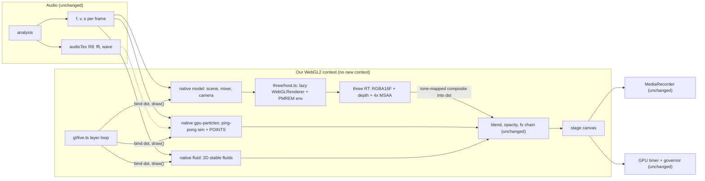
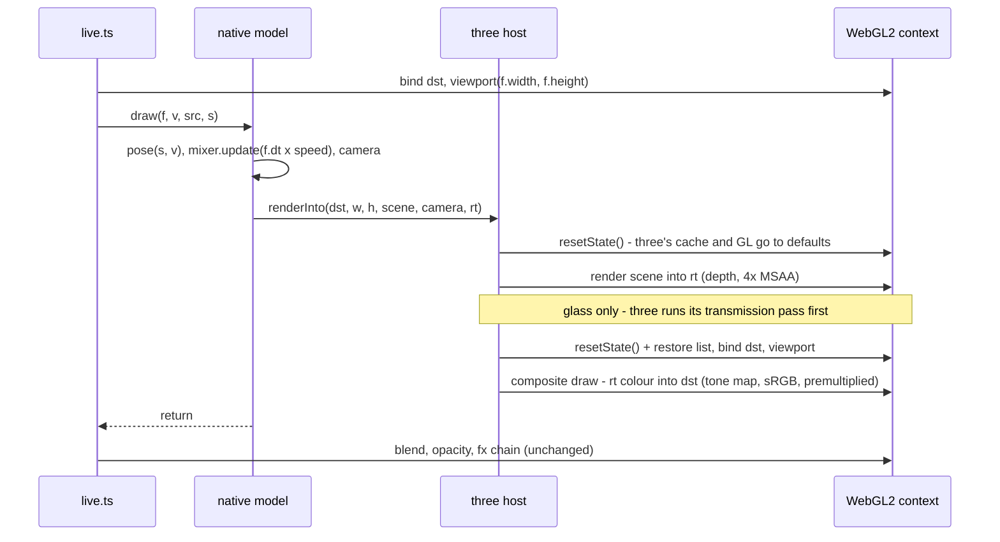
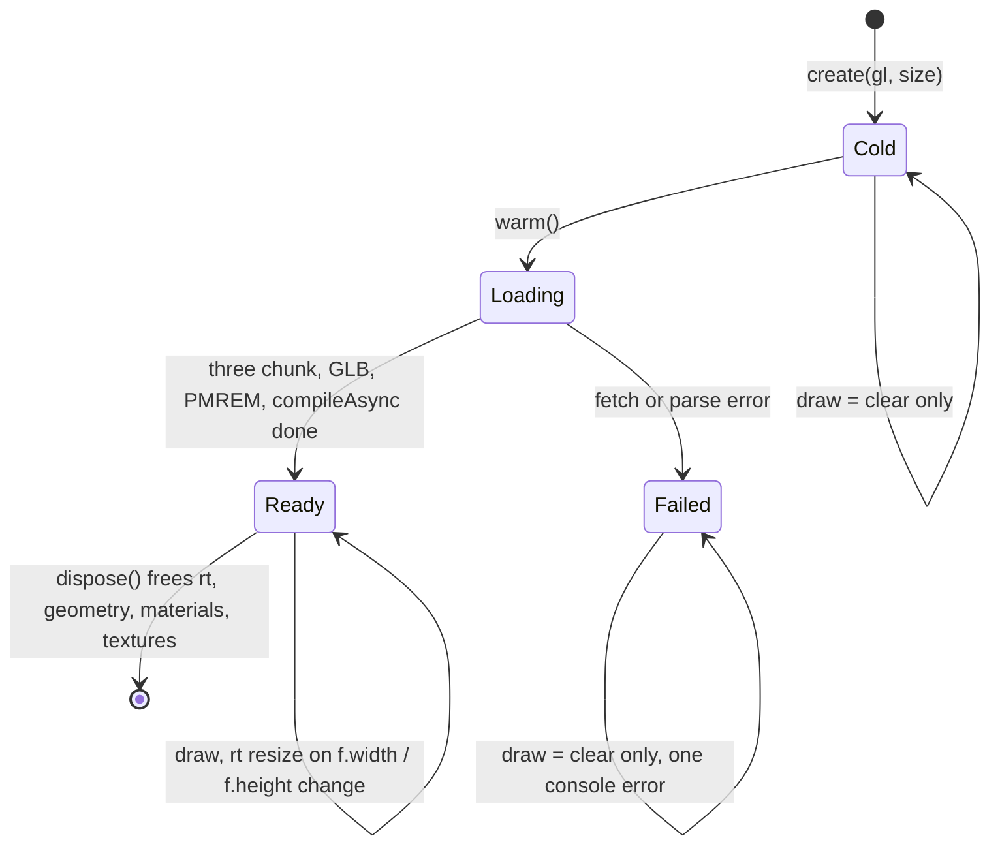
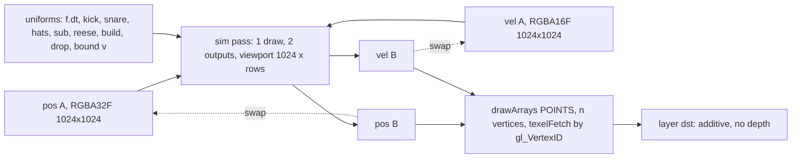
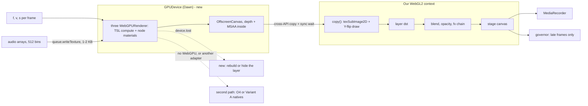
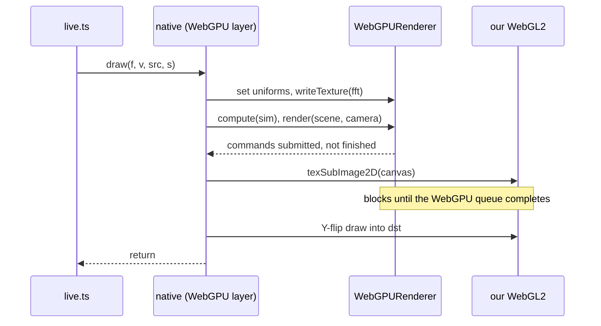
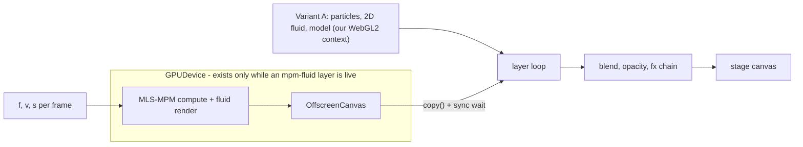
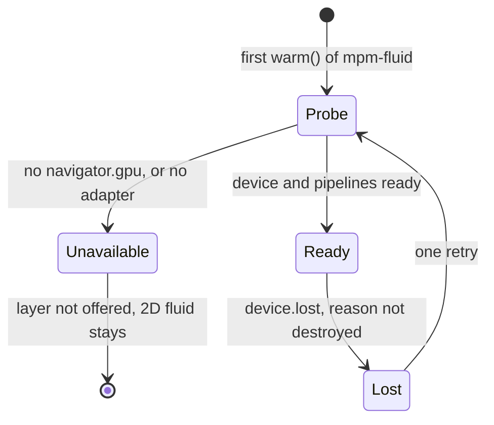

# Design: GPU particles, fluids, GLTF 3D (chrome / glass) as layer types

## TL;DR
- Three variants. **A**: everything on OUR WebGL2 context. Particles and the 2D fluid are plain natives in our GLSL (no three). Only the GLTF layer lazy-loads three `WebGLRenderer` on our context. **B**: three `WebGPURenderer` on its own canvas + a per-frame copy. **C**: A + one WebGPU-only layer for 3D particle fluids.
- Recommendation: **A**. It adds no GPU API, no context and no copy. The governor, the recorder and context loss work unchanged. Windows runs the same code. B needs a WebGL2 path as its Windows fallback anyway, so B = A + more.
- A does not deliver 3D particle fluids: MLS-MPM needs WebGPU atomics (research §5). G2's minimum, a 2D grid fluid, is met. C adds the 3D fluid later, gated by spike S2.
- Biggest unknown = R1: the cost of 2^20 points on WebGL2 on the M4. Spike S1-P settles it. Pass line: billed p95 <= 5.0 ms at N = 1 048 576, 1728x1117, 0 late / 3600 frames.
- Every ms figure in this file is a computed estimate, not a measurement.

## Freshness
- 2026-11-16, system-designer, `master e35ab7c`, brief `DESIGN-GPU3D-2026-11-16`.
- Inputs: `thoughts/spec_gpu3d.md` §1-§4 (G1-G5, R1-R6); `agents/research/research_gpu3d.md` TL;DR, §1, §3, §4, §5, §7, §8, §9, §10, §11; `thoughts/spec_veejay_wizard.md` TL;DR, Freshness, §2.8; `agents/STATE.md` HEAD.
- Not read (outside the brief): research §2 and §6, and all code. Code facts come from research §1 only.
- Web, patterns only: [Mapbox GL JS, three.js custom layer](https://docs.mapbox.com/mapbox-gl-js/example/add-3d-model/) (`context: gl`, `autoClear = false`, `resetState()` before `render()`); [WebGL-Fluid-Simulation `script.js`](https://github.com/PavelDoGreat/WebGL-Fluid-Simulation) (pass list, defaults, MIT header); [three.js forum on PR #26371](https://discourse.threejs.org/t/different-color-output-when-rendering-to-webglrendertarget/57494) (no tone mapping into render targets).

## Constraints (fixed by the specs)
- **Scope** (spec_gpu3d §2): G1 particles, target 1 M. G2 fluids, 2D grid minimum. G3 GLTF, rigged and animated. G4 chrome + glass. G5 full layer behaviour.
- **Acceptance** (spec_gpu3d §4): R1 particles billed p95 <= 5 ms at >= 1 M, or the measured ceiling + the lever. R2 fluid <= 4 ms, reacts to kick / drop. R3 animated CC0 animal with chrome and with glass, <= 5 ms. R4 blend, fx, bindings, governor, recorder, context loss. R5 no regression. R6 Mac required, Windows stated.
- **Non-goals** (spec_gpu3d §3): one demo built-in per capability, no other scenes. No Syphon / NDI. No Electron work. No engine rewrite.
- **Stack**: WebGL2 compositor + Butterchurn, Chrome-first, localhost (CLAUDE.md § Stack). The default mode "60 adaptive" drops resolution to protect 60 fps. The target machine is fanless (spec_veejay_wizard §2.8, Freshness).
- **Licensing**: any licence is allowed and recorded (CLAUDE.md § Constraints). three r187 MIT. WebGL-Fluid-Simulation MIT. TD `particlesGpu` proprietary: rewrite by analogy only (research §4, §5, §11).
- **Engine facts used** (research §1): `Native.draw(f, v, src?, s?)` draws into the bound FB. Targets are colour-only, RGBA8 or RGBA16F. One WebGL2 context, `alpha:false, antialias:false`. Context loss reloads the page. The governor reacts to late frames by scaling resolution 0.6-1.0. The recorder captures `stage` only.

## Estimate basis (used by every cost figure)
- 1 screen = 1728 x 1117 = 1 930 176 px. Frame budget 16.7 ms at 60 fps.
- Anchor: shipped full-screen layers bill 0.71-2.53 ms p95 (stars 0.71, superformula 1.01, grad-map 2.35, phaser 2.53; `agents/STATE.md` HEAD, queue item 2). ⚠️ Assumption, needs confirmation: those benches ran at 1728x1117.
- Derived rate: one simple full-screen pass = 0.7-1.0 ms, so 2.0-2.8 M simple fragments per ms. Estimate = computed workload / rate.
- Vertex-bound work has no anchor (research §5: no instrumented number). It is marked "unknown" and goes to the spike.

## Variant A - one context: WebGL2 natives + three `WebGLRenderer` on our context (the simplest)

### Summary
- **Particles (G1) and the 2D fluid (G2) are ordinary natives in our GLSL.** No three, no new dependency, no shared state. They follow the TF / FBO patterns the engine already has (research §1: `scenes/particles.ts`, 65 536 points).
- **Models (G3, G4) use three r187 `WebGLRenderer({ canvas, context: gl })` on OUR context** (research §4; option O2 in §10). three renders into its own render target, which has depth and 4x MSAA. Our code composites that target into the layer's `dst`. Nothing is copied between contexts.
- **three is a lazy chunk.** `import('three')` runs inside the model native's `warm()`. A show without a model layer never loads three.
- Pattern reference: Mapbox GL JS custom layers run three on the map's own context with `autoClear = false` and `resetState()` before every `render()`.
- Not carried forward from research §10: O4 (`forceWebGL` on our context: fallback backend, #31250 open, no `resetState` equivalent checked), O5 (readback: 7.72 MB per frame through RAM, >= 1 frame late), O6 (overlay: not recorded, outside blends).

### Component diagram


### Modules and planned file layout (`web/src/`; final paths are the planner's call)
| File | Responsibility |
|---|---|
| `scenes/gpu-particles.ts` (new) | State textures, sim pass (MRT), POINTS draw, audio forces. Pure seam `particleRows(w, h, density)`. |
| `scenes/fluid.ts` (new) | Port of the WebGL-Fluid-Simulation solver, MIT header kept. Display pass into `dst`. Its bloom and sunrays are not ported: our fx chain covers them. Pure seam `splats(s, f, v)`. |
| `three/host.ts` (new) | The only module that imports `three`. Memoised `threeHost(gl)`: dynamic import, one `WebGLRenderer` on our context, one PMREM env, `renderInto()`. |
| `three/model.ts` (new) | `native/model`: GLB load, `AnimationMixer`, chrome / glass material, camera. Pure seam `pose(s, v)`. |
| `public/models/<animal>.glb` (new) | The CC0 animal + its THIRD_PARTY row (pack choice: research §6, not read here). |
| native registry, built-ins (edit) | 3 natives + the demo built-ins. |
| `gl/scene.ts`, `gl/live.ts`, `gl/engine.ts`, `quality.ts`, `recorder.ts` | **No change.** |

### Reuse
| What | From | Licence | Mode |
|---|---|---|---|
| `WebGLRenderer`, `GLTFLoader`, `PMREMGenerator`, `AnimationMixer`, `MeshPhysicalMaterial` | npm `three` 0.187.0, pinned exact | MIT (research §4) | import-as-dep, lazy chunk |
| Stable-fluids solver | PavelDoGreat/WebGL-Fluid-Simulation | MIT (research §5) | copy with header |
| TF / FBO particle pattern | our `scenes/particles.ts` (twgl-adapted, MIT; research §1) | own | reuse |
| Force list: drag, turbulence, directional | TD `particlesGpu` (research §11) | proprietary | rewrite by analogy |
| Rigged test asset | donor `Samples/glTF/Fox.glb`, 162 852 B (research §11) | see research §6 | copy with credit |

### Sequence: one frame of the model layer


### Host rules (the contract that keeps the shared context safe)
1. **Every host call that touches GL ends with `resetState()` plus our restore list, before control returns to the engine or to the event loop.** This covers the constructor, PMREM generation, `initTexture`, `compileAsync` and `render`. ⚠️ Assumption, needs confirmation in S1-T: the constructor enables `DEPTH_TEST` and `CULL_FACE` at r187.
2. `resetState()` also runs before each `render()`. Our engine changed GL since three's last call, so three's state cache is stale (the Mapbox pattern).
3. `resetState()` restores GL defaults, not our engine's ambient state. ⚠️ Assumption: it does not touch pixel-store parameters. The restore list is exactly what the GL-state diff of S1-T shows, plus `dst` and the viewport.
4. three never sizes the canvas: no `setSize`, no `setPixelRatio`. It renders into render targets only.
5. All uploads and compiles happen in `warm()`. The stage frame only renders.
6. `three` is pinned to exactly `0.187.0`. One touchpoint is undocumented: handing the RT's colour to our code (the RT's raw texture, or `setRenderTargetTextures` / `setRenderTargetFramebuffer`, research §4). S1-T picks the one that works. An upgrade re-runs S1-T.
7. three does not tone-map into render targets (PR #26371; ⚠️ verify at r187). Our composite draw converts linear to display: tone map, sRGB, premultiplied alpha. It needs no Y flip: the RT is a GL texture, not a canvas.

### State: model native lifecycle


### Data flow: particle buffers

- `n = rows x 1024`, `rows = particleRows(f.width, f.height, density)`. The sim viewport and the draw count both use `rows`. Nothing is reallocated when the governor changes the layer size.
- Default `density` 0.5433 particles per pixel gives 1 048 576 at 1728x1117. At 1440x932, the default mode's internal size (spec_veejay_wizard §2.8), it gives 729 088; `density` 0.78 reaches the cap there.
- Additive points are order-independent, so the particle layer needs no depth buffer.
- Position is RGBA32F. A half float steps 2^-11 near |x| = 1, which is 0.42 px at 1728 px wide; slower drifts would stall. Velocity stays RGBA16F.

### Key TypeScript contracts
```ts
// gl/scene.ts - UNCHANGED (research §1)
//   NativeDef.create(gl, size?) -> Native
//   Native.draw(f, v, src?, s?); dispose?(); hidden?(); warm?(): Promise<void>

// scenes/gpu-particles.ts
export const CAP_ROWS = 1024;                  // 1024 x 1024 = 1 048 576 state texels
export const DENSITY = 0.5433;                 // particles per pixel: the cap at 1728 x 1117
/** Rows simulated and drawn this frame, 0..CAP_ROWS. Pure. */
export function particleRows(w: number, h: number, density: number): number;

// scenes/fluid.ts
export interface Splat { x: number; y: number; dx: number; dy: number; rgb: [number, number, number]; radius: number }
/** Pure: kick -> impulse, drop -> ring burst, hats -> small dye. */
export function splats(s: Sources, f: FrameInput, v: Values): Splat[];

// three/host.ts - the only importer of 'three'
export interface ThreeHost {
  THREE: typeof import('three');
  renderer: import('three').WebGLRenderer;     // context: our gl, autoClear false
  env: import('three').Texture;                // PMREM, built once
  /** resetState -> render into rt -> resetState + restore -> composite rt into dst. */
  renderInto(dst: WebGLFramebuffer | null, w: number, h: number,
    scene: import('three').Scene, camera: import('three').Camera,
    rt: import('three').WebGLRenderTarget): void;
}
export function threeHost(gl: WebGL2RenderingContext): Promise<ThreeHost>;   // memoised per gl

// three/model.ts
export interface Pose { speed: number; weights: number[]; orbit: number; dolly: number; envRot: number }
/** Pure: sources + bound values -> animation speed, clip weights, camera, env rotation. */
export function pose(s: Sources, v: Values): Pose;
```
- `Sources`, `FrameInput` and the type of `v` are the existing ones in `gl/scene.ts` (research §1). `Values` is a placeholder name.
- **No change to `Native`, `NativeDef`, `FrameInput` or the layer document.**
- The pure seams import nothing from `three`, so Vitest runs them without a GL context.

### Cost per frame at 1 screen (estimates)
| Layer | Workload (computed) | Estimate |
|---|---|---|
| Particles, sim | 1 pass, 1 048 576 texels, 2 outputs; curl noise at ~2.5 simple fragments each = 2.6 M | 0.9-1.3 ms |
| Particles, fill | 1 px: 1.05 M fragments (0.54 screen). 2 px: 4.19 M (2.17 screens). 3 px: 9.44 M (4.89 screens) | 0.4-0.5 / 1.5-2.1 / 3.4-4.7 ms |
| Particles, vertex | 1 048 576 vertices, 2 `texelFetch` each | **unknown** |
| **Particles total at 2 px** | | **2.4-3.4 ms + vertex** |
| Fluid, sim 198 x 128 | curl, vorticity, divergence, clear, 20 x pressure, gradient subtract, advect = 26 passes x 25 344 = 0.66 M | |
| Fluid, dye 1584 x 1024 | 1 advect pass = 1.62 M | |
| Fluid, display | 1 pass = 1.93 M | |
| **Fluid total** | 4.21 M fragments (2.18 screens) + 28 render passes | **1.8-2.9 ms** |
| **Model, chrome** | shading 0.15-0.35 screen x 3-4, MSAA resolve 1 screen, composite 1 screen | **1.7-3.4 ms** |
| **Model, glass** | shading x 2-2.5 more, transmission target 1.33 x scale^2 screens, resolve, composite | **3.0-6.8 ms** (scale 0.5: 2.3-5.8) |
| `resetState()` x 2 + restore | ~96 GL calls, CPU only (research §4: ~44 per reset) | 0.05-0.1 ms |

- Memory (computed): particles 2 x 16.8 MB (pos) + 2 x 8.4 MB (vel) = 50 MB. Fluid dye 2 x 13.0 MB = 26 MB. Model RT = 61.8 MB MSAA colour + 30.9 MB MSAA depth + 15.4 MB resolve = 108 MB. Glass adds 113 MB at scale 1.0 or 28 MB at 0.5 (research §7: HalfFloat, mips, >= 4 samples).
- ⚠️ Assumptions behind the estimates: the animal covers 15-35 % of the screen; a physical material costs 3-4 simple fragments; a render pass costs 10-30 us; a GL call costs 0.5-1 us.
- Reading: the fluid and chrome fit their budgets with margin. Particles and glass can exceed 5 ms. Both go to spike S1.

### How Variant A meets the acceptance criteria
| ID | Mechanism | Status |
|---|---|---|
| R1 | Ping-pong sim + POINTS, `n = rows x 1024`. Levers: `density` (count) and point size <= 2 px. | **Measured-risk -> S1-P.** If 1 M fails, the measured ceiling N* ships with the density lever (R1's second clause). |
| R2 | Stable-fluids port at the reference defaults: sim 128, dye 1024, 20 pressure iterations. `splats()`: kick -> impulse splat, drop -> ring burst + curl boost, hats -> small dye. | Estimate 1.8-2.9 ms. Bench at its build step. Levers: dye 512, pressure 12. |
| R3 | three on our context: GLB + `AnimationMixer`. Chrome = `metalness 1, roughness ~0` + PMREM env. Glass = `MeshPhysicalMaterial` transmission (research §7). | Chrome: the estimate fits. **Glass: measured-risk -> S1-T.** Levers: `transmissionResolutionScale` 0.5, then MSAA 2. |
| R4 | The layer draws into `dst` like any native, so blend, opacity, the fx chain and bindings are unchanged. Governor, recorder and context loss: see the checklist. | By construction. S1-T checks state bleed. |
| R5 | No engine file changes. three loads only in a model layer's `warm()`. Host rule 1 leaves GL as the engine expects. | S1-T: GL diff {} and the frozen pair of the next layer. |
| R6 | The same WebGL2 code on Mac and Windows. No WebGPU. | By construction. The unknown Windows GPU changes speed only. |

- **G5 Library.** The three natives register like the existing natives. Demo built-ins: see Decision needed.
- **G3 audio.** `pose()` maps sources and bound values to `mixer.update(f.dt x speed)`, clip weights, camera orbit / dolly and env rotation. The clock is `f.dt`, so pause and seek stay coherent.

### The brief's checklist for Variant A
- **Depth buffer.** Private to the model layer: three's render target has depth + 4x MSAA. Engine targets stay colour-only. Particles are additive and need none. The fluid is 2D.
- **GL state reset cost.** 2 x `resetState()` (~88 GL calls) + the restore list, per model layer per frame: estimate 0.05-0.1 ms CPU. Zero for particles and fluid.
- **16-context cap.** +0 contexts, +0 GPU devices.
- **Governor.** All GPU work is on our context. The existing GPU timer bills it, and late frames scale `f.width / f.height` as today. Response per layer:
  - Particles: the density rule. Count and fill fall with the pixel count. At the 0.6 floor `n` = 36 % (⚠️ Assumption: the scale is linear per axis).
  - Model: by pixels. The RT follows the layer size.
  - Fluid: its display pass only. Sim and dye sizes are fixed. `ponytail:` a dye resize-with-copy is added only if the bench demands it.
- **Recorder.** Pixels land in `stage`. Unchanged.
- **Context loss.** One context: the page reloads as today (research §1). three's own lost / restored listeners are inert.
- **Windows fallback.** The same path. It needs `EXT_color_buffer_float`, which the engine already probes (research §1). Without it the particle layer is not offered and the 65 536-point TF scene remains. Nothing depends on the unrecorded Windows GPU.
- **Bundle.** three core + `WebGLRenderer` = ~194 KB gz before tree-shaking (research §4), plus `GLTFLoader`, in one lazy chunk. The main bundle gains 0 bytes of three. Particles and fluid add only their GLSL.
- **Compile stalls.** `warm()` runs `compileAsync` and all uploads off the stage frame (research §9: `warm()` exists for this).

### What Variant A leaves open (not blocked, nothing built for it)
- **3D particle fluid.** A later WebGPU layer plugs in through the milk `copy()` precedent (research §1, §3 path a). That is Variant C.
- **Glass that refracts the layers below; chrome that reflects them.** Same context, so `ExternalTexture(src)` feeds three without a copy (research §4, §8). B cannot do this without a second copy.
- **Particles driven by the fluid's velocity texture, or particles inside the 3D scene.** Same context, shared textures.
- **Text layer, video files, MIDI** (backlog order, `agents/STATE.md` HEAD): untouched. A 3D text layer would reuse `three/host.ts`.
- **Electron** (spec_veejay_wizard TL;DR): the WebGL2 path is identical there.

### Risks (Variant A)
1. **R1.** The vertex cost of 2^20 points on ANGLE Metal is unknown (research §5). -> S1-P.
2. **State bleed** between three and our engine: blend, depth, cull, program, VAO, pixel-store (research §9). Mitigation: host rules 1-3. Proof: the GL diff in S1-T. Fallback: A'.
3. **Glass cost.** By default the transmission pass renders into a HalfFloat, mip-mapped, >= 4x MSAA target at full size (research §7). Lever: scale 0.5.
4. **First-use compile stall** of the physical material (research §9: unmeasured). Mitigation: `warm()`.
5. **Realloc hitch** when the governor steps and the RTs resize (research §9: resize cost is unmeasured even for milk). S1-T measures it.
6. **Undocumented three touchpoint** (host rule 6). Mitigation: the pinned version.
7. **Memory.** ~108 MB per live model layer, +28 to 113 MB with glass, 50 MB particles, 26 MB fluid (estimates).
8. **Thermal.** The machine is fanless (spec_veejay_wizard §2.8). Stacked new layers of 3-5 ms each use most of a frame. The governor handles it; the 30-min soak must include such a stack.
9. **Layer alpha.** A model drawn over other layers needs the layer's alpha in the blend (research gap G1).

### Fallback A' (only if S1-T fails on state bleed)
three `WebGLRenderer` on its own WebGL2 canvas + `copy()`, exactly the `milkdrop/native.ts` pattern (research §1: 0.10 ms main thread, 0 late / 3600 frames). Price: +1 context of the 16; the governor sees it through late frames only; no `ExternalTexture` sharing.

### Effort (Variant A)
**M.** Particles S-M, fluid S-M, three host + model M. No engine change.

### Spike S1 (technical; coder worktree, no merge; two dispatches)
**S1-P settles the biggest unknown (R1).**
- Arm 0: the existing TF scene with its count raised from 65 536 to 1 048 576. This is one constant (research §1: `scenes/particles.ts:1`).
- Arm 1: texture ping-pong 1024 x 1024 + POINTS by `gl_VertexID`.
- Run: the project bench on the M4 at 1728x1117. N = 262 144, 524 288, 786 432, 1 048 576. Point size 1 px and 2 px. Additive into the layer target.
- **Pass line: billed p95 <= 5.0 ms at N = 1 048 576 with point size <= 2 px, and 0 late / 3600 frames at governor 1.00x.**
- Outcome routing:
  - Arm 0 passes -> keep the TF pattern. Do not build the ping-pong sim.
  - Only arm 1 passes -> ping-pong, as drawn above.
  - Neither passes -> N* = the largest N that passes becomes the cap, `DENSITY = N* / 1 930 176`, and the design states it per R1.

**S1-T is the integration smoke (R3, R4, R5).** three host + `Fox.glb`, chrome then glass, placed between two existing layers. Pass:
1. The GL-state diff after the layer = {}, pixel-store included (the K5 instrument, `agents/STATE.md` HEAD queue item 2).
2. The frozen-pair diff of the next layer <= the known 0.08 / 255 floor (same source).
3. Billed p95 <= 5.0 ms for chrome and for glass. Glass may use scale 0.5.
4. 0 late frames between `warm()` resolved and the first visible frame.
5. <= 1 late frame per governor step.
6. With three loaded and no model layer in the stack, an existing scene's billed p95 stays inside its run-to-run noise (R5).

Routing: fail 1 or 2 -> A'. Fail 3 for glass at scale 0.5 -> the design states the ceiling; levers MSAA 2 and screen coverage.

## Variant B - three `WebGPURenderer` on its own canvas + a per-frame copy

### Summary
- One `GPUDevice` and one three `WebGPURenderer` (research §4; option O3 in §10) render every new layer type on an OffscreenCanvas. Particles = TSL compute. Fluid = a TSL grid solver, or the MLS-MPM example in 3D (max 131 072 particles, 64^3 grid; research §5). Models = node materials.
- Per frame, each such layer renders. Then our context runs milk's `copy()`: `texSubImage2D(canvas)` + a Y-flip draw into `dst` (research §3 path a). The read blocks until the submitted WebGPU work completes (research §3).
- It needs a second code path wherever WebGPU is absent or sits on another adapter (research §3, §9).

### Component diagram


### Sequence: one frame of a WebGPU layer


### Modules and contracts
- `gpu/device.ts`: adapter, device, one renderer (`await renderer.init()` inside `warm()`), `device.lost` handling.
- `gpu/particles.ts`, `gpu/fluid.ts`, `gpu/model.ts`: the three layer types in TSL.
- `copy()` is extracted from `milkdrop/native.ts` and shared with milk.
- `Native` is unchanged. Two additions:
  - `NativeDef.available?(): boolean`, so the Library hides a layer the machine cannot run (⚠️ unless `hidden()` already means this; research gap G5).
  - A `device.lost` path. Nothing in `web/src` handles a lost GPUDevice today (research §9).
- Audio: uniforms are written per frame. The 512-bin arrays are re-uploaded with `queue.writeTexture`, 1-2 KB (research §8). `src` and `audioTex` cannot be shared.
- Depth and MSAA live inside the WebGPU canvas (`antialias` / `samples`, research §4). Engine targets stay colour-only.
- Reuse: npm `three` 0.187.0, the `three.webgpu` build, MIT; three TSL examples, MIT (research §4); milk `copy()`, own.

### Cost per frame, Variant B (estimates)
- **Fixed overhead per WebGPU layer:** the cross-API copy of 1 screen (7.72 MB as RGBA8, research §3) + the Y-flip draw = up to 2 simple passes = **0.7-2.0 ms before any content**. The copy is ⚠️ unmeasured (research §3). If Chrome copies through system memory (two adapters, research §3), that is 463 MB/s at 60 fps.
- **Content:** the same GPU does the same raster work under either API (⚠️ Assumption: Dawn and ANGLE both drive Metal on the M4). WebGPU points are 1 px, so 2^20 larger sprites are 2^21 triangles. B does not remove R1's unknown. It adds the overhead above.
- **Model:** A's shading and MSAA resolve, + three's output pass (1 screen), + the overhead above = 2.4-5.4 ms for chrome (A: 1.7-3.4 ms).
- **Timer:** our GPU timer reads copy + wait, which tracks the layer's WebGPU time (milk: median 7.61 ms on 0.10 ms of main-thread work, research §1).

### How Variant B meets the acceptance criteria
| ID | Mechanism | Status |
|---|---|---|
| R1 | TSL compute. The shipped examples run 2-3 x 10^5 particles (research §4). | Measured-risk: 1 M + the copy. |
| R2 | A TSL grid fluid, or MLS-MPM in 3D. | The only variant with a 3D fluid inside this epic. |
| R3 | Node materials with transmission (research §7). | Measured-risk: the 5 ms includes the copy. |
| R4 | Blend, fx and bindings run after the copy. The recorder sees it. The governor sees late frames only. | New `device.lost` path. |
| R5 | No engine change. Each frame with such a layer blocks on a second GPU timeline. | Needs S2. |
| R6 | Mac ok. Windows: WebGPU and the adapter pairing are unknown (no probe file, research §1). | Second path: O4 (`forceWebGL`: TF compute, gather-only, #31250 open; research §4) or A's natives. |

### The brief's checklist for Variant B
- **Depth buffer:** inside the WebGPU canvas. **GL state:** nothing shared; `copy()` behaves as milk's does today.
- **16-context cap:** +0 WebGL contexts, +1 GPUDevice. Two visible WebGPU layers need two canvases, or one canvas rendered and copied twice (two waits).
- **Governor:** blind to the GPU time, as with milk (research §1, §9). The canvas must resize when `f.width / f.height` change.
- **Recorder:** ok, the copy lands in `stage`. **Context loss:** a new, separate failure mode.
- **Windows fallback:** a second implementation, built and tested without knowing the GPU.
- **Bundle:** ~318 KB gz, lazy (research §4).

### What Variant B leaves open
- The renderer three is investing in; `WebGLRenderer` gets "no larger new features" (research §4).
- 3D fluids now. One TSL codebase for O3 and O4 (research §10).
- Our GLSL effects stay in the compositor; they do not run inside `WebGPURenderer` (research §9).

### Risks (Variant B)
1. The copy cost is unmeasured on both machines (research §3). It sits under every new layer.
2. `WebGPURenderer` is "still in an experimental state" (research §4).
3. Dual-GPU laptops copy through system memory (research §3, §9).
4. A device-loss path that does not exist today.
5. The Windows fallback doubles the build and the test matrix.
6. ⚠️ Assumption: an 8-bit canvas, so HDR is cut before our fx chain. A float canvas into WebGL is not researched.
7. Pipeline compile at first use is unmeasured (research §9).

### Effort (Variant B)
**L.** XL with a tested Windows fallback.

## Variant C - hybrid: A, plus one WebGPU layer for 3D particle fluids

### Summary
- Particles, the 2D fluid and models are exactly Variant A.
- One extra layer type, `native/mpm-fluid`, runs an MLS-MPM particle fluid on WebGPU on its own OffscreenCanvas and enters the compositor through `copy()` (research §3 path a).
- The layer exists only on a machine where WebGPU is present and spike S2 passed. Elsewhere the Library does not offer it, and the 2D fluid is the fluid.
- Source for the solver, picked when that work starts: three's `webgpu_compute_particles_fluid` in TSL (MIT, max 131 072 particles, 64^3 grid) or WebGPU-Ocean in WGSL (MIT, "~100,000 particles on integrated graphics", low activity) (research §5).

### Component diagram (the delta to A)


### State: availability of the WebGPU layer


### Delta to A
- Module: `gpu/mpm-fluid.ts` (device, sim, render, loss handling). `copy()` is shared with milk.
- Contract: the same availability flag as B, for this one layer. Everything else is A.
- Cost (estimates): A's figures, plus for this layer the 0.7-2.0 ms copy overhead of B. The solver itself has no ms figure: research §5 gives only "real time" at ~100 000 particles on integrated graphics.

### How Variant C meets the acceptance criteria
- R1, R3, R5, R6: as A.
- R2: the 2D fluid as A. The 3D fluid is extra and is a measured-risk: S2 plus a solver bench.
- R4: as A. For `mpm-fluid` only: the governor sees late frames only, and a `device.lost` path is new.
- R6 for `mpm-fluid`: Mac after S2; Windows only after a probe on that PC. Nothing else depends on it.

### Leaves open, risks, effort
- Open: everything A leaves open. The WebGPU layer is isolated, so it can be dropped without touching A.
- Risks: A's risks, plus B's risks 1, 3, 4 and 7 confined to one optional layer.
- Effort: **A (M) + M = L.** A ships first. The `mpm-fluid` layer is a follow-up, not part of A's plan.

### Spike S2 (needed for B, and for C's extra layer; not for A)
A WebGPU canvas -> `texSubImage2D` -> our compositor at 1728x1117, with the milk K1 instrument (research §3, implication), on the M4 and on the Windows PC.
- Trivial source (clear + 1 triangle), so the wait is ~0 and the reading is the copy.
- **Pass line: main-thread p95 <= 0.3 ms; our GPU-timer median for copy + wait <= 1.0 ms; 0 late / 3600 frames; governor 1.00x.** The 0.3 ms line is 3x the WebGL-to-WebGL precedent of 0.10 ms (research §1).
- Windows also records the WebGPU adapter against WebGL's `UNMASKED_RENDERER` (the dual-GPU case, research §9).
- Fail on a machine -> no WebGPU layer on that machine.

## Comparison
| | A (one context) | B (WebGPU + copy) | C (hybrid) |
|---|---|---|---|
| GPU APIs / contexts added | 0 / 0 | 1 GPUDevice | 0 now, 1 GPUDevice with `mpm-fluid` |
| Per-frame transfer | none | copy + wait per layer, unmeasured | none; copy for `mpm-fluid` only |
| R1, 1 M particles | measured-risk, S1-P | same raster work + 0.7-2.0 ms | as A |
| R2, 2D fluid | est. 1.8-2.9 ms | est. A + 0.7-2.0 ms | as A |
| 3D particle fluid | no | yes | yes, where S2 passes |
| R3, chrome / glass | est. 1.7-3.4 / 3.0-6.8 ms | est. 2.4-5.4 ms chrome | as A |
| Renderer maturity | stable (research §4) | "experimental" (research §4) | stable + 1 isolated layer |
| Governor sees the cost | yes, our timer | late frames only | yes; `mpm-fluid` late frames only |
| Recorder | unchanged | ok after the copy | ok |
| Context / device loss | unchanged | new path | new path for 1 layer |
| Windows | same code | second implementation | same code; `mpm-fluid` after a probe |
| Engine / contract changes | none | availability flag, loss path | none now |
| Lazy bundle | ~194 KB gz | ~318 KB gz | ~194 KB gz now |
| Spikes | S1 | S1 on WebGPU + S2 on 2 machines | S1; S2 later |
| Effort | **M** | **L-XL** | **L** (A first) |

## Research gaps (for the lead; none blocks the pick)
- **G1** Layer alpha: does the `normal` blend use the layer's alpha, premultiplied? Needed for a model over other layers.
- **G2** What `src` is in `Native.draw` (the composite below?), its orientation and colour space.
- **G3** Does the engine cache GL state across layers? Which ambient state does it expect after a native's `draw`, besides `blendEquation`? Does the K5 GL diff cover pixel-store?
- **G4** Is the governor scale linear per axis? (The 36 % figure assumes it.)
- **G5** `create(gl, size?)`: what `size` means (a tile hint would size the particle state for Library tiles). `hidden()` semantics. Who calls `warm()`, and when.
- **G6** The bench resolution behind the STATE anchors (assumed 1728x1117).
- **G7** Research §6, not in this brief: the CC0 animal pack, the `Fox.glb` licence, and whether the assets need Draco / meshopt decoders.
- **G8** three r187 `WebGLRenderer` details (constructor side effects, `compileAsync`, `ExternalTexture`, the RT hand-over). S1-T answers these; no separate research is needed.
- **G9** The Windows PC: GPU, `EXT_color_buffer_float`, WebGPU status (no probe file, research §1). A does not depend on it.

## Decision needed (the lead's picks)
1. **Variant: A, B or C.** Designer: A.
2. **Run S1 before the plan.** Designer: yes, both dispatches. S1-P decides TF vs ping-pong and the shipped count. S1-T decides shared context vs A'.
3. **If S1-P misses 1 M:** ship N* with the density lever (R1's second clause), or reopen the variant. Designer: ship N*. B would not lower the raster cost.
4. **Demo built-ins:** 4 = particles, fluid, model chrome, model glass (one per G1-G4; the two model demos share one native), or 3 with glass as a parameter. Designer: 4.
5. **S2 now or later.** Designer: later, only if a 3D fluid is ordered. Its Windows half needs the user's PC.

## Recommendation
Pick **Variant A**. The spec fixes outcomes, not the API: 1 M particles, a fluid, an animated animal in chrome and glass, each behaving like any layer (spec_gpu3d §2, §4). A reaches all of them with the least new surface: no second GPU API, no extra context, no per-frame copy, no engine or contract change, and three loaded only when a model layer is used. Because all work stays on our context, the governor, the recorder and context loss work as they do today, and Windows runs the same code without knowing its GPU. B cannot lower the cost that decides R1, because the same GPU rasterises the same points under either API, and it adds an unmeasured copy under every layer plus a second implementation for Windows. The one thing A gives up is the 3D particle fluid; G2 requires only the 2D grid fluid, and C can add the 3D layer later behind spike S2 without touching A. The two real risks of A are measurable in one cheap spike: S1-P for the 1 M count (pass line: billed p95 <= 5.0 ms at N = 1 048 576, <= 2 px, 1728x1117, 0 late / 3600 frames) and S1-T for the shared GL state and the glass cost, with A' as the precedented fallback.
