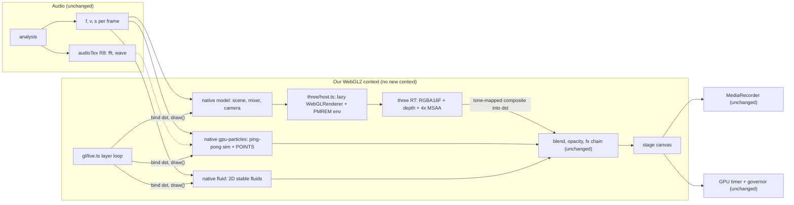
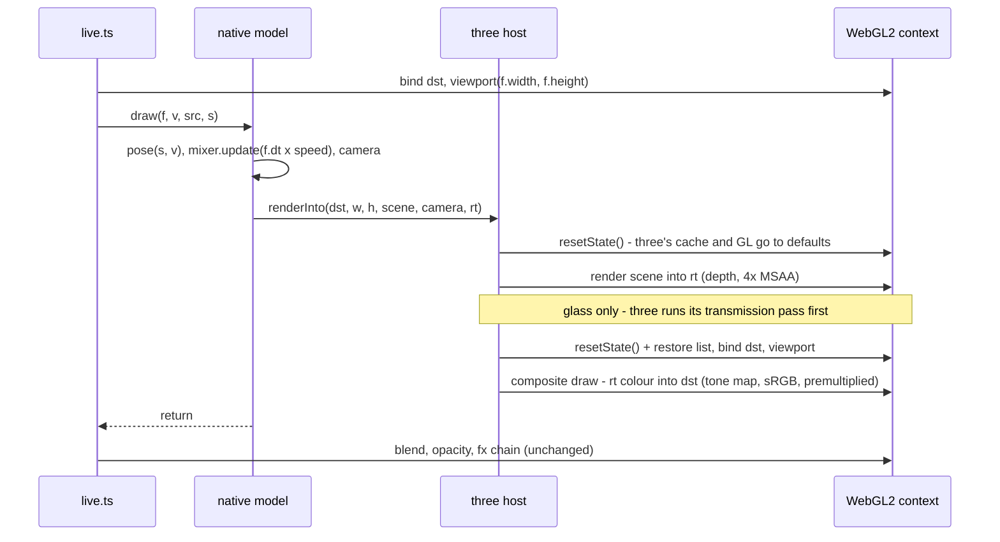
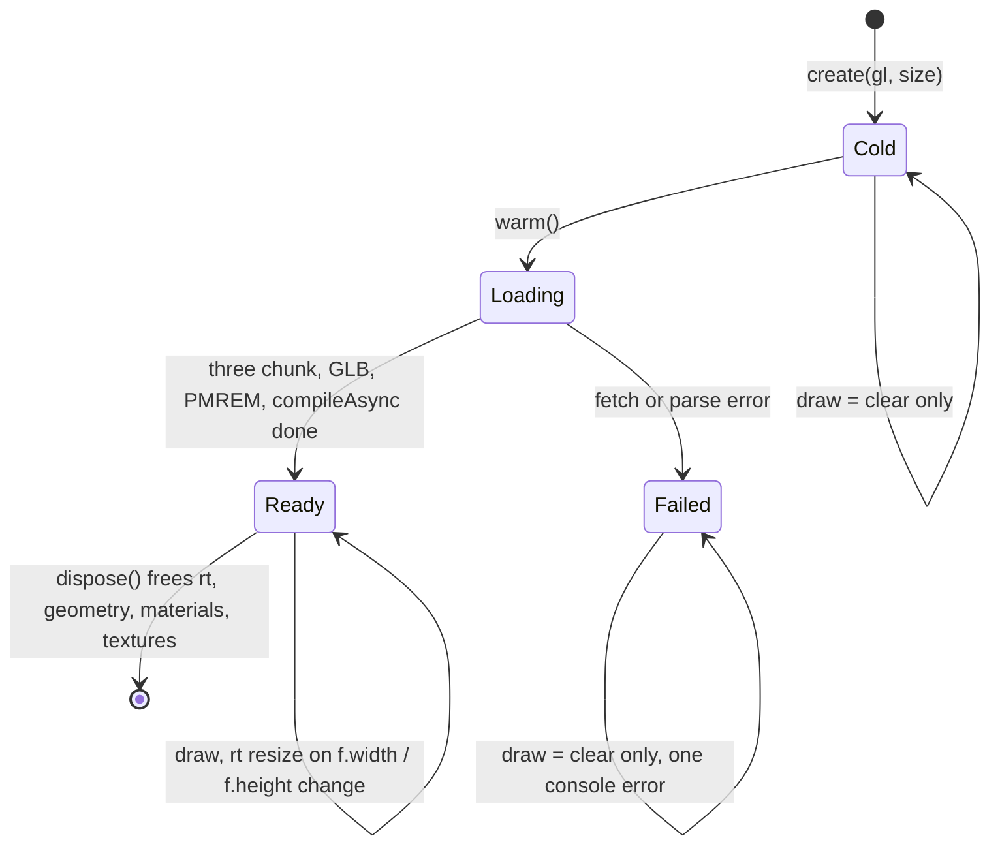
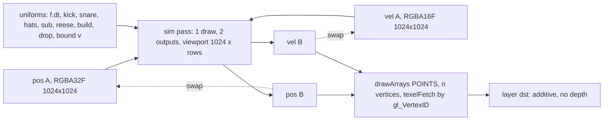
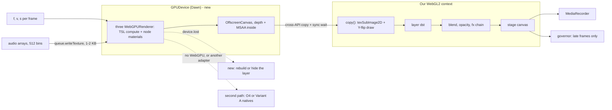
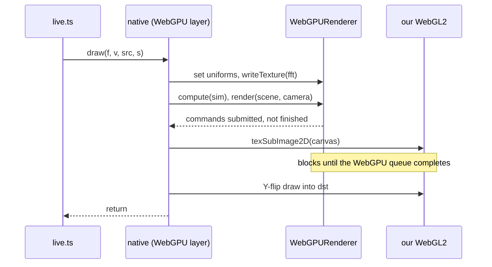
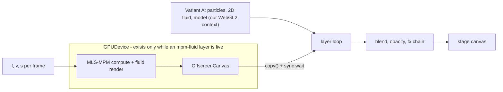
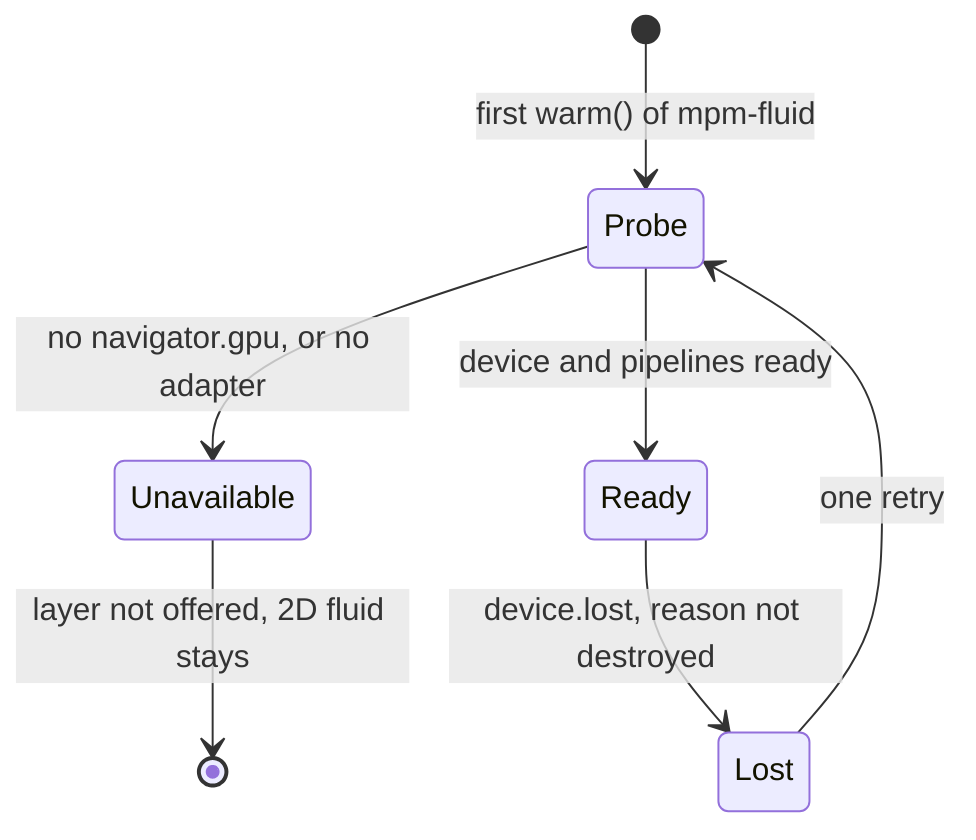
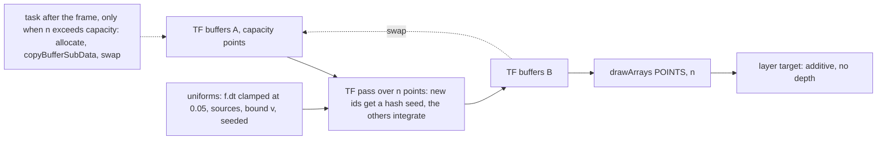
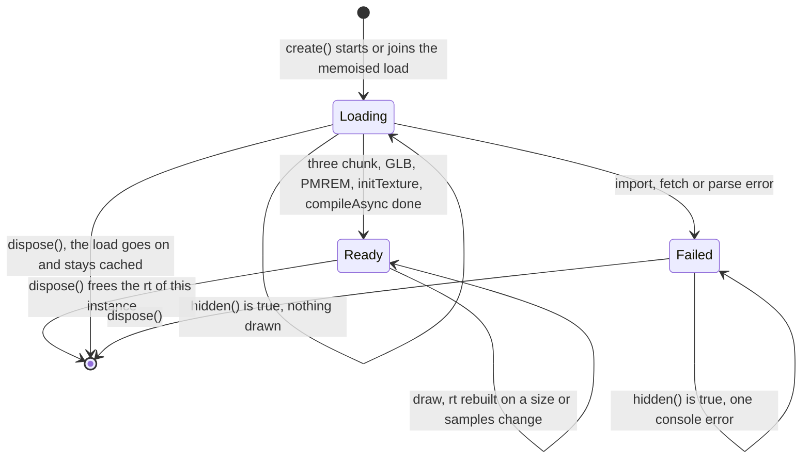

# Design: GPU particles, fluids, GLTF 3D (chrome / glass) as layer types

## TL;DR
- Three variants. **A**: everything on OUR WebGL2 context. Particles and the 2D fluid are plain natives in our GLSL (no three). Only the GLTF layer lazy-loads three `WebGLRenderer` on our context. **B**: three `WebGPURenderer` on its own canvas + a per-frame copy. **C**: A + one WebGPU-only layer for 3D particle fluids.
- Recommendation: **A**. It adds no GPU API, no context and no copy. The governor, the recorder and context loss work unchanged. Windows runs the same code. B needs a WebGL2 path as its Windows fallback anyway, so B = A + more.
- A does not deliver 3D particle fluids: MLS-MPM needs WebGPU atomics (research §5). G2's minimum, a 2D grid fluid, is met. C adds the 3D fluid later, gated by spike S2.
- Biggest unknown = R1: the cost of 2^20 points on WebGL2 on the M4. Spike S1-P settles it. Pass line: billed p95 <= 5.0 ms at N = 1 048 576, 1728x1117, 0 late / 3600 frames.
- Every ms figure in this file is a computed estimate, not a measurement.

## Freshness
- 2026-11-16, system-designer, `master e35ab7c`, brief `DESIGN-GPU3D-2026-11-16`.
- Inputs: `thoughts/spec_gpu3d.md` §1-§4 (G1-G5, R1-R6); `agents/research/research_gpu3d.md` TL;DR, §1, §3, §4, §5, §7, §8, §9, §10, §11; `thoughts/spec_veejay_wizard.md` TL;DR, Freshness, §2.8; `agents/STATE.md` HEAD.
- Not read (outside the brief): research §2 and §6, and all code. Code facts come from research §1 only.
- Web, patterns only: [Mapbox GL JS, three.js custom layer](https://docs.mapbox.com/mapbox-gl-js/example/add-3d-model/) (`context: gl`, `autoClear = false`, `resetState()` before `render()`); [WebGL-Fluid-Simulation `script.js`](https://github.com/PavelDoGreat/WebGL-Fluid-Simulation) (pass list, defaults, MIT header); [three.js forum on PR #26371](https://discourse.threejs.org/t/different-color-output-when-rendering-to-webglrendertarget/57494) (no tone mapping into render targets).

## Constraints (fixed by the specs)
- **Scope** (spec_gpu3d §2): G1 particles, target 1 M. G2 fluids, 2D grid minimum. G3 GLTF, rigged and animated. G4 chrome + glass. G5 full layer behaviour.
- **Acceptance** (spec_gpu3d §4): R1 particles billed p95 <= 5 ms at >= 1 M, or the measured ceiling + the lever. R2 fluid <= 4 ms, reacts to kick / drop. R3 animated CC0 animal with chrome and with glass, <= 5 ms. R4 blend, fx, bindings, governor, recorder, context loss. R5 no regression. R6 Mac required, Windows stated.
- **Non-goals** (spec_gpu3d §3): one demo built-in per capability, no other scenes. No Syphon / NDI. No Electron work. No engine rewrite.
- **Stack**: WebGL2 compositor + Butterchurn, Chrome-first, localhost (CLAUDE.md § Stack). The default mode "60 adaptive" drops resolution to protect 60 fps. The target machine is fanless (spec_veejay_wizard §2.8, Freshness).
- **Licensing**: any licence is allowed and recorded (CLAUDE.md § Constraints). three r187 MIT. WebGL-Fluid-Simulation MIT. TD `particlesGpu` proprietary: rewrite by analogy only (research §4, §5, §11).
- **Engine facts used** (research §1): `Native.draw(f, v, src?, s?)` draws into the bound FB. Targets are colour-only, RGBA8 or RGBA16F. One WebGL2 context, `alpha:false, antialias:false`. Context loss reloads the page. The governor reacts to late frames by scaling resolution 0.6-1.0. The recorder captures `stage` only.

## Estimate basis (used by every cost figure)
- 1 screen = 1728 x 1117 = 1 930 176 px. Frame budget 16.7 ms at 60 fps.
- Anchor: shipped full-screen layers bill 0.71-2.53 ms p95 (stars 0.71, superformula 1.01, grad-map 2.35, phaser 2.53; `agents/STATE.md` HEAD, queue item 2). ⚠️ Assumption, needs confirmation: those benches ran at 1728x1117.
- Derived rate: one simple full-screen pass = 0.7-1.0 ms, so 2.0-2.8 M simple fragments per ms. Estimate = computed workload / rate.
- Vertex-bound work has no anchor (research §5: no instrumented number). It is marked "unknown" and goes to the spike.

## Variant A - one context: WebGL2 natives + three `WebGLRenderer` on our context (the simplest)

### Summary
- **Particles (G1) and the 2D fluid (G2) are ordinary natives in our GLSL.** No three, no new dependency, no shared state. They follow the TF / FBO patterns the engine already has (research §1: `scenes/particles.ts`, 65 536 points).
- **Models (G3, G4) use three r187 `WebGLRenderer({ canvas, context: gl })` on OUR context** (research §4; option O2 in §10). three renders into its own render target, which has depth and 4x MSAA. Our code composites that target into the layer's `dst`. Nothing is copied between contexts.
- **three is a lazy chunk.** `import('three')` runs inside the model native's `warm()`. A show without a model layer never loads three.
- Pattern reference: Mapbox GL JS custom layers run three on the map's own context with `autoClear = false` and `resetState()` before every `render()`.
- Not carried forward from research §10: O4 (`forceWebGL` on our context: fallback backend, #31250 open, no `resetState` equivalent checked), O5 (readback: 7.72 MB per frame through RAM, >= 1 frame late), O6 (overlay: not recorded, outside blends).

### Component diagram


### Modules and planned file layout (`web/src/`; final paths are the planner's call)
| File | Responsibility |
|---|---|
| `scenes/gpu-particles.ts` (new) | State textures, sim pass (MRT), POINTS draw, audio forces. Pure seam `particleRows(w, h, density)`. |
| `scenes/fluid.ts` (new) | Port of the WebGL-Fluid-Simulation solver, MIT header kept. Display pass into `dst`. Its bloom and sunrays are not ported: our fx chain covers them. Pure seam `splats(s, f, v)`. |
| `three/host.ts` (new) | The only module that imports `three`. Memoised `threeHost(gl)`: dynamic import, one `WebGLRenderer` on our context, one PMREM env, `renderInto()`. |
| `three/model.ts` (new) | `native/model`: GLB load, `AnimationMixer`, chrome / glass material, camera. Pure seam `pose(s, v)`. |
| `public/models/<animal>.glb` (new) | The CC0 animal + its THIRD_PARTY row (pack choice: research §6, not read here). |
| native registry, built-ins (edit) | 3 natives + the demo built-ins. |
| `gl/scene.ts`, `gl/live.ts`, `gl/engine.ts`, `quality.ts`, `recorder.ts` | **No change.** |

### Reuse
| What | From | Licence | Mode |
|---|---|---|---|
| `WebGLRenderer`, `GLTFLoader`, `PMREMGenerator`, `AnimationMixer`, `MeshPhysicalMaterial` | npm `three` 0.187.0, pinned exact | MIT (research §4) | import-as-dep, lazy chunk |
| Stable-fluids solver | PavelDoGreat/WebGL-Fluid-Simulation | MIT (research §5) | copy with header |
| TF / FBO particle pattern | our `scenes/particles.ts` (twgl-adapted, MIT; research §1) | own | reuse |
| Force list: drag, turbulence, directional | TD `particlesGpu` (research §11) | proprietary | rewrite by analogy |
| Rigged test asset | donor `Samples/glTF/Fox.glb`, 162 852 B (research §11) | see research §6 | copy with credit |

### Sequence: one frame of the model layer


### Host rules (the contract that keeps the shared context safe)
1. **Every host call that touches GL ends with `resetState()` plus our restore list, before control returns to the engine or to the event loop.** This covers the constructor, PMREM generation, `initTexture`, `compileAsync` and `render`. ⚠️ Assumption, needs confirmation in S1-T: the constructor enables `DEPTH_TEST` and `CULL_FACE` at r187.
2. `resetState()` also runs before each `render()`. Our engine changed GL since three's last call, so three's state cache is stale (the Mapbox pattern).
3. `resetState()` restores GL defaults, not our engine's ambient state. ⚠️ Assumption: it does not touch pixel-store parameters. The restore list is exactly what the GL-state diff of S1-T shows, plus `dst` and the viewport.
4. three never sizes the canvas: no `setSize`, no `setPixelRatio`. It renders into render targets only.
5. All uploads and compiles happen in `warm()`. The stage frame only renders.
6. `three` is pinned to exactly `0.187.0`. One touchpoint is undocumented: handing the RT's colour to our code (the RT's raw texture, or `setRenderTargetTextures` / `setRenderTargetFramebuffer`, research §4). S1-T picks the one that works. An upgrade re-runs S1-T.
7. three does not tone-map into render targets (PR #26371; ⚠️ verify at r187). Our composite draw converts linear to display: tone map, sRGB, premultiplied alpha. It needs no Y flip: the RT is a GL texture, not a canvas.

### State: model native lifecycle


### Data flow: particle buffers

- `n = rows x 1024`, `rows = particleRows(f.width, f.height, density)`. The sim viewport and the draw count both use `rows`. Nothing is reallocated when the governor changes the layer size.
- Default `density` 0.5433 particles per pixel gives 1 048 576 at 1728x1117. At 1440x932, the default mode's internal size (spec_veejay_wizard §2.8), it gives 729 088; `density` 0.78 reaches the cap there.
- Additive points are order-independent, so the particle layer needs no depth buffer.
- Position is RGBA32F. A half float steps 2^-11 near |x| = 1, which is 0.42 px at 1728 px wide; slower drifts would stall. Velocity stays RGBA16F.

### Key TypeScript contracts
```ts
// gl/scene.ts - UNCHANGED (research §1)
//   NativeDef.create(gl, size?) -> Native
//   Native.draw(f, v, src?, s?); dispose?(); hidden?(); warm?(): Promise<void>

// scenes/gpu-particles.ts
export const CAP_ROWS = 1024;                  // 1024 x 1024 = 1 048 576 state texels
export const DENSITY = 0.5433;                 // particles per pixel: the cap at 1728 x 1117
/** Rows simulated and drawn this frame, 0..CAP_ROWS. Pure. */
export function particleRows(w: number, h: number, density: number): number;

// scenes/fluid.ts
export interface Splat { x: number; y: number; dx: number; dy: number; rgb: [number, number, number]; radius: number }
/** Pure: kick -> impulse, drop -> ring burst, hats -> small dye. */
export function splats(s: Sources, f: FrameInput, v: Values): Splat[];

// three/host.ts - the only importer of 'three'
export interface ThreeHost {
  THREE: typeof import('three');
  renderer: import('three').WebGLRenderer;     // context: our gl, autoClear false
  env: import('three').Texture;                // PMREM, built once
  /** resetState -> render into rt -> resetState + restore -> composite rt into dst. */
  renderInto(dst: WebGLFramebuffer | null, w: number, h: number,
    scene: import('three').Scene, camera: import('three').Camera,
    rt: import('three').WebGLRenderTarget): void;
}
export function threeHost(gl: WebGL2RenderingContext): Promise<ThreeHost>;   // memoised per gl

// three/model.ts
export interface Pose { speed: number; weights: number[]; orbit: number; dolly: number; envRot: number }
/** Pure: sources + bound values -> animation speed, clip weights, camera, env rotation. */
export function pose(s: Sources, v: Values): Pose;
```
- `Sources`, `FrameInput` and the type of `v` are the existing ones in `gl/scene.ts` (research §1). `Values` is a placeholder name.
- **No change to `Native`, `NativeDef`, `FrameInput` or the layer document.**
- The pure seams import nothing from `three`, so Vitest runs them without a GL context.

### Cost per frame at 1 screen (estimates)
| Layer | Workload (computed) | Estimate |
|---|---|---|
| Particles, sim | 1 pass, 1 048 576 texels, 2 outputs; curl noise at ~2.5 simple fragments each = 2.6 M | 0.9-1.3 ms |
| Particles, fill | 1 px: 1.05 M fragments (0.54 screen). 2 px: 4.19 M (2.17 screens). 3 px: 9.44 M (4.89 screens) | 0.4-0.5 / 1.5-2.1 / 3.4-4.7 ms |
| Particles, vertex | 1 048 576 vertices, 2 `texelFetch` each | **unknown** |
| **Particles total at 2 px** | | **2.4-3.4 ms + vertex** |
| Fluid, sim 198 x 128 | curl, vorticity, divergence, clear, 20 x pressure, gradient subtract, advect = 26 passes x 25 344 = 0.66 M | |
| Fluid, dye 1584 x 1024 | 1 advect pass = 1.62 M | |
| Fluid, display | 1 pass = 1.93 M | |
| **Fluid total** | 4.21 M fragments (2.18 screens) + 28 render passes | **1.8-2.9 ms** |
| **Model, chrome** | shading 0.15-0.35 screen x 3-4, MSAA resolve 1 screen, composite 1 screen | **1.7-3.4 ms** |
| **Model, glass** | shading x 2-2.5 more, transmission target 1.33 x scale^2 screens, resolve, composite | **3.0-6.8 ms** (scale 0.5: 2.3-5.8) |
| `resetState()` x 2 + restore | ~96 GL calls, CPU only (research §4: ~44 per reset) | 0.05-0.1 ms |

- Memory (computed): particles 2 x 16.8 MB (pos) + 2 x 8.4 MB (vel) = 50 MB. Fluid dye 2 x 13.0 MB = 26 MB. Model RT = 61.8 MB MSAA colour + 30.9 MB MSAA depth + 15.4 MB resolve = 108 MB. Glass adds 113 MB at scale 1.0 or 28 MB at 0.5 (research §7: HalfFloat, mips, >= 4 samples).
- ⚠️ Assumptions behind the estimates: the animal covers 15-35 % of the screen; a physical material costs 3-4 simple fragments; a render pass costs 10-30 us; a GL call costs 0.5-1 us.
- Reading: the fluid and chrome fit their budgets with margin. Particles and glass can exceed 5 ms. Both go to spike S1.

### How Variant A meets the acceptance criteria
| ID | Mechanism | Status |
|---|---|---|
| R1 | Ping-pong sim + POINTS, `n = rows x 1024`. Levers: `density` (count) and point size <= 2 px. | **Measured-risk -> S1-P.** If 1 M fails, the measured ceiling N* ships with the density lever (R1's second clause). |
| R2 | Stable-fluids port at the reference defaults: sim 128, dye 1024, 20 pressure iterations. `splats()`: kick -> impulse splat, drop -> ring burst + curl boost, hats -> small dye. | Estimate 1.8-2.9 ms. Bench at its build step. Levers: dye 512, pressure 12. |
| R3 | three on our context: GLB + `AnimationMixer`. Chrome = `metalness 1, roughness ~0` + PMREM env. Glass = `MeshPhysicalMaterial` transmission (research §7). | Chrome: the estimate fits. **Glass: measured-risk -> S1-T.** Levers: `transmissionResolutionScale` 0.5, then MSAA 2. |
| R4 | The layer draws into `dst` like any native, so blend, opacity, the fx chain and bindings are unchanged. Governor, recorder and context loss: see the checklist. | By construction. S1-T checks state bleed. |
| R5 | No engine file changes. three loads only in a model layer's `warm()`. Host rule 1 leaves GL as the engine expects. | S1-T: GL diff {} and the frozen pair of the next layer. |
| R6 | The same WebGL2 code on Mac and Windows. No WebGPU. | By construction. The unknown Windows GPU changes speed only. |

- **G5 Library.** The three natives register like the existing natives. Demo built-ins: see Decision needed.
- **G3 audio.** `pose()` maps sources and bound values to `mixer.update(f.dt x speed)`, clip weights, camera orbit / dolly and env rotation. The clock is `f.dt`, so pause and seek stay coherent.

### The brief's checklist for Variant A
- **Depth buffer.** Private to the model layer: three's render target has depth + 4x MSAA. Engine targets stay colour-only. Particles are additive and need none. The fluid is 2D.
- **GL state reset cost.** 2 x `resetState()` (~88 GL calls) + the restore list, per model layer per frame: estimate 0.05-0.1 ms CPU. Zero for particles and fluid.
- **16-context cap.** +0 contexts, +0 GPU devices.
- **Governor.** All GPU work is on our context. The existing GPU timer bills it, and late frames scale `f.width / f.height` as today. Response per layer:
  - Particles: the density rule. Count and fill fall with the pixel count. At the 0.6 floor `n` = 36 % (⚠️ Assumption: the scale is linear per axis).
  - Model: by pixels. The RT follows the layer size.
  - Fluid: its display pass only. Sim and dye sizes are fixed. `ponytail:` a dye resize-with-copy is added only if the bench demands it.
- **Recorder.** Pixels land in `stage`. Unchanged.
- **Context loss.** One context: the page reloads as today (research §1). three's own lost / restored listeners are inert.
- **Windows fallback.** The same path. It needs `EXT_color_buffer_float`, which the engine already probes (research §1). Without it the particle layer is not offered and the 65 536-point TF scene remains. Nothing depends on the unrecorded Windows GPU.
- **Bundle.** three core + `WebGLRenderer` = ~194 KB gz before tree-shaking (research §4), plus `GLTFLoader`, in one lazy chunk. The main bundle gains 0 bytes of three. Particles and fluid add only their GLSL.
- **Compile stalls.** `warm()` runs `compileAsync` and all uploads off the stage frame (research §9: `warm()` exists for this).

### What Variant A leaves open (not blocked, nothing built for it)
- **3D particle fluid.** A later WebGPU layer plugs in through the milk `copy()` precedent (research §1, §3 path a). That is Variant C.
- **Glass that refracts the layers below; chrome that reflects them.** Same context, so `ExternalTexture(src)` feeds three without a copy (research §4, §8). B cannot do this without a second copy.
- **Particles driven by the fluid's velocity texture, or particles inside the 3D scene.** Same context, shared textures.
- **Text layer, video files, MIDI** (backlog order, `agents/STATE.md` HEAD): untouched. A 3D text layer would reuse `three/host.ts`.
- **Electron** (spec_veejay_wizard TL;DR): the WebGL2 path is identical there.

### Risks (Variant A)
1. **R1.** The vertex cost of 2^20 points on ANGLE Metal is unknown (research §5). -> S1-P.
2. **State bleed** between three and our engine: blend, depth, cull, program, VAO, pixel-store (research §9). Mitigation: host rules 1-3. Proof: the GL diff in S1-T. Fallback: A'.
3. **Glass cost.** By default the transmission pass renders into a HalfFloat, mip-mapped, >= 4x MSAA target at full size (research §7). Lever: scale 0.5.
4. **First-use compile stall** of the physical material (research §9: unmeasured). Mitigation: `warm()`.
5. **Realloc hitch** when the governor steps and the RTs resize (research §9: resize cost is unmeasured even for milk). S1-T measures it.
6. **Undocumented three touchpoint** (host rule 6). Mitigation: the pinned version.
7. **Memory.** ~108 MB per live model layer, +28 to 113 MB with glass, 50 MB particles, 26 MB fluid (estimates).
8. **Thermal.** The machine is fanless (spec_veejay_wizard §2.8). Stacked new layers of 3-5 ms each use most of a frame. The governor handles it; the 30-min soak must include such a stack.
9. **Layer alpha.** A model drawn over other layers needs the layer's alpha in the blend (research gap G1).

### Fallback A' (only if S1-T fails on state bleed)
three `WebGLRenderer` on its own WebGL2 canvas + `copy()`, exactly the `milkdrop/native.ts` pattern (research §1: 0.10 ms main thread, 0 late / 3600 frames). Price: +1 context of the 16; the governor sees it through late frames only; no `ExternalTexture` sharing.

### Effort (Variant A)
**M.** Particles S-M, fluid S-M, three host + model M. No engine change.

### Spike S1 (technical; coder worktree, no merge; two dispatches)
**S1-P settles the biggest unknown (R1).**
- Arm 0: the existing TF scene with its count raised from 65 536 to 1 048 576. This is one constant (research §1: `scenes/particles.ts:1`).
- Arm 1: texture ping-pong 1024 x 1024 + POINTS by `gl_VertexID`.
- Run: the project bench on the M4 at 1728x1117. N = 262 144, 524 288, 786 432, 1 048 576. Point size 1 px and 2 px. Additive into the layer target.
- **Pass line: billed p95 <= 5.0 ms at N = 1 048 576 with point size <= 2 px, and 0 late / 3600 frames at governor 1.00x.**
- Outcome routing:
  - Arm 0 passes -> keep the TF pattern. Do not build the ping-pong sim.
  - Only arm 1 passes -> ping-pong, as drawn above.
  - Neither passes -> N* = the largest N that passes becomes the cap, `DENSITY = N* / 1 930 176`, and the design states it per R1.

**S1-T is the integration smoke (R3, R4, R5).** three host + `Fox.glb`, chrome then glass, placed between two existing layers. Pass:
1. The GL-state diff after the layer = {}, pixel-store included (the K5 instrument, `agents/STATE.md` HEAD queue item 2).
2. The frozen-pair diff of the next layer <= the known 0.08 / 255 floor (same source).
3. Billed p95 <= 5.0 ms for chrome and for glass. Glass may use scale 0.5.
4. 0 late frames between `warm()` resolved and the first visible frame.
5. <= 1 late frame per governor step.
6. With three loaded and no model layer in the stack, an existing scene's billed p95 stays inside its run-to-run noise (R5).

Routing: fail 1 or 2 -> A'. Fail 3 for glass at scale 0.5 -> the design states the ceiling; levers MSAA 2 and screen coverage.

## Variant B - three `WebGPURenderer` on its own canvas + a per-frame copy

### Summary
- One `GPUDevice` and one three `WebGPURenderer` (research §4; option O3 in §10) render every new layer type on an OffscreenCanvas. Particles = TSL compute. Fluid = a TSL grid solver, or the MLS-MPM example in 3D (max 131 072 particles, 64^3 grid; research §5). Models = node materials.
- Per frame, each such layer renders. Then our context runs milk's `copy()`: `texSubImage2D(canvas)` + a Y-flip draw into `dst` (research §3 path a). The read blocks until the submitted WebGPU work completes (research §3).
- It needs a second code path wherever WebGPU is absent or sits on another adapter (research §3, §9).

### Component diagram


### Sequence: one frame of a WebGPU layer


### Modules and contracts
- `gpu/device.ts`: adapter, device, one renderer (`await renderer.init()` inside `warm()`), `device.lost` handling.
- `gpu/particles.ts`, `gpu/fluid.ts`, `gpu/model.ts`: the three layer types in TSL.
- `copy()` is extracted from `milkdrop/native.ts` and shared with milk.
- `Native` is unchanged. Two additions:
  - `NativeDef.available?(): boolean`, so the Library hides a layer the machine cannot run (⚠️ unless `hidden()` already means this; research gap G5).
  - A `device.lost` path. Nothing in `web/src` handles a lost GPUDevice today (research §9).
- Audio: uniforms are written per frame. The 512-bin arrays are re-uploaded with `queue.writeTexture`, 1-2 KB (research §8). `src` and `audioTex` cannot be shared.
- Depth and MSAA live inside the WebGPU canvas (`antialias` / `samples`, research §4). Engine targets stay colour-only.
- Reuse: npm `three` 0.187.0, the `three.webgpu` build, MIT; three TSL examples, MIT (research §4); milk `copy()`, own.

### Cost per frame, Variant B (estimates)
- **Fixed overhead per WebGPU layer:** the cross-API copy of 1 screen (7.72 MB as RGBA8, research §3) + the Y-flip draw = up to 2 simple passes = **0.7-2.0 ms before any content**. The copy is ⚠️ unmeasured (research §3). If Chrome copies through system memory (two adapters, research §3), that is 463 MB/s at 60 fps.
- **Content:** the same GPU does the same raster work under either API (⚠️ Assumption: Dawn and ANGLE both drive Metal on the M4). WebGPU points are 1 px, so 2^20 larger sprites are 2^21 triangles. B does not remove R1's unknown. It adds the overhead above.
- **Model:** A's shading and MSAA resolve, + three's output pass (1 screen), + the overhead above = 2.4-5.4 ms for chrome (A: 1.7-3.4 ms).
- **Timer:** our GPU timer reads copy + wait, which tracks the layer's WebGPU time (milk: median 7.61 ms on 0.10 ms of main-thread work, research §1).

### How Variant B meets the acceptance criteria
| ID | Mechanism | Status |
|---|---|---|
| R1 | TSL compute. The shipped examples run 2-3 x 10^5 particles (research §4). | Measured-risk: 1 M + the copy. |
| R2 | A TSL grid fluid, or MLS-MPM in 3D. | The only variant with a 3D fluid inside this epic. |
| R3 | Node materials with transmission (research §7). | Measured-risk: the 5 ms includes the copy. |
| R4 | Blend, fx and bindings run after the copy. The recorder sees it. The governor sees late frames only. | New `device.lost` path. |
| R5 | No engine change. Each frame with such a layer blocks on a second GPU timeline. | Needs S2. |
| R6 | Mac ok. Windows: WebGPU and the adapter pairing are unknown (no probe file, research §1). | Second path: O4 (`forceWebGL`: TF compute, gather-only, #31250 open; research §4) or A's natives. |

### The brief's checklist for Variant B
- **Depth buffer:** inside the WebGPU canvas. **GL state:** nothing shared; `copy()` behaves as milk's does today.
- **16-context cap:** +0 WebGL contexts, +1 GPUDevice. Two visible WebGPU layers need two canvases, or one canvas rendered and copied twice (two waits).
- **Governor:** blind to the GPU time, as with milk (research §1, §9). The canvas must resize when `f.width / f.height` change.
- **Recorder:** ok, the copy lands in `stage`. **Context loss:** a new, separate failure mode.
- **Windows fallback:** a second implementation, built and tested without knowing the GPU.
- **Bundle:** ~318 KB gz, lazy (research §4).

### What Variant B leaves open
- The renderer three is investing in; `WebGLRenderer` gets "no larger new features" (research §4).
- 3D fluids now. One TSL codebase for O3 and O4 (research §10).
- Our GLSL effects stay in the compositor; they do not run inside `WebGPURenderer` (research §9).

### Risks (Variant B)
1. The copy cost is unmeasured on both machines (research §3). It sits under every new layer.
2. `WebGPURenderer` is "still in an experimental state" (research §4).
3. Dual-GPU laptops copy through system memory (research §3, §9).
4. A device-loss path that does not exist today.
5. The Windows fallback doubles the build and the test matrix.
6. ⚠️ Assumption: an 8-bit canvas, so HDR is cut before our fx chain. A float canvas into WebGL is not researched.
7. Pipeline compile at first use is unmeasured (research §9).

### Effort (Variant B)
**L.** XL with a tested Windows fallback.

## Variant C - hybrid: A, plus one WebGPU layer for 3D particle fluids

### Summary
- Particles, the 2D fluid and models are exactly Variant A.
- One extra layer type, `native/mpm-fluid`, runs an MLS-MPM particle fluid on WebGPU on its own OffscreenCanvas and enters the compositor through `copy()` (research §3 path a).
- The layer exists only on a machine where WebGPU is present and spike S2 passed. Elsewhere the Library does not offer it, and the 2D fluid is the fluid.
- Source for the solver, picked when that work starts: three's `webgpu_compute_particles_fluid` in TSL (MIT, max 131 072 particles, 64^3 grid) or WebGPU-Ocean in WGSL (MIT, "~100,000 particles on integrated graphics", low activity) (research §5).

### Component diagram (the delta to A)


### State: availability of the WebGPU layer


### Delta to A
- Module: `gpu/mpm-fluid.ts` (device, sim, render, loss handling). `copy()` is shared with milk.
- Contract: the same availability flag as B, for this one layer. Everything else is A.
- Cost (estimates): A's figures, plus for this layer the 0.7-2.0 ms copy overhead of B. The solver itself has no ms figure: research §5 gives only "real time" at ~100 000 particles on integrated graphics.

### How Variant C meets the acceptance criteria
- R1, R3, R5, R6: as A.
- R2: the 2D fluid as A. The 3D fluid is extra and is a measured-risk: S2 plus a solver bench.
- R4: as A. For `mpm-fluid` only: the governor sees late frames only, and a `device.lost` path is new.
- R6 for `mpm-fluid`: Mac after S2; Windows only after a probe on that PC. Nothing else depends on it.

### Leaves open, risks, effort
- Open: everything A leaves open. The WebGPU layer is isolated, so it can be dropped without touching A.
- Risks: A's risks, plus B's risks 1, 3, 4 and 7 confined to one optional layer.
- Effort: **A (M) + M = L.** A ships first. The `mpm-fluid` layer is a follow-up, not part of A's plan.

### Spike S2 (needed for B, and for C's extra layer; not for A)
A WebGPU canvas -> `texSubImage2D` -> our compositor at 1728x1117, with the milk K1 instrument (research §3, implication), on the M4 and on the Windows PC.
- Trivial source (clear + 1 triangle), so the wait is ~0 and the reading is the copy.
- **Pass line: main-thread p95 <= 0.3 ms; our GPU-timer median for copy + wait <= 1.0 ms; 0 late / 3600 frames; governor 1.00x.** The 0.3 ms line is 3x the WebGL-to-WebGL precedent of 0.10 ms (research §1).
- Windows also records the WebGPU adapter against WebGL's `UNMASKED_RENDERER` (the dual-GPU case, research §9).
- Fail on a machine -> no WebGPU layer on that machine.

## Comparison
| | A (one context) | B (WebGPU + copy) | C (hybrid) |
|---|---|---|---|
| GPU APIs / contexts added | 0 / 0 | 1 GPUDevice | 0 now, 1 GPUDevice with `mpm-fluid` |
| Per-frame transfer | none | copy + wait per layer, unmeasured | none; copy for `mpm-fluid` only |
| R1, 1 M particles | measured-risk, S1-P | same raster work + 0.7-2.0 ms | as A |
| R2, 2D fluid | est. 1.8-2.9 ms | est. A + 0.7-2.0 ms | as A |
| 3D particle fluid | no | yes | yes, where S2 passes |
| R3, chrome / glass | est. 1.7-3.4 / 3.0-6.8 ms | est. 2.4-5.4 ms chrome | as A |
| Renderer maturity | stable (research §4) | "experimental" (research §4) | stable + 1 isolated layer |
| Governor sees the cost | yes, our timer | late frames only | yes; `mpm-fluid` late frames only |
| Recorder | unchanged | ok after the copy | ok |
| Context / device loss | unchanged | new path | new path for 1 layer |
| Windows | same code | second implementation | same code; `mpm-fluid` after a probe |
| Engine / contract changes | none | availability flag, loss path | none now |
| Lazy bundle | ~194 KB gz | ~318 KB gz | ~194 KB gz now |
| Spikes | S1 | S1 on WebGPU + S2 on 2 machines | S1; S2 later |
| Effort | **M** | **L-XL** | **L** (A first) |

## Research gaps (for the lead; none blocks the pick)
- **G1** Layer alpha: does the `normal` blend use the layer's alpha, premultiplied? Needed for a model over other layers.
- **G2** What `src` is in `Native.draw` (the composite below?), its orientation and colour space.
- **G3** Does the engine cache GL state across layers? Which ambient state does it expect after a native's `draw`, besides `blendEquation`? Does the K5 GL diff cover pixel-store?
- **G4** Is the governor scale linear per axis? (The 36 % figure assumes it.)
- **G5** `create(gl, size?)`: what `size` means (a tile hint would size the particle state for Library tiles). `hidden()` semantics. Who calls `warm()`, and when.
- **G6** The bench resolution behind the STATE anchors (assumed 1728x1117).
- **G7** Research §6, not in this brief: the CC0 animal pack, the `Fox.glb` licence, and whether the assets need Draco / meshopt decoders.
- **G8** three r187 `WebGLRenderer` details (constructor side effects, `compileAsync`, `ExternalTexture`, the RT hand-over). S1-T answers these; no separate research is needed.
- **G9** The Windows PC: GPU, `EXT_color_buffer_float`, WebGPU status (no probe file, research §1). A does not depend on it.

## Decision needed (the lead's picks)
1. **Variant: A, B or C.** Designer: A.
2. **Run S1 before the plan.** Designer: yes, both dispatches. S1-P decides TF vs ping-pong and the shipped count. S1-T decides shared context vs A'.
3. **If S1-P misses 1 M:** ship N* with the density lever (R1's second clause), or reopen the variant. Designer: ship N*. B would not lower the raster cost.
4. **Demo built-ins:** 4 = particles, fluid, model chrome, model glass (one per G1-G4; the two model demos share one native), or 3 with glass as a parameter. Designer: 4.
5. **S2 now or later.** Designer: later, only if a 3D fluid is ordered. Its Windows half needs the user's PC.

## Recommendation
Pick **Variant A**. The spec fixes outcomes, not the API: 1 M particles, a fluid, an animated animal in chrome and glass, each behaving like any layer (spec_gpu3d §2, §4). A reaches all of them with the least new surface: no second GPU API, no extra context, no per-frame copy, no engine or contract change, and three loaded only when a model layer is used. Because all work stays on our context, the governor, the recorder and context loss work as they do today, and Windows runs the same code without knowing its GPU. B cannot lower the cost that decides R1, because the same GPU rasterises the same points under either API, and it adds an unmeasured copy under every layer plus a second implementation for Windows. The one thing A gives up is the 3D particle fluid; G2 requires only the 2D grid fluid, and C can add the 3D layer later behind spike S2 without touching A. The two real risks of A are measurable in one cheap spike: S1-P for the 1 M count (pass line: billed p95 <= 5.0 ms at N = 1 048 576, <= 2 px, 1728x1117, 0 late / 3600 frames) and S1-T for the shared GL state and the glass cost, with A' as the precedented fallback.

## Skeptic response

**rev 1, 2026-11-16, system-designer.** This section answers `agents/architecture-skeptic/skeptic_gpu3d.md` §1 (C1-C11, read at `aa78305`). It uses spike S1-P (`scratchpad/gpu3d/s1p.md`, `bce1f81`) and the lead rulings in `agents/STATE.md` HEAD (entry "GPU3D SKEPTIC").

- **Result: 8 accept, 3 accept-modified, 0 reject.** Variant A's shape stands. Its R1 argument, its cost table, the model lifecycle and the glass mechanism change.
- How to read: a block marked **rev 1** replaces the lines of this file that its heading names. Lines that no block names stand.
- Not re-read (outside the brief): L39-L111, L210-L243, L282-L430. For L213, L215, L218, L228, L233 and L239 I rely on the skeptic's quotes.
- No web source was used. Measured numbers come from s1p.md or from the skeptic's cited evidence. Numbers marked "est." are computed.

### Findings C1-C3
| ID | Sev | Verdict | What changes (rev 1), or the evidence |
|---|---|---|---|
| C1 | HIGH | accept-modified | The claim "B cannot lower the cost that decides R1" (L464, L469) is withdrawn. It holds for raster only. S1-P: raster = 7.7 ms of the 1 M frame; with every point clipped the frame bills 3.9-4.4 ms (s1p.md L7, L28). A compute splat has no per-point raster stage. Change: spike **S1-W** (2 stages, kill line) decides whether Variant C gains a splat path. Modified in 2 places. (1) No availability flag enters the document or the engine: the path choice is internal to the particle native, and the TF path is the fallback. (2) S1-W gains 5 recorded lines: a res 0.5 row, the session class, an as-shipped row, a same-frame marker, the copy cost. See § Spike list rev 1 and § Variant C rev 1. |
| C2 | HIGH | accept | N* = 131 072 is the bare-layer figure: billed p95 4.67 ms, 0.33 ms of headroom. The arm-0 look adds +2.6 ms p95 at res 1 (13.73 against 11.10, s1p.md L22-L23). Change: **N\*_shipped** is measured on the particles demo as it ships: its res, its look, its fx. See § Spike list rev 1, Bench N*. |
| C3 | HIGH | accept | R1 is **not closed at N\***. Change: a `count` value up to 1 048 576. Counts above N\*_shipped are L-class (the julia / Color Replacement precedent: a cost note, never starred). Measured at 1 M on TF, alone: billed p95 11.1-14.6 ms bare, 13.7 ms with the arm-0 look, 0 late / 3602, max 16.8 ms (s1p.md L4, L22-L24, L32). The R1 record has 3 lines: N\*_shipped, the 1 M record (alone, and one 60 s run with a crossfade), the S1-W outcome. See § Particles rev 1 and Decision 3 rev 1. |


### Findings C4-C7
| ID | Sev | Verdict | What changes (rev 1), or the evidence |
|---|---|---|---|
| C4 | HIGH | accept | Lead ruling: the model RT defaults to **1 sample + depth** (Serpent mode S precedent, `scenes/serpent.ts:714`). `samples` is a value: 1 (default) or 4. Evidence accepted: 4x MSAA on RGBA16F + depth at 1728x1118 adds +2.6 to +3.3 ms (ns-spike.md L11-L14), and three resolves through the same renderbuffer + blit path. S1-T benches both settings and gains a route for a chrome miss. See § Model rev 1. |
| C5 | HIGH | accept | Lead ruling: `MeshPhysicalMaterial.transmission` is removed. Glass = a **single-pass material**: fresnel, PMREM reflection, one PMREM lookup along the refracted ray, layer alpha. No transmission RT, no back-face pre-pass. Two statements are withdrawn. (1) L239, "glass refracts the layers below through `src`": `src` is the previous node of the same layer, and null for a generator (scene.ts:6-7, live.ts:356-359). (2) The "MSAA 2" lever (L215, L280): it never reached the transmission RT (WebGLRenderer.js:2033). See § Model rev 1. |
| C6 | HIGH | accept | Lead ruling: `create()` starts the memoised load, `warm()` awaits the same promise, and `hidden()` returns true until Ready (the milk pattern, milkdrop/native.ts:88). Evidence accepted: the engine calls `warm()` only at Start and only for starred scenes (app.ts:63-66, library.ts:111-114). All 3 demos are unstarred (C10), so every demo takes the `create()` path. See § Model rev 1. |
| C7 | MED | accept | The composite writes **straight alpha**. The RT holds premultiplied linear colour: three blends over a (0,0,0,0) clear, and a 4-sample resolve weights the edge colour by coverage. Order in the composite: un-premultiply in linear space (`rgb / max(a, 1e-4)`), then tone map, then sRGB, then write `(rgb, a)`. The engine's `normal` blend then premultiplies once (live.ts:100, :132). Host rule 7 is corrected. Check: S1-T line 4. |

### Findings C8-C11
| ID | Sev | Verdict | What changes (rev 1), or the evidence |
|---|---|---|---|
| C8 | MED | accept-modified | Lead ruling: particle state is allocated at the current count and grows lazily, off the stage frame. Modified: `create(gl, size?)` cannot see `v` (L156). So `create()` allocates the def's default count, and a higher `v.count` grows the buffers in a task between frames. Seeding moves to the GPU (a hash of `gl_VertexID`): no CPU array is filled or uploaded, as particles.ts:103-111 does today. See § Particles rev 1. |
| C9 | MED | accept | The K5 instrument is gone (`f8fc3fc`), and it never read CULL_FACE. S1-T writes a **fresh GL-state diff** with a mutation self-check. Host rule 1's assumption is confirmed: the constructor enables CULL_FACE and DEPTH_TEST (WebGLState.js:450-455). Host rule 3's assumption is false: `reset()` issues 13 pixel-store calls (WebGLState.js:1210-1272). Both rules are corrected. See § Host rules rev 1 and § Spike list rev 1, S1-T. |
| C10 | MED | accept | Lead ruling: **3 demo built-ins, all `star: false`**, Library-only: particles, fluid, model. Glass is the `glass` value of the model demo. Unit test: `library.playlist()` contains no gpu3d demo id, and the Library shows <= 3 new entries. Decision 4 is corrected. |
| C11 | LOW | accept-modified | The statement "the unknown Windows GPU changes speed only" (L218, L233) is withdrawn. On ANGLE D3D11 a point with `gl_PointSize` > 1 expands through a geometry shader (Khronos WebGL PR #3356). Modified: no Windows-only draw path ships before a measurement. The bench on the user's PC picks the lever: a 1 px draw with no `gl_PointSize` write, or instanced quads. See § R6 statement rev 1. |


### Particles rev 1 (replaces the data flow L134-L151 and the contract L159-L163)
**Measured (S1-P, `bce1f81`).** Neither arm passes at 1 M: billed p95 11.10-14.58 ms (TF), 13.78-14.68 ms (ping-pong). The cost is per visible point. Medians at 1 M: raster 7.7 ms, vertex 1.6, sim 0.7, fixed 1.2. Routing per L268-L270: keep TF; the ping-pong sim is not built.

**The layer.** G1 = the existing TF native, `scenes/particles.ts`, with one new value, `count`. S1-P arm 0 was this file with one constant changed, so S1-P's numbers describe this file. `scenes/gpu-particles.ts` is not created, and the Library gets no second particles native.
- ⚠️ Assumption, needs confirmation: the existing native's physics and look are the demo's base. I did not read the file.
- The def's default `count` stays 65 536, so every shipped document draws as today (R5). Pin: `builtin:particles` keeps its billed p95 and its mean luma inside run-to-run noise.
- The particles demo sets `count` = N\*_shipped. The top of the range is 1 048 576.

**`count` and the governor.** The density rule stays: `n = count x (w x h) / (W0 x H0)`, clamped to 0..1 048 576.
- `w x h` = the size of this instance's target in this frame.
- `W0 x H0` = the stage's internal size at governor scale 1.0. It is not the instance's own target, so a Library tile draws only its pixel share.
- On the stage at scale 1.0, n = `count`: the top setting is a literal 1 048 576 at any window size. At the governor floor (0.6 per axis) n = 36 % of `count`. The per-pixel brightness stays constant across governor steps (skeptic §2).
- Contract: `particleRows(w, h, density)` becomes `particleCount(w, h, w0, h0, count): number`, still pure. `CAP_ROWS` and `DENSITY` are removed: TF buffers have no 1024-row quantum.
- Research gap RG-1 decides where the native reads `W0 x H0`.



**Allocation (C8).**
1. `create()` allocates the TF buffers by size only, at the def's default count. It fills no CPU array.
2. The TF pass seeds every point whose id >= `seeded` from a hash of `gl_VertexID`. The seed distribution equals today's (uniform over the same domain).
3. A frame that asks for n > capacity draws `capacity` points. A task after that frame allocates the next power of two >= n, copies the live state on the GPU (`copyBufferSubData`) and swaps. Capacity never shrinks before `dispose()`.
4. A 1 M document therefore pays one growth, at its first draw. A bound `count` cannot thrash: the whole range 65 536 -> 1 048 576 is at most 4 growths per instance.
- Memory (computed, 4 buffers x 2 float32 per point): 2.1 MB at 65 536, 4.2 MB at 131 072, 33.5 MB at 1 048 576. ⚠️ Assumption, needs confirmation: all 4 buffers are vec2 float32 (the skeptic cites only the seed array's shape). The bench records the real figure.
- Check (the skeptic's harness): 10 autopilot cuts into the particle scene, at the demo's count and at 1 048 576. Pass: per prepare <= 1 frame > 1.5 x refresh, and `minScale` stays 1.0. Lever if 1 M fails: one grown buffer set cached per context. It is not built now.

**R1 record (C3).** R1 stays open until S1-W reports. The gate record carries 3 lines:
1. N\*_shipped: the count, the res and the billed p95 from Bench N*.
2. The 1 M setting (L-class): billed p95 and late frames alone; plus one 60 s harness run that crossfades from a shipped starred scene into the demo at 1 048 576 and back: late frames and `minScale`, recorded, no pass line.
3. S1-W: pass or fail, with the stage that decided.
- L-class marking = the precedent: a cost note in the def's header. A built-in with `count` > N\*_shipped is never starred.


### Model rev 1 (replaces L34-L35 and the state diagram L121-L132)
**Summary lines.** L34: the RT has depth and **1 sample**, not 4x MSAA. L35: `import('three')` runs inside the memoised load that `create()` starts. three loads when the first model instance is created: a stage layer, an editor layer or a Library tile. A show without a model instance still never loads three.

**Target (C4).** Value `samples`: 1 (default) or 4. The RT is rebuilt only when the rounded value changes. At 1 sample the silhouette aliases; the lever is `samples` 4, whose cost S1-T records.

**One material for chrome and glass (C5, C10).** Value `glass` 0..1; 0 = chrome. One program, compiled once inside the load. `glass` drives uniforms only: metalness, base colour, refraction weight, body alpha. No program switches at run time, so a material change cannot stall on a compile.
- Fragment: the PMREM reflection weighted by fresnel, plus one PMREM lookup along the refracted ray weighted by `glass`. Alpha = mix(body alpha, 1, fresnel) at `glass` 1; alpha = 1 at `glass` 0.
- Front faces only, depth write on: 1 draw per mesh, no back-face pre-pass, no sorting.
- The layers below show through the body by the layer alpha, **undisplaced**. Only the environment is displaced. To refract the layers below, a native would need the compositor's accumulated image as an input. That is an engine change and stays out of scope (spec_gpu3d §3). The roadmap is not blocked: it is one optional input, designed when it is ordered.
- ⚠️ Assumption, needs confirmation in S1-T (three API, not in research): `onBeforeCompile` on the standard material at the pinned 0.187.0 can add the refracted PMREM lookup and keep skinning. Fallback order: a `ShaderMaterial` built from three's skinning chunks; then a stock refraction-mapped material without the fresnel mix.

**Lifecycle (C6).**

- The load is memoised per context: the host once, each GLB once per URL. `warm()` returns the same promise, so a starred scene is Ready before its first draw.
- An instance owns its RT and its animation time. It applies `pose()` right before its own render, so instances share one loaded scene graph. ⚠️ Assumption, needs confirmation: three recomputes the skeleton on every `render()` call. If it does not, a Library tile can show the stage's pose; the stage is unaffected.
- The GLB's geometry and textures, the material and the PMREM env are shared. They live until the page reloads (context loss reloads the page, L22). `dispose()` no longer frees them (this replaces L131). `ponytail:` session cache, one entry per GLB URL; add eviction when a pack of large models is ordered.
- Start's throwaway `create()` + `dispose()` (live.ts:654) now preloads the model. A disposed instance ignores the resolved load.
- A failed load stays failed until the page reloads. No retry logic is built.
- At Ready the model appears in one frame. No fade is built.


### Host rules rev 1 (replaces rules 1, 3, 5, 7 at L113-L119; rules 2, 4, 6 stand)
1. Every host call that touches GL ends with `resetState()` plus our restore list, before control returns to the engine or to the event loop. The entry points are: the constructor, PMREM generation, `initTexture`, `compileAsync`, `render`. The constructor enables CULL_FACE and DEPTH_TEST (WebGLState.js:450-455; this was an assumption, the skeptic confirmed it). For `compileAsync`, the restore runs right after the call returns its promise, before the `await`. ⚠️ Assumption, needs confirmation in S1-T: after that point three issues GL queries only.
3. `resetState()` restores GL defaults, not our ambient state. It also resets the 13 pixel-store parameters (WebGLState.js:1210-1272). That reset is harmless today: our ambient pixel store is the GL default, and only bench.ts:348-350 sets FLIP_Y, scoped (skeptic C9). The restore list = the fields that the S1-T diff reports, plus `dst` and the viewport. three leaves none of its textures bound to a texture unit.
5. All uploads and compiles happen inside the memoised load, in tasks between frames. `draw` only renders. Before Ready, `hidden()` is true.
7. three does not tone-map into render targets (PR #26371; ⚠️ verify at r187). The RT holds premultiplied linear colour. The composite un-premultiplies in linear space (`rgb / max(a, 1e-4)`), then tone-maps, then encodes sRGB, then writes straight `(rgb, a)` into `dst`. It needs no Y flip.
- Rule 6's pin (`three` exactly `0.187.0`) now also covers the material patch. An upgrade re-runs S1-T.

### Cost and memory rev 1 (replaces rows L194-L197 and L202-L203, the memory line L206, the reading L208)
| Layer | Figure | Source |
|---|---|---|
| Particles, 1 M, TF | billed p95 11.1-14.6 ms bare, 13.7 ms with the arm-0 look; 0 late / 3602 alone | measured, s1p.md |
| Particles, 131 072, bare | billed p95 4.67 ms; 196 608 fails (>= 6.18) | measured, s1p.md |
| Particles, the look | +2.6 ms p95 at res 1; a per-pixel term | measured, s1p.md L22-L23 |
| Particles, res 0.5 | -2.1 ms at 262 144; -0.9 ms at 1 M | measured, s1p.md L29 |
| Model, chrome, 1 sample | est. 1.0-2.4 ms = the L202 workload without the resolve screen; 1.7-4.0 ms if the anchors were normal class (x 1.65) | computed |
| Model, 3D anchor | Serpent mode S (1 sample + depth, 1728x1118): 2.17-2.19 ms normal class, projected 3.6 ms slow | measured, ns-spike.md via skeptic C4 |
| Model, `samples` 4 | +2.6 to +3.3 ms on the same RT format; chrome then reads 5.6-8.3 ms in slow class | measured on Serpent; projection by the skeptic |
| Model, glass | est. 1.1-3.1 ms = chrome with shading x 1.2-1.5; 1.8-5.1 ms at x 1.65 | computed |

- Memory at 1 screen, computed from L206's per-sample figures: the model RT at 1 sample = 15.4 MB colour + 7.7 MB depth = 23.2 MB (108 MB at 4 samples). Glass adds 0 MB. Particles: § Particles rev 1. The fluid is unchanged (26 MB).
- Reading: the fluid is unchanged (est. 1.8-2.9 ms). Chrome fits at 1 sample. Glass at the top of its range does not fit in slow class, so S1-T line 3 decides. Particles fit only at N\*_shipped.


### Spike list rev 1 (replaces L261-L281)
**S1-P: done** (`bce1f81`, `scratchpad/gpu3d/s1p.md`). Result: R1 is missed on WebGL2; keep TF; the bare N* = 131 072.

**Bench N\* (C2, C3): a step of the particle build, not a spike.**
- Subject: the particles demo as it ships (its look, its fx), on the project bench, slow class, alone.
- Rows: N in {65 536, 131 072, 196 608} x res in {1, 0.5}, 3 rounds each. Res 0.5 is the res that `builtin:particles` uses (skeptic C2).
- N\*_shipped = the largest N whose every round has billed p95 <= 5.0 ms. If both res give the same N, take res 1.
- Prediction (skeptic §3, computed): 65 536-131 072 at res 1; 131 072-196 608 at res 0.5.
- Also recorded here: the 1 048 576 rows of the R1 record, and the 10-cut allocation check (§ Particles rev 1).

**S1-T rev 1: the integration smoke (R3, R4, R5). It closes C4, C5, C6, C7 and C9.**
Setup: the three host + `Fox.glb`, the one material, the RT at 1 sample + depth, the model layer between two existing layers.

Instrument 1 (new; it replaces "the K5 instrument" at L273): a pure `glState(gl)` snapshot and a `diff(a, b)`. Fields:
- Enables: BLEND, CULL_FACE, DEPTH_TEST, STENCIL_TEST, SCISSOR_TEST, POLYGON_OFFSET_FILL, SAMPLE_ALPHA_TO_COVERAGE, RASTERIZER_DISCARD, DITHER.
- Blend: 4 factors, 2 equations, colour. Depth: func, mask. Cull face, front face. Colour mask. Stencil: func, op, mask.
- Viewport, scissor box, clear colour, clear depth, line width, polygon offset.
- Every pixel-store parameter, pack and unpack.
- Bindings: FRAMEBUFFER (draw and read), RENDERBUFFER, CURRENT_PROGRAM, VERTEX_ARRAY, ARRAY_BUFFER, UNIFORM_BUFFER (generic + the indexed points in use), TRANSFORM_FEEDBACK, PIXEL_PACK and PIXEL_UNPACK buffers, ACTIVE_TEXTURE, and TEXTURE_2D / CUBE_MAP / 3D / 2D_ARRAY on units 0-15.

This list = the skeptic's list (the full `reset()` list + cull, blend, depth, program, VAO, buffer bindings) + the old K5 fields + the texture units 8-15 + two states that a TF native depends on (the TRANSFORM_FEEDBACK binding, RASTERIZER_DISCARD).

Instrument 2 (new): a spy on the `gl` methods. It logs every call whose stack is inside the three chunk and outside a host entry point. It is off during the timing lines.


**S1-T rev 1, pass lines.**

0. Self-check (mutation): with `resetState()` skipped after the constructor, the diff reports CULL_FACE and DEPTH_TEST. An empty diff means a blind instrument; fix it before any other line.
1. Diff = {} around each host entry point: the constructor, PMREM, `initTexture`, the synchronous part of `compileAsync`, `renderInto`. No three texture stays bound to a unit. Instrument 2 logs no call except `getProgramParameter`.
2. The frozen-pair diff of the next layer <= the known 0.08 / 255 floor.
3. Billed p95, slow class, one session:
   - (a) `glass` 0, `samples` 1: <= 5.0 ms.
   - (b) `glass` 1, `samples` 1: <= 5.0 ms.
   - (c) `glass` 0, `samples` 4: recorded. Prediction: (c) >= (a) + 2.0 ms (skeptic C4).
4. Alpha (C7): display white at alpha 0.5 from the model, over a white layer, gives stage = 1.0 +- 1/255.
5. Glass is single-pass (C5): `glass` 1 against `glass` 0 adds 0 draw calls and 0 textures in `renderer.info`. One still goes to the lead: the Fox at `glass` 1 over a high-contrast checker layer. Expected: the checker shows through undisplaced, and there is no white haze.
6. Lifecycle (C6): after Start, add a model layer to an unstarred scene.
   - Within 5 s the layer's mean luma > 0.02.
   - While it loads, the layers below are unchanged (frozen pair <= the floor).
   - `minScale` stays 1.0. The late frames of the load are recorded.
7. 0 late frames between the load resolving and the first visible frame.
8. <= 1 late frame per governor step, and per `samples` change (the RT rebuild).
9. With three loaded and no model layer in the stack, an existing scene's billed p95 stays inside its run-to-run noise (R5).

**S1-T rev 1, routing.**
- Fail 0: fix the instrument.
- Fail 1 or 2: fallback A' (own canvas + `copy()`, L255-L256).
- Fail 3a or 3b: apply the levers in this order. First: the model RT at scale 0.5, upscaled in the composite. Second: a cap on the animal's screen coverage. If the line still reads > 5.0 ms, R3 FAIL goes to the lead. The design does not waive it.
- 3c > 5.0 ms: `samples` 4 is L-class and gets a cost note. This is the expected outcome.
- Fail 4: fix the composite.
- Fail 5: the material is not single-pass. Use the next fallback of § Model rev 1.
- Fail 6 on `minScale`: split the load into smaller tasks and re-run. If it still fails, the lead rules (the milk precedent: first tile 32 ms, `agents/STATE.md` HEAD § Queue item 5).
- Fail 7 or 8: record the frame count; the lead rules.
- Fail 9: the shared context costs existing scenes even when no model draws. Fallback A'.


**S1-W: the compute-splat spike (C1). Two stages. Stage 1 is the kill line.**
One coder dispatch, ~45-60 min, own worktree, no merge. Raw WebGPU, no three. The stages and the pass lines are the skeptic's; the lines marked "added" are mine and are recorded, not pass lines.

Stage 1: a standalone page, no app code.
- First check: `requestAdapter()` returns an adapter in the headless harness, and `timestamp-query` is in its features. Precedent: the `rvm` WebGPU arm of the camera probe (`agents/STATE.md` HEAD § Queue item 2). If either is missing, report to the lead. Do not switch to a headed run.
- Workload: 1 048 576 particles with the arm-1 physics of S1-P. One compute pass: integrate, then 1 `atomicAdd` per particle into a 1728 x 1118 `u32` buffer (a 1 x 1 footprint). One full-screen resolve. One `clearBuffer`.
- Measure: `timestamp-query` over the compute pass, the resolve pass and the clear; 3 rounds x 3 s.
- **Kill line: GPU p95 <= 3.0 ms. Above it: stop.** No interop work starts.
- Added: the same run with an 864 x 559 buffer (res 0.5; more particles per pixel, so more contention on the atomics).
- Added: label the session class with the bench's wireform+flash row, run right before.

Stage 2: interop. It runs only after stage 1 passes.
- A native copies the WebGPU canvas into its layer with the milk `copy()` pattern (`milkdrop/native.ts`).
- Row A (the skeptic's pass line), bare: billed p95 <= 5.0 ms with `own/flash`, slow class; main-thread p95 <= 0.3 ms; 0 late / 3600.
- Row B (added; the C2 lesson), as shipped: the resolve writes the count as data (16 bits in 2 channels; canvas alpha mode `opaque`). The existing look chain of the particle native reads it, at the demo's res. N in {262 144, 524 288, 1 048 576}.
- Marker (added): one corner texel carries the frame index. The WebGL side reads the same index in the same rAF callback, byte-exact. This proves 0 frames of lag and no colour conversion in the copy. ⚠️ Assumption, needs confirmation: the copy returns the frame that was just submitted.
- Added: billed ms minus `timestamp-query` ms = the copy + wait cost. This closes the gap "WebGPU -> WebGL2 copy cost unmeasured" (`agents/STATE.md` HEAD, entry "GPU/3D research"), for S2 too.

Outcome:
- Stage 1 fails, or row A fails: no WebGPU particle path is built. R1 closes on lines 1 and 2 of the R1 record. The lead reports the numbers to the user.
- Row A passes, and row B at 1 048 576 reads <= 5.0 ms: the splat path is designed (§ Variant C rev 1). R1 can then pass by its first clause.
- Row A passes, and row B misses at 1 048 576: the lead decides from row B's sweep against N\*_shipped.

Expected (computed, nothing here is measured on WebGPU):
- Row A, res 1 (skeptic §3): 3.2-4.5 ms + A. A is the atomics term, unmeasured on the M4. The pass needs A <= 0.5-1.8 ms.
- Row B, res 1: row A + the arm-0 look (+2.6 ms, measured on TF) = 5.8-7.1 ms + A. Row B cannot pass at res 1 with that look.
- Row B, res 0.5: 2.3-2.6 ms + A (skeptic §3) + the look scaled by the pixel count (0.65 ms) = 3.0-3.3 ms + A. So the splat demo is plausible at res 0.5 only, if A <= 1.7-2.0 ms.


### Variant C rev 1 (adds to the Variant C section; its body L377-L430 was not re-read)
C = A + optional WebGPU layers. Each layer has its own spike:
1. **Splat particles** (new): decided by S1-W.
2. `mpm-fluid` (unchanged): decided by S2, only if a 3D fluid is ordered.

Shape of the splat path, if S1-W passes. An addendum designs it from stage 2's numbers. Nothing is built or stubbed before that; the TF native ships without WebGPU hooks.
- One particle native, two paths. The document, the `count` value, the bindings and the built-in never name the API. No availability flag enters the document or the engine.
- TF path: always present. It is the path on a machine without WebGPU, after `device.lost`, and on the unprobed Windows PC. It keeps the document's `count`, with the L-class behaviour of § Particles rev 1.
- Splat path: one lazy `GPUDevice` per page. The particle state lives in a storage buffer that the compute pass updates in place. n follows the same density rule. The count buffer follows the layer size.
- The WebGPU side outputs the count as data. Our GLSL look chain turns it into colour. So both paths share one look, and the recorder sees the layer as it sees milk.
- Which counts use the splat path comes from row B's sweep (the crossover with TF).
- The copy is billed: our timer reads the copy plus the cross-context wait, which tracks the source's GPU time (skeptic §2). Stage 2 confirms this against `timestamp-query`.
- Known costs of this shape:
  - The physics exists twice: GLSL for TF, WGSL for compute.
  - One count per pixel means the splat look = a function of count, position and time. A per-particle colour needs more atomics per particle.
  - One more loss path (`device.lost`).

### R6 statement rev 1 (replaces the Windows claims at L218 and L233)
- Mac (M4): required. Measured by S1-P, Bench N* and S1-T.
- Windows: the same code runs, but the point path differs. On ANGLE D3D11, a point with `gl_PointSize` > 1 goes through a geometry shader (skeptic C11). The per-point cost is unknown until the user's PC is benched.
- Bench on the PC, when it is available: N\*_shipped at 2 px, and at 1 px with no `gl_PointSize` write (the skeptic's check). Add instanced quads if the 1 px draw is wrong or missing.
- ⚠️ Assumption, needs confirmation (GLSL ES 3.00 §7.1, not in research): a shader that never writes `gl_PointSize` has an undefined point size. So that draw is valid only on a backend where it was measured.
- The Windows default (<= 1 px, or quads) is picked from that bench. No Windows-only path ships before it.
- If the PC's per-point cost is > 3 x the Mac's, the governor floor (36 % of n) cannot hold 5 ms. The PC then needs its own default count. That is decided with the PC numbers.


### Comparison rev 1 (replaces the rows named here in L431-L448; the other rows stand)
| | A (one context) | B (WebGPU + copy) | C (hybrid) |
|---|---|---|---|
| GPU APIs / contexts added | 0 / 0 | 1 GPUDevice | 0 now; 1 GPUDevice if the splat path or `mpm-fluid` is built |
| R1, 1 M particles | in budget at N\*_shipped; 1 M is L-class: 11.1-14.6 ms, 0 late alone (measured) | as drawn (raster sprites): the same raster term + the copy | as A; plus the splat path if S1-W passes: 3.2-4.5 ms + A, bare (computed) |
| R3, chrome / glass | est. 1.0-2.4 / 1.1-3.1 ms at 1 sample, single-pass glass | est. 2.4-5.4 ms chrome | as A |
| Governor sees the cost | yes, our timer | through the copy wait (skeptic §2; unconfirmed) | yes; a copy layer through the copy wait |
| Spikes | S1-P done; Bench N*; S1-T rev 1 | S1 on WebGPU + S2 on 2 machines | A's + S1-W now; S2 later |
| Effort | **M** | **L-XL** | **M now** (= A); + M (est.) for the splat path; + L for `mpm-fluid` |

### Risks rev 1 (Variant A; replaces risks 1, 3, 4, 7 at L245-L251 and adds 10-13; risks 2, 5, 6, 8 stand)
1. **R1 is measured, not unknown.** 1 M on TF bills 11.1-14.6 ms. The in-budget count is N\*_shipped. Only S1-W can remove the 7.7 ms raster term.
3. **Glass.** There is no transmission pass. The risks are now the patch on a pinned three (host rule 6) and the look: the environment refracts, the lower layers do not.
4. **Cold load after Start.** An unstarred scene loads from `create()` while the show runs. S1-T line 6 measures it. A starred scene still preloads through `warm()`.
7. **Memory** (computed). Model 23.2 MB at 1 sample (108 MB at 4). Glass +0 MB. Particles 2.1-33.5 MB by capacity. Fluid 26 MB.
9. **Layer alpha: answered.** `normal` is a straight-alpha over (live.ts:100, :132). Host rule 7 rev 1 matches it.
10. **Aliasing at 1 sample.** Lever: `samples` 4, L-class if S1-T line 3c says so.
11. **An L-class count in a stack.** 1 M holds 60 fps alone. In a stack the governor steps down and the density rule cuts n. The 60 s harness run records it.
12. **Windows points** (C11): see § R6 statement rev 1.
13. **Growth at 1 M.** One 33.5 MB allocation per instance, at its first draw. The 10-cut check covers it.

### Research gaps rev 1 (for the lead; none blocks the pick)
- **RG-1** Where does a native read the stage's internal size at governor scale 1.0: `FrameInput`, `create`'s `size`, or the quality scale? `particleCount` needs it. Fallback if the engine exposes none: `W0 x H0` = 1 930 176 px. `count` is then literal at 1 screen only; the top setting gives 729 088 at 1440 x 932 (L149).
- **RG-2** How does a native declare a value that must not be bound to audio (`samples`)? The planner reads it from the document code.
- Closed by the skeptic: G1 (layer alpha), G2 (`src`), G4 (the governor scale is per axis, quality.ts:25), the `warm()` and `hidden()` parts of G5, the pixel-store part of G3.
- Still open: the `size` part of G5, G6, G7, G9. G8 stays inside S1-T, with the material patch added.


### Decision needed rev 1 (replaces L461-L466)
1. **Variant.** A for everything that ships now. C's splat path only if S1-W passes. Designer: as the lead directed.
2. **Spikes.** S1-P is done. S1-T rev 1 runs before the model steps are planned. S1-W runs as its own dispatch. The particle layer and the fluid depend on neither spike.
3. **R1 (rev 1).** R1 is not closed at N\*.
   - (a) Ship the TF layer now: `count` on `scenes/particles.ts`; the demo at N\*_shipped from Bench N*; the range up to 1 048 576 as L-class, with the R1 record.
   - (b) S1-W decides the splat path.
   - The earlier text "B would not lower the raster cost" is withdrawn for compute.
4. **Demo built-ins (rev 1).** 3, all unstarred, Library-only: particles, fluid, model. Glass is the model's `glass` value. Ruled by the lead.
5. **S2.** Later, unchanged. S1-W stage 2 gives S2 its copy-cost number.
6. **New, small. Designer defaults; they apply unless the lead objects.**
   - (a) Extend `scenes/particles.ts`. The alternative, a second particles native, duplicates the TF setup and adds a second particles entry.
   - (b) One material with `glass` 0..1. The alternative is two materials and two programs.
   - (c) The model asset cache lives for the session.

### Recommendation rev 1 (replaces L468-L469)
Keep **Variant A** for everything that ships now, and let spike **S1-W** decide whether Variant C's optional WebGPU layer is built as a compute-splat path of the particle native. A still adds no GPU API, no context, no copy and no engine or contract change. Its particle layer is the existing TF native with a `count` value. The demo runs at N\*_shipped, measured on the layer as shipped. The range reaches 1 048 576 as an L-class setting, which holds 60 fps alone (0 late / 3602). R1 stays open until S1-W reports: a compute splat is the one mechanism that removes the measured 7.7 ms raster term, and my earlier claim that WebGPU could not lower that cost was wrong for compute. The TF layer is needed in every outcome, as the fallback without WebGPU, after a device loss and on the Windows PC. B as a whole stays rejected: the splat needs raw WebGPU only, and a move to `WebGPURenderer` buys nothing for the fluid or the model. The model layer changes in four places: a 1-sample target, one material that covers chrome and a single-pass glass, a load that starts in `create()` with `hidden()` until Ready, and a straight-alpha composite. S1-T rev 1 proves the shared GL state with a new instrument and benches chrome and glass against 5.0 ms; A' remains the fallback.

### Acceptance after rev 1 (spec_gpu3d §4)
| ID | Status after this response | Closes on |
|---|---|---|
| R1 | OPEN | Bench N* + the 1 M record + S1-W |
| R2 | unchanged (est. 1.8-2.9 ms) | the fluid build's bench |
| R3 | OPEN | S1-T lines 3a, 3b, 5 |
| R4 | OPEN for the model; the particle layer and the fluid stay plain natives | S1-T lines 1, 2, 4, 6, 7, 8 |
| R5 | OPEN | S1-T line 9; the `builtin:particles` pin |
| R6 | Mac: as R1-R5. Windows: stated in § R6 statement rev 1 | the bench on the user's PC |


## Lead rulings (2026-11-16, after the skeptic response)
- **Decision 6 accepted as the designer's defaults:** (a) extend `scenes/particles.ts` (def default 65 536 kept, pin on `builtin:particles`); (b) one model material with `glass` 0..1; (c) the model asset cache lives for the session, `dispose()` frees only the instance's render target.
- **RG-1 / RG-2:** resolved by the coder at the plan step from the code (graphify): where a native reads the stage's internal size at governor scale 1.0 (`FrameInput` width/height path), and how a native declares a non-bindable value (`samples`). Neither changes the variant.
- **S1-W warning noted:** a bare stage-1 pass is not R1; stage 2 records the as-shipped row B and the res 0.5 row (the splat demo is plausible at res 0.5 only).

## Lead rulings — recheck round (2026-11-16) + FINAL PICK
- **N1 HIGH → fixed by text (the skeptic's proposal):** the particle native draws `n = count` points at any layer res and governor scale (as today); Library tiles draw `min(count, 4096)`; every bench / R1 record reports **points drawn**. RG-1 drops. `builtin:particles` keeps drawing 65 536 (R5 pin).
- **N2 MED:** S1-P's 1–2 px figures do not describe the shipped look (≈ 49 px² mean point). Bench N* measures the layer AS SHIPPED (look, point size, res 1 and 0.5) and records points drawn; the "1 M at 60 fps alone" claim for the TF path is re-measured there, not assumed.
- **N3 MED:** straight alpha is correct under `normal` only. The model native outputs straight alpha under `normal` and premultiplied colour for every other blend (`add`, `screen`, `max`, `multiply`); S1-T line 4 checks each blend mode.
- **N4 MED → answered by S1-W evidence** (`scratchpad/gpu3d/s1w.md`): `gpuMs` does NOT include WebGPU work (flat 1.99 ms from 1 M to 4 M); S1-W stage 2 passed on `gpuMs` + WebGPU timestamps = 4.84 ms. Rule: a WebGPU layer's budget and its governor input = `gpuMs` + its own timestamp-query p95.
- **N5 LOW:** `material.transparent = true` at every `glass` value (no program switch mid-show). **N6 LOW:** the growth path unbinds COPY_READ / COPY_WRITE (and TF) around `copyBufferSubData`. **N7 LOW:** the Library tile bake skips a native while `hidden()` is true and re-bakes when it turns ready.
- **S2 design gate: PASS by lead ruling** — no C-finding open; N1 closed by the skeptic's own text fix; N2–N7 ruled above (no second recheck round; recorded as a ruling).
- **FINAL PICK: Variant A + C's optional path as a WebGPU compute-splat path of the same particle native** (S1-W PASS: 1 M at 4.84 ms total, 0 late / 3601; TF is the fallback when WebGPU is absent or `device.lost`). The 3D particle fluid (MLS-MPM) stays out until ordered.
