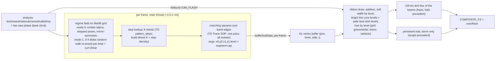
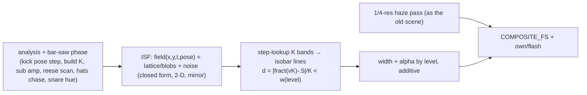
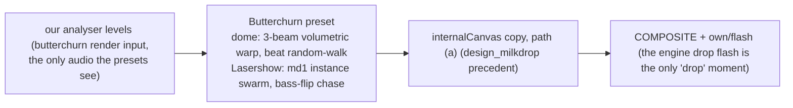

# Design — wave-3 laser scenes REWORK (CP2)

## TL;DR
The rejected `builtin:laser-grid` (analytic polar-fan ISF, "Terminator 2 '91") and the never-built `builtin:laser-storm` are replaced by ONE new CPU native `native/laser` implementing the TD reference workflow: per-frame low-res pattern field → step-lookup ("topographic lines for brightness gradients") → marching-squares trace → real-width additive ribbon geometry + cheap haze, with two render regimes (techno grid / rave storm) on the proven plexus/creatures multi-regime precedent. **Recommended default: Variant A.** B (per-pixel isobar ISF) is the cheapest spec-passing diff but stays in the rejected per-pixel family; C (ship the MilkDrop laser presets) costs nothing to build but is the 1990s second-bar look with no binding to our analysis and an unknown 5 ms outcome on the dome preset.

## Freshness
2026-11-15, system-designer. Inputs cited:
- `agents/research/research_donor_laser.md` — TL;DR, §1 (TD workflow: mono low-res pattern → blur → level/γ → step-lookup cycles+phase → Trace SOP), §3 (trace knobs: thresh, doresample/step, dosmooth/corner, fitcurve), §4 (the rejected approach), §5 (the 3 local laser presets), §6 (paths). Preset JSONs read from the §6.7 paths: `GreatWho - Lasershow.json` (md1: 1024 triangle instances on a bass-flipping radial, `dir` flips at bass > 1.3, positions jump off-beat; a pulsing 36-gon), `martin - cope - laser dome.json` (v2: a warp shader that light-accumulates 3 beams with 1/r falloff; beam positions random-walk on a 3D lattice, repositioning on a mid-average beat detector — the reference for beat-locked discrete re-pose), `ORB - Lazer Ride.json` (v2: spectrum Lissajous drift + mirror/blur comp — calm, fails the DnB drive bar).
- `agents/planner/plan_scenes_wave3.md` — L14 (no design pass existed; planner picks), L22 (P6: the analytic-ISR pick, now void), L23 (P7: light-neutral chase construction, WCAG), L27–36 (Conventions: billing gate, 1 px lines, binding syntax, viewport rule, "no input brightens the frame on a hit"), L41–49 (scenes table; rows 6–7 = laser-grid / laser-storm), L159–184 (CP2: frozen contract, S2.1 as built + lead flatness ruling, S2.2 unstarted), L225 (CP3 close; CP4 = wave close once lasers unblocked), L231–250 (acceptance mapping + risks 5–7).
- `agents/STATE.md` HEAD — S2.1 merged billing (2.89–3.93 ms quiet, pooled ≤4.86), the user's rejection, S1.x/S3.x measured anchors (plexus 2.15/3.48; vortex 32768 per-frame upload 4.26/4.22; orb 60000 4.04/3.95; wireform 96² fill ≈0.3 ms; halo ⅛-res tent; scope persistent trail), the melt/julia unstar precedents, the Spirit-drive lesson (autonomous motion required).
- No new web research needed: all facts are local. Considered-and-dropped: GPU pattern texture + `readPixels` trace (sync stall, ≥1 frame latency, zero codebase precedent) — not a variant.

## §1 Problem + constraints
Rebuild the two laser scenes (plan rows 6–7) so they pass the user's look bar. Fixed by the brief + spec/plan:
1. **Forbidden:** the closed-form analytic polar-fan approach (per-pixel constant-width beams + analytic halo, 2-D noise "smoke") — that exact look was rejected outright ("полное дерьмо").
2. **Drive bar:** DnB/rave needs visible drive — fast motion, hard hits on kick/snare, a big drop. Calm pretty morphs fail (the Spirit precedent).
3. **Look bar:** primary = TD workflow (pattern → stepped topographic contours → traced polygons = the beam); secondary = the 3 MilkDrop laser presets (beat-locked discrete re-pose + sparse beams in volumetric haze). Rewrite by analogy; no verbatim donor blocks; TD files are read-only references (plan Conventions L29: no donor authorisation).
4. **Zero new npm deps.** Own ISFs stay in the ES 1.00 subset (constant loop bounds, no array constructors, no `varying`) — only relevant to Variant B.
5. **Cost:** billed p95 (scene + `own/flash`, 1728×1118, both arr fixtures) ≤ 5 ms, with a named lever if over (plan Conventions L30; CP4 L229).
6. **Engine facts:** WebGL2/twgl, no depth buffer this wave, `lineWidth` = 1 px, per-frame CPU geometry + upload is proven (plexus, vortex), bindings `param←source attack/release min→max` with `lfo`/`bar saw`/event sources, `VJW_FLASH` inputs (min 0, flashGate ≤3/s), "no input brightens the frame on a hit".
7. **Scope:** the plan promises 10 starred built-ins for the wave; rows 6–7 keep their ids and genres (techno grid, rave/DnB storm) or the minimal change is stated per variant.

## §2 Variants

### Variant A — `native/laser`: CPU pattern → step-lookup → marching-squares trace → ribbon geometry (RECOMMENDED)

**Summary.** One new native, two regimes. Each frame, on the CPU: (1) fill a small pattern grid (default 96×96) with a regime field; (2) quantise into K bands (the TD step-lookup — "topographic lines for brightness gradients"); (3) single-pass marching-squares over all band boundaries → segments with their contour level. Upload one interleaved vertex buffer; render as additive soft-width ribbon quads (real beam cross-section, no 1-px lines, no depth buffer) + an ⅛-res tent-blur haze (the halo precedent) + an optional persistent trail for the storm's streaks (the scope precedent). Everything the old scene did with angles and halos is replaced by geometry: beams are the traced isobars of an animated field, and the field re-poses discretely on the beat (the TD cycles+phase idea, and the laser-dome preset's beat-locked jumps).

**Generation.**
- `mode 0` (techno grid): an emitter lattice (4×3 soft blobs, mirroring the old 4-truss composition) where each emitter's intensity steps through `steps` poses per bar from the `phase` input (bar saw): `pose = floor(phase·steps)/steps` — the TD "Number of Cycles / Phase" stepped pattern, so the picture re-poses beat-locked instead of gliding. Field = max of the blobs + low-frequency wobble, mirror-symmetric → strict techno geometry.
- `mode 1` (rave storm): a centre emitter (its concentric isobars read as the cone/tunnel the old row 7 wanted) + two side scanners; blob targets random-walk to new lattice positions **per kick** (the laser-dome preset's beat-locked re-pose, which is exactly what makes that preset read as a laser show), plus curl-noise shear driven by `scan` (reese).
- Step-lookup K bands (default 5); **build raises K** (3→6/7) = contour density ramp = tension into the drop. `dash` (hats) rotates which levels are bright — a **light-neutral level chase** (P7's construction: every step lights the same count, frame luma flat by construction; WCAG 2.3.1 holds as the old scene's fixed-clock ruling did).
- Pure seam for Vitest: `laserField(mode, x, y, t, pose, amp, scan)` and `traceBands(bands, w, h, cap)` (synthetic disc → closed boundary loop, midpoints on the edge ±1 cell; saddle case; `cap` respected). The trace twin is unit-testable exactly like `plexusPairs` was.

**Render.** De-indexed ribbon quads (6 verts/segment), one soft `uv.x` across the width (no sub-pixel shimmer — the creatures "hard 2 px disc shimmers" lesson), width and alpha per level (core levels bright/thin, outer levels wide/faint = a beam cross-section, not a constant-width line), additive, `gl.viewport` per the Conventions. Haze = ⅛-res 3×3 tent of the beam pass (halo precedent, ≤ ~1 ms). Trail (storm static ≈.8) for streaks on the fast beams. No depth buffer needed (additive only); no LINES pass (ponytail: the ribbon already carries the core).

**Audio drive (rows, planner assumptions to confirm at the CP2 demo):**
| source | grid (mode 0) | storm (mode 1) |
|---|---|---|
| `phase←bar saw` | pose steps (4/bar) | blob re-pose per beat |
| `K←build 1/.3 3→6` | contour densification | contour densification |
| `amp←sub .05/.3` | blob reach / pattern scale | tunnel radius (the cone opens) |
| `scan←reese .05/.4` | moiré drift = the wall scan | curl shear = the scanners sweep |
| `dash←hats 0/.06` | light-neutral level chase | level chase |
| `hue←snare 0/.25` | green↔white | rainbow shift |
| `width←kick 0/.12 0→.6 [F]` | beam pop (flash-gated) | beam pop |
| `burst←drop 0/.4 0→1 [F]` | **full open**: all K levels lit at full width, pose to widest step, chase stops | full open + blob jump to max reach |
| lfo sine (slow) | field drift so rest is alive (Spirit-drive lesson) | same |

**Assets.** `builtin:laser-grid` doc **replaced in place** (same id, same scene name, new native mode 0 + new bindings) and `builtin:laser-storm` doc **added** (mode 1). `own/laser-grid.fs` stays in the catalog as a manual L-class effect with a header note ("look rejected by user 2026-11-14; the scene is now `native/laser` mode 0") — the julia / Color-Replacement precedent; its `NEW_OWN` test row stays (the file still parses). Plan rows 6–7 keep ids, genres and the 10-starred count; only the bindings block is rewritten. New files: `web/src/scenes/laser.ts` + `web/src/scenes/laser.test.ts` (2 new + edits — within the ≤3 convention).

**Cost story.** CPU: 96² field + one trace pass ≈ 0.5–1 ms (anchors: wireform's 96² de-indexed fill ≈0.3 ms, orb's 60k CPU points negligible inside 4.04 ms; ⚠️ estimate, the A/B bench settles it). GPU: per-frame upload of roughly 8–24k ribbon vertices (⚠️ estimate of contour length at K 5) sits between the measured plexus (few k, 2.15–3.48) and vortex (32k, 4.26–4.22); ribbon draw + ⅛-res blur ≈ 1–2 ms (halo's scene billed 4.39–4.41 including its blur). **Expected billed +flash ≈ 3.5–4.8 ms. Lever, in order: grid 96→64 (≈2.2× fewer vertices), then K 5→3, then the segment cap / short-segment thinning (TD `doresample`/`step` — "how many points you generate and the un-snoothness you can accept").** Over after the levers → lead ruling (unstar, the melt precedent).

**Rest vs drop.** Rest: a green/white wall of stepped isobars around the emitter lattice, poses ticking per 16th in a flat-luma chase, slow autonomous drift. Drop: `burst` opens all contour levels at full width with a white core, the pose snaps to its widest step, the chase stops — a full-open flash inside the ≤3/s gate.

**Acceptance mapping (plan L231–239):** §4.1 billing via the A/B bench + named lever; §4.2 reaction r per bound param on both fixtures (techno scene on the dnb fixture + techno preset per the Conventions); §4.3 `__flash` ≤3/s + luma cap by the P7 light-neutral construction + the old scene's fixed-16th-clock flatness check (kept); §4.5/§4.6 CP sheet + 60 s run + 2b library block come free (the def carries category/tags). Roadmap: the CPU trace → ribbon pipeline is exactly the pipeline the pending user-designed **lightning scene** (mask edge → traced bolt) will reuse — no scaffolding added, just a note. 3D/orbit camera untouched (the scenes are frontal, as the old ones).

**Risks.** (1) Look authoring: a traced isobar field is a new picture — the regime fields need the same screenshot tuning loop as S0.1/S3.1, and "contours ≠ lasers" is the failure mode if the fields are too smooth/too symmetric (mitigation: the blob + curl recipe is lifted from the dome preset's actual behaviour). (2) Cost estimate is unmeasured; the lever chain is proven (vortex fired its N lever exactly this way). (3) CPU trace on the main thread: governor jsMs watches it; ≤1 ms expected. (4) The flatness gate wording (S2.1) assumed beams; it generalises to "same lit-level count per step" — the planner restates it for levels.

**Effort: M** (one native + test + two builtin docs + ISF header note, over ~2 steps S2.1'/S2.2').

### Variant B — per-pixel isobar ISF (the simplest thing that meets the numeric spec)

**Summary.** No native, no geometry. Rewrite `own/laser-grid.fs` (and a `laser-storm.fs` or a `mode` float in one file) as a **stepped-contour field shader**: per pixel, evaluate a closed-form 2-D field (emitter lattice / blob sum + value noise — *not* a polar fan), quantise to K bands, and draw the isobars as `d = |fract(v·K) − 0.5|/K < width(level)` with a wider fainter skirt level for glow, ¼-res haze pass as the old scene had. It is the cheapest diff that satisfies every numeric gate (the old scene's 2.89–3.93 ms quiet billing is the known number, full-res fragment cost is flat, ES 1.00 subset friendly: constant K loop, no includes).

**Audio drive.** Same mapping table as A (pose step on `phase`, K on build, chase on hats, full-open burst) — the ISF takes scalars, so the drive story is identical; the difference is only that the "beams" are screen-space bands of a field, not geometry.

**Assets.** Two ISF rewrites (or one file + `mode`), the two builtin docs point at them; `laser-grid.fs` redone in place, `laser-storm.fs` new as originally planned. Plan rows 6–7 otherwise intact.

**Cost story.** Known: the old scene billed 2.89–3.93 ms quiet (2 passes: ¼-res + full-res); a K-5 band loop at full res is comparable. Lever: layer res .75 (the plan's existing S2.1 lever).

**Rest vs drop.** Rest: a slowly drifting moiré of flat constant-width contour lines. Drop: all bands flood to full width + flash.

**Risks.** (1) **Look: this is the variant closest to the rejected one.** Different shape (isobars, not a fan) but the same family the user named: per-pixel, constant-width "beams", analytic glow, 2-D noise haze — the §4 critique ("no real beam cross-section or scattering volume") applies almost verbatim. Highest re-rejection risk of the three. (2) No real width: band thickness is a screen-space constant, it does not taper or narrow with distance, so it reads as a "line drawing", not a beam. (3) Drives the 10-scene count fine, but wastes a second user review cycle if it fails the bar. Meets constraints 1 (not a polar fan — ⚠️ borderline, needs confirmation at the gate), 4, 5, 7; weak on 2–3.

**Effort: S** (1–2 steps, ISF rewrites only).

### Variant C — ship the MilkDrop laser presets through the existing butterchurn pipeline

**Summary.** Zero custom render code. Copy 2 of the 3 laser presets into `web/src/milkdrop/presets/` via the existing `web/scripts/milk-presets.mjs` (credit fields per spec §6 — packaging MIT, preset content "unknown (preset author)" per research §5, the same terms as the 25 already shipped), register `builtin:milk-<slug>` scenes in the `spread()` list, probe them under the K2-style 5 ms gate. The honest candidates: `laser dome` (the one that actually looks like lasers — sparse beams, volumetric 1/r glow, beat-locked re-pose) and `GreatWho - Lasershow` (md1 1997 swarm). `Lazer Ride` is ruled out at the bar: calm spectrum ribbons, no drive.

**Audio drive.** Preset-internal only (the dome's mid-average beat detector, the Lasershow's bass flip). No bindings to our kick/snare/build/drop envelopes — the Q2 ruling (no detector hooks) stands — so "hard hits on kick/snare, a big drop" depends on what the preset happens to react to. The build→drop K-density story does not exist.

**Assets.** Rows 6–7 become `builtin:milk-laser-dome` + `builtin:milk-lasershow` (ids change → the plan's rows and the 2b library names change with them); the old `laser-grid` ISF is then unstarred to L-class (melt precedent) or kept as today. The 30-scene `spread()` order shifts.

**Cost story.** Unknown until probed: the dome preset runs a full-res warp with 3 light accumulations + noise volumes — plausibly **over** the 5 ms K2 gate (the probe passed 264/387 presets, i.e. ~29 % failed). Lasershow (md1, 1024 instances) is cheaper but the look is the era the user rejected. The kill criteria are the probe's own: any preset >5 ms is dropped.

**Rest vs drop.** Dome rest: three beams wandering in haze, re-posing on detected beats. Drop: only the engine's own flash — no scene-level full-open.

**Risks.** (1) Rejection: Lasershow is literally 1997; the dome may not pass the cost gate at all; the user's primary reference (the TD trace workflow) is not met by either. (2) Scope creep into the milk system: playlist spread, probe, credit rows for a look the brief says to *rewrite by analogy*, not ship. (3) It answers "what does a laser look like in 1998" instead of the brief.

**Effort: S** (script + probe + builtin edits) — with a high probability of dying at the gate or at the review.

## §3 Comparison

| | **A: CPU trace native** | **B: per-pixel isobar ISF** | **C: ship MilkDrop presets** |
|---|---|---|---|
| Meets the TD look bar (primary ref) | **Yes — is the TD workflow** (pattern → steps → traced polygons) | Partial: the step-lookup, not the trace/beam | No: second bar only |
| Meets the second bar (MilkDrop) | Yes (beat-locked re-pose + haze, taken from the dome preset's behaviour) | No | **Yes, verbatim** |
| DnB drive (kick hit, build→drop story) | **Full bindings** (pose, K, full-open burst) | Full bindings (same scalars) | Preset-internal only, no drop story |
| Rejection risk (the user's bar) | Medium — new picture, tuned in the screenshot loop like S0.1/S3.1 | **High** — same per-pixel family as the reject | **Highest** — md1 era / gate unknown |
| Billed estimate @1728×1118 | ≈3.5–4.8 ⚠️ (anchors: plexus 2.15–3.48, vortex 4.22–4.26, halo-blur ≤1) | known ≈2.9–3.9 (old scene measured) | unknown; dome plausibly >5 (probe kill) |
| Named lever | grid 96→64 → K 5→3 → segment cap | layer res .75 | none (drop if over) |
| New engine surface | none (per-frame upload, trail, ⅛ blur all precedented) | none | none |
| Diff | 2 new files + builtin swap + ISF note | 2 ISF rewrites | script + probe + spread change + 2 id renames |
| Plan rows 6–7 / 10-starred count | **kept (same ids, genres)** | kept | ids change, count kept |
| New deps | none | none | none (presets already in node_modules) |
| Roadmap | the trace→ribbon seam is the future lightning pipeline | nothing | nothing |
| Effort | **M** | S | S |

**⭐ Recommended default (the lead should take this): Variant A.** It is the only variant that renders the primary reference — beams as traced, real-width geometry with beat-locked re-posing and our full analysis bindings — inside the 5 ms gate on measured precedents (vortex's per-frame upload, halo's ⅛-res blur) with a proven lever chain; B is the cheap fallback only if A misses the gate after its levers, and C does not meet the brief's look requirement.

## §4 Decision the lead records
**Pick: Variant A** (the user has delegated variant picks to the lead; report the pick after). Scope changes to `agents/planner/plan_scenes_wave3.md` (the planner rewrites CP2 on this):
1. **CP2 frozen contract replaced:** delete the two-ISR contract (L159–163); add the `native/laser` contract — inputs `mode (long 0|1), K (2..8 def 5), steps (2..8 def 4), phase (0..1), amp, scan, dash, hue, width, haze, trail, hit [F], burst [F]`; `VJW_FLASH ["hit","burst"]`; pure seams `laserField(...)` and `traceBands(bands,w,h,cap)` with the Vitest twin; registered in `fx/catalog.ts` (category geometry, tags laser/trace).
2. **S2.1 replaced** ("`own/laser-grid.fs` → `builtin:laser-grid`") with: `native/laser` trace engine + mode 0 field + `builtin:laser-grid` doc swapped in place (same id). Gates: billed +flash p95 ≤5, lever order grid 96→64 → K 5→3 → segment cap; the luma-flatness gate restated for the light-neutral **level** chase (P7 construction, fixed-16th-clock reading per the 2026-11-14 ruling); `__flash` ≤3/s; live pass with r on the §2 table bindings (⚠️ planner assumptions, confirm at the CP2 demo); techno scene on dnb fixture + techno preset.
3. **S2.2 replaced** ("`own/laser-storm.fs` → `builtin:laser-storm`") with: mode 1 field (beat-locked blob random-walk, tunnel + side scanners) + `builtin:laser-storm` doc added. Same gates; drop still = full-open (all K levels, widest pose).
4. **`own/laser-grid.fs`:** stays in the catalog, L-class header note (rejected look 2026-11-14; the scene is now `native/laser` mode 0); its `NEW_OWN` test row and file remain untouched. No unstar bookkeeping needed (the scene id is reused, the fx id is not a starred scene).
5. **Rows 6–7:** bindings blocks rewritten per §2's table; look descriptions updated ("traced isobar beams, stepped poses" / "beat-walking blob beams, tunnel + scanners"); genre, ids, count (10 starred), demo intent, and CP4 unchanged (CP4 stays the wave close; its L229 library line reads `native/laser` instead of the two ISFs).
6. **No user question** — the pick is delegated to the lead; the lead reports it.
