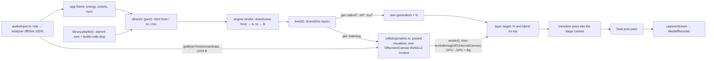
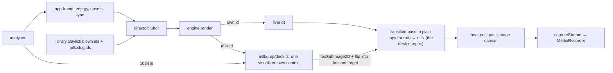
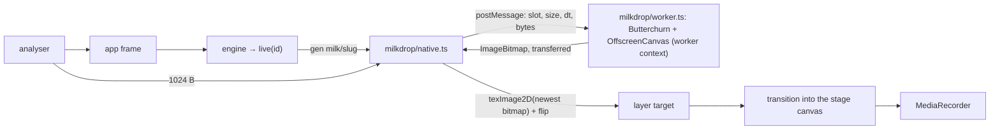

# Design — MilkDrop / Butterchurn (epic `milkdrop`)

## TL;DR
- **Variant A (recommended, simplest):** each curated preset becomes a catalog native generator `milk/<slug>`, wrapped in a one-layer built-in `SceneDoc` `builtin:milk-<slug>`. Stars, playlist, director, gl-transitions, prepare-ahead, warm-at-Start, `?bench`, panel and REC then work unchanged. **B:** a whole-frame MilkDrop "deck" the engine switches to, with MilkDrop's own preset morphs. **C:** A, with Butterchurn in a Worker.
- In all three, `butterchurn@3.0.0-beta.5` (MIT, exact pin) renders in its own OffscreenCanvas WebGL2 context.
  - Each frame is copied GPU→GPU into our `#stage` context, so `#stage` and REC carry both engines.
  - Audio comes from our exported `analyser` through the public `render({audioLevels, elapsedTime})`. No new audio nodes.
- 20–30 shader-bearing presets from `butterchurn-presets@3.0.0-beta.4` (WASM equations) are copied into the repo with credit fields.
  - Presets hear only bass/mid/treb. Our kick/reese/drop act on top of them.
  - Feeding our detectors into presets needs an unofficial hook, which is the user's call.
- **Plan step 1 in every variant is a `?bench` probe on the M4**, with kill criteria K1–K4: copy cost, per-preset GPU, switch hitch, JS headroom.

## Freshness
- Written 2026-11-03 at master `b6272e6`.
- Spec `thoughts/spec_veejay_wizard.md`:
  - TL;DR L6, §1 L15, §2.4 L48–49, §3 L75, §4 L78, §5 L92–93, §6 L99–101;
  - §7 L103–110, read because this role maps §7.
- Research:
  - `agents/research/research_butterchurn_integration.md` §1–§6 (2026-11-03, fresh).
  - `agents/research/research_donor_milkdrop.md` §2, §3, §4, §6 (2026-10-27), only for facts the delta lacks: options, `internalCanvas`, no dispose, async `loadPreset` and its blend, CPU 4.17/2.32 ms, `pixelRatio`.
- Design: `agents/system-designer/design_effects.md`:
  - E1 (natives);
  - E2 L110–133 (5 ms budget, compile-all at Start, prepare-ahead);
  - roadmap L471 ("Butterchurn: a native generator, its canvas uploaded as a texture").
- Code (contracts confirmed):
  - `gl/scene.ts`, `gl/engine.ts` L1–216, `gl/live.ts` L25–29, L108–124, L192–209, L236–326, L400–441;
  - `director.ts`, `library.ts`, `fx/catalog.ts`, `fx/types.ts`, `frame.ts`;
  - beyond the brief: `app.ts` L227–245 and L315–338 (prepare/peek timing), and `bench.ts` L1–30 (probe reuse).
- Web, pattern only: a hidden Butterchurn canvas re-uploaded as a texture every frame is an existing pattern (three.js `CanvasTexture`). No reference found composites it with other passes.

## Constraints
- **Goal (§4 L78):** 20–30 curated Butterchurn presets in the shared playlist, autopiloted with our scenes, and both engines composited into one recorded canvas.
- **Bar (§1 L15):** a calm UI, buttery-smooth output, "side by side with MilkDrop".
- **Locked (§5):** Butterchurn; REC = `MediaRecorder` + `canvas.captureStream()`; WebGL2; Chrome; localhost.
- **Licensing (§6):** any license is allowed, including unknown preset licenses, but every dependency's license is recorded. Presets embed warp/comp GLSL, so each one carries author, URL and license (L100).
- **No §7 regressions:**
  - §7.3: the own scenes stay in the playlist, with bar-line switching and keys;
  - §7.4: REC keeps picture and sound;
  - §7.5: 60A holds 60 fps for 30 min on the M4. design_effects E2 allows ≤30 drops over ~60 switches, so one drop per switch fails;
  - §7.6: gates.
- **Inherited rules (design_effects E2):**
  - ≤5 ms GPU p95 per scene at the bench size (1728×1118, scale 1);
  - nothing compiles inside a fade (compile-all at Start, prepare-ahead);
  - the governor steps down only while the median JS time is < 10 ms (research §2).
- **Out of scope:** `.milk` import, a MilkDrop editing UI, MIDI/Link, and off-thread rendering unless the probe forces it (C).

## Common to all variants

### C1 Engine line, presets, storage
- **`butterchurn@3.0.0-beta.5`, exact pin, MIT.**
  - Both lines are equally idle (research §1).
  - 3.x runs EEL as WASM: 2.32 ms/frame vs 4.17 ms in JS (prior §6).
  - 3.x already renders on an internal OffscreenCanvas (prior §3).
  - Webamp's fork publishes 3.0.0-beta.5 as `latest` (research §1).
- **Candidates:** `butterchurn-presets@3.0.0-beta.4`, 504 presets, 395 of them with warp/comp shaders. They use `*_eqs_eel` (the WASM path), and the packaging is MIT (research §5).
  - It is a devDependency, read only by `?bench`.
  - A favourite that exists only in 2.4.7 (`*_eqs_str`) still loads on 3.x through the JS path (research §5).
  - baron and Ansorre are out: they carry no shaders.
- **Shipped presets:** one copied file per curated preset, `web/src/milkdrop/presets/<slug>.json` = `{ name, author, url, license, preset }`.
  - JSON has no comment header, so these fields carry §6's credit. `license` reads "content unknown (preset author); packaging MIT (butterchurn-presets, Jordan Berg)".
  - Size: median ~6 KB, p90 ~11 KB (research §5). They load with an eager `import.meta.glob`, as `fx/catalog.ts` does.
- **`THIRD_PARTY.md`:** butterchurn and its runtime deps (⚠️ G1), butterchurn-presets, and the preset list.
- **Types:** a hand-written `milkdrop/butterchurn.d.ts` covering only the members we call. Upstream ships no types.

### C2 Context, frame path, REC
- **Contexts:** Butterchurn 3.x creates its own OffscreenCanvas and WebGL2 context. It has no caller-FBO option, and its Renderer is not exported (research §4). So:
  - we run 1 + N contexts (Chromium's cap is 16);
  - no GL state is shared, so nothing leaks into twgl.
- **The canvas we hand it:** a detached canvas holding a `bitmaprenderer` context, so its `getContext('2d')` is null (HTML spec, prior §3).
  - Butterchurn then skips its own `drawImage` copy, and the frame stays in the undocumented `visualizer.internalCanvas` (prior §3).
  - A boot check asserts that member exists ⚠️ G2.
- **Per frame, in the same task as `render()`** (the drawing-buffer rule, research §4):
  1. `texSubImage2D(internalCanvas)` into one texture of ours. Chromium does this as a GPU→GPU blit (research §4).
  2. One fullscreen copy with a Y-flip into the bound target.
  - The probe also measures two alternatives: `transferToImageBitmap()`, which takes the GPU path too (research §4), and the public 2D-canvas path (no internals, one extra copy).
- **REC is unchanged.** The frame goes shot target → transition → `#stage` → `captureStream()` (research §2), so REC holds both engines, with sound.
- **Context loss:** losing Butterchurn's context calls `location.reload()`, as `#stage` already does (engine.ts:17).

### C3 Audio
- **Feed:** no `connectAudio`. It would add a DelayNode, 3 AnalyserNodes and a splitter per visualizer on the audio thread (prior §2), while underruns are under investigation. Instead, every frame:
  1. `analyser.getByteTimeDomainData(bytes)` reads 1024 B (research §3);
  2. `render({ audioLevels: { timeByteArray: bytes, timeByteArrayL: bytes, timeByteArrayR: bytes }, elapsedTime })` (public, prior §2).
  - It is the same signal and the same frame as `energy`. Mono goes to both L and R (accepted).
- **`createVisualizer(ctx, …)` gets our `ctx`,** so its band edges use the real sample rate (research §3).
- **`elapsedTime`** is the `dt` Butterchurn's caller gets. In A/C that is the layer's warped `dt`, so the heat speed-up (app.ts:328) and a bound layer `speed` time-warp the preset through a public API.
- **Our sources → presets:** the only route is overriding the undocumented `renderer.audioLevels` (research §6). **Default: not built.** Kick/reese/drop still reach a MilkDrop frame through:
  - the drop cut (app.ts:330);
  - the heat post pass over `#stage` (engine.ts:204–215);
  - the heat time-warp;
  - in A/C, our fx layers on top, bound to any source.
  - If the user wants the hook (Q2), it is ~15 lines in one file. It relies on the exact pin and falls back to Butterchurn's own levels if a boot check fails. Tuning it needs the real tracks (STATE queue 4).

### C4 Resolution, governor, REC freeze
- **Size:** the visualizer follows the size of the target it draws into.
  - On a change it calls `setRendererSize(w, h, { pixelRatio: 1, textureRatio: 1 })`. That resamples its feedback, so trails survive a governor step (research §4).
  - `pixelRatio: 1` is a must: the DPR default gives 4× the pixels (prior §6).
- **When it can change:** governor steps come at most every ~2 s (research §4), and `setOutput` is frozen during REC (app.ts:233). So Butterchurn never resizes while recording.
- **Knobs for a heavy preset:** layer `res` (A/C), the mesh from 48×36 down to 32×24 (Webamp's, CPU, prior §6), and the governor floor 0.6.
- **Known limit:** our per-scene timer (engine.ts:163–174) sees only the copy, so the panel's GPU hint under-reports MilkDrop scenes. The probe times Butterchurn's context separately.
- **JS time:** Butterchurn's CPU (equations plus 3 JS FFTs) runs inside our frame's JS time, which the governor's GPU-bound test reads (research §4).

### C5 Plan step 1 in every variant: the probe
- **Setup:** `?bench&milk` is a self-contained section of `bench.ts`. It installs nothing beyond C1, drives visualizers directly before any integration code exists, and runs on the M4 at 60A.
- **Candidates:** all 395 shader-bearing presets, ~1 s each. Results go to `window.__bench`.
- **Measures:**
  1. copy: GPU p95 and main-thread ms, for the three C2 paths;
  2. per preset: `render()` main-thread ms, and Butterchurn GPU ms (a timer query on `internalCanvas.getContext('webgl2')`, which is the same context object, prior §3);
  3. per preset: how long `loadPreset` plus the first render blocks the main thread, cold and warm (warm = a second load after a warm-up pass); visualizer creation ms; `setRendererSize` ms;
  4. a 60 s autopilot over own and MilkDrop scenes: late frames per switch, and the JS median.
- **Kill criteria** (⚠️ knobs set by design):

| # | Measure | Fails when | Then |
|---|---|---|---|
| K1 | copy | > 1 ms GPU p95 or > 0.5 ms main thread, on every path | stop; back to design (vendored shared-context fork) |
| K2 | Butterchurn GPU + copy | > 5 ms p95 at the bench size | that preset is out; if < 20 pass at res 1, and again at res 0.75 with mesh 32×24, stop and ask the user |
| K3 | warm load + first render | > 8 ms median or > 16 ms p90, or a late frame at a MilkDrop prepare in the 60 s run | stop; either vendor Butterchurn with async compile (`KHR_parallel_shader_compile` has 0 hits upstream, research §5), or have fewer MilkDrop switches (the user decides) |
| K4 | our JS median with MilkDrop on screen | ≥ 9 ms | mesh 32×24; if still ≥ 9 ms → Variant C |

## Variant A — presets as native generators (simplest; recommended)
**Summary.**
- Butterchurn sits behind the frozen CP1 native contract, the slot that design_effects reserved for it (L471).
- Each preset is a catalog generator `milk/<slug>`:
  - `create()` borrows a pooled visualizer and loads the preset;
  - `draw()` renders it and copies the frame into the bound target (C2).
- Its built-in `builtin:milk-<slug>` has one layer: normal, opacity 1. From there it is an ordinary scene:
  - starred into the playlist (library.ts:89–92);
  - faded with a random gl-transition (app.ts:316–318);
  - prepared ahead (app.ts:321), warmed at Start (live.ts:417), swept by `?bench`;
  - opened in the panel (Save as, then fx on top);
  - recorded.



**Modules and files:**

| File (under `web/`) | Change | Responsibility |
|---|---|---|
| `package.json` | edit | `butterchurn` 3.0.0-beta.5 (exact); devDependency `butterchurn-presets` 3.0.0-beta.4 |
| `src/milkdrop/presets/*.json` | new, 20–30 | the curated presets (C1) |
| `src/milkdrop/presets.ts` | new, pure | glob → `PRESETS`, `MILK_SCENES`, `spread()`. No GL import, so the library and doc tests stay browser-free |
| `src/milkdrop/native.ts` | new | the pool, the `milk/*` natives, audio bytes, copy, resize (C2–C4) |
| `src/milkdrop/butterchurn.d.ts` | new | the members we call |
| `src/fx/catalog.ts` | +1 line | register the natives |
| `src/scenes/builtin.ts` | ~2 lines | `BUILTIN = spread(own, MILK_SCENES)` (Q4) |
| `src/gl/scene.ts`, `src/gl/live.ts` | ~3 lines | the optional `warm?()` (below) |
| `src/bench.ts` | edit | the C5 probe |
| `THIRD_PARTY.md` | edit | C1 |
| `src/milkdrop/presets.test.ts` | new | credit fields present, slugs unique, every doc passes `parseScene`, `spread` order |

**Pool and lifecycle:**
- **Visualizers are made once and reused.** Butterchurn has no dispose (prior §2), and creating one compiles its built-in shaders (⚠️ cost unmeasured, C5.3).
  - `acquire()` pops a free visualizer or creates one. A native's `dispose()` returns its visualizer once its load has settled.
  - In practice the pool holds 2: the scene on screen and `peek()`. That matches `prepare([from, peek()])` (app.ts:321), which disposes before it builds (live.ts:402–409), so the next scene reuses the visualizer the old one returned.
  - Fast ←/→ presses mid-fade can briefly need a 3rd. `ponytail:` the pool has no cap; each visualizer is one of Chromium's 16 contexts.
- **`create()`** starts `loadPreset(p, 0)` (async in 3.x, prior §2), then one throwaway `render()` to warm the GL pipeline. Until both finish, `draw()` clears its target to black.
- **`warm?()`, new and optional on `NativeDef`:** at Start, `warm()` (live.ts:417) awaits it instead of create/dispose, one preset at a time, behind the existing "compiling n/N" line.
  - It creates both pool visualizers, then loads and renders each starred preset once.
  - That primes whatever program caches Chromium, ANGLE and Metal keep. ⚠️ Assumption: a second compile of the same source is much cheaper. K3 measures it.
- **Result:** a preset's compile lands at prepare time, mid-scene, never inside a fade or at a drop cut, since the cut goes to `peek()`, which is already prepared. That is design_effects E2's rule.
  - An unpredicted one (a manual ←) shows black for its load time, today's "one hitch per press" class.
- **MilkDrop → MilkDrop:** two visualizers render side by side, and our random gl-transition fades them like any two scenes. MilkDrop's own morph is not used (that is B).

**Contracts:**
```ts
// gl/scene.ts — CP1 plus one optional member; live.ts warm() awaits it instead of create()/dispose()
export interface NativeDef extends EffectDef { create(gl: WebGL2RenderingContext): Native; warm?(): Promise<void> }

// milkdrop/presets.ts — pure (signatures)
export interface PresetFile { name: string; author: string; url: string; license: string; preset: object }
export declare const PRESETS: readonly (PresetFile & { slug: string })[]
export declare const MILK_SCENES: readonly SceneDoc[] // 'builtin:milk-<slug>': one layer, gen { ref: 'milk/<slug>' }, fx []
export declare function spread<T>(own: readonly T[], milk: readonly T[]): T[] // the autopilot order (Q4)

// milkdrop/native.ts — GL
export declare const milkdrop: readonly NativeDef[] // 'milk/<slug>', kind 'generator', category 'feedback', inputs []

// milkdrop/butterchurn.d.ts — only what we call (3.0.0-beta.5)
declare module 'butterchurn' {
  interface Levels { timeByteArray: Uint8Array; timeByteArrayL: Uint8Array; timeByteArrayR: Uint8Array }
  interface Size { pixelRatio: number; textureRatio: number }
  export interface Visualizer {
    loadPreset(preset: object, blendTime: number): Promise<void>
    render(opts: { audioLevels: Levels; elapsedTime: number }): void
    setRendererSize(width: number, height: number, opts: Size): void
    readonly internalCanvas: OffscreenCanvas // undocumented (prior §3)
  }
  const butterchurn: { createVisualizer(ctx: AudioContext, canvas: HTMLCanvasElement, opts: { width: number; height: number } & Size): Visualizer }
  export default butterchurn
}
```

**Reuse and licenses:**
- `butterchurn` 3.0.0-beta.5, MIT, plus its runtime deps (⚠️ G1). Imported as a dependency.
- `butterchurn-presets` 3.0.0-beta.4: MIT packaging; each preset's content license is unknown. The 20–30 shipped presets are copies; the package stays a devDependency for the bench.
- twgl.js 7.0.0, MIT (existing): `fullscreenProgram` does the flip copy.
- `donor/`: nothing MilkDrop-related (research Freshness).

**§4 and §7:**
- **§4 L78:** 20–30 starred `builtin:milk-*` built-ins join the playlist, and REC of `#stage` holds both engines (C2).
- **§7.1–7.2:** input and analysis are untouched. MilkDrop reads the same `analyser` in the same frame (C3).
- **§7.3:** the own scenes stay. The director and keys are untouched, and MilkDrop entries switch on bar lines like any scene.
- **§7.4:** REC is unchanged (C2).
- **§7.5:** the probe gates K1–K4 first. Compile-at-Start and mid-scene prepare keep compiles out of fades. The lead's 30-min run is repeated with MilkDrop in the playlist.
- **§7.6:** pure parts are in Vitest (`presets.test.ts`); GL parts go through `?bench`.

**Roadmap left open (nothing built):**
- **2b editor:** presets are catalog nodes, so the editor can browse and layer them as they are.
- **Detectors → presets (Q2):** one later step inside `native.ts` (C3).
- **Camera, clip mixer:** unaffected; both are natives over video textures.
- **Electron:** same Chromium, same context cap.
- **More presets, `.milk` import:** a later research item (a converter). The file format stays.

**Risks:**
- **R1, switch hitch (K3):** the §7.5 risk. Warm-at-Start priming caches is ⚠️ an assumption.
- **R2, copy cost on the M4 (K1):** unmeasured.
- **R3, per-preset GPU/CPU (K2, K4):** an MM fade runs two presets (2× CPU), but fades are 1 bar in 16, so the median holds.
- **R4, internals:** `internalCanvas` (exact pin, boot check).
- **R5, an idle beta dependency:** exact pin; MIT allows vendoring.
- **R6, cold start:** a freshly loaded preset fades in from an empty feedback buffer, or from the previous preset's image on a reused visualizer. That is taste; a pre-roll knob exists if it looks weak.
- **R7, black frames:** an unprepared MilkDrop scene needed at once (manual ←, a second cut right after a switch) shows black until it loads.
- **R8, memory:** each pooled visualizer holds its textures at the internal size (⚠️ unmeasured; the M4 has 16 GB).
- **R9:** the panel's GPU hint under-reports MilkDrop (C4).

**Effort: M.** Probe S; integration M (~150 new lines + ~6 edited lines of app code); curation needs the user's time.

## Variant B — a MilkDrop "deck": a whole-frame second engine
**Summary.**
- Butterchurn is a second engine beside `live`. MilkDrop entries are playlist ids `milk:<slug>`, not SceneDocs.
- `engine.drawScene` sends them to `milkdrop/deck.ts`, which owns one visualizer and draws its frame into the shot target (C2).
- Between two MilkDrop entries the deck runs MilkDrop's own morph, `loadPreset(to, seconds)`. Old and new presets run side by side with a per-vertex blend (prior §2). The engine copies instead of running our transition for that fade.
- Trade: the authentic MilkDrop look between presets, and only one extra context, against no layering and compiles inside fades.



**Modules and files:**

| File (under `web/`) | Change | Responsibility |
|---|---|---|
| `src/milkdrop/deck.ts` | new | one visualizer; `preload`, `morph`, `render`, `name` |
| presets, `butterchurn.d.ts`, `package.json`, `THIRD_PARTY.md` | as A | (no `MILK_SCENES`) |
| `src/gl/engine.ts` | edit | `drawScene` branches on `isMilk`; a milk → milk fade is a copy |
| `src/app.ts` | edit | preload only while the deck is off screen; `morph(to, s)` when a milk → milk fade starts (s from BPM × bars, or 2 s); the name and the edited target for milk ids (`live()` throws on them, live.ts:322) |
| `src/library.ts` | edit | `playlist()` and `setStar` take milk ids |
| panel | edit | read-only for a milk id |
| `src/bench.ts` | edit | the C5 probe, plus the hitch of `loadPreset(to, s)` at a fade start |

**Contracts:**
```ts
// milkdrop/deck.ts
export const isMilk = (id: SceneId) => id.startsWith('milk:')
export declare const deck: {
  preload(id: SceneId): void                 // loadPreset(p, 0) + one render; only while the deck is off screen
  morph(to: SceneId, seconds: number): void  // a milk → milk fade: MilkDrop's own blend
  render(f: FrameInput, into: Target): void  // render + copy into a shot target
  name(id: SceneId): string
}
// engine.ts drawScene: isMilk(id) ? deck.render(f, into) : live(id).render(f, s, into)
// library.ts: playlist() = starred own ids + starred milk ids; setStar(milk id) stores in vjw.stars
```

- **Reuse:** as A.
- **§4/§7:** as A, except:
  - **§7.5 is weaker.** The deck can preload only while an own scene is on screen. A milk → milk switch compiles when the fade starts, and a drop cut from milk to milk compiles at the drop. K3 is stricter for B: any hitch there is visible.
  - **§7.3:** fades run on the director's bars, but Butterchurn's blend runs on seconds, so the two only roughly line up.
- **Roadmap:** the 2b editor can't layer MilkDrop, because the deck sits outside the doc model. Moving to A later means rewriting the deck. Q2's hook is the same.
- **Risks:** compiles inside fades and at drops; 4 modules touched plus the panel; the fade-length mismatch; no fx or bindings on presets; a special case in the panel.
- **Effort: M.**

## Variant C — A, with Butterchurn in a Worker
**Summary.**
- Placement is A's: natives, built-in docs, a pool.
- The visualizers live in a module Worker on their own OffscreenCanvases. That takes Butterchurn's CPU off the main thread: equations at 2.3–4.2 ms, FFTs, and GL call encoding (prior §6).
- Per frame:
  1. the native posts `{ slot, w, h, dt, bytes }`;
  2. the worker renders and posts back `transferToImageBitmap()`, transferred;
  3. the native uploads the newest bitmap (GPU path, research §4) and closes it.



- **Files:** as A, plus `src/milkdrop/worker.ts` (Butterchurn, a `window = self` shim ⚠️ G8, the message loop). `native.ts` holds the slot ↔ worker protocol and the newest-bitmap texture.
- **Contract:**
```ts
// milkdrop/native.ts ↔ milkdrop/worker.ts
type ToWorker =
  | { t: 'load'; slot: number; preset: object }
  | { t: 'frame'; slot: number; w: number; h: number; dt: number; bytes: Uint8Array }
type FromWorker =
  | { t: 'frame'; slot: number; bitmap: ImageBitmap } // transferred; the native closes it after upload
  | { t: 'loaded'; slot: number }
  | { t: 'error'; slot: number; msg: string }
```
- **Gains:** K4 can't fail, and preset JSON and WASM work leave the main thread too.
- **Costs:**
  - MilkDrop runs +1 frame late (~17 ms, against §7.2's ≤50 ms hypothesis);
  - shims for 36 `window`/`document` refs (research §4, ⚠️ G8);
  - newest-wins frame pacing, and harder debugging;
  - Chromium's worker context cap is 4 (research §4);
  - a link may still stall the GPU process for our context (⚠️ G8), so C doesn't fix K3 if the hitch is on the GPU side.
- **§7, reuse, roadmap:** as A, plus the latency note on §7.2.
- **Effort: L.** Only worth it if K4 still fails at mesh 32×24.

### Rejected placements
- **A shared context through a vendored fork** that exports `Renderer` and binds our FBO: no copy, but Butterchurn's GL state lands in twgl's context and we would own a fork. It stays only as K1's fallback.
- **A 2D-canvas compositor** (prior §4a): loses gl-transitions and the post pass, and adds a copy per engine.
- **Butterchurn's canvas laid over `#stage` in the DOM:** REC would miss it (§4 L78).

## Comparison

| | A — native generators | B — deck | C — worker |
|---|---|---|---|
| Where Butterchurn sits | a generator layer in a SceneDoc | a whole-frame engine beside `live` | as A; renders in a Worker |
| Context owner | `native.ts` pool: stage + 2 (3 on fast presses) | `deck.ts`: stage + 1 | the Worker: stage + 2 |
| Frame → stage | `texSubImage2D(internalCanvas)` → layer → transition | the same, into the shot target | ImageBitmap → `texImage2D` → layer |
| Existing app code touched | ~6 lines (catalog, builtin, scene/live warm) | engine, app, library, panel | as A |
| Effects/bindings on presets | yes | no (post pass + drop cut only) | yes |
| MilkDrop → MilkDrop | our gl-transition, two presets live | MilkDrop's own morph | our gl-transition |
| Where a compile lands | mid-scene (prepare-ahead) | mid-scene after own scenes; inside the fade or at a drop for milk → milk | the worker thread; GPU side ⚠️ |
| Main-thread CPU per MilkDrop frame | ~2.3 ms + FFTs (×2 in an MM fade) | ~2.3 ms + FFTs | upload only |
| Latency | same frame | same frame | +1 frame |
| Internals relied on | `internalCanvas` | `internalCanvas` | `internalCanvas`, a `window` shim |
| 2b editor fit | presets are catalog nodes | outside the doc model | as A |
| Effort | **M** | M | L |

## Recommendation
**Variant A.**
- It is the slot design_effects reserved (L471). Butterchurn hides behind the frozen native contract, so the playlist, stars, director, transitions, prepare-ahead, compile-at-Start, `?bench`, panel and REC need no new code path: one new module and ~6 changed lines of app code.
- Every preset compile lands mid-scene, never inside a fade or at a drop. B can't promise that for milk → milk.
- Our effects and bindings still work on top of presets.
- Its two real unknowns are what plan step 1 measures before any integration code is written: the per-frame copy and the warm-load hitch on the M4. The kill criteria then send us to a vendored async compile, or to C.
- B wins only on MilkDrop's classic morph. If the user misses it after seeing A, it is a separate, later step.

## Research gaps
- **G1:** the runtime dependency tree and licenses of butterchurn 3.0.0-beta.5, for the §6 record. The install step lists them; not a blocker.
- **G2:** whether the 3.0.0-beta.5 dist has `internalCanvas`, and the null-2D skip with a `bitmaprenderer` canvas. Prior §3 read master. The probe asserts both.
- **G3:** whether the 3.0.0-beta.4 presets load cleanly on engine 3.0.0-beta.5, four years apart. The probe counts load errors.
- **G4–G7:** cold/warm compile and first-draw cost (K3), the copy on the M4 (K1), our current JS median at 60A (K4), and per-preset GPU (K2). All are measured in C5, not by research.
- **G8 (C only):** whether a `window = self` shim is enough for Butterchurn in a Worker, and whether a link in a worker's context stalls the main context in the GPU process.

## Decision for the user
1. **Variant: A, B or C?**
   - **A:** MilkDrop presets become normal scenes, and our transitions, effects and drop reactions work on them. Between two MilkDrop presets you see our transitions, not MilkDrop's classic morph.
   - **B:** MilkDrop runs as a separate deck with its classic morphs. Presets get no effects on top, and those morphs carry a higher risk of a stutter.
   - **C:** A on a background thread. Only worth it if the first measurement shows A overloads the main thread.
   - *Recommended: A.*
2. **Should presets react to our kick/reese/drop directly?** By default presets react to their own bass/mid/treb, and our detectors act on top: drop cuts, flashes, speed-ups and effect layers. Wiring our detectors into the presets needs an unofficial Butterchurn hook. It works on the pinned version but could break on an upgrade, and tuning it needs your real tracks. *Default: no; maybe later.*
3. **Who picks the 20–30?**
   - (a) We pick ~25 that pass the speed test, all starred, and you unstar what you don't like.
   - (b) For one session, every preset that passes (likely 40+) is starred. You watch them, unstar the ones you don't like, and the unstarred ones are deleted.
   - *Default: (a).*
4. **How should MilkDrop mix into the autopilot?** (a) Spread evenly among our scenes, (b) strict alternation (ours, MilkDrop, ours…), or (c) one MilkDrop block. *Default: (a).*

## Probe ruling (2026-11-04)
Inputs: `plan_milkdrop.md` S1.2 L74–92, S2.1 L97, S2.2 L104–112, S2.3 L116, S2.4 L126, S3.1 L132–133; `bench.ts:246-271` (`gpuTimer`), `:316-380` (K1); the lead's full `?bench&milk` run 2026-11-04 01:5x (M4, Chrome 156, ANGLE Metal, 1728×1118, silence, 60A) and its injected rAF count; `engine.ts:139-174`, `quality.ts:25,70-86`, `app.ts:342-346`.

**Verdict: CP1 = go.** K1 and K2 failed on an instrument that times a cross-context wait, not copy work; with the replacements below, K1–K4 pass. Variant A and C2's copy path (a) stand; only the K1/K2 instruments change.

**1. K1's measure is invalid.** A timer query on our context around `texSubImage2D(internalCanvas)` also counts our GPU stream waiting for Butterchurn's context to finish its frame (⚠️ mechanism inferred, not traced):
- The copy moves a fixed W×H (bench.ts:338), yet its reading tracks the preset's own GPU: medians 7.61 vs 4.51 ms over 387 presets, median difference 3.36 ms; preset 160 own 3.64 → copy 6.49, preset 177 own 5.93 → copy 8.55.
- Path (c) does strictly more GPU work (Butterchurn's extra `drawImage` blit), yet reads lowest (1.62 ms): its wait happens on the 2D canvas's context, which no timer of ours sees.
- End to end, what K1 guards held: 60 s at full size, MilkDrop `render()` + copy (a) every frame over our autopilot and its fades, presets 160 and 177 (own 3.64 / 5.93 ms): 3600 frames, 0 late, max 18.8 ms, governor 1.00×.
- **K1 replaced:** that 60 s run at full size has 0 late frames (> 1.5 × the refresh median) and ends at 1.00×, and the copy's main-thread p95 is ≤ 0.5 ms (that half was valid). **Pass:** 0 late, main 0.10 ms. The per-path GPU rows stay as information ("copy + wait").
- Not "many copies in one query": it averages the sync away, and the sync is what a milk → milk fade doubles. §7.5 judges late frames anyway.
- **S2.2 copies with path (a), as C2.** (c) is more work hidden from our timer; (b) gains nothing; (d) skips one fullscreen draw (real cost well under 1 ms, ⚠️ bandwidth estimate, ~15 MB/frame) but needs an RGBA8 target, and targets may be half-float (engine.ts:76). (d) stays a knob (see 5).

**2. K2 replaced:** Butterchurn's own GPU p95 (the timer on its own context; nothing in its `render()` crosses contexts) ≤ 5 ms at the bench size, i.e. the inherited per-scene rule (Constraints) on the valid term. ≥ 20 must pass; the 0.75 + mesh 32×24 re-run and "ask the user" stay. **Pass:** 264/387 (125 ≤ 4 ms). The copy's share is now in K1's end-to-end run, which ran a preset above this limit with 0 late frames.

**3. CP2/CP3 changes**
- **S3.1 margin:** `gpuP95 ≤ 4 ms` alone (116 presets, 49 authors); the `k2` flag and `copyP95` are void. `?bench&milk` still prints "K1/K2: fail": void per this ruling, no code change.
- **Done-checks:** plain `?bench`'s GPU column for `milk/*` comes from the engine timer (bench.ts:141 ← engine.ts:170-172), so it includes the wait (≈ the probe's `copyP95`, median 7.61 ms). S2.2 and S3.1 drop their "≤ 5 ms" for these rows; errors and upright pictures stay.
- **S2.3 `warm?()`:** a fresh visualizer's first load blocks up to 26 ms (1 late frame), and `createVisualizer` takes 51–76 ms on the main thread. When Start ends, both pool visualizers exist and each is past its first load, not only the one that took the presets. A third visualizer made at runtime (~80–100 ms) is accepted for fast ←/→ only (Pool and lifecycle).
- **R9 and C4's "Known limit" are inverted:** for milk scenes the hint (engine.ts:170-172 → app.ts:346 → Panel.tsx:226) includes the wait, so it reads high, never low. Display only; no change.
- **Governor:** it steps down on late frames while the JS median is < 10 ms (quality.ts:70-86, `jsBudgetMs` :25). It never reads `gpuMs` (readers: app.ts:342, bench.ts:141/186), so the wait can't step it down; only real late frames can, and with MilkDrop's JS at 2.4 ms they still count as GPU-bound.
- **Gap:** `setRendererSize` cost (C5.3) is unmeasured (the probe never resizes); it runs at a governor step or a window resize with milk on screen. Accepted: rare.

**4. Gate: none.** Inside Variant A as picked; only the instrument changed, on the evidence in 1. The user's stop rule for a CP1 fail does not trigger; the lead reports this ruling in its next summary so the user can overrule it.

**5. No extra check before CP2.** The 60 s run already carried our fades plus a MilkDrop render every frame (the own ↔ milk load shape), and every failure below has a knob inside A. One forced run in the lead's harness at S2.4's CP2 demo, no coder step: silence, full size, ≥ 60 s holding (i) a fade between the two heaviest of S2.1's 3 presets (2 renders + 2 copies) and (ii) the starred own scene with the highest plain-`?bench` GPU fading with a milk scene. Pass = 0 late frames incl. switches, 1.00× at the end. Fail → path (d), then a lower S3.1 cap, then back to design.
