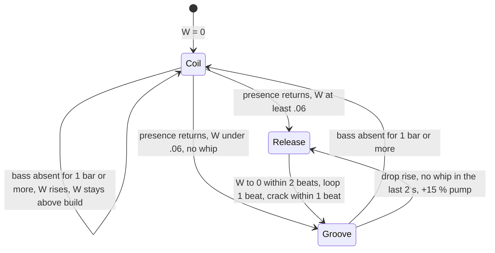
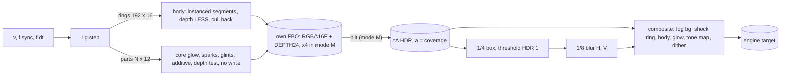

**Scene states**

- One whip per drop: a `drop` rise within 2 s after a whip only flares (recipe 5, C14).

**How each variant draws it**
| Item | A mesh + depth | B raymarch | C strip impostor |
|---|---|---|---|
| Lens, flutes, ripple | VS: the lens outline, 24 sides from `gl_VertexID`. FS: flutes + ripple as analytic bump from (u, side angle). Vertex ripple only when `zoom` > 1 (384 rings) | a 2D lens SDF in the twisted frame per step; bump at the hit | FS: the view ray against the local lens cylinder (2 quadratics); the same bump |
| Taper, coil 0.8-4 | per-ring `halfWidth` and positions | <= 32 joints + radii as uniforms | per-ring screen half-extent from the rig |
| Occlusion | depth test LESS, back faces culled | per pixel, free | painter: CPU sort far -> near, blend over |
| Edge AA | mode M: MSAA 4x resolve, alpha = coverage. Mode S: edge smooth after the tone map | closest-approach coverage | analytic edge alpha |
| Chrome | shared GLSL `studio(r, rough)`: a key strip, 2 rim strips and a fog bounce as smoothstep bands in the world-space reflection (the structure of liquid-chrome.fs L36-44; no sky, no horizon). Schlick rim. One tangent-aligned lobe per strip gives >= 3 lines (C3). `rough` widens the bands (research §1.3), and so does `fwidth` of the reflection (no highlight crawl) | the same block | the same block |
| Fog | FS depth fog from the view distance over `nearDist`; fog background, glow band and dither in the composite | the same; fog from the ray length | as A |
| Gills, heat | FS: trough mask x heat ramp (per-ring `heat`); fringe = the mask's outer band. Core glow = an additive billboard on the coil axis + an axis light term | the same at the hit; glow summed along the ray | as A; the glow sits between the far and near segments |
| Whip, crack | the rig moves the rings; a `heat` 6x band rides the loop | the joints move; 32 joints cannot hold the loop | the rig; strips fold at the loop |
| Sparks, glints | additive instanced quads, depth-tested, no depth write (the lasers.ts L582-617 pattern) | a second additive pass, no occlusion | additive, drawn last, no occlusion |

### Variant A: mesh + depth (recommended; the simplest that meets the spec)
A standard opaque mesh with a depth test. No sort, no impostor math. The same file count as B and C.

