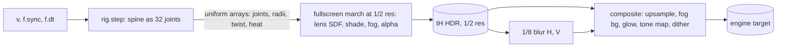
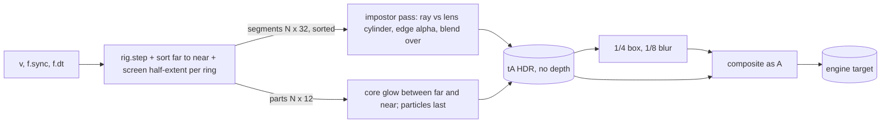

### Variant B: SDF raymarch (no mesh, no depth)
One fullscreen pass marches a twisted-lens tube. Occlusion, edge AA and fog come free. It does not fit R2; it is listed because the brief asks for the evaluation.

- Cost at full res: an analytic-helix SDF is about 60 arithmetic ops per step x 48 steps, about 25x the per-pixel work of a b3 shader (my estimate), on about half of the pixels: about 12 ms normal, 20 ms slow. A polyline spine (32 joints, one capsule test each) costs 5-10x more; research §1.2 derives 4 x 10^9 capsule evaluations per frame. b4 points the same way: 48 cheap iterations on 1/4 of the pixels billed 20.4 ms.
- At 1/2 res: about 3 ms + the frame 1.5 ms = 4.6 ms normal, 7.6 ms slow. The 4-6 px highlight lines (C3) and the sharp silhouette (creative §6) do not survive 1/2 res.
- The drop recipe needs a free-form spine (loop, crack, kink). An analytic helix cannot hold it, and 32 joints are too few for 4 turns plus a loop. The twist makes the distance inexact, so the steps shrink (research §1.2, ⚠️ unverified there).
- Reuse: `fCapsule`, `donor/hg_sdf/hg_sdf.glsl` L325-326 (MIT OR CC-BY-NC-4.0; keep the header). Sparks need a second additive pass with no occlusion.
- Effort: M. Verdict: not viable inside R2.

### Variant C: sorted strip impostors (no depth, no MSAA)
The body is one camera-facing strip, 2 vertices per ring. The FS intersects the view ray with the local lens cylinder, shades it and fades the edge. The CPU sorts the segments far -> near.

- No new GL feature: blending only, as every scene today (isobars.ts L489). Analytic edge AA at no cost. Instances are self-contained (2 x RING) because the sort reorders them. Reuse as A.
- Cost: the frame 2.2-2.6 ms + body 1.0-1.9 ms (FS about 2.3x b3; back to front, so no early-z) + particles 0.2 ms = 3.4-4.7 ms slow, 2.0-2.9 ms normal. The cheapest path.
- Risk 1 (HIGH, at the climax): a painter sort pops where the body crosses itself or where two parts lie within one segment length in depth. That is the whip loop and the crack (S5, C2).
- Risk 2: strips fold on the inside of tight bends and degenerate where the tangent points at the camera. The local-cylinder model fails there (the loop, the snap kink).
- Risk 3: the most shader math of the three and the hardest to debug. Sparks and glints get no occlusion.
- Effort: L. Prefer C only if both AA modes of A fail the spike.
