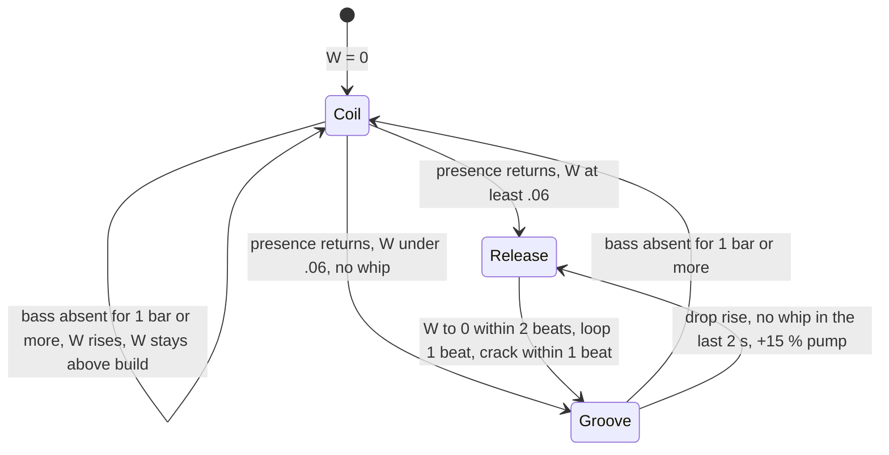
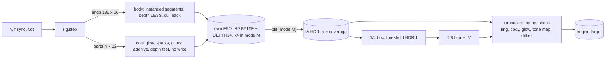
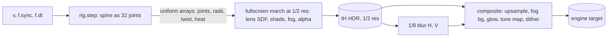
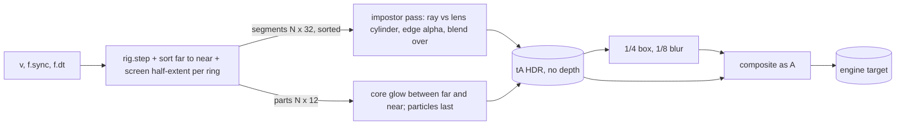

# Design: Neuro Serpent (DnB wave 4, Scene A)
## TL;DR
- One shared CPU rig, three render paths. **A** = an instanced tube mesh + a depth renderbuffer in the native's own HDR target. **B** = an SDF raymarch. **C** = sorted camera-facing strip impostors, no depth.
- **Recommend A.** Estimated billed +flash p95: 2.2-3.5 ms normal, 3.7-5.8 ms slow (x1.65) with MSAA 4x (mode M); 2.0-2.8 / 3.3-4.7 ms single-sample with a post edge smooth (mode S). MSAA has no cost basis in the repo, so the spike A/Bs the two AA modes first. The lever chain is in §4.
- B fails R2 (about 12 ms normal at full res, even with an analytic helix). C is the cheapest (3.4-4.7 ms slow) but pops where the body crosses itself (the whip) and folds at tight bends.
- Every variant: 1 new scene file + 1 test + registration, no engine change, the Rave Lasers pipeline shape (HDR target -> 1/8 glow chain -> one composite), not `createBloom`.
- SG1: add a `reeseLevel` source, for presence only; the body rows stay on `band8`. A bass that returns on a kick reads 0.2 s late (features.ts L19-22, L63), so C12 needs a reading (Decision 3).
## Freshness
- 2026-11-15, system-designer, master `d73907a` + the uncommitted `creative_neuro_serpent.md`.
- Artifacts: `agents/creative-director/creative_neuro_serpent.md` TL;DR-§3, §6, §8, Signal gaps. `thoughts/spec_dnb_wave4.md` §5. `agents/research/research_dnb_wave4.md` §1, §4. `agents/audio-dsp/dsp_dnb_wave4.md` §3, §5. `agents/STATE.md` HEAD.
- Read outside the brief's ranges: creative §4, §5, §7 (one whole-file read) and dsp TL;DR-§2 (the SG1 basis).
- Code (narrow): `gl/scene.ts`, `gl/view.ts`, `gl/post.ts`, `gl/bloom.ts` L1-75, `gl/engine.ts` L16, L22, L80-99 (grep), `fx/own/liquid-chrome.fs` L30-56, `scenes/wireform.ts` L1-125, `scenes/lasers.ts` L1-40, L540-654, `scenes/isobars.ts` L1-16, L478-517, `audio/features.ts` L1-120, `frame.ts`, `fx/types.ts`, `bind.ts` L7, L12, L26, L122 (grep), `fx/catalog.ts` L8, L26 (grep), `scenes/builtin.ts` L1007-1015 (grep).
- Not read: `gl/live.ts`, `audio/arrange.ts`, the rest of `bind.ts` and `builtin.ts`, the SDLC doc. Web: not used.
- Parts: 9 files (`design_neuro_serpent.md`, `.2.md` to `.9.md`). Join = concatenate in order.
## §1 Problem and constraints
- Problem: the first opaque, self-occluding, lit 3D body in a codebase with no depth attachment (engine.ts L80-81, view.ts L8-9; no depth, cull or MSAA call anywhere in `web/src`), inside the 5 ms budget.
- Spec (`spec_dnb_wave4.md` §5): R1 stills gate (user). R2 billed +flash p95 <= 5 ms at 1728x1117 on `dnb174-arr` and `dubstep140-arr`. R3 `__flash` <= 3/s and 0 late frames in 60 s. R4 r >= .80 (>= .60 flash-gated). R5 the drop is the climax. R6 = "follows `B`" (the lead-confirmed reading). R7 one built-in, DnB preset.
- Creative: never cut the highlight lines, depth fog, occlusion, gills or the drop recipe; the cut order is fringe, spark count, haze noise (creative §2 L52). §6 must-nots. C1-C18.
- Budget: a slow session runs 1.6-1.7x normal, so the design target is <= 3.0 ms in a normal session.
- Contract: `NativeDef.create(gl, size?)` returns `{ draw(f, v), dispose }` and draws into the bound framebuffer (scene.ts L7, L13). Unchanged.
- Licence: any; record the provenance (CLAUDE.md § Constraints).
- Non-goals: no engine or `renderTarget` change, no texture asset (cubemap, matcap), no bar phase (creative §4), no growl detector (SG4), no new dependency.
### Cost bases (billed +flash p95 at 1728x1117; cited below as b1-b4)
- b1 Rave Lasers, the same pipeline shape, slow sessions: 2.85-2.99 ms loud, 4.44-4.58 ms at the drop (STATE HEAD: RL S6, S5.3, fix-1).
- b2 wireform = lines + `createBloom` + `COMPOSITE_FS`: 3.78-3.84 ms slow (same entries). Bloom as a def pass billed +3.3 ms (isobars.ts L497-498). So `createBloom` is out.
- b3 one full-res analytic pass: superformula 1.01 ms, stars 0.71 ms (STATE Queue 2: S1.1, S1.3). ⚠️ The session speed is not recorded; taken as normal.
- b4 `own/julia.fs`: 20.4 ms at Iter 48, res .5 (julia.fs L35; STATE Queue 2: S1.2).
## §2 Variants
### §2.0 Shared by A, B and C
**Files**
- `web/src/scenes/serpent.ts` (new): the pure rig + GLSL + `serpent: NativeDef`. The lasers.ts shape (rig from L19, def L550-654).
- `web/src/scenes/serpent.test.ts` (new): Vitest rows on the rig.
- Registration: `web/src/fx/catalog.ts` L8 + L26 (import, the catalog list) and one built-in `builtin:neuro-serpent` in `web/src/scenes/builtin.ts` (R7). Template: `builtin:rave-lasers`, L1007-1015; the built-in repeats the def's binds.
- Only with `reeseLevel`: `audio/features.ts` `fill`, `bind.ts` L26 (`SOURCE_IDS` and its group), `bind.test.ts` L67 (the pinned count), one fixture.
- Roadmap (Electron on Mac + Windows later, CLAUDE.md § Stack): every variant uses WebGL2 core calls only, keeps the native contract and adds no dependency.

**Rig contract** (pure, runs in Node; the `createRig` / `laserState()` precedent, lasers.ts L581, L598)
```ts
export const RING = 16 // p.xyz, halfWidth | n.xyz (RMF + twist), u (arc, in w) | b.xyz, heat | crest, ripple, 2 spare
export interface SerpentOut { rings: number; parts: number; vp: Float32Array; eye: readonly number[]; nearDist: number; glow: number; shock: number; key: number }
export interface SerpentState { phase: 'coil' | 'release' | 'groove'; W: number; B: number; turns: number; twist: number
  ripple: number; ripplePhase: number; spanFW: number; speed: number; whips: number; rings: number; snaps: number; snapSide: 1 | -1; glints: number }
export function createSerpent(seed: number): {
  step(i: { v: Readonly<Record<string, Value>>; beat: number; bpm: number; dt: number; aspect: number }, rings: Float32Array, parts: Float32Array): SerpentOut
  state(): SerpentState }
```
- Determinism (C18): the rig reads `v`, `f.sync.beat`, `f.sync.bpm`, `f.dt` and a seeded hash. No `Math.random`, no wall clock (lasers.ts L601 reads `performance.now()`; do not copy that).
- Spine: a helix (0.8 -> 4.0 turns from `W`) on a seeded drift path, plus additive terms: the thrash wave (`B`), the whip loop and the crack sweep (release), the snap kink (snare). 192 rings, uniform in arc length (knob). Each end tapers over 15 % of `L` and closes on a zero-width ring.
- Frames: rotation-minimising by double reflection (Wang et al. 2008, research §1.2; own code, about 15 lines; the body is open, so no closure fix), anchored at mid-body. A helix rolls an RMF by turns x sin(pitch angle), so the rig removes that roll with a linear counter-twist against the coil reference (the coil axis projected off the tangent). Then twist(u) goes on top, and `twist` alone sets the wide / narrow count in C2 (S1 <= 1, S2 >= 3).
- ⚠️ Assumption, needs confirmation: the coil reference puts the wide chord along the coil axis (tape-wound), so the core glow lights the wide inner faces.
- Camera: `orbitVP` unchanged (view.ts L17). The rig subtracts the lagged body centre (lag 1 s). `w` in world units = (% FH) x 2 (view.ts L2-3).
- Ripple phase: a monotone integrator. Each frame adds 2 x max(0, beat step), which is 1 ripple length per 8th note, or 5.8 Hz x dt while bpm = 0. A beat jump adds bpm x dt / 30 for that frame. It never reverses (creative §6).
- `W`: the absence time counts from the last frame with `presence` above θ. Winding starts when it reaches 1 bar and credits that bar. So 16 bars give `W` .85 (3.5 turns), a gap under 1 bar winds 0, and a 1.1-bar gap winds .058, under the .06 whip floor (C11). `W` >= `build`. `W` never falls while the bass is absent. bpm = 0 uses 345 ms per beat.

**Def: inputs and bindings** (creative §3 rows in brackets)
| Input | Source | Attack / release (s) | Rig use |
|---|---|---|---|
| `bass` | `band8` | .06 / .30 | twist, ripple height, flex + thrash, scale [1-4]; rows 3-4 get slower rig one-poles |
| `presence` | `reeseLevel` (SG1) | 0 / 0 | absence -> `W` [12]; return -> release [14] |
| `reese`, `wobble` | same | .03 / .2 | burst = the larger [6] |
| `sub` | `sub` | .04 / .4 | thickness [7] |
| `kick`, `snare`, `hats` | same | 0 / 0 | float; the rig fires on a rise [8-10]. Release 0 keeps 96-100 % of the snare and hat hits (dsp §2.1) |
| `build` | `build` | 0 / 0 | floor of `W` [11] |
| `drop` | `drop` | 0 / .4 | ungated: the fallback whip and the one-whip latch (recipe 4-5) |
| `flare` | `drop` | 0 / .4 | flash-class, `flash: ['flare']`. On the gated rise the rig starts the shock (400 ms) and key (1 s) envelopes [15] |
| `orbit`, `yaw`, `pitch`, `zoom` | none | - | still angles A / B and the S7 close-up; `orbit` 1 = auto drift |
- `band8` over `band6`: the higher worst-track r (.51 against .47, dsp §2.1). Lever: a second input and the max.
- Row 1 release: .35 s leaves twist .58 at 1 s from twist 6 (0.25 + 5.75 x e^(-1/.35); `release` is the one-pole tau, bind.ts L122). C17 wants <= .5, so the table uses .30 s (.46). dsp G6.1 allows >= .3 s.
- `drop` + `flare` repeat the lasers' `climax` + `burst` pair (lasers.ts L564-565, L576-577).
- If Decision 2 is "no", only the `presence` row changes (source `band8` + a rig-side kick mask). The contract stays.
**Scene states**

- One whip per drop: a `drop` rise within 2 s after a whip only flares (recipe 5, C14).

**How each variant draws it**
| Item | A mesh + depth | B raymarch | C strip impostor |
|---|---|---|---|
| Lens, flutes, ripple | VS: the lens outline, 24 sides from `gl_VertexID`. FS: flutes + ripple as analytic bump from (u, side angle). Vertex ripple only when `zoom` > 1 (384 rings) | a 2D lens SDF in the twisted frame per step; bump at the hit | FS: the view ray against the local lens cylinder (2 quadratics); the same bump |
| Taper, coil 0.8-4 | per-ring `halfWidth` and positions | <= 32 joints + radii as uniforms | per-ring screen half-extent from the rig |
| Occlusion | depth test LESS, back faces culled | per pixel, free | painter: CPU sort far -> near, blend over |
| Edge AA | mode M: MSAA 4x resolve, alpha = coverage. Mode S: edge smooth after the tone map | closest-approach coverage | analytic edge alpha |
| Chrome | shared GLSL `studio(r, rough)`: a key strip, 2 rim strips and a fog bounce as smoothstep bands in the world-space reflection (the structure of liquid-chrome.fs L36-44; no sky, no horizon). Schlick rim. One tangent-aligned lobe per strip gives >= 3 lines (C3). `rough` widens the bands (research §1.3), and so does `fwidth` of the reflection (no highlight crawl) | the same block | the same block |
| Fog | FS depth fog from the view distance over `nearDist`; fog background, glow band and dither in the composite | the same; fog from the ray length | as A |
| Gills, heat | FS: trough mask x heat ramp (per-ring `heat`); fringe = the mask's outer band. Core glow = an additive billboard on the coil axis + an axis light term | the same at the hit; glow summed along the ray | as A; the glow sits between the far and near segments |
| Whip, crack | the rig moves the rings; a `heat` 6x band rides the loop | the joints move; 32 joints cannot hold the loop | the rig; strips fold at the loop |
| Sparks, glints | additive instanced quads, depth-tested, no depth write (the lasers.ts L582-617 pattern) | a second additive pass, no occlusion | additive, drawn last, no occlusion |

### Variant A: mesh + depth (recommended; the simplest that meets the spec)
A standard opaque mesh with a depth test. No sort, no impostor math. The same file count as B and C.

- Depth lives in the native's own framebuffer only; `renderTarget` (engine.ts L80) and the engine targets stay depth-less. Two AA modes, A/B'd at the spike. Mode M: two multisampled renderbuffers (RGBA16F, DEPTH_COMPONENT24), resolved by `blitFramebuffer` into a `renderTarget(true)`; about 15 raw WebGL2 lines. Mode S: one DEPTH_COMPONENT24 renderbuffer on that target (about 6 lines) + a 4-tap edge smooth in the composite, after the tone map. Both follow `f.width` / `f.height` and are deleted in `dispose`.
- ⚠️ Assumption, needs confirmation (mode M): Chrome (ANGLE) accepts MSAA on RGBA16F with EXT_color_buffer_float (engine.ts L22). The spike checks `getInternalformatParameter(RENDERBUFFER, RGBA16F, SAMPLES)`. Without the extension the format is RGBA8, as in `renderTarget` (engine.ts L81).
- Body draw: one ring buffer bound twice with a one-ring offset (divisor 1), so an instance is the segment between ring i and ring i+1 (the attribute pattern of lasers.ts L590-594). 192 x 24 x 2 = 9216 triangles, up to about 100 px² each at Groove scale.
- Frame order: clear colour + depth -> body -> core glow + particles (blend ONE, ONE on rgb; alpha untouched) -> restore the GL defaults (depth test off, cull off, depth mask on) -> blit (mode M) -> 1/4 box -> 1/8 blur (`BLUR` from isobars.ts, as lasers.ts L14) -> composite into the engine target (lasers.ts L602, L640-642).
- Composite: the fog background + glow band + shock ring (x `shock`), the body over them (premultiplied), + glow, the lasers max-channel tone map (lasers.ts L543-544), hash dither (L545-546).
- Tile mode (`size` given, scene.ts L11-12): 64 rings, mode S.
- Reuse: own code only (the lasers.ts pipeline, isobars.ts `BLUR`, view.ts, the `env()` structure of liquid-chrome.fs, the helix frame of wireform.ts L60-69). `NOISE` (webgl-noise, MIT) only if the haze noise is built. Not used: matcaps (no licence, research §4), TD snippets.

| Cost part (A) | Basis | Normal ms | Slow ms |
|---|---|---|---|
| Frame: clear + 1/8 chain + composite | b1 loud minus its thin beam fill (⚠️ the split is not measured) | 1.3-1.6 | 2.2-2.6 |
| Body FS: about 2x a b3 shader x coverage (Groove 26 %, cap 35 %) x overdraw <= 1.5 | b3 | 0.5-1.0 | 0.9-1.7 |
| MSAA 4x + depth + resolve (mode M) | none in the repo (⚠️ assumed) | 0.3-0.8 | 0.5-1.3 |
| Core glow + particles | b1 (thin fill) | <= 0.1 | <= 0.2 |
| **Total p95 at the drop, mode M** | | **2.2-3.5** | **3.7-5.8** |
| **Total, mode S** (edge smooth 0.1-0.2 ms slow instead of MSAA) | | **2.0-2.8** | **3.3-4.7** |

**Risks, ranked**
1. Budget in a slow session: mode M centre 4.7 ms, top 5.8 ms; mode S top 4.7 ms. The spike measures both first; the levers are in §4.
2. Look: an analytic studio has no self-reflection and can read as plastic or "1991" (creative §6). Mitigation: roughness contrast, tangent lobes, rim, HDR + glow. The S3 stills gate decides; architecture cannot fix it.
3. Edge quality: the MSAA resolve averages HDR samples before the tone map (WebGL2 has no custom resolve), so edges above about HDR 2x keep some stair-step. Mode S smooths after the tone map but softens the silhouette by about 1 px. The spike compares both on S7 and a 10 s clip.
4. GL state bleed: the first user of DEPTH_TEST, CULL_FACE, depthMask and READ_FRAMEBUFFER; every other native assumes the defaults (isobars.ts L489). Restore after the pass + one harness row: GL state diff = {} after `draw` (the camera K5 precedent, STATE Queue 2).
5. MSAA float support (the ⚠️ above). Fallback: mode S.
6. Lifecycle: renderbuffers are new GL objects. The lasers T-LC and T-CTX rows apply (create / dispose delta 0, context loss).
7. Frames: an RMF recomputed every frame can roll the far end when the curve changes (hence the mid-body anchor). A self-crossing in the whip renders as a clean intersection, not a pop.
- Effort: L (one file about the size of lasers.ts; the rig is about half of it). A second depth scene lifts the renderbuffer lines into `renderTarget` then, not now.
### Variant B: SDF raymarch (no mesh, no depth)
One fullscreen pass marches a twisted-lens tube. Occlusion, edge AA and fog come free. It does not fit R2; it is listed because the brief asks for the evaluation.

- Cost at full res: an analytic-helix SDF is about 60 arithmetic ops per step x 48 steps, about 25x the per-pixel work of a b3 shader (my estimate), on about half of the pixels: about 12 ms normal, 20 ms slow. A polyline spine (32 joints, one capsule test each) costs 5-10x more; research §1.2 derives 4 x 10^9 capsule evaluations per frame. b4 points the same way: 48 cheap iterations on 1/4 of the pixels billed 20.4 ms.
- At 1/2 res: about 3 ms + the frame 1.5 ms = 4.6 ms normal, 7.6 ms slow. The 4-6 px highlight lines (C3) and the sharp silhouette (creative §6) do not survive 1/2 res.
- The drop recipe needs a free-form spine (loop, crack, kink). An analytic helix cannot hold it, and 32 joints are too few for 4 turns plus a loop. The twist makes the distance inexact, so the steps shrink (research §1.2, ⚠️ unverified there).
- Reuse: `fCapsule`, `donor/hg_sdf/hg_sdf.glsl` L325-326 (MIT OR CC-BY-NC-4.0; keep the header). Sparks need a second additive pass with no occlusion.
- Effort: M. Verdict: not viable inside R2.

### Variant C: sorted strip impostors (no depth, no MSAA)
The body is one camera-facing strip, 2 vertices per ring. The FS intersects the view ray with the local lens cylinder, shades it and fades the edge. The CPU sorts the segments far -> near.

- No new GL feature: blending only, as every scene today (isobars.ts L489). Analytic edge AA at no cost. Instances are self-contained (2 x RING) because the sort reorders them. Reuse as A.
- Cost: the frame 2.2-2.6 ms + body 1.0-1.9 ms (FS about 2.3x b3; back to front, so no early-z) + particles 0.2 ms = 3.4-4.7 ms slow, 2.0-2.9 ms normal. The cheapest path.
- Risk 1 (HIGH, at the climax): a painter sort pops where the body crosses itself or where two parts lie within one segment length in depth. That is the whip loop and the crack (S5, C2).
- Risk 2: strips fold on the inside of tight bends and degenerate where the tangent points at the camera. The local-cylinder model fails there (the loop, the snap kink).
- Risk 3: the most shader math of the three and the hardest to debug. Sparks and glints get no occlusion.
- Effort: L. Prefer C only if both AA modes of A fail the spike.
## §3 Comparison
| | A mesh + depth | B raymarch | C strip impostor |
|---|---|---|---|
| R2 estimate p95, normal / slow (ms) | mode M 2.2-3.5 / 3.7-5.8; mode S 2.0-2.8 / 3.3-4.7 | 12 / 20 (1/2 res: 4.6 / 7.6) | 2.0-2.9 / 3.4-4.7 |
| Occlusion | exact, also at a self-crossing | exact | pops at crossings |
| Edge AA | MSAA 4x (cost unknown) or a post edge smooth | analytic | analytic |
| Whip, crack, kink | free-form rig | too few joints | strips fold or degenerate |
| Full-res look (lines, silhouette) | yes | no at 1/2 res | yes, outside the failure cases |
| New GL features | depth renderbuffer (+ MSAA and blit in mode M) | none | none |
| New files | scene + test | scene + test | scene + test |
| Effort | L | M | L |
## §4 Recommendation and lever chain
**Variant A.** It is the only path that is exact on occlusion at the whip and keeps the full-res look. It uses a standard pipeline: an opaque mesh, a depth test and the Rave Lasers post chain. In a slow session its cost sits on the 5 ms line in mode M (centre 4.7 ms) and under it in mode S (top 4.7 ms, 4.5 ms with L1). The one unknown, MSAA, is measured at the start of the spike. B cannot meet R2. C is the fallback only if both AA modes of A fail.

**Lever chain if over budget** (in this order; the savings are slow-session estimates)
- L1 Draw the instances near -> far (CPU sort of 192 keys; instances become self-contained): early-z, -0.2 to -0.4 ms. Look-neutral.
- L2 Mode M only: MSAA 4x -> 2x, -0.2 to -0.5 ms.
- L3 Mode M -> mode S, if its edges passed the spike A/B: -0.4 to -1.1 ms against 4x.
- L4 Creative cut 1, fringe off: about -0.1 ms.
- L5 Creative cut 2, sparks 120 -> 60: up to -0.1 ms.
- L6 Creative cut 3, haze noise off: about -0.1 ms (if it was built).
- L7 Drop the far blur and keep the near tent: -0.1 to -0.2 ms.
- Never: the highlight lines, depth fog, occlusion, gills, the drop recipe (creative §2 L52).
- Rule: one lever per measurement, each recorded with its measured delta (CLAUDE.md § Task tiers, the performance flow). Stop at p95 <= 5 ms in a slow session.
- Haze noise: a contrast <= 4 % on a 3-8 % background is <= 0.8 / 255, under one 8-bit step. Build it last, as value noise inside the composite (0 extra passes), or not at all (the creative-director's call).

**Acceptance mapping** (all variants unless marked)
- R1, C1: stills S1-S10 from a live pass. `orbit`, `yaw`, `pitch` and `zoom` give the angles A / B and the close-up.
- R2: the cost tables + the lever chain.
- R3, C15: only `flare` is flash-class (`flashGate`, post.ts L46-58). Rings, snaps and glints stay local (<= 5 % of the frame, by size). The rig's JS stays well under 0.1 ms (192 rings).
- R4, R6, C6, C7: `state().twist` and `.ripple` against the bound `bass`, r >= .80 (the lasers T-C12 method, STATE RL S5.3). `flare`: r >= .60.
- R5, C12-C14: the release state machine, read from `state().turns`, `.spanFW`, `.whips`. C13 from frames.
- R7: one built-in. C2: lens + flutes + twist; overlap by depth (A), march (B) or sort (C).
- C3, C4: `studio()` + tangent lobes + rim. HDR stays in RGBA16F until the tone map. A cavity term (>= 60 % darker). Floor tone `#070A10`.
- C5: fog background 3-8 %, depth fog <= 25 % at 3x `nearDist`, hash dither.
- C8-C10: rises on float inputs with attack 0 / release 0, on the same frame. Counts in `state()`.
- C11: the `W` rules + the kick-proof `presence`. C16, C17: `state().speed`; row-1 release .30 s. C18: no wall clock, no `Math.random`.
## Decision needed
1. Variant: **A** (recommended) or C. B is not viable.
2. `reeseLevel`: add it (light SDLC §4, audio-dsp first), or ship on `band8` with a scene-side kick mask (no analyser change; a 4-frame delay and its own tuning).
3. The C12 reading: "<= 3 frames after `presence` crosses θ". A bass that returns on a kick then starts the release up to 0.2 s + 3 frames after the true onset. Confirm it, or route it to the creative-director.
4. Spike gates, in this order: AA mode M against mode S (billed delta + edge quality on S7 and a 10 s clip), the billed +flash p95 at Groove coverage, the stills. The user gate is the S3 stills sheet, not this pick.
## Signal-gap answers
### SG1: a kick-proof bass presence -> `reeseLevel`, for presence only
- Two uses: absence -> `W` (row 12, C11) and return -> release (row 14, C12, C14).
- No listed signal is both kick-proof and inside 50 ms when the bass returns on a kick. `band6` / `band8` are immediate but pump with the kick (dsp G6.1). `raw.reese` is kick-gated at hop rate (features.ts L62-67) but holds for `HOLD` = 0.2 s after every kick: "a bass note that starts on a kick shows HOLD late" (L63; L19-22). `sub`, `reese` and `wobble` share that hold (L67).
- Answer: bind `presence` to a new `reeseLevel`. (1) During a lone kick it reads the held pre-kick level, so C11 holds by construction, with no θ tuning against the pump. (2) The best truth r: .53-.74 at 0.1 s and .67-.83 per bar, against .47-.73 for `band6` / `band8` (dsp §2.1, G6.2). (3) About 5 product lines that expose a value already computed and already used by the classifier and the arrangement (features.ts L55-57).
- The body rows 1-4 stay on `band8` (the lead-confirmed R6 reading): the ignite (0-60 ms, recipe 1) needs the ungated band. Side effect: a lone kick in a drum-only build bar blips the twist and the ripple for about .3 s. ⚠️ A creative call at the spike: keep it as the build shiver, or scale rows 1-2 by presence (the ignite is then up to 0.2 s late on a kick).
- Timing: a return without a kick starts the release within 1 hop + 1 frame. With a kick (the usual drop) it starts at +0.2 s. The loop then reaches the head near +0.55 s and the crack ends near +0.9 s, so the late `drop` (+0.3 to +0.7 s) still lands on the loop or the crack (recipe 4).
- θ is relative: present = `presence` > θ x peak, where peak is a slow max-hold of `presence` in the rig (decay about 30 s, ⚠️ knob). Line-in gain and the source's scale then do not move it. Default θ = .25 (⚠️ until Research gap 1).
- Alternative (a), `band8` + a scene-side kick mask: the `kick` event reaches the scene 27-38 ms p50 and 39-57 ms p90 after the onset (dsp §5 d), while the band rises at once. The mask needs a 4-frame delay line and still waits 0.2 s on a kick: the same latency class, more scene code, its own tuning, a copy of features.ts L62-67.
- Alternative (b), the creative fallback (`W` from `build`, the release from `drop`): `build` gives no ramp before 6 of 9 drops and `drop` is absent on 3 of 9 (dsp TL;DR). The build story is lost on most drops.
- SDLC §4 cost: not a detector change. No detector, gate, band, threshold or timing changes, and every existing source stays bit-identical. It is an additive source-contract change (`SOURCE_IDS` is pinned by bind.test.ts L66-67, L75-78). Light §4, audio-dsp leads: (1) a fixture, reese on / off / kick-only (kick-only reads 0; a bass that starts on a kick reads at most `HOLD` + 1 hop late); (2) before / after on the same dataset (3 tracks + 2 arr fixtures, the w4sim dumps): diff 0 on every existing id; (3) the r table for the new id; (4) the 0..1 scale. Effort S.
### SG2: the bass dip before the drops
- Not answerable from the inputs (Research gap 2). The design does not depend on it. No dip and no `build` -> `W` stays under .06 -> no release; the `drop` rise then launches the whip from Groove with the +15 % pump (recipe 4). R5 and C13 stay UNKNOWN on such drops (dsp G7). The S9 caption carries the bars of absence.
### SG3: `drop` absent on 3 of 9 drops, late on the rest
- `drop` feeds only the flare and the fallback whip. On a drop without it, recipe steps 1-3 run alone, so C13 must be reachable without step 4. Spike check: one Sub Focus drop (0 of 3 fire there, dsp §2.1).
- For the test-architect: the app-wide drop flash (post.ts L12-13: white mix .8, decay .1 s) lands on the crack frame. C15 "clipped white <= 20 %" is measured with it.
### SG4: growl timbre
- Accepted as specified. The ripple height comes from `B`, the travel from `f.sync.beat` (the monotone integrator, §2.0), the burst from the larger of `reese` and `wobble`. No growl source is needed. C7 measures against `B`.
## Research gaps
1. θ data (SG1): the level distributions of `raw.reese` and `band8` in drum-only bars against bass bars, and at the first 3 frames of each audit drop against lone build kicks. Owner: audio-dsp, from the existing dumps (`scratchpad/dsp/`).
2. SG2: the bars of bass absence before each of the 9 audit drops. The same run as gap 1.
3. MSAA on RGBA16F renderbuffers: the support and the billed cost on ANGLE-Metal, and on ANGLE-D3D11 for the Windows stage. Owner: the spike.
4. The `reeseLevel` scale: `raw.reese` is linear and not normalised (features.ts L55-56). Owner: audio-dsp.
5. The session speed of the b3 numbers, and the split of b1 between beam fill and composite. Both widen the A estimate; the spike replaces them.
## Skeptic response
rev 2 · 2026-11-15 · system-designer. Answers `agents/architecture-skeptic/skeptic_neuro_serpent.md` §1. **accept 10 · accept-modified 2 (S-1, S-5) · reject 0.** The design file is not edited: each row names the design lines it replaces. Lead rulings applied: wall clock for every timed window, `reeseLevel` yes, mode M against mode S first at the spike. Extra reads: `scratchpad/dsp/w4sim.ts` L134-L137 (dump columns), `w4.log` L129-L143 (audit drop and `fired` times).
### §R1 Verdicts
| ID | Sev | Verdict | Change (design lines replaced) | Proof |
|---|---|---|---|---|
| S-1 | HIGH | accept-modified | §R2 T1-T6 replace the one-frame trigger (L53, L76-L80): hysteresis, a provisional release, 1 beat of on-time before `W` is spent, abort + re-arm. Modified: the whip loop starts at the commit, not at the crossing. | V1-V5; replay a-d |
| S-2 | MED | accept | §R2 T7 (L221): `ref` is frozen while the bass is unconfirmed, has a floor and starts at it. | V6; replay e |
| S-3 | MED | accept | §R2 T8 (L64, L80, L82): a `drop` rise commits from any phase, Coil included. Stated in the design: `presence` reads the reese band only, `drop` arms on sub + reese. | V7; replay f, g |
| S-4 | MED | accept (lead ruling) | §R2 Clocks. L47 "no wall clock" is withdrawn: `now` is a `step()` input, so C18 holds in Node. Stricter than the finding: beat windows also use the clamped wall step × bpm, not `f.sync.beat` steps. | V8 |
| S-5 | MED | accept-modified | §R5: row T-S5 + a travel rule. Modified: the rule is the default, not a cut after a FAIL. | T-S5 at the spike |
| S-6 | MED | accept | §R2 T9: a rig-side fit scale bounds the coverage (35 %; 40 % at `zoom` > 1) and the eye clearance (0.5). `state().coverage` is exposed. | V9 (rig sweep) |
| S-7 | MED | accept | §R4: depth invalidate in both modes, MSAA colour invalidate after the blit, mode M costed as stores + 2 resolves. Mode S is the expected path. | A/B arms with and without the invalidates, one slow session, wireform reference |
| S-8 | MED | accept | §R4: body row × 1.6-2.0; frame row marked "sign unknown"; the mode S levers are expected, not contingent. | Spike split in one slow session: billed full / body off / particles off, with the triangle count and the projected body px per sample |
| S-9 | LOW | accept | §R4: the sort lever (L1) leaves the Mac chain and is not built. A geometry lever and a coverage lever join. The pilot Mac is Apple silicon (STATE Queue 2: M4). | One on / off run at the Windows stage |
| S-10 | LOW | accept | Mode S, fixed before the A/B: the body FS writes a = `nearDist` / view distance into tA.a (background 0; coverage = a > 0). The composite smooths (4 taps, after the tone map) only where the relative step of a between neighbours is > .08 (⚠️ knob). That finds silhouettes and near-over-far edges and leaves highlight cores alone. Mode M keeps a = coverage. | Mode S crops of S3 and S7 at 400 %: ≥ 90 % of near-over-far edge pixels hold an intermediate value; highlight core width = mode M ± 1 px |
| S-11 | LOW | accept | twgl `createFramebufferInfo` + `resizeFramebufferInfo` (imported at engine.ts L5) replace the raw renderbuffer lines (L111), with the attachment specs of the finding. Created at 1 × 1; resized at draw time before the first draw. Mode S owns its colour texture + depth; the RGBA8 fallback stays. The restore list gains `colorMask` / `blendFuncSeparate` (skeptic §2). | T-LC with a resize 1728 × 1117 → 1469 × 949 → draw: `checkFramebufferStatus` COMPLETE, 0 GL errors, GL state diff = {} |
| S-12 | LOW | accept | Mode M: `centroid` on the normal and position varyings. Both modes: N·V clamped to ≥ 0 in `studio()`, and an upper clamp on the `fwidth` band widening (centroid derivatives are unreliable on edge pixels). | Mode M crop of S7 at 400 %: 0 silhouette pixels brighter than the interior rim maximum |
### §R2 Drop trigger and rig rules, rev 2 (replaces design L53 `W`, L76-L82, L221)
Terms: `x` = `presence` / `ref`. `on` = the Schmitt state of `x`. `h` = on-time in beats. `a` = absence in beats. `W0` = `W` at the start of an attempt. Knobs marked ⚠️ get their values from the replay (§R3).
- **T1 Hysteresis.** `on` turns true at `x` ≥ θ_on and false at `x` ≤ θ_off. Defaults: θ_on .30, θ_off .15 ⚠️.
- **T2 Attempt = provisional release.** An attempt starts on the frame `on` turns true while the bass is unconfirmed. It spends nothing: `W` keeps its value. Phase = `release` only after a real absence (`a` ≥ 1 bar, creative row 14) with `W0` ≥ .06; it starts ≤ 1 frame after the crossing (C12). Only the displayed wind moves: `W0` × (1 - u(h)), u = smoothstep over 0 to 1.5 beats. The whip loop does not launch. Any other attempt is invisible: its commit only re-confirms the bass and leaves `W` alone (L77; a `build`-wound `W` waits for `drop`, T8).
- **T3 On-time.** `h` grows only on frames with `on` true. While `on` is false, `h` and the displayed wind hold. A gap > GAP = ½ beat ⚠️ sets `h` to 0.
- **T4 Commit = the minimum on-time.** At `h` ≥ COMMIT = 1 beat ⚠️: the bass is confirmed, `a` := 0, `ref` unfreezes. If the attempt is a release: `W` := 0, the whip loop launches now (1 beat), then the crack (≤ 1 beat), `whips` + 1, and the 2-s one-whip latch starts. After the commit, u runs on elapsed beats. On a steady bass the unwind is 74 % done at +1 beat (1.63 turns from 4.0; C12 wants ≤ 1.8) and ends at +1.5 beats (computed).
- **T5 Abort + re-arm.** A release whose `h` returns to 0 before the commit (T3) aborts: the displayed wind eases back to `W` in ½ beat, phase = `coil`, `aborts` + 1. `W` was never changed. The next `on` rise starts a new attempt at once; there is no lock-out.
- **T6 Absence.** `a` counts every frame the bass is not confirmed-on. The pending `h` is subtracted from it (floor 0), so an attempt pauses the absence and an abort credits the time back. `a` returns to 0 only at a commit. Confirmed-on = `on` true with `h` ≥ COMMIT; in Groove a gap ≤ GAP keeps `h`, so a chopped bass stays confirmed. `W` = the design's map of `a` (1-bar threshold with credit, .85 at 16 bars), `W` ≥ `build`. Groove → Coil at `a` ≥ 1 bar, as before.
- **T7 `ref` (S-2).** `ref` = a max-hold of `presence` with a 30-s decay ⚠️, updated only on confirmed-on frames. In Coil and during an attempt it is frozen, so an absence cannot lower its own threshold. `ref` ≥ `REF_MIN` ⚠️ and starts at `REF_MIN`; the first confirmed bass bar then sets it. Ceiling: an input below θ_on × `ref` (the master turned down, or a level under `REF_MIN`) reads as absence until the level returns. Upgrade path, not built: re-seed `ref` on a `drop` rise.
- **T8 `drop` rise (S-3).** With no whip in the last 2 s, a `drop` rise commits at once from any phase. A pending attempt commits early. With `W` ≥ .06 (Coil, or a `build`-wound Groove) the rig releases at scale `W` and launches the loop. With `W` < .06 it is the +15 % pump whip of recipe 4. Inside the latch the rise only flares (recipe 5). A presence commit after a `drop` commit finds `W` = 0, so there is no second whip (C14).
- **T9 Fit (S-6).** One scale s ≤ 1 on ring positions and half-widths about the lagged centre. s is the largest value with (1) the sum of projected segment footprints ≤ 35 % of the frame (overlap ignored, so it over-counts) and (2) every ring surface ≥ 0.5 world units from the eye. Attack in the same frame, release 1 s. `zoom` > 1: cap 40 % (§R4). The cap wins over the row-4 and recipe-2 sizes (creative L36).
- **What the viewer sees.** A kick tail ≤ 4 frames past the HOLD: `h` ≤ .19 beat, wind change 4.6 %, turn change 3.6 % of 4.0 turns (C11 wants ≤ 5 %; computed at 174 BPM). A 1/16 stab (¼ beat of on-time): the coil loosens 7 % and re-tightens. A 1/8 stab (½ beat): 26 %. A bass note ≥ 1 beat is a return by definition, the mirror of "a gap < 1 bar is not an absence".
- **Timing change.** The loop starts at the commit, 1 beat later than L220. A kick-coincident drop at 174 BPM: crossing +0.2 s, commit +0.55 s, loop to +0.89 s, crack to +1.24 s. The late `drop` (+0.3 to +0.7 s) lands on the unwind or the loop; the 1-s key envelope still covers the crack. C13 at +1 beat sees the unwind and the growth, not the loop: checked at the spike. Lever: COMMIT ½ beat, if replay line a stays 0 there.
- **Clocks (S-4).** `step(i)` gains `now` (seconds, `performance.now()/1000`, read once per draw as lasers.ts L601 does). The rig keeps `dtw` = clamp(`now` - previous `now`, 0, 0.1 s). Seconds windows run on `dtw`: shock 400 ms, key 1 s, latch 2 s, ring half-life 100 ms, gash 300 ms, glint 60 ms, shiver 80 ms, centre lag 1 s, fit release 1 s, `ref` decay 30 s. Beat windows run on `dtw` × bpm / 60 (bpm 0 → 174): `a`, `h`, GAP, COMMIT, unwind, loop, crack, snap hold, ring travel. Ripple phase: + k × max(0, beat step) per frame (k from §R5), capped at twice the nominal step of `dtw`. `i.dt` (the layer clock) drives the seeded drift and the auto-orbit only.
- **Vitest rows (pure rig; the test feeds `now`).** V1 a stab of ¼, ½ and ¾ beat at `W` .5: `whips` 0, `W` after ≥ `W` before, phase back to `coil`. V2 a 4-frame tail at θ_on every 2 beats for 16 bars, `build` 0: turns ≥ 3.3, per-kick turn change ≤ 5 %, `whips` 0 (C11). V3 a steady return: phase `release` ≤ 1 frame, commit at 1 beat, `whips` 1, turns ≤ 1.8 at +1 beat (C12). V4 a chopped return (1/16 on, 1/16 off): one commit within 2 beats. V5 `x` held between θ_off and θ_on: no attempt starts, and a running attempt does not abort. V6 32 bars absent: `ref` unchanged; a pad at .2 × `ref` never turns `on`; a cold start below θ_on × `REF_MIN` winds `W`. V7 a `drop` rise in Coil with `on` false: `whips` 1 on that frame; a presence commit 3 s later leaves `whips` at 1; a `drop` rise during an attempt commits on that frame. V8 `i.dt` × 1.5 for 1 s while `now` runs in real time, then one 30-s step of `now`: every seconds window lasts its nominal real time ± 1 frame; the 30-s step grows `W` by ≤ 0.1 s of winding. V9 the rig sweep on the 3 dumps: yaw 0-345° in 15° steps, pitch +5 to +20°, zoom 1: clearance ≥ 0.5 and `coverage` ≤ 35 % on 100 % of frames.
### §R3 Replay pre-step (before the spike; owner audio-dsp, in the `reeseLevel` light §4 dispatch)
| Line | Measures | Pass |
|---|---|---|
| a (S-1) | presence commits earlier than 2 beats before an audit drop, inside its 16-bar lead-in | 0 in the 9 lead-ins |
| b (S-1) | per audit drop with `W` ≥ .06 at the drop: commits inside [drop - 2 beats, drop + 0.2 s + 2 beats]; `W0` against `W` 1 bar earlier | exactly 1; `W0` ≥ `W` 1 bar earlier |
| c (S-1, C11) | every `on` run in the lead-ins: its length, the `h` it reaches, kick-adjacent or not (start ≤ 0.35 s after a kick rise); aborted attempts per lead-in | kick-adjacent runs: max `h` ≤ .19 beat (4 frames) |
| d (C11) | `W` at the end of each bass-absent stretch ≥ 4 bars against the ideal `W` of its length | ≥ 92 % (3.3 of 3.52 turns) |
| e (S-2) | share of bass-absent frames with `on` true, in the 16 bars before each drop and the first 16 bars of each track | ≤ 5 % |
| f (S-3, C14) | at each of the 7 `drop` rises: phase, `W`, `on`, pending attempt, offset to the nearest audit drop; whips inside ± 2 s of each audit drop; whips elsewhere | 1 per drop that has a return with `W` ≥ .06 or a `drop` rise, else 0; elsewhere 0 |
| g (S-3) | frames with `W` ≥ .06 inside the 16 bars after each audit drop (a Coil reading, or a `build` floor that outlives the drop) | 0; else audio-dsp proposes a `presence` source change |
- Input: `scratchpad/dsp/{kanine,subfocus,andyc}-dnb.json` (60 fps rows). Columns: `t`, `rawReese` (the `reeseLevel` candidate), `bpm`, `build`, `drop`, `fired`, `kick`. Audit drops (w4.log L129-L143): Kanine 44.3 / 88.4 / 154.3 s; Sub Focus 44.1 / 147.9 / 171.0 s; Andy C 46.9 / 91.0 / 157.2 s. `drop` rises: 44.6 / 88.8 / 155.0; 146.6; 47.2 / 91.4 / 157.6 s. Bass-absent truth: the HPSS bass level of dsp §2.1 under a threshold that audio-dsp states.
- Method: one Node script runs T1-T8 only (no geometry) at the defaults, then a sweep: θ_on .2 / .3 / .4 / .5 with θ_off = θ_on / 2; COMMIT ½ / 1 / 2 beats; GAP ¼ / ½ / 1 beat. Pick: the lowest θ_on that passes a-e at COMMIT 1 beat; report whether COMMIT ½ beat also passes. `REF_MIN` default = ½ × the lowest drop-section median of `rawReese` ⚠️; audio-dsp confirms it against line e and the `reeseLevel` scale (Research gap 4). Output: one JSON + a table ≤ 30 lines, with the bars of absence and `W` before each of the 9 drops (Research gap 2).
- Sub Focus 146.6 s: `drop` fires 1.3 s before the 147.9 s audit time (the user's open ear check, STATE Queue 4). If the rig is coiled there, T8 spends `W` early. Line f reports this rise as UNKNOWN until that check: not PASS, and not a line-a failure.
- Outcome: a and b pass at one knob set → S-1 is closed with those knobs. No set passes → the lead gets the fallback of design L223 (`W` is spent by `drop` only), with the creative-director.
### §R4 Cost, rev 2 (S-7, S-8, S-9; replaces design L119-L126 and L186-L193)
| Part | Basis | Normal ms | Slow ms |
|---|---|---|---|
| Frame: clear + 1/4 box + 1/8 chain + composite | unchanged; the sign of its error is unknown (S-8a: it adds a full-res read and drops the smoke pass) | 1.3-1.6 | 2.2-2.6 |
| Body FS | the design row at overdraw 1 (Apple HSR) × 1.6-2.0 for 2×2-quad overshading (S-8b) | 0.8-1.3 | 1.4-2.3 |
| Mode M: MSAA 4x stores + implicit resolve + blit copy | 108 MB per frame with the depth invalidated (139 without): 61.8 colour store + 15.4 resolve + 30.9 blit. ⚠️ No repo anchor converts MB to ms: the design row with its top widened by 108 / 77 (one resolve = 77 MB) | 0.3-1.1 | 0.5-1.8 |
| Mode S: depth-edge smooth | the design row; the depth store (7.7 MB) → 0 by the invalidate | 0.05-0.1 | 0.1-0.2 |
| Core glow + particles | the design row | ≤ 0.1 | ≤ 0.2 |
| **Total, mode S (expected path)** | | **2.3-3.1** | **3.9-5.3** |
| **Total, mode M** | | **2.5-4.1** | **4.3-6.9** |
- Mode S: centre 4.6 ms slow, top over the 5 ms line, so its levers are expected (S-8). Mode M: centre 5.6 ms; it ships only if the A/B measures p95 ≤ 5 ms in a slow session.
- Invalidates: `invalidateFramebuffer` with `[DEPTH_ATTACHMENT]` after the last depth-tested draw in both modes (mode M: before the blit). Mode M also invalidates `[COLOR_ATTACHMENT0]` of the MSAA framebuffer after the blit (⚠️ unverified: it may drop the 61.8 MB store). The A/B runs each mode with and without them.
- Close-up (`zoom` > 1, 384 rings): cap 40 % → body ≤ 1.7-2.0 ms slow at × 1.3-1.5 overshading (larger quads); mode S top 5.0 ms (computed from the design row at coverage 1, 3.3 ms slow).
- **Lever chain, Mac pilot** (one lever per measurement; the split of S-8 is measured first). (1) Mode M only: MSAA 4x → 2x, -0.2 to -0.5 ms. (2) Mode M → mode S, -0.4 to -1.6 ms. (3) New, geometry at `zoom` ≤ 1: 24 → 16 sides and 192 → 128 rings; 9216 → 4096 triangles, quads 6-9 × 21 px → 9-14 × 31 px, overshading × 1.6-2.0 → × 1.4-1.65: -0.2 to -0.4 ms (computed); the lens arc error at 16 sides is 0.35 px at `w` = 100 px. (4) New, coverage cap 35 → 30 % through T9: -0.2 to -0.3 ms on the p95 frames. (5) Fringe off, -0.1. (6) Sparks 120 → 60, -0.1. (7) Haze noise off, -0.1 (if built). (8) Far blur off, -0.1 to -0.2.
- Mode S top after levers 3-8: 5.3 - (0.7 to 1.2) = 4.1 to 4.6 ms slow. The "never" list is unchanged (L194).
- Former L1 (near → far sort): out of the chain. It saves ≈ 0 on Apple TBDR (HSR is exact per pixel, whatever the order) and doubles the instance data. It is a note for the Windows stage and is not built now.
### §R5 Ripple strobe (S-5): the row and the rule
- **Row T-S5 (R3, C15).** Capture 10 s of Groove on a 174 BPM and on a 140 BPM fixture, 60 fps, 1728 × 1117. A flash at a pixel = a rise and a fall of ≥ 0.10 relative luminance with the darker state < 0.80 (WCAG 2.3.1). For every 1-s interval (step 0.25 s) and every 575 × 372 px window (stride ≤ 64 px; WCAG's 341 × 256 at 1024 × 768, scaled): the share of pixels with > 3 flashes is ≤ 25 %. Report the maximum share. Design target: ≤ 10 %.
- **Bound (frequency × area).** Either the ripple rate f ≤ 3.0 lengths per second at any area, or the flickering area ≤ 25 % of every window at any f. The design takes the first.
- **Rule (default).** The travel division is the fastest of {1/8 note, 1 beat, 2 beats} that keeps f ≤ 3.0 Hz: bpm ≤ 90 → per 8th; 90 < bpm ≤ 180 → per beat (174 → 2.9 Hz, 140 → 2.33 Hz); bpm > 180 → per 2 beats; bpm 0 → 2.9 Hz, not 5.8 (replaces L52). A saw ripple makes 1 dash per length, so a line pixel sees ≤ 3 ripple flashes in any second. A ring or a snap that crosses the same pixel adds 1; T-S5 measures that stack (rings, snaps and glints stay ≤ 5 % of the frame, L201).
- ⚠️ The rule changes creative row 5 and C7 (per 8th → per beat at DnB tempo). The spike runs T-S5 at both rates. The creative-director restores the 8th rate only on a measured PASS at that rate. On a FAIL at the beat rate, the next cut is the dash contrast, not the rate.
### §R6 Changes for the plan
1. Rig contract: `step(i)` = `{ v, beat, bpm, now, dt, aspect }`: `now` = wall seconds for every window; `dt` = the layer clock, for drift and auto-orbit only. `SerpentState` gains `committed`, `onTime`, `aborts`, `ref`, `coverage`.
2. The trigger = T1-T8, with θ_on, θ_off, COMMIT, GAP, `REF_MIN` and the `ref` decay as named constants. Their values come from §R3.
3. Pre-step before the spike: the §R3 replay, in the audio-dsp `reeseLevel` dispatch. S-1 closes on lines a + b.
4. Rig: the T9 fit; the §R5 travel division; the §R2 clock table.
5. Renderer: twgl framebuffers (S-11); the invalidates (S-7); depth in tA.a + the depth-edge smooth in mode S (S-10); `centroid` + the N·V clamp (S-12); `colorMask` / `blendFuncSeparate` in the restore list. No sort is built.
6. Spike order: (0) the replay; (1) mode M against mode S, each with and without the invalidates, + the S-10 and S-12 crops; (2) the split full / body off / particles off; (3) T-S5 at both rates; (4) the stills sheet.
7. Cost: §R4 replaces the table (L119-L126) and the chain (L186-L193).
8. New matrix rows for the test-architect: V1-V9, T-S5, the T-LC resize, the S-10 and S-12 crops, replay lines a-g. C12 is read from `state().phase` and timed from the θ_on crossing (lead ruling); ⚠️ C13 needs the same reading.
9. Creative-director acks, one line each: (a) the stab flinch (7 % for a 1/16, 26 % for a 1/8), or no visible unwind before the commit (C12 is then re-ruled); (b) the loop 1 beat later (the flare lands on the loop, not on the crack); (c) the ripple per beat at 90-180 BPM; (d) the 40 % close-up cap.
10. For the lead, outside the 12 findings: Shatter A-3 (the autopilot cuts the scene on every real drop, STATE HEAD) applies here too. The cold start is Coil, `W` 0, `ref` = `REF_MIN`, so a cut-in on the drop whips only if `drop` rises after the cut.

## Lead rulings on the response (2026-11-15)
- **The 4 creative acks — ACCEPTED by the lead** (flash safety and timing trade-offs; the user judges the look at the S3 stills): the stab flinch (7 % for a 1/16, 26 % for a 1/8); the loop + crack one beat later (crack ends at +1.24 s); the ripple rate ≤ 3.0 Hz (C7 per beat at DnB tempo) with row T-S5 (pixels > 3 flashes/s ≤ 25 % of any 575 × 372 window); a 40 % close-up cap.
- **Autopilot cut on a real drop (Shatter A-3) applies here too:** the Serpent uses the same cold-entry rule — every rise detector starts at 0, so a first frame with `drop` ≥ .5 is T0 and commits the whip from any phase under the one-whip latch; C13/C14 also run held under LOCK.
- **Sub Focus 146.6 s vs the 147.9 s audit drop:** UNKNOWN until the user's ear check (already pending); the replay reports it, no rule change.
- The Node replay pre-step (audio-dsp, with the `reeseLevel` light SDLC §4) sets the knob values before the spike.

## Lead ruling — recheck round 2 (2026-11-15) + variant pick
Source: `agents/architecture-skeptic/skeptic_neuro_serpent.md` § Recheck: S-4..S-12 CLOSED; S-1 (replay a+b, c+d, + a 16th-snare-roll lead-in), S-2 (line e), S-3 (lines f+g) CLOSED-PENDING-REPLAY; new N-1 HIGH, N-2/N-3 MED, N-4/N-5 LOW. The lead adopts the skeptic's fixes (no waiver; the replay + Vitest prove them):
- **N-1 (HIGH):** after a `drop` commit, the absence accumulator `a` holds at 0 until the first presence commit or for 16 bars, whichever comes first → a reese entering 3 s after a sub-led drop never fires a second whip. V7 at 174 BPM proves it.
- **N-2 (MED):** `a` := 0 on every frame with `h` ≥ COMMIT (not only at the commit event) → a 1/16-chopped groove bass does not re-coil 2 bars into a drop. New Vitest V10.
- **N-3 (MED):** the frozen `ref` thaws: after 16 bars without a presence commit, `ref` decays toward the running bass peak with τ = 8 bars → a quieter next track / a pulled master still confirms. Vitest V11 + replay line h (the 3 dumps chained at −6 and −12 dB).
- **N-4 (LOW):** a size guard before twgl `resizeFramebufferInfo` (engine.ts L85 pattern) — resize only when the size changes.
- **N-5 (LOW):** replay line f passes a whip whose truth absence is ≥ 1.13 bars (the W floor whips a real drop-out by design).
- **Replay pre-step (audio-dsp, before the spike):** §R3 replay with the roll tag, the synthetic `arr`, line h, and the truth threshold fixed BEFORE the sweep; plus the `reeseLevel` light SDLC §4 (fixture before/after diff 0, r table). It sets θ_on/θ_off/REF_MIN/COMMIT and closes S-1..S-3 numerically.
- **VARIANT PICK: A** (tube mesh + depth renderbuffer in the native's own HDR FBO; the spike A/Bs mode M vs mode S first). Lead pick per the never-ask rule; logged in `agents/STATE.md`.
