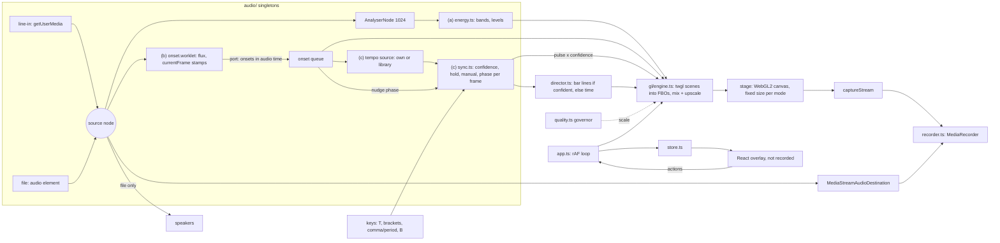
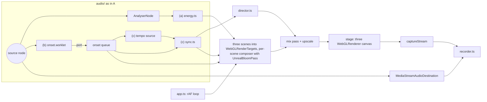
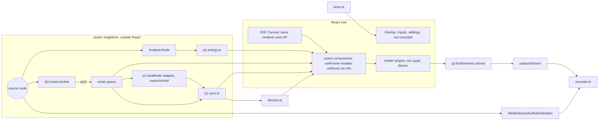

# Design — pilot (epic `pilot`)

## TL;DR
- **One engine, 4 own scenes, one recorded canvas.** MilkDrop is the next step; the design shows it can be added without a rewrite, and builds nothing for it now.
- **The three variants differ on the WebGL2 layer and on who owns the frame loop:**
  - **A**: twgl, imperative engine outside React.
  - **B**: three.js, imperative, outside React.
  - **C**: React Three Fiber (the external review's lean pick). R3F owns the loop; scenes are components that mutate uniforms in `useFrame`.
- **Analysis follows spec §2.2.**
  - **(a) Energy:** `AnalyserNode`, read every frame.
  - **(b) Onsets:** a small AudioWorklet that stamps each onset with `currentFrame` audio time.
  - **(c) Tempo + phase (non-blocking bonus):** a swappable source behind our own sync controller. The controller handles confidence, hold, Tap / ×2 / ÷2 / nudge, and fades to energy-only.
  - Which (c) source to use (own, beatfinder, aubiojs, essentia.js, BTrack) waits for `research_audio_copyleft_libs.md`.
- **Recommendation: A + hybrid analysis.** A has the fewest dependencies and unknowns and drives the frame directly for §7.5. C is the alternative if React-native scenes and Fast Refresh while tuning outweigh that, and only once R8 confirms R3F lets us control frame pacing.
- 9 gate questions. 10 research gaps; most are one-off measurements on the M4.

## Freshness
- Authored 2026-10-27 by system-designer. Revision 3 of the same day, after four rounds of user input relayed by the lead:
  1. License guardrails lifted.
  2. Analysis split into separate tasks.
  3. An external architecture review (its library claims are unverified).
  4. User answers: line-in only (no MIDI), Butterchurn moved out of the pilot, (c) is a non-blocking bonus.
- Inputs:
  - `agents/STATE.md`: HEAD, "Session 3 log", "Open ⚠️ assumptions". These predate the user answers; the lead updates them.
  - `thoughts/spec_veejay_wizard.md`, re-read after the user's update: TL;DR, §2.1–§2.8, §3, §4, §5, §6, §7, §8.
  - `agents/research/research_render_stack.md` §1, §3–§7; §2 skimmed. Cited below as **render §N**.
  - `agents/research/research_donor_milkdrop.md` §1–§6, §8. Used only for next-step readiness; cited as **milkdrop §N**.
  - `agents/research/research_audio_analysis.md` §1–§6. Cited as **audio §N**.
  - `CLAUDE.md`: Stack, Constraints (hard), Repo layout.
- **Not read:** `agents/research/research_audio_copyleft_libs.md`, which is still in progress. Capability facts I need from it are listed under R7.
- **⚠️ Drift:** `CLAUDE.md` "Constraints (hard)" still says "Never add a GPL/AGPL dependency (spec §6)", while spec §6 now allows any license. The lead updates `CLAUDE.md`.
- **Web, used for patterns only:** the three.js manual page on Canvas Textures (per-frame `needsUpdate`), used only for the MilkDrop note in variants B and C: https://threejs.org/manual/en/canvas-textures
- **Repo state:** no `./donor/` and no `web/` yet. All research is dated 2026-10-27, so none is stale.

## Constraints
- **Scope (spec §2):**
  - **Inputs (§2.1).** USB line-in via `getUserMedia` with echo cancellation, noise suppression and AGC off, stereo, channels 1–2. Routing is verified with `track.getSettings()` plus a test tone on each hardware input. Local files arrive by drag-and-drop. There is no sync input in the pilot.
  - **Analysis (§2.2).** Three tasks:
    - (a) energy: bands plus bass/mid/treb with auto-gain;
    - (b) onsets, timestamped in audio time, low latency, false positives tolerated;
    - (c) tempo + phase + confidence, a **non-blocking bonus** that must hold through breaks, offer manual Tap / ×2 / ÷2 / nudge, and fall back to energy-only.

    "(a) + (b) alone must make a good visualizer."
  - **Scenes (§2.3).** 4 own scenes: shader abstraction, styled spectrum, GPU particles, pixels/glitch. Parameters live in code, with no editor scaffolding.
  - **Playlist (§2.5).** The 4 scenes, with autopilot: on bar lines when phase is confident, otherwise on time.
  - **UI (§2.6).** A minimal overlay.
  - **Recording (§2.7).** REC captures the *final canvas* plus the audio track. The React overlay is not recorded.
  - **Quality modes (§2.8).** 60 adaptive, 60 full, 30.
- **Non-goals (§3):** MilkDrop/Butterchurn (next step), MIDI, editor, camera, clip mixer, tab/system/network audio, desktop shell, second screen, backend, deployment, Safari/Firefox parity, offline render. **No scaffolding for any of these.**
- **Acceptance criteria (§7):**
  1. Line-in appears in the picker and visuals react to it; file drag-and-drop works.
  2. (a) energy bands and (b) timestamped onsets are exposed. **Audio→visual lag is measured on the real rig**; ≤50 ms is a ⚠️ hypothesis.
     - Bonus (c), measured separately: tempo accuracy (⚠️ ±1 BPM in ~10 s), visual-pulse offset (ms), and recovery time after a transition.
  3. All 4 scenes are in the playlist; autopilot is smooth (bar lines when confident, otherwise time); all keys work.
  4. REC produces a playable file with picture and sound.
  5. 60 adaptive holds 60 fps for 30 min on the M4; 60 full and 30 are selectable.
  6. ESLint, tsc and Vitest pass.
- **Stack (§5, locked):**
  - Vite + React + TS, Web Audio, WebGL2, MediaRecorder; Chrome-first, localhost.
  - WebGL library: one of raw / twgl / regl / OGL / three / PixiJS.
  - **WebGPU is not justified.** Butterchurn, the next-step engine, is WebGL2-only (render §2). A WebGPU engine now would force a second API later.
- **Licensing (§6, user 2026-10-27).** Any license is allowed. Prefer permissive when options are otherwise equal. **Record every dependency's license** in `web/THIRD_PARTY.md`. Ported shaders keep an author/URL/license header.
  - regl and PixiJS are excluded on technical grounds, not license: regl exposes only the WebGL1 API and is dormant; PixiJS is 2D-oriented and has no transform feedback (render §1).
  - OGL is now license-eligible but stays unused: it has been dormant for about 18 months, and its `Program` has no transform feedback (render §1).
- **Product code: `web/` confirmed.** It is the Vite root with its own `package.json`.

## Shared decisions (all variants)

### S1. Loop and state
- **Page shell.** `web/index.html` contains `<canvas id="stage">` (A, B) and `<div id="ui">`. In C, R3F creates the canvas inside React.
- **Audio, analysis, sync, director, quality and recorder are module-level singletons** in every variant. They are created once at import, never inside an Effect, because StrictMode double-runs Effects in dev (render §3). React documents module-level initialisation as the pattern for app setup (render §3).
- **A and B: `app.ts` owns the rAF loop.** Per-frame data never goes through React.
- **C:** R3F owns the loop, and per-frame work happens in `useFrame` by mutating refs. The R3F docs say there is "no reason" to call `setState` there (render §3).
- **Engine → UI.** `store.ts` exposes `subscribe`/`getSnapshot` for `useSyncExternalStore`. The snapshot object is replaced only when a displayed value changes (render §3 cached-snapshot rule). In C, the Canvas subtree never subscribes to it.
- **UI → engine.** Plain calls to `actions`. One `keydown` listener lives at module level, so keys work while the overlay is hidden.
- **HMR.**
  - Overlay files export components only (`eslint-plugin-react-refresh`, render §3).
  - In A and B, editing an engine or scene module must trigger a **full reload**, never a second GL context. The mechanism is for the planner to verify ⚠️.
  - The last device auto-reconnects from localStorage, so a reload is cheap (R6).
- **Context loss.** On `webglcontextlost`, call `location.reload()` ⚠️.

### S2. Audio: input graph and analysis architecture
**Graph.** There is one `AudioContext`. The current source node fans out to:
- (i) an `AnalyserNode`: fftSize 1024, smoothing 0;
- (ii) the onset `AudioWorkletNode`;
- (iii) a `MediaStreamAudioDestinationNode`, the REC audio track (render §5);
- (iv) `destination`, for files only. Line-in is not monitored through the Mac ⚠️.
- (v) Only if Q3 picks a library for (c): that library's node.

**Sources and the channel check.**
- **Device:** `getUserMedia` with the chosen `deviceId` and all processing off. **No "channels 1–2" guarantee.** On selection we log `track.getSettings()` (channel count, sample rate). A `?debug` readout shows L/R meters through a `ChannelSplitterNode`, so the user can run the per-input test tone required by spec §2.1. Chromium source suggests a >2-channel interface opens as stereo on channels 1–2, but that is inferred and unverified (audio §6).
- **File:** drop the file, then `<audio src=objectURL>` → `MediaElementAudioSourceNode`.

**Analysis architecture options:**

| | α: AnalyserNode only | **H: hybrid (chosen)**. AnalyserNode for (a), AudioWorklet for (b) | γ: AudioWorklet + SharedArrayBuffer |
|---|---|---|---|
| (a) energy | Native FFT, read per rAF | Same | Same, or in the worklet |
| (b) onset timestamp | `ctx.currentTime` at read time (receipt time, quantised to the frame, σ≈4.8 ms derived) | **`currentFrame` sample time** (audio §2), hop 256 = 5.3 ms @48 k | Same as H |
| (b) detection window | 1024 FFT; window centre 10.7 ms | 512 FFT, hop 256; window centre 5.3 ms (audio §5 table) | Same as H |
| Main-thread hitches / 30 mode | Onsets lost during a hitch; 30 mode still reads every rAF | Unaffected | Unaffected |
| Transfer to main thread | None | `port.postMessage` per onset, plus the ODF batched per ~8 hops for (c). Latency is unmeasured (R9) | Ring buffer. Needs COOP/COEP in Vite `server.headers` and `preview.headers`, plus CORP/CORS on cross-origin assets (audio §2) |
| Extra code | 0 | 1 worklet file + pure `onset.ts` + an FFT (fft.js 4.0.4, or a copy of Butterchurn's MIT `fft.js`) | H plus headers and the ring buffer |

- **Why H:** spec §2.2 asks for onsets "timestamped in audio time" with "low latency". H has the shorter detection window. It keeps onsets intact through render jank. It gives (c) precise times, and any library (c) source needs an AudioWorklet host anyway.
- **Why not α:** it is the fallback if the TS-worklet bundling (R5) or the message latency (R9) disappoints. The pure `onset.ts` runs unchanged on AnalyserNode frames.
- **Why not γ:** rejected. It pays COOP/COEP to move a few numbers per hop.

**Per-frame audio clock.** Each frame maps `ctx.getOutputTimestamp()` (contextTime ↔ performanceTime, audio §2) to an `audioNow`.
- Onset hits are drawn by **age**: `audioNow − onset.t`. The decay envelope is therefore correct even when the onset fell between frames.
- Beat phase is `(audioNow + lead − anchor) / period` per frame. It is never driven by when an event was received.

**(a) Energy:**
- **Bands:** `BAND_COUNT = 32`, log-spaced 30 Hz–16 kHz.
- **bass/mid/treb** use Butterchurn's ranges (20–320 / 320–2800 / 2800–11025 Hz; audio §4), so "bass" means the same thing once MilkDrop arrives.
- **Auto-gain** follows Butterchurn's style:
  - `val = imm/longAvg`, `att = avg/longAvg`;
  - rates 0.2 rising / 0.5 falling, `longAvg` 0.992 (≈4.2 s), each rescaled as `rate^(30/fps)` (audio §4).
  - This makes line-in and file input level-independent.
- **Spectrum resolution, ponytail:** bass bars are coarse at 46.9 Hz per bin. If the spectrum scene looks steppy, add a second analyser at 4096 for that scene only.

**(b) Onsets:**
- **Detection:** half-wave-rectified spectral flux with causal peak-picking, `post_max = 0`, so there is no look-ahead (audio §3).
- **Message:** `{t, strength}`, where `t` comes from `currentFrame`.
- **Lag:** on paper, line-in lag is about the 1024 path's 30–47 ms minus ~5 ms (audio §5, derived). **It is measured on the rig (§7.2).** Capture, processing, frame wait and display all add to it.
- **Measurement method ⚠️:**
  - `?flash` paints a full white frame on each onset.
  - rekordbox plays a click track into the console and on to the line-in.
  - A 240 fps phone video of the screen and speaker gives the end-to-end lag.

**(c) Tempo + phase, the bonus.** It splits into a swappable *source* and *our* controller:
- **Source** (`tempo.ts`, chosen in Q3). It takes onsets or the ODF and reports `{bpm, anchor (audio time of a beat), confidence}`.
- **Controller** (`sync.ts`, always ours) does the following:
  - **Confidence:** the source's own value if it has one. Otherwise, the fraction of strong onsets within ±⅛ beat of predicted beats over the last 16 beats ⚠️.
  - **Hold:** when onsets vanish (breaks), keep the grid running at the last period for up to 16 bars, with confidence decaying slowly ⚠️.
  - **Manual controls** (proposed keys ⚠️, Q5):
    - `T`: tap tempo; sets period and anchor.
    - `[` / `]`: ÷2 / ×2.
    - `,` / `.`: nudge phase ±10 ms.
    - `B`: mark the bar "1".

    The source keeps correcting from the manually set grid.
  - **Smooth fallback:** scenes multiply every beat-driven term by `confidence`, which is smoothed over ~1 beat. When rhythm is lost, they glide to (a)+(b)-only reaction. The autopilot switches to the time fallback.
  - **Two tracks overlapping in a mix:** hysteresis. The grid only re-anchors after a competing grid has explained onsets better for 8 consecutive beats ⚠️. A beatmatched overlap keeps the grid. A non-beatmatched one drops confidence, which gives energy-only reaction until one track dominates.
  - **Bar "1":** best-effort low-band accent heuristic plus `B`. Downbeat detection is not in research (R3).
  - **Drift arithmetic (spec §7.2):** 1 BPM of uncorrected error is about 1 beat of drift per minute, so onsets continuously nudge phase and period.
- **Own-source precision (derived ⚠️, bench-verified):**
  - The coarse step is autocorrelation (ACF) over ~6 s, as BTrack does (audio §3), folded into 90–180 BPM ⚠️.
  - It is then refined by a least-squares fit of beat times.
  - With σ≈1–5 ms onset stamps over 21 beats, period error is ≲0.05 BPM.
  - So the ±1 BPM budget is limited by octave errors and beat assignment, not by resolution.

**Candidates for the (c) source.** Facts come from audio §1 and §3 only. Every gap is in R7, which `research_audio_copyleft_libs.md` is collecting.

| Candidate | License | Covers | Known facts | Missing / risk |
|---|---|---|---|---|
| **Own ACF + PLL** | n/a | BPM + phase | Algorithms and references (audio §3); derivation above | Convergence on real EDM (bench + tracks); downbeat (R3) |
| **beatfinder** (user-found; the review's pick) | MIT (claimed) | BPM + beats + "phase-corrected grid" (claimed) | **Nothing in research** | Everything. The review says it schedules beats with `setTimeout` ⚠️. If so, its events carry timer jitter (receipt time), so we need its audio-time beat predictions, not its callbacks |
| **aubiojs** 0.2.1 (bundles aubio) | GPL-3.0+ | BPM, maybe beats | Real-time per hop: `Tempo.do(buf)`, `getBpm()`. ~209 kB with WASM inlined. Dormant since 2023-08 | Beat events or phase; precision; convergence; whether it runs in `AudioWorkletGlobalScope` |
| **essentia.js** 0.1.3 | AGPL-3.0 | BPM, maybe beats | "real-time and offline". WASM 1.99 MB + glue 2.56 MB. Dormant | Which real-time rhythm algorithms the JS build exposes; per-frame cost |
| **BTrack** (C++) | GPL-3.0 | BPM + beats | Causal. 5.94 s buffer. **41 tempo states, 80–160 BPM in 2-BPM steps** | No JS/WASM build found in research, so it is our build. The 2-BPM grid sits at the ±1 BPM edge, and 174 BPM folds to 87 |
| **realtime-bpm-analyzer** 5.0.16 | Apache-2.0 | BPM only | AudioWorklet. Integer BPM; events every ~1–2 s; ≥~10 s needed, "20+ s" recommended; `confidence` stays 0; no phase | Accuracy on EDM. It cannot give phase, so it would only be a seed |

Rule for Q3. A library replaces the own source if R7 shows four things:
1. It gives beat times or phase **in audio time** in real time in Chrome.
2. Its period resolution is finer than ±1 BPM.
3. It converges in ≤~10 s.
4. It runs in a worklet or on the main thread without a SharedArrayBuffer.

Prefer permissive among equals.

### S3. Director: playlist, autopilot, transitions
- **`playlist.ts`** is the ordered list of the 4 scene ids; autopilot walks it in sequence ⚠️.
- **Autopilot** (spec §2.5 ⚠️):
  - **Confident phase** (confidence ≥ θ for 2 bars ⚠️): switch 16 bars after the last switch, on a bar line, with a 1-bar transition (`mix = (beat − startBeat)/4`).
  - **Otherwise:** switch every 30 s with a 2 s transition ⚠️.
- **Keys:** `←`/`→` transition immediately ⚠️ (1 bar if confident, otherwise 2 s). `Space` = hold (shown as "Lock" in the UI).
- **`director.ts` is pure.** `update(now, sync) → Shot`, unit-tested.

### S4. Quality modes and governor
| Mode | Output canvas size (base) | Scale | Pacing |
|---|---|---|---|
| `60-adaptive` (default) | ½ × `clientWidth·dpr` (≈1440×932 fullscreen, exact 2× upscale) | governor, range [0.6, 1] ⚠️ | every rAF |
| `60-full` | 1 × `clientWidth·dpr` | 1 | every rAF |
| `30` | 1 × `clientWidth·dpr` ⚠️ (spec only says "30 fps cap") | 1 | every other rAF |

- **Base size.** Measured, not hard-coded, because the macOS "looks like" scaled modes vary (render §4). Recomputed on resize, fullscreen and DPR change.
- **Fixed output size per mode.** Scenes render into an internal target at `base × scale` that is upscaled into the fixed output. **During REC the output size is frozen:** `F` changes CSS only and `Q` is ignored ⚠️. What happens if the recorder's canvas changes size mid-recording is unknown (R2).
- **Governor.** A frame-time heuristic after Babylon `SceneOptimizer` (render §4).
  - **Refresh period:** the median rAF delta, never a hard-coded 16.67 ms (Energy Saver changes it, render §4). A frame counts as late when its delta exceeds 1.5× the refresh period.
  - **Step down:** a ~2 s window with more than N late frames **and** JS frame time under ~10 ms (i.e., GPU-bound) multiplies scale by 0.85.
  - **Step up:** 10 s with no late frames probes ×1.1. After a failed probe, the probe interval doubles ⚠️. All of these are knobs.
- **No GPU timer query.** Its availability on Apple Silicon is unverified (render §4).
- **Thermals.** The −22% sustained GPU drop (render §6) is absorbed by the governor. The 30-minute run verifies it.
- **§7.5 metric.** The overlay's quality badge shows `60A · 0.80× · 3 drops` ⚠️ (Q7).

### S5. Recording
- **Final canvas.** Only one engine exists in the pilot, so the engine's canvas **is** the final canvas: `canvas.captureStream()` with no fps argument, one frame per canvas change (render §5).
  - The visible WebGL canvas is captured at paint invalidation, so `preserveDrawingBuffer:false` is fine (milkdrop §4c).
  - The overlay is DOM, so it is never in the stream.
- **Audio.** The `MediaStreamAudioDestinationNode` track, combined as `new MediaStream([v, a])`.
- **`mimeType`:** the first type that `isTypeSupported` accepts, in this order:
  1. **`video/mp4;codecs=avc1.<High, level per size>,mp4a.40.2`**: the M4 hardware-encodes H.264, and Chrome has recorded MP4 since version 126; the file plays in QuickTime (render §5).
  2. `webm;vp9,opus`
  3. `webm;vp8,opus`
  4. `webm`

  This changes the STATE assumption "WebM" (Q6).
- **Bitrate.** Set `videoBitsPerSecond` to ≈12 Mbps at half-Retina ⚠️ (a knob). Chrome's default of 2.5 Mbps (render §5) is too low.
- **No `timeslice`.** Since Chrome 140, WebM duration is only written for unchunked recordings (render §5). On stop, one Blob goes to `<a download>`. Ceiling: long takes are held in memory (R2).
- ⚠️ §7.5 is measured without REC. Recording performance must be measured (R2).

### S6. Next step: a second engine (readiness only, nothing built)
- **Playlist.** `Item` becomes a union (`OwnSceneId | {milkdrop: name}`), and `Shot {from, to, mix}` already models cross-item transitions.
- **Audio.** `audio/input.ts` already exposes the source node that Butterchurn's `connectAudio` needs, in the same AudioContext (milkdrop §2).
- **Final canvas.**
  - **A:** insert a visible 2D canvas. `drawImage` the engine canvas into it, and let Butterchurn 3.x draw into it directly (milkdrop §4a, §4d). `captureStream()` moves to that canvas.
  - **B and C:** a `CanvasTexture` upload (milkdrop §4b; cost ⚠️), or the same 2D final canvas.
  - The recorder already takes "the final canvas" as an argument.
- **Later sync from the rig** (MIDI Clock/Link, spec §4) plugs in as another (c) source behind the same contract. The bar "1" still comes from `B` or a heuristic.

### S7. License recording
`web/THIRD_PARTY.md` gets one line per dependency, giving name, version and license:
- the WebGL layer: twgl.js (MIT), three (MIT), or R3F (license not in research, R8);
- fft.js (npm MIT; GitHub has no LICENSE file);
- the Q3 (c) library, if one is chosen;
- the toolchain (R4).

Ported shaders keep their header. The Shadertoy default license is CC BY-NC-SA (render §7).

### S8. Shared contracts (TypeScript)
```ts
// audio/energy.ts — (a)
export const BAND_COUNT = 32;                                      // log 30 Hz–16 kHz
export interface Levels { bass: number; mid: number; treb: number } // 1 ≈ running average
export interface Energy { bands: Float32Array; level: Levels; att: Levels }

// audio/onset.ts — (b), pure DSP shared by the worklet and Vitest
export interface Onset { t: number; strength: number }  // t = AudioContext time from currentFrame, s
export function detect(spectrum: Float32Array, t: number): Onset | null; // flux + causal peak-pick (stateful closure in practice)

// audio/tempo.ts — (c) source: own ACF+PLL, or adapter over the Q3 library
export interface TempoReading { bpm: number; anchor: number; confidence: number } // anchor = audio time of a beat
export interface TempoSource { push(o: Onset): void; read(): TempoReading | null }

// audio/sync.ts — (c) controller, always ours
export interface Sync {
  bpm: number;            // 0 = none
  beat: number;           // continuous: floor = beat index, fract = phase
  bar: number;            // continuous: (beat − downbeatOffset) / 4
  confidence: number;     // 0..1, smoothed; scenes multiply beat terms by it
}
export interface SyncControls { tap(t: number): void; double(): void; halve(): void; nudge(ms: number): void; downbeat(t: number): void }
export function syncAt(audioNow: number): Sync;          // per frame, from the audio clock (+ lead knob)

// what every scene reads each frame (A/B: passed in; C: read from the same singletons inside useFrame)
export interface FrameInput {
  energy: Energy;                 // (a)
  onsets: readonly Onset[];       // (b) fired since last frame
  lastOnset: Onset | null;        // envelope by age = audioNow − t
  audioNow: number;               // audio-clock time of this frame
  sync: Sync;                     // (c)
  time: number; dt: number; width: number; height: number; // render target px (base × scale)
}

// director.ts
export type OwnSceneId = 'tunnel' | 'spectrum' | 'particles' | 'glitch';
export interface Shot { from: OwnSceneId; to: OwnSceneId | null; mix: number }
export interface Director { update(now: number, sync: Sync): Shot; next(): void; prev(): void; setHold(on: boolean): void }

// quality.ts
export type QualityMode = '60-adaptive' | '60-full' | '30';
export interface Governor { frame(now: number, jsMs: number): void; readonly scale: number; readonly drops: number }

// store.ts
export interface UiSnapshot {
  devices: { id: string; label: string }[];
  source: { kind: 'device'; id: string } | { kind: 'file'; name: string } | null;
  sceneName: string; bpm: number; confident: boolean; hold: boolean;
  recording: boolean; quality: QualityMode; scale: number; drops: number;
}

// recorder.ts
export function startRecording(finalCanvas: HTMLCanvasElement, audio: MediaStreamTrack, videoBps: number): () => Promise<void>; // stop() downloads
```

**Shared files** under `web/`. Variant-specific files are listed in each variant.
```
web/  index.html  package.json  vite.config.ts  tsconfig.json  eslint.config.js  THIRD_PARTY.md
web/src/
  main.tsx                 # imports singletons, renders <Overlay/> (C: <App/>)
  store.ts
  audio/input.ts           # context, devices, sources, fan-out, getSettings log, ?debug L/R meters
  audio/energy.ts          # (a)                                  + .test.ts
  audio/onset.ts           # (b) pure DSP                         + .test.ts
  audio/onset.worklet.ts   # (b) AudioWorkletProcessor: hop FFT → onset.ts → port
  audio/tempo.ts           # (c) source (own or adapter)          + .test.ts (synthetic bench)
  audio/sync.ts            # (c) controller                       + .test.ts
  director.ts              #                                      + .test.ts
  quality.ts               #                                      + .test.ts
  recorder.ts
  playlist.ts
  ui/Overlay.tsx  ui/overlay.css
```

## Variant A — twgl, imperative engine outside React (simplest that meets §7)

**Summary.**
- `app.ts` owns the rAF loop. Each frame runs this sequence: read (a) → drain (b) onsets → compute (c) `syncAt(audioNow)` → `director.update` → `engine.render(shot, frame)` → `governor.frame`.
- **The engine:** `gl/engine.ts`, built on twgl.
  - It draws on `#stage`, a WebGL2 canvas with `alpha:false`, `antialias:false`, `preserveDrawingBuffer:false`, sized to the base.
  - Each scene renders into an FBO at `base × scale`.
  - One final pass crossfades the shot's two FBOs and upscales into the stage.
- **REC:** `#stage.captureStream()`.

**WebGL layer.**
- twgl.js 7.0.0: MIT, active (single maintainer), 22.7 kB gz.
- **Particles:** transform feedback, using twgl's TF helpers and its "transform feedback particles" example.
- **Bloom:** a hand-written dual-filter blur in `gl/bloom.ts`, roughly 100 lines (render §1).

**Analysis coverage.**

| Task | Module / source | Consumer |
|---|---|---|
| (a) | `energy.ts` ← `AnalyserNode`, main thread, every rAF | Bass swells and high-band sparks in all scenes |
| (b) | `onset.worklet.ts` → port → onset queue | Flashes and hits (particle bursts, glitch hits), enveloped by age |
| (c) | `tempo.ts` (Q3 source) → `sync.ts` | Director bar lines; between-beat pulses scaled by `confidence` |



**Files (A):**
- `app.ts`: singleton loop, keys, actions.
- `gl/engine.ts`: context, FBOs, mix and upscale pass.
- `gl/bloom.ts`.
- `scenes/{tunnel,spectrum,particles,glitch}.ts`: GLSL as template strings, plus one exported `params` object per scene that the stage-2 editor binds to later.

**Contracts (A):**
```ts
export interface Scene { readonly name: string; draw(f: FrameInput): void }  // into the bound FBO
export type SceneFactory = (gl: WebGL2RenderingContext) => Scene;           // all 4 built at startup
// gl/engine.ts
export function render(shot: Shot, f: FrameInput): void;                     // FBO(s) → mix → upscale → stage
```

**Libraries:** twgl.js (MIT); fft.js (MIT on npm) inside the worklet; the Q3 (c) library if any. Algorithms are referenced, not copied: Butterchurn's level constants (audio §4) and the flux/peak-pick definitions (audio §3). `./donor/` does not exist.

**§7:**
1. Picker plus drop target; channel check via `getSettings` + `?debug` meters.
2. `Energy` + `Onset` with audio-time stamps; lag measured by the `?flash` method. Bonus (c) via the S2 bench and Q4 metrics.
3. Director: FBO crossfade, bar lines if confident, otherwise time; all keys.
4. `#stage.captureStream()` + audio track.
5. Fixed output, governor, drops badge.
6. Vitest on `energy`, `onset`, `tempo`, `sync`, `director`, `quality`.

**Roadmap:**
- **Stage 2:** scenes keep their `params`.
- **Stage 3:** the camera and segmentation mask become textures in the same mix pass.
- **Stage 4:** video textures.
- **Next step (MilkDrop):** S6, path a/d via a 2D final canvas.
- **Electron:** unchanged.

**Risks:**
- Bloom and TF particles are ours to write and tune.
- Engine and scene edits trigger a full reload, which hurts tuning ergonomics. Mitigation: auto-reconnect (R6), or scene hot-swap via Vite HMR `accept`, which research has not covered (R10).
- Shared risks: (c) quality, the downbeat heuristic, recorder cost (R2), worklet bundling (R5).

**Effort: M.** Smallest dependency surface, fully known facts.

## Variant B — three.js, imperative, outside React

**Summary.**
- Same loop, state and analysis as A.
- `render/three.ts` builds a `WebGLRenderer` on `#stage`. `three@0.186.1`'s WebGLRenderer has been WebGL2-only since r163 (render §1).
- **Scenes** are `Scene3 {scene, camera, update(f)}`. Each renders into a `WebGLRenderTarget` at `base × scale`.
- **Glow scenes** run their own `EffectComposer` with `UnrealBloomPass`, using three's MIT addons. This makes bloom per-scene, so there is no selective-bloom problem.
- **Particles** use `GPUComputationRenderer` (float render-target ping-pong) plus `Points`. WebGLRenderer has no transform feedback.
- **Transition:** a fullscreen mix pass over two targets.
- **WebGPU:** never `WebGPURenderer`. Reported issues: EffectComposer and ShaderMaterial are unavailable ⚠️, and the WebGL2 fallback leaks (render §2).
- **pmndrs `postprocessing`** (Zlib) is eligible, but how it compares is not in research (R9).

**Analysis coverage:** identical to A.



**Files (B):** `app.ts`, `render/three.ts`, `scenes/*.ts` exporting `Scene3`.

**Contracts (B):**
```ts
import type * as THREE from 'three';
export interface Scene3 { readonly name: string; readonly scene: THREE.Scene; readonly camera: THREE.Camera; update(f: FrameInput): void }
export function render(shot: Shot, f: FrameInput): void; // targets → mix → stage
```

**§7 / roadmap:** as in A. Stage 3 gets `VideoTexture`. Next step: `CanvasTexture` for Butterchurn, or a 2D final canvas (S6).

**Risks:**
- Framework glue (materials, render targets, composers) for content that is mostly fullscreen GLSL.
- Frequent r-releases (render §1): pin the version exactly.
- Same edit-reload ergonomics as A.

**Effort: M.** Bloom and GPGPU come for free; there is more glue.

## Variant C — React Three Fiber, the external review's lean pick

**Summary.**
- `App.tsx` renders the overlay plus an R3F `<Canvas>`. R3F creates the renderer and canvas and owns the rAF loop.
- **Scenes** are components: `<Tunnel/>`, `<Spectrum/>`, `<Particles/>`, `<Glitch/>`. Each reads the audio, onset and sync singletons in `useFrame` and **mutates uniforms through refs, never `setState`** (render §3).
- **UI** (inputs, settings, presets) is ordinary React.
- **Bloom:** the review's route is `@react-three/postprocessing` `<Bloom>` (built on pmndrs `postprocessing`, Zlib), or three's `UnrealBloomPass`. The facts are not in research (R8, R9).
- **Particles:** `GPUComputationRenderer` inside a component.
- **Transitions:** both scene components stay mounted during a transition. Each renders into its own render target, and a fullscreen quad mixes them. In R3F this needs render-target plumbing (e.g. drei `useFBO`; R8). It is the fiddliest part.
- **REC:** `gl.domElement.captureStream()`, obtained in `onCreated`.
- **(c) source:** beatfinder, as the review proposes, marked **experimental** and swappable behind `TempoSource` (the same slot as A and B; Q3).

**Analysis coverage:** the same modules as A. The only difference is that the consumers are `useFrame` callbacks.



**Files (C):**
- `App.tsx`: the Canvas and the overlay.
- `scenes/*.tsx`.
- `render/mix.tsx`: render targets and the mix quad.
- `quality.ts` drives R3F's `dpr`/`frameloop` (mechanism: R8).
- There is no `app.ts` loop.

**Contracts (C):**
```ts
export type SceneComponent = (p: { target: THREE.WebGLRenderTarget }) => JSX.Element; // reads singletons in useFrame
```

**§7:**
- 1, 2, 4, 6: as in A.
- 3: transitions via render targets.
- 5: the governor and the 30 fps cap must act through R3F's loop controls (R8).

**Roadmap:**
- **Stage 2 (React editor):** best fit, since scenes are components and params can be props.
- **Stage 3:** `VideoTexture`.
- **Next step:** `CanvasTexture` or a 2D final canvas (S6).

**Honest comparison against A and B:**
- **Bundle:** three's 185 kB gz plus R3F (size unknown, R8) plus postprocessing (unknown). On localhost and in Electron, bundle size is not a pilot constraint.
- **Particles:** same as B; no transform feedback.
- **Bloom:** easiest of the three, if R8 and R9 confirm the R3F postprocessing stack.
- **Loop control:** for §7.5 (governor, 30 fps cap, size frozen during REC), the loop belongs to R3F rather than to us.
- **StrictMode:** `<Canvas>` mount and remount behaviour under StrictMode is unverified, and duplicate WebGL contexts are a known hazard (render §3).
- **Dev ergonomics:** **scene edits hot-reload with Fast Refresh**, because the files export only components (render §3) and the audio singletons survive. This is the biggest ergonomic win while parameters are tuned in code.

**Risks:**
- R8 (R3F facts: version and React 19 compatibility, StrictMode, frame-pacing controls, DPR control, license, size).
- R7 (beatfinder is unverified; its `setTimeout` scheduling is a timing risk).
- Transition plumbing.
- A React re-render reaching the Canvas subtree by accident.

**Effort: M.** Least scene code, most unknowns.

## Comparison
| | A — twgl | B — three, imperative | C — R3F (review) |
|---|---|---|---|
| WebGL layer | twgl 7.0.0, MIT, 22.7 kB gz | three r186, MIT, 185 kB gz | three + R3F (+ postprocessing); size and license not in research (R8) |
| Who owns the frame | Our `app.ts` | Our `app.ts` | R3F |
| Particles | Transform feedback (twgl helpers + example) | `GPUComputationRenderer` (float RT) | Same as B |
| Bloom | Hand-written, ~100 lines | `UnrealBloomPass` per scene | `<Bloom>` / `UnrealBloomPass` (R8, R9) |
| Scene transitions | FBO mix pass | Render targets + mix pass | Render targets + mix quad (R8) |
| §7.5 control (governor, 30 cap, fixed size during REC) | Direct | Direct | Via R3F `dpr`/`frameloop` (R8) |
| StrictMode / HMR | Singleton; edits trigger full reload | Same as A | Scene components Fast-Refresh; Canvas double-mount ⚠️ |
| Scene authoring | Raw GLSL + twgl | three materials + GLSL | JSX + materials + GLSL |
| Stage-2 React editor fit | `params` objects | `params` objects | Props, best |
| Next-step MilkDrop | 2D final canvas (milkdrop §4a/§4d) | CanvasTexture or 2D final canvas | Same as B |
| Analysis (a)/(b)/(c) | H (S2); (c) via Q3 | Same | Same; beatfinder in the (c) slot per the review |
| Unknowns before coding | R2, R5 | R2, R5, R9 | R2, R5, **R7, R8**, R9 |
| Effort | **M (smallest surface)** | M | M (least scene code, most unknowns) |

## Recommendation
**Recommended: Variant A with hybrid analysis H.**
- The WebGL layer is twgl, with an imperative engine and our own loop.
- (a) energy comes from the `AnalyserNode`; (b) onsets come from an AudioWorklet stamped with `currentFrame`.
- (c) is a non-blocking bonus behind our `sync.ts` controller. Its source is chosen at a short follow-up gate after `research_audio_copyleft_libs.md` lands.

**Why A:**
- It is the smallest setup that meets every spec §7 criterion, and every fact it relies on is already in research.
- It drives the frame directly, which is what §7.5 needs on a fanless M4: governor, 30 fps cap, and fixed output size during REC.
- Its only costs are about 100 lines of bloom and the transform-feedback setup.

**When C is the better pick:** if hot-reloading scenes while tuning, and a React-native path to the stage-2 editor, matter more to you than the dependency and loop-control unknowns. In that case choose C only after R8 confirms that R3F lets us control frame pacing and DPR. Treat beatfinder as experimental until R7 verifies it.

**B** is the middle option: three's bloom and GPGPU without putting React in the loop.

**Planner sequencing:** open with a one-off probe on the target (R1, R2, R5, R9), and put the (c) steps last, behind the S8 contracts.

## Spec §8 and STATE ⚠️ ledger
| Item | Status |
|---|---|
| Butterchurn (§8) | **Deferred to the next step** (spec §2.4, §4). Readiness is in S6; the facts stay in milkdrop §1–§8 |
| Render library | **Gated: Q1** (A twgl / B three / C R3F). regl, PixiJS, OGL and WebGPU are excluded (Constraints) |
| Dynamic-resolution technique | **Resolved** (S4) |
| Loop outside React | **Resolved:** S1 for A and B; in C, R3F's `useFrame` with mutation via refs |
| Beat/onset/BPM approach and latency | **(a), (b) resolved** (S2 H, lag measured on the rig). **(c) source gated: Q3** after R7 |
| >2-input interfaces | **Changed:** no channel guarantee. Acceptance check is `getSettings` + per-input test tone with the `?debug` meters (spec §2.1) |
| MediaRecorder codecs | Candidate list from Chromium source; the code picks the first one supported. Target check is R1 |
| Thermal throttling | **Carried:** −22% (render §6), handled by the governor and checked in the 30-minute run |
| ⚠️ Autopilot every 16 bars, ~1-bar transition | Now applies only with confident phase; 30 s / 2 s time fallback otherwise (Q9) |
| ⚠️ Key map | Kept, plus the proposed sync keys `T [ ] , . B` (Q5) |
| ⚠️ localStorage | Kept (Q9) |
| ⚠️ Channels 1–2 only | Becomes a verified acceptance check, not an assumption |
| ⚠️ WebM output | **Change proposed:** MP4/H.264 first (Q6) |
| ⚠️ ≤50 ms lag | A hypothesis, measured on the rig with the `?flash` + 240 fps video method (Q9) |
| ⚠️ ±1 BPM in ~10 s | Now part of the bonus (c) metrics (Q4) |
| MIDI Clock/Link | Out of the pilot (spec §3); a later (c) source (S6) |
| `CLAUDE.md` license line | Stale vs spec §6. The lead updates it |

## Research gaps
R1, R2, R5 and R9 need one run on the M4 in Chrome 156. The researcher had no browser.
- **R1.** Target checks: `MediaRecorder.isTypeSupported` for the S5 list, and whether the `avc1` level string matters; the fullscreen value of `clientWidth·dpr`; whether `EXT_disjoint_timer_query_webgl2` is available (informational only).
- **R2.** MediaRecorder cost at 1440p60 and 2880p60; whether Chrome uses the M4's hardware H.264 encoder; memory use of long unchunked takes; behaviour when the canvas size changes mid-recording (render §5 ⚠️).
- **R3.** Causal **downbeat (bar "1") detection**: algorithms and realistic accuracy on EDM. audio §3 covers beat phase only.
- **R4.** Licenses of the toolchain (React, Vite, Vitest, ESLint, TS, plugins) and of the chosen WebGL layer, for `THIRD_PARTY.md`.
- **R5.** How Vite bundles a TypeScript AudioWorklet module that imports `onset.ts` and fft.js. Fallback: a self-contained worklet file.
- **R6.** Chrome's autoplay policy for `AudioContext` on localhost: can a saved device start without a click? Fallback ⚠️: a one-click "Start" while the context is suspended.
- **R7** (being collected now into `research_audio_copyleft_libs.md`). For each (c) candidate:
  - **beatfinder:** license, maintenance, API; whether it gives real-time beat times **in audio time** or via `setTimeout` callbacks; whether its "phase-corrected grid" claim holds; precision and convergence.
  - **aubiojs:** beat events from `Tempo.do`; precision of `getBpm`; whether it runs in `AudioWorkletGlobalScope`.
  - **essentia.js:** which real-time rhythm algorithms its JS build exposes, and their cost.
  - **BTrack:** whether any JS/WASM build exists, and the effort to make one.
  - **realtime-bpm-analyzer:** accuracy on EDM.
- **R8.** React Three Fiber (and drei / `@react-three/postprocessing`, if used):
  - license, version, maintenance and gzipped size;
  - React 19 compatibility;
  - `<Canvas>` behaviour under StrictMode (duplicate WebGL contexts?);
  - frame-pacing control for the 30 fps cap and the governor (`frameloop`, manual advance);
  - DPR and size control;
  - the render-target/FBO helpers needed for transitions.
- **R9.** Latency of `AudioWorklet` → main-thread `postMessage` in Chrome. Research flags "messaging latency" but gives no figure. Also pmndrs `postprocessing` vs three's own addons (B, C).
- **R10.** Vite HMR `accept`, for scene hot-swap in A and B without a full reload. Optional; this is ergonomics only.

## Decision needed
1. **Variant (WebGL layer and loop ownership):**
   - **A, twgl** (recommended);
   - **B, three.js** imperative;
   - **C, React Three Fiber** (the review's lean pick). If C, it goes ahead only after R8 confirms frame-pacing and DPR control.
2. **Analysis architecture:**
   - **H** (recommended): `AnalyserNode` for (a) plus an AudioWorklet that stamps (b) onsets with `currentFrame`;
   - **α**: `AnalyserNode` only. Simplest, but onset stamps are quantised to the frame (receipt time) and are lost during main-thread hitches.
3. **(c) tempo/phase source.** The controller (confidence, hold, manual keys, fallback) is ours either way.
   - Decide now: our own ACF + PLL.
   - Or **defer to a short gate after `research_audio_copyleft_libs.md`** (recommended), choosing among own, beatfinder (MIT, experimental, `setTimeout` risk), aubiojs, essentia.js and BTrack-WASM by the S2 rule. The contracts don't change, so planning can proceed with the (c) steps last.
4. **(c) bonus metric thresholds ⚠️** (spec §7.2 lists the metric types; these are proposed values):
   - **Tempo:** within ±1 BPM of rekordbox's displayed BPM within ~10 s of the kick entering, on steady 4/4 at 90–180 BPM, on a 5-track set you choose. A half- or double-tempo reading counts as a miss even though `[`/`]` can fix it.
   - **Pulse offset:** median |grid beat − kick onset| ≤ 20 ms and p95 ≤ 40 ms, in audio time. The end-to-end 240 fps video is reported, not gated.
   - **Recovery:** confident and on-grid within ≤ 8 beats after the incoming track's kick dominates. No confident wrong grid during non-beatmatched overlaps.
   - **Hold:** at most ⅛ beat off after an 8-bar break.
   - **Bench** (Vitest, synthetic): p95 ≤ 20 ms, 0 slips and 0 flips over 5 simulated minutes.

   Accept these, or adjust?
5. **Sync keys and the bar "1" ⚠️:**
   - Keys: `T` tap, `[`/`]` ÷2/×2, `,`/`.` nudge ±10 ms, `B` mark the downbeat. Accept, or remap?
   - Bar "1": a best-effort heuristic plus `B` (recommended), or real downbeat detection, which needs research R3 first?
6. **Recording:**
   - MP4/H.264 + AAC first with WebM as fallback (recommended), or WebM first?
   - Also confirm: §7.5 is measured without REC, and during REC the output size is frozen and `Q` is ignored.
7. **§7.5 metric.** "Holds 60 fps" means ≤1 late frame per minute on average over 30 min after warm-up, counted by the overlay drop counter (a late frame is one >1.5× the refresh period). Accept, or set a different threshold?
8. **Lag measurement for §7.2:**
   - `?flash` (white frame on each onset);
   - rekordbox click track → console → line-in;
   - 240 fps phone video of the screen and the speaker, run once on the real rig.

   Accept as the method?
9. **Confirm the carried defaults:**
   - **Autopilot:** confident phase → every 16 bars on a bar line with a 1-bar transition; otherwise every 30 s with a 2 s transition. Sequential order. `←`/`→` act immediately.
   - **Base keys:** `←/→/Space/F/R/Q`.
   - **Persistence:** localStorage keeps the last device and the quality mode.
   - **Channel check:** `getSettings` + `?debug` L/R meters + per-input test tone.
   - **Monitoring:** line-in is not played back through the Mac.
   - **"30" mode:** full resolution at 30 fps.
   - **Adaptive scale floor:** 0.6.
   - **Code location:** `web/`.
