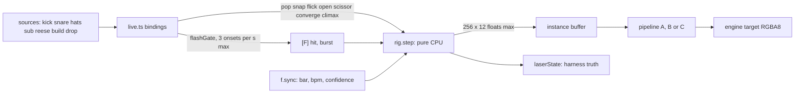
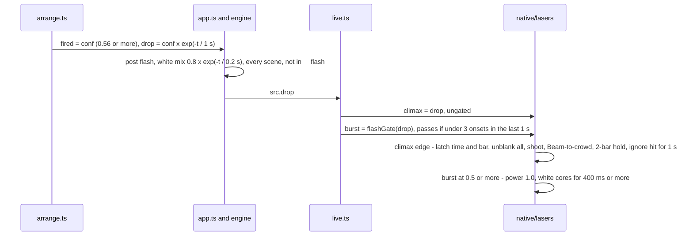
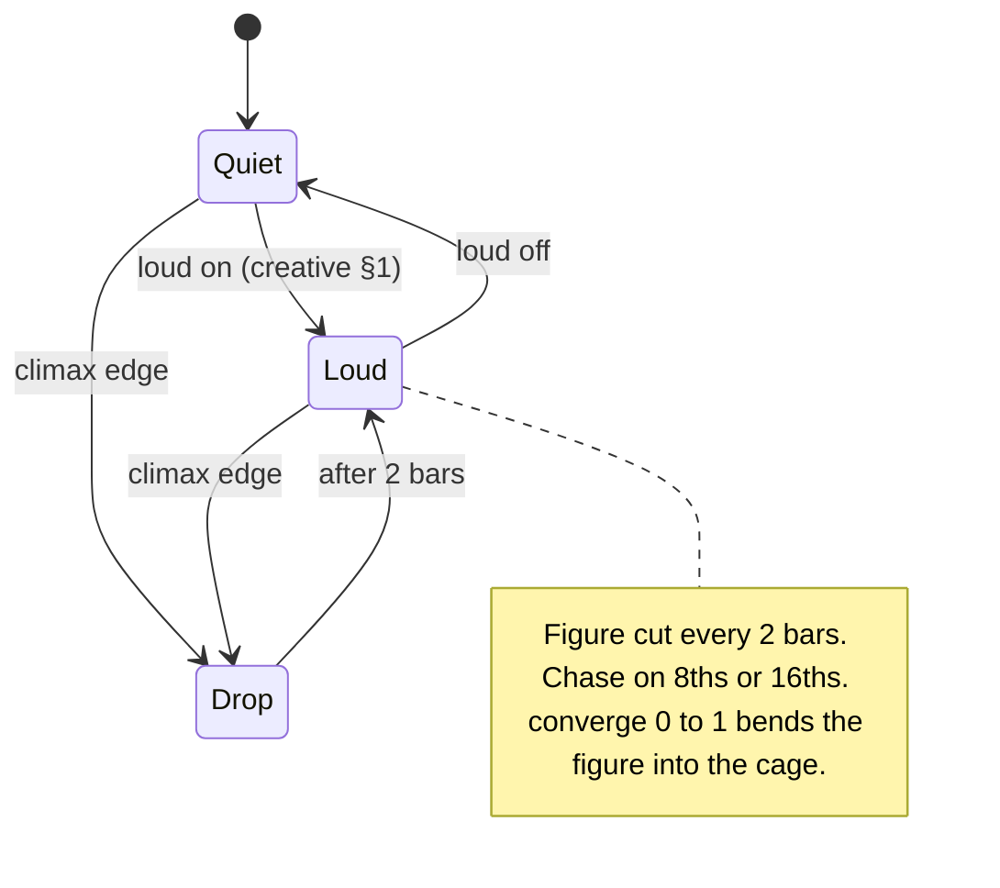
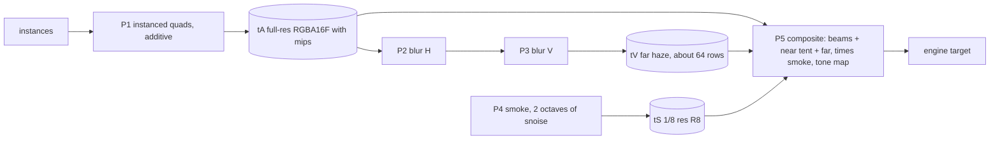
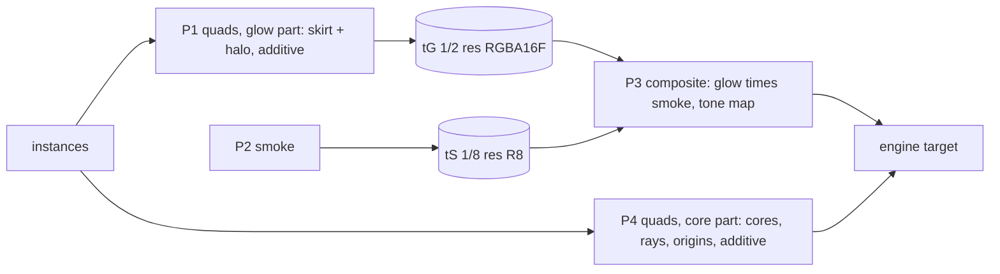
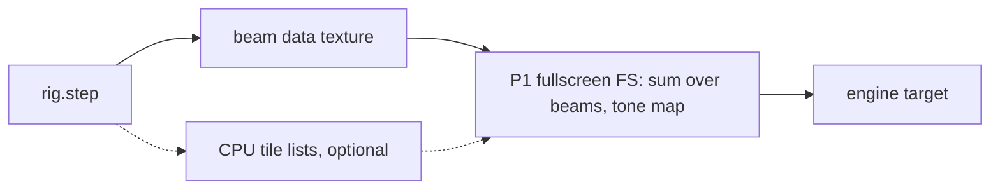

# Design — Rave Lasers (RL-S2: one DnB scene, 23 emitters, up to 135 beams in haze)

## TL;DR
- One new native `native/lasers` and one built-in `builtin:rave-lasers`. Every variant shares one pure CPU rig (figures, chase, light bookkeeping) that writes ≤ 256 beam instances per frame. The variants differ only in the GPU pipeline.
- **A (recommended, simplest):** the Isobars pipeline. Instanced beam quads go into a full-res HDR target; its mip chain is the haze; one composite. ≈ 3.2–3.9 ms at 135 beams (≤ 5.1 ms in a slow-GPU session); default `truss` 3.0–3.5 ms.
- **B:** split resolution. Skirt + analytic halo at ½ res; cores added at full res. ≈ 2.0–2.6 ms (computed, no in-house anchor); new look risks.
- **C (rejected):** per-pixel beam loop. 12–20 ms; 3.5–5 ms with CPU-binned beam lists.
- The 3 signal gaps are answered in `## Codebase facts`. Two creative-spec lines cannot hold as worded (C10 second clause; the drop veil timing): see `## Decision needed`.

## Freshness
- 2026-11-15, system-designer. Brief `RL-S2-DESIGN`, source commit `7dff355`.
- Inputs: `agents/creative-director/creative_rave_lasers.md` TL;DR, §2, §3, Signal gaps, §6, §8 (L1–L16, L25–L104, L118–L130, L146–L167); `thoughts/spec_rave_lasers.md` §6 R1–R9; `agents/research/research_rave_lasers.md` §5, §6; `agents/STATE.md` HEAD.
- Code read at `7dff355`, under `web/src/`: `scenes/isobars.ts` L196–L523; `gl/scene.ts`; `gl/post.ts`; `gl/live.ts` L56–L85, L136–L147, L168–L197, L280–L324; `gl/engine.ts` L55–L114, L160–L221; `bind.ts`; `audio/features.ts` L1–L129; `audio/sync.ts` L1–L60, L120–L154; `audio/arrange.ts` L20–L59, L126–L155; `app.ts` L214–L225, L340–L369; `fx/types.ts`; `frame.ts`; `scenes/builtin.ts` L974–L1013. Other file:line references come from grep hits or from research §6.
- Not read (outside the brief's ranges): creative §1 (the quiet / loud rule), §4, §5, §7 (the stills list); `thoughts/spec_veejay_wizard.md` §4, §7. Roadmap notes rest on STATE HEAD only.
- No web source was used. Costs are measured anchors (research §5, STATE HEAD) or marked computed.
- Notation: `[F]` marks a flash-gated input (as `web/src/scenes/isobars.ts:323`).
- Split artifact (Write cap 5 KB): this file, then `design_rave_lasers.2.md` … `.9.md`. The lead joins them in numeric order.

## §1 Problem and constraints
- Problem: draw up to 135 straight beams, 64 booth rays, 2 sheets and 23 origin sprites from 23 fixed emitters, in haze, at billed +flash p95 ≤ 5 ms at 1728×1117 (R5). Hits move geometry. Full-frame brightness rises only through the flash gate (R6, creative Rule H).
- Fixed by the inputs:
  - Acceptance: R1–R9 (`spec_rave_lasers.md` §6), C1–C16 (creative §8), the 12 must-nots (creative §6).
  - Rig: emitter counts and positions are never cut. Beams per emitter may drop to the floor (creative §2.1). The floor for `full` is 93 beams (T 8×5 + S 6×3 + F 7×5) and 2×24 rays.
  - Contract: `Native` / `NativeDef` stay frozen (`web/src/gl/scene.ts:7`, `:11`). The flash gate stays as is (`web/src/gl/post.ts:46`).
  - Stack: WebGL2 + `twgl.js` 7.0.0 (MIT, installed). No variant needs a new dependency.
  - Licence: own code, credit "VeeJay Wizard". `webgl-noise` is MIT and already copied into 5 files (research §6).
- Non-goals: a drawn truss, stage or crowd (creative §2.1); a 3D camera; a techno variant (R9); a new detector (creative Signal gaps).
- Measured anchors (billed +flash p95):
  - **M1** Isobars ribbons, ≤ 8,000 segments, full-res HDR target, no haze: 1.57 ms dnb / 1.73 ms dub (research §5 b).
  - **M2** Isobars mip haze: + ≈ 1.3 ms. Total 3.76 ms in a slow-GPU session, a factor ≈ 1.3 over M1 + M2 (research §5 d).
  - **M3** per-pixel fan, 32 beams = 61.8 M segment tests: 2.9–3.9 ms, so ≥ 16–21 M tests per ms (research §5 a).
  - **M4** one simple full-res pass: 0.71 ms (stars), 1.01 ms (superformula) (STATE HEAD, wave-2 S1.1 / S1.3).

## §2 Variants
### §2.0 Shared by A, B and C: the rig (no GL)
- Files: new `web/src/scenes/lasers.ts` (def + rig + GL) and `web/src/scenes/lasers.test.ts`. Edits: `web/src/fx/catalog.ts` (+1 entry, as `isobars` at `:6`, `:24`); `web/src/scenes/builtin.ts` (+1 doc, as `:986–1006`).
- Ids: native `native/lasers`; built-in `builtin:rave-lasers`, name "Rave Lasers". `builtin:laser-grid` is not reused: it names one figure of five, and it matches the rejected `web/src/fx/own/laser-grid.fs`.


| Input | Type; default | Bind: source, attack / release (s) | Role |
|---|---|---|---|
| `layout` | long 0 / 1 / 2 = truss / floor / full; 0 | — | groups present (creative §2.1) |
| `green`, `white`, `red` | float 0–1; 0.7 / 0.3 / 0 | — | emitter colour shares (R3) |
| `haze` | float 0–1; 0.5 | — | haze gain (R4) |
| `open` | float 0–1 | sub, 0.04 / 0.3 | beams per emitter, spread, lit emitters |
| `scissor` | float 0–1 | reese, 0.03 / 0.15 | neighbour fans lean apart |
| `converge` | float 0–1 | build, 0.15 / 0.8 | the build ramp into the cage |
| `flick` | float 0–1 | hats, 0 / 0.18 | dark-share target, speckle depth |
| `pop` | float 0–1 | kick, 0 / 0.14 | spread ×1.3, chase jump. Geometry, not gated |
| `snap` | float 0–1 | snare, 0 / 0.11 | Grating burst, chase reverse, S pose step. Not gated |
| `climax` | float 0–1 | drop, 0 / 0.4 | drop geometry: unblank, shoot, hold. Not gated |
| `hit` [F] | float 0–1 | kick, 0 / 0.14; min 0, max 1 | core gain +40 %. Gated |
| `burst` [F] | float 0–1 | drop, 0 / 0.4; min 0, max 1 | drop brightness: `power` 1.0, white cores. Gated |
- `flash: ['hit', 'burst']`. An [F] bind rests at 0 and spans 0–1; the native applies the gain. Reason: the gate's ON line is 0.5 in output units (`web/src/gl/post.ts:34`, `:46–57`). An [F] input whose max is below 0.5 never fires; at max 0.5 it fires only at the source's peak (Isobars `hit`, `web/src/scenes/isobars.ts:332`).
- The times are the creative §3 targets; the planner may tune them. `scissor` follows wobble under Dubstep Auto with no extra code (`isobars.ts:304–305`; `web/src/bind.ts:93`).
```ts
// web/src/scenes/lasers.ts, exported for lasers.test.ts (the isobars `traceBands` precedent)
export const EMITTERS: readonly { group: 'T' | 'S' | 'F' | 'B'; x: number; y: number; max: number; floor: number }[] // 23 (creative §2.1)
export interface RigIn {
  v: Readonly<Record<string, Value>> // the bound inputs above
  bar: number; locked: boolean       // f.sync.bar; locked = bpm > 0 && confidence >= 0.3
  time: number                       // f.time: wall clock (f.dt is heat-scaled, app.ts:357)
  width: number; height: number      // px
}
export interface RigOut { n: number; light: number; core: number; haze: number; speckle: number } // instance count + 4 frame scalars
export interface LaserState {        // CPU truth for the harness (C2, C8, C11, C12, C14, C15)
  mode: 'quiet' | 'loud' | 'drop'; figure: number; step: number
  open: number; converge: number; spread: number; power: number
  lit: Uint8Array                    // lit beams per emitter, 23
  onsets: number                     // full-frame brightness onsets the native rendered
}
export interface Rig { step(x: RigIn, out: Float32Array): RigOut; state(): LaserState }
export function createRig(seed?: number): Rig
// One instance = 12 floats: x0 y0 x1 y1 (px) | w0 w1 (core half-width at each end, px) | gain0 gain1 | hot | tint | kind | fade
// tint: 0 green, 1 white, 2 red. kind: 0 beam, 1 sheet, 2 ray, 3 origin (disc + glint). fade: share of the length that fades at the tip.
```
- The native returns `laserState()` beside `draw` (the `isobarState()` precedent, `isobars.ts:365`).
- Rig rules (every variant):
  1. **One primitive.** A beam is a straight segment from its emitter to the frame exit: the ray ∩ the frame rectangle, inflated by the half-width, so the viewport clips the end. A Sheet is the same primitive with a flat-top profile and a wide `w1` (a wedge). A ray is a beam with a 1-px core and no skirt.
  2. **Depth is 2.5D.** Each beam has a `toward` value 0–1. It sets `w1 / w0` (1 → 3.5), `gain1 / gain0` and the glint (`toward` ≥ cos 10°). A 3D camera is rejected: the creative numbers are screen-space (emitter positions, square cage cells).
  3. **Blanking and chase.** An unlit beam emits no instance. The lit count per emitter is rig state. At each chase step it moves by ≤ 1 toward `round(n · (1 − 0.6 · flick))` (C14, creative §6.5). The speckle depth follows `flick` directly, so row 3's 30 ms attack still shows. Entry `shoot`: `x1 y1` runs from the emitter to the exit in ≤ 48 ms with `fade` 0.2. Exit: one instance stays at falling gain for ≤ 50 ms.
  4. **Clock.** `step = floor(bar · 8)`; 16 at `converge` ≥ 0.75 for ≤ 4 bars. The figure cuts at the bar wrap, every 2 bars (loud) or 4 bars (quiet). Not locked: 5.8 Hz and 2.8 s (creative §3). Steps and cuts apply only while a drum input was > 0.05 in the last 0.7 s (C11). Reason: the grid runs on for ≤ 16 bars of silence (`web/src/audio/sync.ts:28`, `:133`). ⚠️ Assumption, needs confirmation: the 0.7 s window.
  5. **Light bookkeeping** (the Isobars P7 precedent, `isobars.ts:467–479`). Each lit primitive gets a relative weight: emitter share ÷ its lit beams, capped at `W_MAX`. One scalar (`RigOut.light`) pins Σ weight × on-screen area (closed form) to `L0 · power`, or less where the cap binds (few-beam figures). So a chase step, a Pop, a pose step or a Grating burst cannot change the total linear light. Only three things can: `power` (slewed in the rig), `hit` (core light × (1 + 0.4 · hit)) and `burst` (`power` → 1.0, `hot` → 1).
  6. **Timers** (burst, shoot, glint, afterglow, and the 2-bar hold when not locked) latch `f.time`.
  7. **Palette.** The normalised `green` / `white` / `red` amounts are the emitter shares, seeded per figure. A beam carries `tint`; the shaders hold the 3 skirt and 3 core colours of creative §2.5.



### Variant A — the Isobars pipeline (simplest; recommended)
- Summary: all instances draw additively into one full-res HDR target. Its mip chain gives the haze. One composite adds the smoke and tone-maps. This is `web/src/scenes/isobars.ts:482–512` with a new vertex stage and a new composite.

- **P1** is one `drawArraysInstanced(TRIANGLE_STRIP, 0, 4, n)` (the `web/src/scenes/spectrum.ts:135` precedent). The VS builds the trapezoid from the instance. The FS takes the cross-section from the pixel's distance to the beam axis (flat varyings). Reason: an interpolated side coordinate kinks along a trapezoid's diagonal. The core σ is clamped to ≥ 0.6 px and its peak is scaled down by the same factor, so 1–2 px cores do not crawl.
- **P1 colour:** white core light × `hot` + the skirt colour of the `tint`. Alpha accumulates the Sheet's share; P5 deepens the smoke there (± 25 % → ± 40 %).
- **P2–P3:** the Isobars `BLUR` shader, imported (`isobars.ts:263–280`; +1 `export`). Start at ≈ 64 rows with σ 3 texels ≈ 52 px: a lone beam's far haze is then < 0.1 % of its peak at 200 px (C4). Isobars' 32 rows (σ ≈ 105 px) would leave 16 %.
- **P5:** the Isobars `COMPOSITE`, rewritten: + the smoke tap, and the tone map acts on the max channel (`c · (1 − exp(−m · E)) / m`). Reason: the per-channel form (`web/src/scenes/particles.ts:83`, research §6) moves a bright `#00FF46` skirt past hue 150° once its linear sum exceeds ≈ 1.7 (computed). That fails C13.
- **Reuse:** the native contract; the flash gate; the Isobars pass order, `BLUR`, HDR target and mip setup (`isobars.ts:341–344`, `:497–512`); `renderTarget`, `fullscreenProgram` (`web/src/gl/engine.ts:61`, `:80`); `webgl-noise` `snoise`.
- **Not reused as code:** the Isobars ribbon VS / FS (`isobars.ts:222–258`). It draws de-indexed contour segments with per-level widths; beams need instancing, trapezoid widths and an analytic cross-section. Its soft profile and its core-to-white mix carry over as a pattern.
- **Rejected reuse:** `own/bloom` as a def pass (+3.3 ms, `isobars.ts:497–498`); the `scope.ts` trail (a full-res persistent target for 3 frames of afterglow; the rig keeps 1 float per beam); `God Rays.fs` (shafts from one point, cost ∝ px × samples); `hg_sdf` (the distance to a ray is 2 lines).
- **Cost at 135 beams** (`full`, drop, every beam at `toward` 1). Fill ≈ 7–10 M px = 3.6–5.1× the frame (computed: 135 × 1200 px × 43–61 px mean support). At the M3 rate and 2 tests per fragment, P1 ≈ 0.7–1.2 ms, against ≈ 0.35–0.45 ms for a loud `truss` Fan (86 beams, ≈ 3.5 M px). Total = M1 + M2 + the fill excess ≈ **3.2–3.9 ms**; slow-GPU session (× 1.3) ≈ 4.2–5.1 ms. Default `truss`: 3.0–3.5 ms (3.9–4.6 ms slow). ⚠️ Assumption, needs confirmation: the ribbon fill inside M1 ≈ the fill of a loud `truss` Fan. Quiet (Sheet + Lone beams) fills less than a loud Fan. CPU: ≤ 3,072 floats per frame against 288,000 for Isobars (its draw CPU p95 is 1.00 ms).
- **Roadmap:** tiles work through `create(gl, size)`; widths scale with `height / 1117`. A second look later is another built-in doc on the same native. No scaffolding is added for either.
- **Risks:** A-1 the `full` drop sits on the budget line in a slow session. A-2 the blur halo has one width, so only the skirt widens toward the viewer. A-3 the 1.3 ms haze cost has no measured split (mip chain / blur / taps). **Effort: M.**

### Variant B — split resolution (cheapest)
- Summary: wide soft light at ½ res, thin hot light at full res. The same instance buffer is drawn twice; a `uPart` uniform picks the profile and the support. No blur pass and no mip chain: each beam carries its own analytic halo (20× the core, ≤ 8 % of the skirt peak), and that halo widens toward the viewer.

- **Haze:** the halo is exactly 0 outside its quad, so "≤ 0.02 at 200 px" (C4) holds by construction. The lift between beams comes only from overlapping halos. The Sheet draws in P1.
- **Core-to-white:** P4 adds white core light in display space; the RGBA8 target clamps at 1. Skirts keep A's max-channel tone map, in P3.
- **Reuse:** the native contract, the flash gate, instancing, `renderTarget`, `fullscreenProgram`, `snoise`. Not reused: the Isobars `BLUR` and mip haze (the analytic halo replaces them) and the Isobars ribbon shaders (as A). Rejected as in A: `own/bloom`, the `scope.ts` trail, `God Rays.fs`, `hg_sdf`.
- **Cost at 135 beams:** P1 ≈ 3.6 M texels (135 × 1200 px × 90 px mean halo ÷ 4) ≈ 0.35–0.45 ms. P4 ≈ 2.1 M px ≈ 0.15–0.2 ms. The rest is an M1-class base (HDR target + geometry + composite) with a ½-res target and no M2. Total ≈ **2.0–2.6 ms** (2.6–3.4 ms slow). Basis: computed from M1, M3 and M4. ⚠️ Assumption, needs confirmation: no in-house anchor exists for an additive ½-res quad pass.
- **Roadmap:** as A.
- **Risks:** B-1 cores add after the tone map, so the drop can clip to flat white where cores cross bright glow (C9). B-2 no far haze: a gap wider than two halos falls to black, the mark of rejected look 1 (creative §6.1). B-3 a ½-res skirt (σ ≈ 2 texels) can shimmer on fast sweeps. B-4 two profiles and two draws are more shader code than A. **Effort: M** (above A).

### Variant C — per-pixel beam loop (rejected)
- Summary: one full-res fragment shader loops over the beams (read from a float data texture) and sums an analytic in-scatter term per beam (research §5 a, c). This is the technique of rejected attempt 1, not its look.

- **Draws:** every item of §2.4 per pixel; the rig is unchanged.
- **Cost at 135 beams:** cost ∝ px × beams. M3 scaled from 32 beams to 199 primitives ≈ **12–20 ms**. ⚠️ Assumption, needs confirmation: the fixed ¼-res mist share inside M3 is unknown, hence the range. With CPU-binned tile lists the count per pixel falls to ≈ 10–40 at the drop: ≈ 3.5–5 ms plus the binning. The rasteriser gives A and B that binning for free.
- **Reuse:** the native contract, the flash gate; no Isobars code. **Roadmap:** as A. **Risks:** fails R5 unbinned; binned, it is the most new code and still on the budget line. **Effort: L.**

### §2.4 How each variant draws the required items
| Item | A | B | C |
|---|---|---|---|
| ≤ 135 beams (`full`) | 1 instanced draw, ≤ 256 instances | 2 instanced draws of one buffer | a loop per pixel |
| White core + coloured skirt | P1: white core × `hot` + tint skirt; HDR sum; max-channel tone map | skirt in P1 (HDR); core in P4 (display space) | per-pixel profile |
| Origin hot spot | `kind` 3 instance in P1: disc ≥ 8 px + 4-ray glint | the same instance, in P4 | a disc per emitter per pixel |
| Haze where beams pass (smooth) | near halo = 3×3 tent at the ⅛-res mip; far = blurred beams | analytic halo per beam | analytic integral |
| Swirling fog | the smoke field × the whole sum; deeper inside the Sheet | the same | noise inside the loop |
| Energy sharing | rig rule 5 | rig rule 5 | rig rule 5 |
| Beams leave the frame | rig rule 1; `fade` 0.2 for the ≤ 15 % that end inside | the same | the same |
| Blanking / chase | rig rule 3 | rig rule 3 | rig rule 3 |
| Cost at 135 beams | 3.2–3.9 ms (≤ 5.1 ms slow) | 2.0–2.6 ms, computed | 12–20 ms; 3.5–5 ms binned |

## §3 Comparison
| | A Isobars pipeline | B split resolution | C per-pixel loop |
|---|---|---|---|
| New / edited files | 2 / 3 | 2 / 2 | 2 / 2 |
| Render targets | 4 (1 full-res HDR) | 2 (none full-res) | 0 |
| Reuse of merged code | highest: pass order, `BLUR`, HDR + mips | medium: instancing only | lowest |
| Cost at 135 beams | 3.2–3.9 ms | 2.0–2.6 ms | 12–20 ms (3.5–5 ms binned) |
| Cost at 86 beams (default `truss`) | 3.0–3.5 ms | 1.9–2.4 ms | not estimated |
| Cost basis | M1 + M2 measured; fill computed | computed from M1, M3, M4 | M3 scaled |
| Budget risk | medium: `full` drop in a slow session | low | high |
| Look risk | low: HDR sum + blur haze, the Isobars glow | medium: clipped drop, no far haze | medium |
| C4 dark side (≤ 0.02 at 200 px) | by a knob (far σ) | by construction | by construction |
| Effort | M | M (above A) | L |

## §4 Recommendation
Pick **Variant A**. It adds the fewest new parts to a pipeline that already ships (Isobars). It sums light in HDR before the tone map, so the drop stays countable (C9). Its cost rests on measured anchors. Its weak point is the `full` drop in a slow-GPU session (≤ 5.1 ms). The S3 spike measures that case first, on both fixtures. If it is over budget, apply one lever per measurement, in this order:
1. **L1 trim the support** (knobs). Skirt support 2.7 → 2.2 × its half-maximum width; exit growth 3.5 → 3× (creative §2.2 allows 3–4×). Fill −20 to −30 %.
2. **L2 floor counts in `full`** (knob; allowed by creative §2.1). 135 → 93 beams, rays 32 → 24. Fill −31 %. `truss` and `floor` keep the maximum.
3. **L3 haze without the mip chain** (code). Draw the same instances again at ⅛ and 1/16 res in place of `generateMipmap`; the σ clamp keeps them alias-free. ⚠️ Assumption, needs confirmation: the saving is unmeasured (risk A-3).
4. **L4 Variant B's split** (code). The skirts move to a ½-res target.

## Decision needed
1. **Variant:** A (recommended), B or C. The line the lead records: "RL design pick = Variant A; ids `native/lasers` + `builtin:rave-lasers`; lever chain L1 → L4; the spike measures the `full` drop first."
2. **C10, second clause** ("`__flash` = 1 in the 1 s after each drop") cannot hold as worded. `hit` and `burst` are two [F] bindings with separate gate states and one shared budget (`web/src/gl/live.ts:190`, `:304`; `web/src/gl/post.ts:38`). A native cannot veto an onset the gate has counted. Proposed: the native ignores `hit` for 1 s after its drop latch, and the test reads the rendered onsets from `laserState().onsets`. `__flash` ≤ 3 per second still holds (R6).
3. **Drop veil.** The app already flashes every scene toward white at a drop: mix 0.8 · e^(−t / 0.2 s), which is 0.29 at +200 ms and 0.23 at +250 ms (`post.ts:12–13`, `:31`; `web/src/gl/engine.ts:216–218`; `web/src/app.ts:358–361`). The creative drop recipe asks ≤ 25 % and ≤ 10 %. Proposed: the scene adds no veil of its own (`burst` drives only `power` and the white cores), and the creative-director restates the veil numbers against the app flash. The alternative is an app-wide knob change (`TAU` 0.2 → 0.1 s), a Tier-2 task that touches every scene.
4. **Stills S3–S5 need the scene held.** The app cuts to the next scene on a confident drop unless hold is on (`app.ts:359`). A cut into this scene at a drop plays the drop recipe from its first frame (`climax` starts ≥ 0.5).

## Risks (ranked; Variant A)
| # | Risk | Level | Mitigation |
|---|---|---|---|
| 1 | The rig does not read as a real rig (C1; the third attempt). Not a render risk | HIGH | the rig is pure and exposes `laserState()`; the S3 sheet is the gate |
| 2 | The `full` drop exceeds 5 ms in a slow session (A-1) | MED | L1 → L4 |
| 3 | Displayed luma is not flat when the lit count changes: rule 5 pins linear light and the tone map is concave | MED | the lit-count slew (rule 3); knob: dark share 60 → 40 % |
| 4 | Decisions 2 and 3 change two creative lines | MED | a lead ruling before the test matrix |
| 5 | The drop's unblank raises displayed luma in 1 frame even when the gate refuses `burst` (same cause as 3) | LOW | ≤ 1 per 20 s (`web/src/audio/arrange.ts:53`); same frame as the app flash |
| 6 | The haze knobs miss C4 (far haze too wide, or halo too narrow for the gap lift); the halo does not widen toward the viewer (A-2) | LOW | knobs: far rows, the two haze gains; L4 gives a depth-following halo |

## Research gaps
- No measured split of the 1.3 ms Isobars haze (mip chain / blur / composite taps). L3's saving is unknown.
- No measured rate for additive quads into RGBA16F at 2–5× overdraw. The fill costs use the M3 per-pixel rate.
- The billed cost of an empty native is not in research §5; M4 stands in for it.
- R6 names a "WCAG luma cap". My inputs hold no rule or mechanism for it (`post.ts:8–13` caps only the app's gain and flash). The test-architect needs the rule.
- Creative §1 (the quiet / loud rule) and §7 (the stills list) were outside this brief. The planner reads them.

## Acceptance map (Variant A; B differs where noted)
| ID | Met by |
|---|---|
| R1, C1, C15, C16 | the rig's figures and the S3 stills gate (not a render property) |
| R2, C2 | the `EMITTERS` constant; every instance starts at an emitter (unit test on the instance buffer) |
| R3, C13 | the `green` / `white` / `red` inputs; the max-channel tone map keeps the skirt hue |
| R4, C4 | near tent + far blur (B: analytic halo). R4's value = C4's lower bound: gap luma ≥ 0.05 |
| R5 | §3 costs; the §4 lever chain |
| R6, C10 | `flash: ['hit', 'burst']`; rig rule 5; decision 2 |
| R7, C8, C9 | `climax` unblanks every emitter; `burst` sets `power` 1.0; `W_MAX` caps the cage's 14 beams; HDR sum (B: risk B-1) |
| R8, C12 | one input per row of creative §3; `laserState()` gives the bound truth. ⚠️ Assumption, needs confirmation: the hats row takes r on the bound `flick`; the rendered dark share lags it by the C14 slew |
| R9 | one built-in doc |
| C3, C5 | rig rule 1 (straight segments, `fade`); rig rule 5 weights (Lone > Fan beam > Sheet) |
| C6, C7 | white core light × `hot`; the `kind` 3 disc + glint |
| C11, C14 | rig rule 4 (drum-armed clock; `pop` / `snap` edges act in the same frame); rig rule 3 |

## Codebase facts (the creative-spec gaps G1 and G5)
- **1. Does `hats` give a 0–1 level? Yes: a 0–1 hit envelope, not a spectral level.** Each detected hat sets it to 1; it falls by 1/e per 60 ms, × sens, capped at 1 (`web/src/audio/features.ts:14`, `:105–112`; listed at `web/src/bind.ts:26`). The hits come from the 7–16 kHz detector (`web/src/audio/drums.ts:13`); real tracks give 3.7–5.4 hats a bar (`drums.ts:17`). Row 3 works with bind attack 0 / release 0.18 s; attack 0 keeps the peak (Isobars `dash`, `web/src/scenes/isobars.ts:329`). The 60 % fallback is not needed.
- **2. Does a bar-phase lock state exist? No boolean. A 0–1 confidence and a bpm exist.** Every native gets `f.sync = { bpm, beat, bar, confidence }` (`web/src/frame.ts:12`; `web/src/audio/sync.ts:7–12`). `bpm` is 0 with no grid (`sync.ts:130`). The codebase's lock line is confidence ≥ 0.3 (`LOCK`, `sync.ts:33`; `SURE`, `web/src/gl/post.ts:11`); `web/src/app.ts:340` uses `bpm > 0`. Use `locked = bpm > 0 && confidence ≥ 0.3`. Read `f.sync.bar` directly: a shaped `bar` binding is multiplied by the confidence, and its saw falls (`bind.ts:22`, `:103–104`, `:119`). The grid holds for ≤ 16 bars with no on-grid onset (`sync.ts:28`, `:132–137`).
- **3. Can a scene route only the brightness part of a hit through the flash gate? Yes.** The gate is per input: only the inputs named in the def's `flash` list pass through `flashGate` (`web/src/fx/types.ts:10–12`; `web/src/gl/live.ts:190`, `:304`). Bind two inputs to `kick`: `pop` (not listed: geometry) and `hit` (listed: brightness). Isobars binds `width` and `hit` to `kick` and lists both (`isobars.ts:323`, `:331–332`). All [F] inputs of all live layers share one budget (`live.ts:56–59`); a tile has its own (`live.ts:142`).
- Further facts for the plan:
  - `drop` = conf · e^(−t / 1 s), conf ≥ 0.56, ≥ 20 s apart (`web/src/audio/arrange.ts:53`, `:64`, `:141–149`). It crosses the gate's 0.5 line on its first frame.
  - `f.dt` is scaled by 1 + 0.5 · heat before the scene draws (`app.ts:357`).
  - A scene draws into an RGBA8 target, and the GPU timer wraps `scene.render` only (`web/src/gl/engine.ts:97`, `:173–177`).
