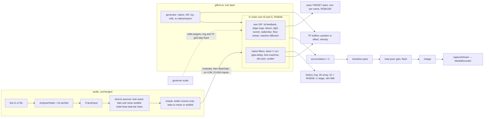
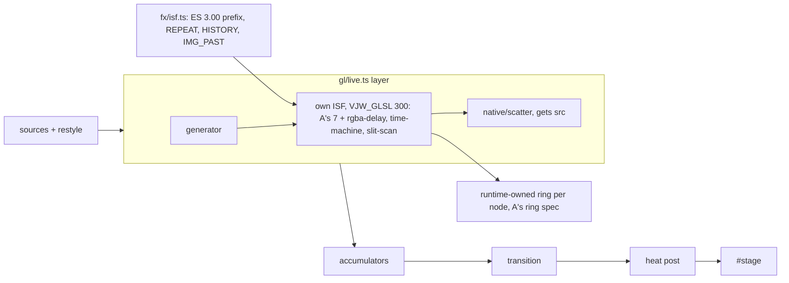
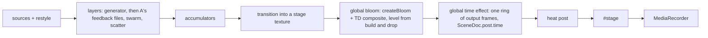

# Design — Stage 2d: the TouchDesigner look (Tracks A + B)

## TL;DR
- **Recommended: Variant A, "files first, two native primitives".** Track A is 7 own ISF files that run in today's engine: TD feedback fx, edge rings, bloom, light tunnel, radial blur, flow smear and reaction-diffusion. Track B adds three things. Natives get the layer's input texture (one optional `src` argument), so they can be filters. A 32-slot `TEXTURE_2D_ARRAY` history ring drives three native time filters. Transform-feedback point natives give a swarm generator and a pixel-scatter filter.
- **Verified in code:** N passes on one `PERSISTENT FLOAT` TARGET already work. `live.ts` points `u[TARGET]` at the texture written last, and every pass owns its own read/write pair. The catch is cost: two textures per *pass*, so an 8-step reaction-diffusion takes ≈62 MB. A ~5-line fix shares one pair per TARGET *name* (≈7.7 MB). Plan B is a native RD filter after S2.1.
- **Bloom is a per-layer ISF fx** (10-pass dual filter plus TD's composite), not a global post pass. **History ring:** RGBA8 at half the stage size, 32 slots, ≤64 MiB, fixed at create, never refit by the governor. **Particles:** transform feedback, as in `particles.ts`.
- **One binding policy for new and old built-ins (hybrid).** Drums, `sub` and build/drop bind directly. The bass family binds to generic `bass`, which Auto-style turns into reese (DnB), wobble (Dubstep) or bass (Techno). Flash-class params are 0..1 inputs, listed under a new `VJW_FLASH` header key that puts them on the shared WCAG gate.
- 4 checkpoints, 16 one-coder steps. CP4 (rebind the existing built-ins) runs after A and B.

## Freshness
- 2026-11-04, system-designer (Opus 5.5). **Inputs:** `thoughts/spec_td_look.md` (all, §1–§5); `agents/research/research_td_look.md` §1b (L34–56), §2 (L58–78), §3 (L79–97), §4–§5 (L99–129); `agents/system-designer/design_effects.md` E1–E2 (L60–130) and Variant A (L288–330); `agents/system-designer/design_audio_reactivity.md` C1 (L73–90) and C5–C6 (L158–214); `agents/STATE.md` HEAD.
- **Code read by symbol** (under `web/src/`): `fx/isf.ts` L1–160; `gl/live.ts` L1–60, L105–144, L175–309; `gl/scene.ts`, `gl/post.ts`, `gl/bloom.ts`; `gl/engine.ts` (`program`, `draw`, `fullscreenProgram`, `renderTarget`, `temps`, `Post`); `scenes/particles.ts`; `scenes/builtin.ts` L1–303 (ids and bindings); `audio/presets.ts`; `bind.ts` L1–60; `frame.ts` (`FrameInput`).
- No TD dump file was opened; look references come from research §1b. This run has no Edit tool, so the file was written with cumulative `Write` calls.

## Constraints
- **Scope (spec §2):** Track A = research §5 items 1–6. Track B = (a) a history ring for RGBA delay, time machine and slit scan (it absorbs the parked polish §1), and (b) a particle layer plus a point renderer usable as a layer generator.
- **Each look:** a catalog effect plus ≥1 starred built-in scene. Defaults lean toward the TD values in research §1b. The header credits the TD component and any OSS block used.
- **Audio (spec §2):** every expressive param binds to a specific 2c source, and the design says what Auto-style changes per genre.
- **Non-goals (spec §3):** depth point clouds, LUT images, cross-layer input, redoing existing own effects, pasting TD text.
- **Acceptance (spec §4):** (1) `?bench` GPU p95 ≤5 ms per new scene at 1728×1117, scale 1; (2) a screenshot against its TD reference, plus a contact sheet per CP; (3) a reaction check on `dnb174.wav` / `dubstep140.wav`; (4) a 60 s autopilot run with 0 late frames, 1.00× and memory within budget; (5) ≤3 flash onsets/s (WCAG).
- **Engine (design_effects E2):** ≤5 ms per scene, so a fade is ≈10–11 ms. A heavy fade was budgeted at ≈130 MB (60A). Persistent targets are resampled on `fit()`. Allocation lands mid-scene through prepare-ahead. Programs compile at Start. WebGL2 has no compute; the ISF dialect is GLSL ES 1.00.
- **Licences** (any allowed, each recorded):
  - Used: webgl-noise (MIT); our own `gl/bloom.ts` (Bjørge technique) and `scenes/particles.ts` (twgl MIT header); jsexp Gray-Scott (BSD-3, algorithm reference); TD by analogy only.
  - Not needed: lygia (Prosperity) and Wombat (credit it only if its derivative noise is copied).

## Verified engine facts (code read 2026-11-04)
1. **Pass targets** (`live.ts` `node()` L137, `run()` L222–233):
   - Every pass with a TARGET builds its *own* read/write pair (2 textures), PERSISTENT or not, keyed by pass index rather than by name.
   - After a pass draws, its pair reverses and `u[TARGET]` points at what it just drew. So a pass always reads the newest texture of a name (an earlier pass this frame, or last frame's last writer), never the one it writes.
   - **So N alternating `PERSISTENT FLOAT` passes on one name work today.** That answers the reaction-diffusion question. The cost is 2 textures per pass: 8 steps at ½ res = 16 × 3.86 MB ≈ 62 MB, plus 16 resample copies on every governor step.
2. **Formats:** `FLOAT` = RGBA16F (`renderTarget(hdr)`); there is no RGBA32F path. The chain temps `t0`/`t1` are RGBA8, so every fx's `inputImage` is LDR and a glow must soft-clip.
3. **Pass sizes:** WIDTH/HEIGHT are evaluated only in `resize()`. A node whose last pass writes a TARGET returns that texture at its own size; the next node samples it by UV. Such a layer loses the fast path (`live.ts` L287).
4. **Natives:** `Native.draw(f, v)` (`gl/scene.ts`) gets no input texture: `run()` passes only the layer's `FrameInput` copy and the values (L208–215). **A native can't be a filter today.** `FrameInput` has the target's `width`/`height`, not the governor scale.
5. **Bloom:** `gl/bloom.ts` `createBloom(gl, levels = 4)` is our dual-filter bloom (threshold fixed at 0.5). It returns `src + strength·glow` and is used only inside spectrum and particles.
6. **Flash gate:**
   - The gated params are a hard-coded set, `own/strobe.strobe` and `own/flash.flash` (`live.ts` L46–48). The code's ponytail note says to move to a `VJW_FLASH` header key when a third such shader appears.
   - `flashGate` counts a rise through 0.5 in the param's *output* units. So a gated binding whose `min` is ≥0.5 never counts an onset, and holds its first value.
7. **Auto-style** (`presets.ts` `map`, design C5) rewrites only `bass`, `onset` and `treb`, and only for `builtin:` scenes. A direct `kick`/`reese`/… binding is genre-invariant.
8. **Built-in bindings** (`scenes/builtin.ts`):
   - The 27 own scenes bind `bass` 22×, `onset` 8×, `kick` 1×, `beat` 1× and `lfo` 2×.
   - The comments on 9 of the `bass` bindings say "on a kick": kaleido-tunnel, vhs-tunnel, pixel-strobe, tunnel-mesh, wave-landscape, sdf-shapes, slit-scan, feedback-ring, rainbow-trails. That intent predates the kick source.
   - tunnel, spectrum, particles, glitch and toy-plasma read audio inside their code.

## Answers to spec §5
- **Bloom: a per-layer ISF fx** (`own/bloom.fs`), not a global post pass, not both; only Variant C goes global. §2 wants every look in the catalog. A post bloom needs the stage as a texture (an extra output-size pass every frame) and blooms spectrum, particles and MilkDrop twice. Heat (C6) already covers global build/drop brightness.
- **Reaction-diffusion and optical flow: ISF multi-pass.** Flow smear works today, because its TARGET names are distinct. RD works today (fact 1), and S1.8 cuts it from ≈62 to ≈7.7 MB. A native RD is plan B only.
- **Shared infrastructure: no new multi-pass layer.** Track A uses the ISF runtime as built. Track B's 2D-array ring and TF buffers aren't ISF 1.00 targets, so they live in natives on `renderTarget`, `fullscreenProgram` and twgl. Three small engine edits are shared: S1.1 `VJW_FLASH`, S1.8 pairs by name and S2.1 `src`. Order: A, B(a), B(b), then CP4.
- **History ring:** RGBA8, ½ stage, 32 slots, a per-effect stride of 1–2 (32–64 frames, 0.53–1.07 s at 60 fps), ≤64 MiB per ring, ≤2 live. Fixed at create, not adaptive: the governor never refits it.
- **Particles: transform feedback, not ping-pong.** Noise forces run in the vertex shader. An image force field comes in as `src` when the point native is a filter (scatter). True cross-layer input stays out.

## Binding policy for all built-ins (rebind pass)
**Policy: hybrid.** Where the meaning is genre-free, bind the source directly. Where the genre decides which bass moves the image, bind generic `bass`.

| Param class | Source | Shape (typical a/r, s) |
|---|---|---|
| Punch: zoom, scale, twist, burst, skew, cell jump | `kick` | 0 / .1–.3 |
| Colour step, hue, palette, second accent | `snare` | 0 / .3 |
| Fine detail, sparkle, edge, RGB jitter (never brightness) | `hats` | 0 / .06–.12, small range |
| Weight, size, swell, tunnel mouth, growth seed | `sub` | .02–.1 / .25–.6 |
| The bass moving the image: displace, warp, curl, fold, turbulence, smear | `bass` (via Auto-style) | .05 / .3–.5 |
| Tension: trail length, depth, threshold | `build` | 1 / 1–2 |
| One-off: reset, spawn, big glow | `drop` | event, or 0 / 1.5 |
| Phase, sweep | `beat` / `bar` with shape `saw` or `sine` | — |
| Brightness on a hit | `kick` / `snare` / `drop` only; a 0..1 input listed in `VJW_FLASH` | — |

- `onset` and `treb` leave the built-ins, because the drums are bound directly. `bass` stays only for its own class.
- **Auto-style on:** only the `bass` class changes per genre.
  - DnB: reese.
  - Dubstep: wobble. It reads 0 at rest, so these params breathe with the LFO.
  - Techno: bass (the map has no `bass` key).
  - Drums, sub and build/drop read the same in every genre.
- **Auto-style off, or a user scene (Save as):** `bass` is the generic low band. Every direct source still runs on the default bands (`presets.ts` `BANDS`), so nothing goes dead.
- **A genre the map doesn't cover** (Default, an unsure classifier, a future genre): same as off. A new genre needs one `map` row (`bass → reese|wobble`), with no scene edits.
- build/drop already reach every scene through heat and the cut (C6). CP4 adds them only where a free param fits.

**CP4 outline.**
- Runs after CP3. It edits the docs in `scenes/builtin.ts` and adds a `VJW_FLASH` key to three existing shaders (marked ⚡).
- Attack/release and ranges stay as they are unless given.
- Rows read `param: old → new`.

| Scene | Rebind |
|---|---|
| tunnel, spectrum, glitch, toy-plasma | unchanged: their audio is in their code |
| particles, and its layer in particles-over-tunnel | add `swirl ← bass` (.05/.4, 1.5→3.5) and `glow ← build` (1/2, 2→4) |
| kaleido-tunnel | `angle`: bass → kick |
| vhs-tunnel | `yScanlineAmount`: bass → kick; `flash ← kick` kept; add Chromatic Aberration amount ← hats (0/.06, small) |
| crt-spectrum | `Amount ← bass` kept (its class) |
| pixel-strobe | `cell_size`: bass → kick; `strobe ← beat` saw kept |
| flythrough | gen `glow`: bass → sub; layer `speed ← bass` kept |
| tunnel-mesh | `twist`: bass → kick; `flash`: onset → snare ⚡ |
| worley-cells, truchet | `borderWidth` / `tSize`: bass → sub |
| fractal | `fold ← bass` kept; `glow`: onset → kick ⚡ |
| wave-landscape | `height`: bass → kick; `glow`: onset → snare (⚡ only after a re-range so min < .5, see fact 6) |
| sdf-shapes | `morph`: bass → kick; `burst`: onset → snare |
| trails-spectrum | add `dischargeRate ← build` (1/2, .12→.05; inverted, G3) |
| spiral-mesh | `twist ← bass` kept; `flash`: onset → snare ⚡ (tunnel-mesh's key); `zoom`: onset → kick |
| slit-scan | `echo.speed`: bass → kick; `angle ← lfo` kept |
| kaleido-maze | `tSize`: bass → sub; `angle`: bass → kick; `rotation ← lfo` kept |
| feedback-ring | `twirlAmount`: bass → kick; `feedbackRate`: onset → snare |
| rainbow-trails | `rise`: bass → kick |
| liquid-chrome | `burst`: onset → kick |
| fluid | `warp ← bass` kept |
| lava-smoke | metaballs `size`: bass → sub; smoke `curl ← bass` kept |
| ink | `spread`: bass → sub |
| milk-* (25) | out of scope: Butterchurn reads its own audio |

- **Net bindings after CP4:** kick 14, snare 5, sub 6, `bass` (Auto) 8, build 3, hats 1, beat 1, lfo 2, onset 0.
- **Size: S.** One coder step (S4.1), plus the lead's reaction check on both fixtures and a contact sheet.
- ⚡ keys go into `own/tunnel-mesh`, `own/fractal` and `own/wave-landscape`. ⚠️ Their `.fs` file names are inferred from the refs.

## Shared decisions (all variants)

### D1 Audio reactivity per new effect
| Effect | `kick` | `snare` | `hats` | `sub` | `bass` → Auto | `build` | `drop` | `beat`/`bar` |
|---|---|---|---|---|---|---|---|---|
| td-feedback | zoom 0/.25 1.012→1.035 | hueStep 0/.3 3→15°/fr | edge 0/.1 .12→.3 | — | displace .05/.4 .01→.07 | fade 1/2 .97→.99 | reset | — |
| edge-rings | scale 0/.3 1.002→1.012 | hueStep 0/.3 −1→−8° | — | gain .1/.6 1.03→1.08 | edge .05/.3 .15→.4 | — | reset | — |
| bloom | glow⚡ 0/.2 0→1 | — | — | — | — | threshold 1/1 .35→.15 | level⚡ 0/1.5 0→1 | rampShift bar saw 0→1 |
| light-tunnel | — | — | — | radius .05/.4 .3→.6 | twirl .05/.4 0→4 | — | — | center.x bar sine .45→.55 |
| radial-blur | strength 0/.18 .04→.3 | — | — | — | — | — | — | — |
| flow-smear | — | — | tint 0/.12 0→.35 | — | force .05/.3 .5→3 | decay 1/2 .85→.96 | — | — |
| reaction-diffusion | — | palette 0/.3 0→.15 | — | seed .02/.25 0→.6 | kill .1/.6 .060→.064 | feed 2/2 .0545→.040 | reset | — |
| rgba-delay | — | rotate (event) | — | — | spread .05/.3 1→12 fr | — | — | — |
| time-machine | — | — | — | — | swirl .05/.3 0→1 | depth 1/1 .3→1 | — | phase beat saw 0→1 |
| slit-scan | — | — | — | span .05/.5 8→31 slots | wave .05/.3 0→.3 | — | — | — |
| swarm | burst 0/.1 0→3 | hueStep 0/.3 0→.2 | sparkle 0/.08 0→.5 | size .05/.3 1.5→3 px | turbulence .05/.4 .2→2 | trail 1/2 .85→.97 | spawn | — |
| scatter | burst 0/.1 0→2 | — | — | size .05/.3 .9→1.4 | scatter .05/.35 0→.12 | spring 1/2 40→12 | explode | — |

- **Reading a cell:** `input attack/release min→max`. Times are in seconds and the range is in the input's own units.
  - `reset`, `spawn`, `explode` and `rotate` are `event` inputs. They fire when the source envelope crosses 0.5.
  - Every resting value sits at or near the TD default from research §1b.
- **Per genre:** only the `bass` column changes (DnB reese, Dubstep wobble, Techno or off: bass). No new built-in binds `onset` or `treb`, so the other two map keys never apply.
- **⚡ inputs:** listed in `VJW_FLASH`. Each is a 0..1 pulse that the shader adds on top of the TD default (e.g. bloom glow = .4 + .3·x), with binding `min` 0.
- **Inverted ranges** (threshold, feed, spring) assume `evaluate()` lerps when min > max (G3).
- **Defaults ship with the effect** (ISF `VJW_BIND`, a native's `bind`, G2), so adding the fx in the panel brings them along.

### D2 WCAG flash cap
- **S1.1 adds the `VJW_FLASH` key.**
  - It is `VJW_FLASH: [names]` in an ISF header, or `flash` on a native def, and becomes `EffectDef.flash`.
  - `live.ts` gates by `def.flash` instead of the hard-coded set.
  - `own/strobe.fs` and `own/flash.fs` get the key; their behaviour doesn't change.
- **Rules:**
  1. Brightness-on-hit params are ⚡ inputs bound only to kick, snare or drop. They share the one ≤3 onsets/s budget.
  2. `hats`, `onset` and `treb` never drive brightness, only hue or thin detail.
  3. The self-sustaining loops (edge-rings gain >1, td-feedback fade) soft-clip above ≈0.8, so a sustained source can't drive a white-out.
  4. Resets on `drop` darken the image, and fire ≤1 per 30 s (C6 refractory).
- **Check:** each step traces frame luma on both fixtures (STATE's luma-std method).
- The MilkDrop luminance limiter (STATE finding) stays a separate item.

### D3 Natives as filters (S2.1)
- `Native.draw(f, v, src?)`, and `run()` passes `src`.
  - Existing natives ignore the extra argument.
  - A native filter declares `kind: 'filter'` and no `inputImage` input.
- The fast path still holds, because natives have no pass targets.
- Every variant needs it, because scatter is a filter.
- ⚠️ G2: the panel's fx picker must list native filters.

### D4 Particles: transform feedback (TF) point natives
- **TF over float ping-pong:**
  - It is the existing `particles.ts` pattern: twgl `createTransformFeedback`, ping-pong VAOs, one pass that updates and rasterises.
  - TF state is 32-bit in buffers. Ping-pong state would be RGBA16F (fact 2), which quantises positions at ≈0.5 px and drifts velocities.
  - Vertex texture fetch is core WebGL2, so the update shader can sample `src` or noise directly.
  - Ping-pong only pays when other passes must read particle state as a texture. Nothing here does.
- **`native/swarm` (generator):**
  - N = 131,072 (knob), state pos/vel.
  - Forces: the curl of webgl-noise 3D simplex drifting with time (TD turbulence) × turbulence, plus a radial burst × kick, plus drag. Respawn is hashed per id.
  - Points of 1.5–3 px draw additively into one persistent RGBA16F trail (`renderTarget(true, true)`).
  - The fade is a fixed-function constant blend (`ZERO, CONSTANT_ALPHA`, the `post.ts` trick): no texture read, no ping-pong.
  - Then `createBloom` (reused), and the composite from `particles.ts`.
- **`native/scatter` (filter), TD pixelRelocator:**
  - One point per 3×3 px stage cell (≈214k at 1728×1117). The grid is fixed at create.
  - The home position comes from `gl_VertexID`; the colour is `texture(src, home)`.
  - The target offset is (noise − .5)·scatter; a spring, a kick burst and drag move the point toward it.
  - Square opaque points on black.
- **Force fields:** noise is evaluated in the vertex shader. "Another layer" means the generator below scatter in the same layer, which arrives as `src`. True cross-layer input stays out: it needs per-layer outputs plus a panel affordance.
- **Instanced meshes (L8):** not needed. POINTS cover sprites.

### D5 GPU and memory budget (1728×1117, scale 1)
- **Base numbers** (research §4, internal; ⚠️ extrapolated):
  - A full-res half-float pass ≈1 ms.
  - Tunnel ≈1.3 ms; spectrum ≈2 ms.
  - Native particles 5.3 ms and the raymarchers (3–10 ms) are too heavy to use as showcase generators.
- **Sizes:** full = 1.93 Mpx (RGBA8 7.7 MB, RGBA16F 15.4 MB); ½ = 0.48 Mpx (1.93 / 3.86 MB).

| Look | Passes / internal size | GPU ms ⚠️ | MB | Showcase `(default)` | Scene ms ⚠️ |
|---|---|---|---|---|---|
| td-feedback | loop ½ (1 persistent FLOAT) + out | .7 | 7.7 | spectrum → td-feedback → bloom | ≈3.5 |
| edge-rings | same | .7 | 7.7 | tunnel → edge-rings | ≈2.0 |
| bloom | 9 targets ½…1/32…½ + composite | .6–1 | 20.5 | glitch → bloom | ≈2.3 |
| light-tunnel + radial-blur | 1 pass; ½ RGBA8 24 taps + mix | .3 + .5 | 0 + 3.9 | spectrum → light-tunnel → radial-blur | ≈2.8 |
| flow-smear | 3 at ⅛ + smear ½ + out | .7–1 | 9.2 | tunnel → flow-smear | ≈2.2 |
| reaction-diffusion | 8 steps ½ + colour | 2–2.5 | 61.8 → 7.7 after S1.8 | spectrum (res .5) → RD | ≈3–3.5 |
| rgba-delay / time-machine / slit-scan | ring push + 2–3 taps | .5 each | 61.8 each | tunnel / Truchet / spectrum → each | ≈1.9–2.6 |
| swarm | TF 131k, fade, createBloom, composite (res .75) | 1.5–2.5 | ≈25 | swarm alone | ≈2.5 |
| scatter | TF 214k, 3×3 px squares | 1–1.5 | 6.9 | tunnel → scatter | ≈2.8 |

- **Peak memory:** a fade between two ring scenes is 2 × 61.8 + 31 (accumulators and temps) + generators ≈ 160 MB at 60A. E2's heavy fade was ≈130 MB.
  - Cap: ≤64 MiB per ring, and ≤2 rings live, because the director holds ≤2 scenes (E2 prepare-ahead). ⚠️ The CP2 close confirms this.
  - At 60F the cap shrinks the ring's size, not its depth.
- **Levers if a bench misses:** layer `res`; RD steps 8 → 6; swarm N 131k → 65k; ring stride; scatter cell 3 → 4 px.

## Variant A — files first, two native primitives (simplest that meets spec §4; recommended)
**Summary.**
- **Track A: all six looks are own ISF files** (7 files: light tunnel and radial blur are separate). Each look is a fullscreen fragment chain with at most one feedback loop and a fixed step count, which ES 1.00 `PASSES` express today. They stay on the panel's existing path, with no engine risk.
- **Natives only where ISF 1.00 can't go:** a `sampler2DArray` (the ring), TF buffers, a custom vertex shader (points).
- **Engine edits:** S1.1 `VJW_FLASH`, S1.8 pairs by TARGET name, S2.1 `src` for natives. The global post pass stays heat-only.



**Modules and files** (all under `web/src/`):
```
fx/own/td-feedback.fs        feedbackTOP ex3: loop at ½ (fade, gamma, hsv, zoom, noise displace, 3×3 blur + Sobel,
                             screen src) + full-res out (crisp source re-screened, TD dryWetMix)
fx/own/edge-rings.fs         feedbackEdge: gain > 1 loop at ½, scale 1.003, blur, hue −2, edge .22, screen + out
fx/own/bloom.fs              bloom.tox: threshold+down ½, down ¼ ⅛ 1/16 1/32, up ×4 (each samples both levels and adds),
                             TD composite (cosine ramp tint, soft clip); shaders ported from our gl/bloom.ts
fx/own/light-tunnel.fs       lightTunnel (Benson lineage): polar clamp of r to radius + the twirl term
fx/own/radial-blur.fs        radialBlur: 24 constant taps at ½ (RGBA8) + full-res dry/wet
fx/own/flow-smear.fs         opticalFlow math: prev/cur luma and flow at ⅛, smear ½ PERSISTENT FLOAT, out
fx/own/reaction-diffusion.fs Gray-Scott (jsexp reference): 8 step passes at ½ on one name + colour; seed = src luma
fx/own/strobe.fs, flash.fs   + VJW_FLASH key (S1.1)
fx/isf.ts, fx/types.ts       VJW_FLASH → EffectDef.flash
gl/live.ts                   gate by def.flash; pairs by TARGET name; pass src to natives
gl/scene.ts                  Native.draw(f, v, src?)
scenes/history.ts            ring() + native/rgba-delay, native/time-machine, native/slit-scan (filters, ES 3.00)
scenes/points.ts             native/swarm (generator), native/scatter (filter): TF ping-pong after particles.ts
fx/catalog.ts                + the 5 natives
scenes/builtin.ts            + ≈11 starred showcase scenes (D5); CP4 rebind
```

**Contracts.**
```ts
// gl/scene.ts: the CP1 contract, widened. Existing natives compile unchanged.
export interface Native {
  draw(f: FrameInput, v: Readonly<Record<string, Value>>, src?: WebGLTexture | null): void // src = previous node's output
  dispose?(): void
}
// fx/types.ts, EffectDef: the WCAG list (ISF header "VJW_FLASH": ["glow", "level"]).
flash?: readonly string[]
// scenes/history.ts: module-local, except the pure, tested slot().
interface Ring { tex: WebGLTexture; depth: number; head: number; filled: number; push(src: WebGLTexture): void; dispose(): void }
export const slot = (head: number, age: number, depth: number) => (((head - age) % depth) + depth) % depth
```
```glsl
// history shaders (ES 3.00)
uniform highp sampler2DArray uRing; uniform sampler2D uSrc; uniform float uHead, uDepth, uFilled;
vec4 past(vec2 uv, float age); // age in slots; 0 = uSrc at full res; fractions mix 2 slots; clamped to uFilled − 1
```
- **`live.ts` `node()`:** passes that name the same TARGET share one pair. The first such pass's FLOAT/PERSISTENT/WIDTH/HEIGHT win. `resize()` and `freeNode()` visit each pair once. A pure pass→pair mapping carries the Vitest.

**History ring (Track B a).**
- **Format and size:**
  - RGBA8: delayed colour needs no HDR.
  - One `texStorage3D(TEXTURE_2D_ARRAY, 1, RGBA8, w, h, 32)` per instance.
  - `w`, `h` = ½ of `gl.drawingBufferWidth/Height` (the stage, G1), shrunk until 32·w·h·4 ≤ 64 MiB: 864×559 (61.8 MB) at 1728×1117, ≈878×568 at 60F.
- **Depth and stride:** 32 slots. The stride is per effect (delay 1, time machine 2, slit scan 2), so the history spans 32 / 64 / 64 frames.
- **Lifetime:**
  - Allocated in `create()`, which prepare-ahead runs mid-scene (E2).
  - `warm()` compiles only, so Start allocates nothing.
  - Never refit. `push()` draws `src`, whatever its size, into slot `head` with linear filtering (one FBO, `framebufferTextureLayer`). Governor steps therefore cost nothing, and the history survives them.
  - A mode change takes effect at the next instance.
  - `filled` clamps ages during the first frames, so there is no black ghost (TD prefills; this way is free).
- **Use:**
  - RGBA delay: R, G, B = `past(uv, 0 / spread / 2·spread)`. The channel order rotates on the snare.
  - Time machine (TD circular ramp): `age = depth·(D−1)·fract(rings·|uv−c| + swirl·θ/2π − phase)`.
  - Slit scan: `age = span·coord`, where coord is y, x or the radius, plus `wave·sin`.

**Track A notes.**
- **Bloom** is not a native that wraps `createBloom`. That would change the bloom that spectrum and particles share, and it would wait for S2.1.
- **Flow smear** follows TD's opticalFlow math. Donor `ISF/Optical Flow Generator.fs` (MIT) may be ported only if a plan step authorises it, keeping its header.
- **RD plan B:** if S1.9 misses 5 ms or the patterns stall in half float, build `native/reaction-diffusion` as a filter (after S2.1). It gets its own two RGBA32F targets (`createFramebufferInfo`) and a JS step loop.

**Spec §4 acceptance:**
1. Every step benches its showcase scene against D5, using the levers listed there.
2. Every step takes a screenshot against research §1b. The lead makes a contact sheet at each CP close.
3. Every step traces its params in `?debug` on both fixtures, with D1's bindings.
4. The CP3 close runs 60 s of autopilot over all the new scenes and checks memory against D5.
5. D2.

**Roadmap left open (spec §4):**
- 2b editor: native filters are catalog entries, so the layer-stack builder lists them like ISF files.
- Stage 3 camera: a camera generator feeds every new filter. Slit scan, flow smear and scatter suit live video. Depth point clouds can reuse scatter's point path.
- Cross-layer input: later, pass the accumulator-so-far as a second sampler.
- Electron: needs nothing beyond WebGL2.

**Risks:**
1. The ms figures are extrapolated (G4). Every step benches.
2. Half-float RD may stall (G5). Plan B covers it.
3. Self-sustaining loops can white out. Soft clip plus D2.
4. `drawingBuffer*` may not be the stage (G1). Fallback: size the ring from the first `f.width`/`f.height`.
5. The picker may not list native filters (G2).
6. A ⚡ range above 0.5 freezes the param (fact 6). D1 and D2 keep ⚡ inputs at min 0.
7. Point sizes are limited on ANGLE-Metal. 1.5–6 px is safe ⚠️.

**Effort: M.** 7 small `.fs` files, 2 native files (≈200 + ≈250 lines), ≈25 engine lines, ≈11 scene docs.

## Variant B — VJW-ISF 3.00 dialect (one shader path for A and B a)
**Summary.** `fx/isf.ts` grows into a superset, so the time effects and RD are own `.fs` files too. Only the point natives stay TypeScript, and S2.1 is still needed for scatter. Bloom is per layer, as in A.

- **`isf.ts` (≈+60 lines):** `"VJW_GLSL": 300` selects an ES 3.00 prefix (`texture()`, `out vec4`, no constant-loop limit). `PASSES[].REPEAT` repeats a pass. `"HISTORY": {"NAME", "DEPTH", "STRIDE"}` declares a ring, read through an `IMG_PAST(name, uv, age)` macro.
- **`live.ts` (≈+60 lines):** draws a pass `repeat` times on one shared pair. It owns a ring per node and pushes `inputImage` before pass 0. It adds an ES 3.00 program path.
- **Files:** A's 7, plus `own/rgba-delay.fs`, `own/time-machine.fs`, `own/slit-scan.fs` and `scenes/points.ts`.
- **Contracts:** `ShaderDef { …; glsl: 100 | 300; history?: { name: string; depth: number; stride: number } }`; `PassDef { …; repeat?: number }`.
- **Buys:** the time effects and RD become files you can paste, import and edit, like every own effect. Dynamic loops (RD steps as a `long` input, radial-blur taps). `sampler2DArray` for any later own file.
- **Costs and risks:**
  - The loader under 52 shader scenes gains two dialects, three keys and a ring lifecycle (resize, governor, dispose, warm). That is the largest regression surface of the three.
  - These files stop being portable ISF (they are ours anyway). Twice the parser tests.
  - Memory and GPU are the same as A.
- **Spec §4:** as A. **Roadmap:** as A, plus the 2b editor could author time effects as text. **Effort: L.**

## Variant C — global post stage
**Summary.** A's feedback files and point natives stay, but bloom and the ring move into the engine's final stage. The transition renders into a stage texture, then a global bloom runs (its level driven by build/drop, like heat), then one global time effect picked per scene, then heat, then the frame goes to #stage.

- **Contracts:** `SceneDoc.post?: { bloom?: number; time?: 'delay' | 'machine' | 'slit' }`, which touches the library, export/import and `edit.ts`. `engine.render` gains a post chain.
- **Buys:** one ring for the whole show (≤64 MiB in total). MilkDrop scenes get bloom and time effects. One global drop glow.
- **Costs:**
  - Fails spec §2 for 4 looks: bloom, RGBA delay, time machine and slit scan aren't catalog effects.
  - A doc schema change.
  - An output-size pass plus bloom every frame, ≈1–1.5 ms, inside fades too (≈10–11 → ≈12 ms).
  - Double bloom on spectrum, particles and MilkDrop.
  - Transitions and the drop cut run through the ring, so cuts smear.
  - A time effect can't sit under other fx.
- **Effort: M.**

## Comparison
| | A (recommended) | B | C |
|---|---|---|---|
| Spec §2: each look is a catalog effect | ✓ | ✓ | ✗ (4 looks are post modes) |
| Engine change | ≈25 lines, 3 small steps | ≈150 lines in isf.ts + live.ts | ≈120 lines + SceneDoc schema |
| New files | 7 `.fs`, 2 `.ts` | 10 `.fs`, 1 `.ts` | 6 `.fs`, 1 `.ts` |
| Regression surface | new files + 3 small live.ts edits | the loader under 52 shader scenes | the final pass of every scene, MilkDrop too |
| Peak memory, 60A fade | ≈160 MB | ≈160 MB | ≈100 MB (one ring) |
| Always-on GPU | 0 | 0 | +1–1.5 ms |
| Time effects as editable files | ✗ (natives) | ✓ | ✗ |
| Time effects stack under other fx | ✓ | ✓ | ✗ |
| Effort | M | L | M |

## Recommendation
**Variant A.** It meets every spec §4 item with the least engine change: three small edits, each its own step. Every look stays a stackable catalog effect. Its two native primitives, the `src` argument and the ring, cover exactly what ISF 1.00 can't express, and nothing more. Risk stays inside new files, so a missed bench costs one look rather than the loader that 52 scenes depend on. **The runner-up, B, would buy** time effects and RD as editable `.fs` files with dynamic loops, which helps once the 2b editor authors shader text, at the price of an L-sized change to the ISF loader. A doesn't block it: the ring spec and `past()` move into the runtime unchanged. C wins only on memory (one ring) and fails spec §2.

## Checkpoint split (for the planner; one coder per step)
| Step | Kind | What | Done when |
|---|---|---|---|
| S1.1 | engine | `VJW_FLASH` → `EffectDef.flash`; gate by def; strobe/flash headers migrate | Vitest parse; strobe/flash still gated; gates green |
| S1.2 | effect | `own/td-feedback.fs` + showcase scene | D5 bench, screenshot, D1 trace on both fixtures |
| S1.3 | effect | `own/edge-rings.fs` + scene | same |
| S1.4 | effect | `own/bloom.fs` + scene (td-feedback's scene gains it) | same, plus a luma trace (D2) |
| S1.5 | effect | `own/light-tunnel.fs` | same (shown in S1.6's scene) |
| S1.6 | effect | `own/radial-blur.fs` + light-tunnel scene | same |
| S1.7 | effect | `own/flow-smear.fs` + scene | same |
| S1.8 | engine | pairs by TARGET name | Vitest on the pure pass→pair map; existing ISF scenes unchanged |
| S1.9 | effect | `own/reaction-diffusion.fs` + scene; plan-B gate | ≤5 ms; patterns hold for 60 s |
| CP1 close | lead | contact sheet, reaction check, commit | — |
| S2.1 | engine | `Native.draw(f, v, src)` | a native filter receives the previous node's texture; existing natives unchanged |
| S2.2 | infra + effect | `scenes/history.ts`: ring + rgba-delay + scene | `slot()` Vitest; bench; ring 61.8 MB |
| S2.3 | effect | time-machine + scene | D5 bench, screenshot, trace |
| S2.4 | effect | slit-scan + scene; the lead drops the parked §1 worktree | same |
| CP2 close | lead | fade between two ring scenes: 0 late frames, memory per D5 | — |
| S3.1 | effect | `scenes/points.ts`: swarm + scene | D5 bench, screenshot, trace |
| S3.2 | effect | scatter + scene | same |
| CP3 close | lead | spec §4.4 closing run, §4.5 flash check | — |
| S4.1 | docs | CP4 rebind (`builtin.ts`) + 3 `VJW_FLASH` keys | doc round-trip test; fixture traces |

- **Order:** cheapest first. S1.8 lands right before RD. S2.1 comes before every native filter. The RD plan B pulls S2.1 forward.

## Research gaps and assumptions
- **G1** ⚠️ `gl.drawingBufferWidth/Height` equals the #stage's fixed per-mode size. This sizes the ring and the scatter grid. Fallback: Risk 4.
- **G2** ⚠️ Unchecked: the catalog picks up new `own/*.fs` files; the panel's fx picker lists `kind: 'filter'` natives; a native def can carry default `bind`.
- **G3** ⚠️ `evaluate()` lerps when min > max (inverted ranges). If not, the shader flips the input.
- **G4** ⚠️ Every ms figure in D5 is extrapolated (research §4).
- **G5** ⚠️ Half-float Gray-Scott holds its patterns. S1.9 decides.
- **G6** ⚠️ JS can't read GPU memory. The CP2 and CP3 memory checks use the GPU memory column in Chrome's task manager.

## Decision needed
1. **Variant:** A (recommended), B or C?
2. **History ring:** RGBA8, ½ stage, 32 slots, stride 1/2/2, ≤64 MiB, fixed at create. Accept?
3. **Reaction-diffusion:** ISF plus S1.8, with a native RD only as plan B. Accept?
4. **Binding policy:** hybrid for new effects and the CP4 rebind (drums, sub and build/drop direct; the bass family through `bass` and Auto-style), with CP4 after CP3 (default). Accept?
5. **Parked slit-scan worktree:** drop `.claude/worktrees/agent-ad8211cb17263523a`, keep `own/echo.fs` as it is, and make S2.4 the true slit scan. Accept?
6. **Flash key:** `VJW_FLASH` replaces the hard-coded flash set (S1.1). Accept?

## Ruling: relative band sources in bindings (2026-11-05)
**Inputs:** `web/src/bind.ts` (`sources`, `restyle`, `evaluate`); `audio/features.ts` L27–38, L59–73; `audio/presets.ts` L23–50; `audio/synth.ts` L59–98, L156–194; `scenes/builtin.ts` (`sub`/`bass` bindings by grep, L384–399); `design_audio_reactivity.md` C1 L73–90, C5 L158–171; this file L51–110; the CP1 coders' evidence (lead brief).

**Diagnosis.**
- **Two conventions behind one alias.** `bass` (`clamp(att.bass/2)`), `sub` and `reese` (level ÷ its 4 s mean ÷ 2, `features.ts` L67–68) rest at .5; `wobble` (`max(0, r − 1)`, L71) rests at 0. C5 L161 ("the aliases share `bass`'s scale") holds for reese, not wobble: hence the Dubstep parking.
- **`evaluate` is a gain from 0.** It fits sources that rest at 0 (drums, onset, drop, wobble: the ones that behave). On a .5-rest source `amount` scales the rest with the swing, so ±.05 can't grow without S1.9's extrapolation.
- **Half the evidence is the fixture.** Its bed is a continuous 55 Hz sine plus a static detuned reese (`synth.ts` L98), and Dubstep has no wobble stem (L79). Any level-independent source is flat on it; the extrapolated range amplifies kick-gate and detune jitter.

**Recommendation: (c) in place, plus (d).** One convention for the sustained family: 0 at rest, one-sided.
1. `features.ts`: `sub` and `reese` = `max(0, r − 1)`, wobble's formula. A steady bed reads 0, twice the 4 s mean reads 1: a rise swings twice as far as today. `amount` and the preset `sens` (exists, `{}` since C3) become plain gains, as for the drums. `raw.*` (classifier, arrangement) is untouched; outside bindings and meters nothing reads these ids.
2. **The bass class binds `reese`** (kick-gated 60–250 Hz: the bassline, not the kick). Maps: DnB drops `bass: 'reese'`; Dubstep `bass: 'wobble'` → `reese: 'wobble'`; Techno unchanged. `bass` (the MilkDrop level) stays for user scenes.
- **Rest under Auto-style:** off, Default and unsure → reese; DnB → reese; Dubstep → wobble; Techno → reese (no longer `bass`). All rest at 0, so a bass-class param rests at `min` in every state; the 2 s crossfades change only the swing. Swing parity per genre = preset `sens` (e.g. Dubstep `wobble`), tuned on real tracks (queue 4). A genre whose bass moves above 250 Hz gets `reese → wobble`: one row, no scene edits.
- Lost: dips below the mean (a bed that drops out reads 0, like a steady one). Heat and build/drop (C6) carry the arrangement.
- No panel or doc-format change; the "→ wobble (auto-style)" hint follows the map. ⚠️ Assumption, needs confirmation: no saved user scene binds `sub`/`reese` yet (it would now rest at `min`).

**Rejected.**
- (a) Extrapolated ranges: tuned to a rest that the map changes (Dubstep parks at the clamp); they amplify fixture jitter, and a real rhythmic bass, which already swings 0↔1, bangs clamp to clamp.
- (b) `lo`/`hi` window: the same per-genre flaw (a .42–.58 window kills wobble's 0–.3), plus a Binding field, two panel inputs, doc parse and undo. Add when a user scene asks for a from-range.
- (c) as a presence source beside the relative one: needs a non-adapting reference (peak-hold AGC: normaliser + id + knob), and this sub class is swell ("swells", "opens", "feeds"). Add when a real track shows a steady sub needs a picture.
- (d′) Re-centre `wobble` at .5 (`r/2`): ends the parking, but every bass-class param idles mid-range on a swing `amount` can't grow.
- (d″) Make `bass` itself excess: rewrites the MilkDrop level that user scenes and `mid`/`treb` share, and FFT `bass` carries the kicks.

**Merged bindings: yes, a follow-up.**
- `bass` → `reese`, ranges kept (`min` is now the rest everywhere): S1.2 displace, S1.3 edge, S1.5 twirl, S1.7 force, S1.9 kill. RD kill .062 must hold 60 s as the rest in all three states (S1.9 saw .060 flood).
- `sub` bindings keep their source. S1.3 gain (rest 1.03) and S1.5 radius are kept. S1.9 seed goes back to D1's 0→.6, dropping the −1.8/2.486 extrapolation and its comment.

**CP2–CP4.** Wherever this design binds the bass class to `bass`, read `reese`: TL;DR L7, fact 7, policy L60–73, the diagram, D1's Auto column and L132, and CP4's 8 bass rows (particles swirl ×2, crt Amount, flythrough speed, fractal fold, spiral twist, fluid warp, smoke curl). The `bass → sub` rows stand. Ranges stay; `min` is the rest for sub/reese, as for kick. Net after CP4: `reese` (Auto) 8, `bass` 0, the rest as L107. Until CP4 the 22 pilot `bass` bindings read plain `bass` in every genre: consistent, accepted.

**Step S1.10 (S), before the CP1 close-out, so before CP2.** CP2/CP3's D1 rows bind sub and the bass class and would otherwise repeat S1.9's workaround.
- `features.ts`, `presets.ts`, `builtin.ts` (the 6 edits above); `features.test.ts` rest and sens expectations, plus one test that a bed returning after a gap reads ≥.9 and then decays; `settings.test.ts` L40–41.
- `scripts/make-fx.mjs`: `arrangement()` fixtures for DnB and Dubstep (the build/drop fixture the CP1 close-out already needs). The Dubstep one mixes in the existing `wobble()` (`synth.ts` L184), silenced over the breakdown.
- Done when: gates are green. DnB fixture: sub and reese sit at p50 <.1 in the groove, the sub reaches ≥.9 at the drop, and the 8 TD params idle near `min` with Auto off and under the DnB map. Dubstep fixture: the bass class follows the LFO. RD holds 60 s (G5).
- Supersedes `design_audio_reactivity` C1 L79 (sub/reese ÷2) and C5 L161.
