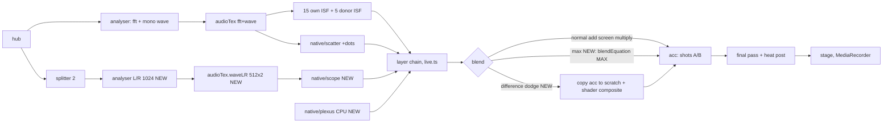
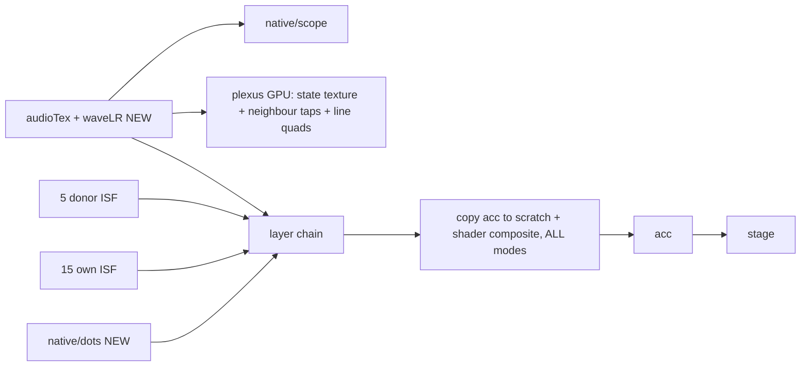

# Design — Stage 2e: TD look, wave 2 (the rest of the dump)

## TL;DR
- Port everything left in the dump that is worth having: the top-10 (research §5), quick wins q1–q11 (research §6) and the three engine gaps (layer blends, stereo wave texture, plexus) — on wave 1's engine, zero new dependencies.
- 5 donor ISF copies (verified parseable in our subset: Solarize, Color Monochrome, Color Replacement, Dilate, Erode), 15 own ISF, 2 new natives (scope, plexus-CPU), 1 extension (scatter → pointillize), 6 engine-file deltas.
- Research corrections found in code: donor `Emboss.fs` and `Sharpen RGB.fs` declare `varying` → cannot compile under our `ISF_VS` → own ISF instead; donor `False Color` has no bias/3-stop ramp → own/gradient instead.
- 15 new starred built-ins, ≤2 ISF fx per layer (wave-1 measured fact: 3 filters over full-res spectrum = 6.4 ms, over the 5 ms budget).
- Variants: A = files first, three small engine deltas (recommended, full spec); B = GPU plexus + unified shader composite; C = minimal engine (defers plexus + difference/dodge layers — simplest that meets spec §4 acceptance).

## Freshness
2026-11-06, system-designer. Inputs: `thoughts/spec_td_wave2.md` whole (L1–52, §1–§5); `agents/research/research_td_wave2.md` §2 L38–59, §3 L61–78, §4 L80–89, §5 L91–158, §6 L160–178, §7 L179–185; `agents/system-designer/design_td_look.md` L44–68 (verified facts + binding policy) and § Ruling L420–452; `agents/planner/plan_td_look.md` L20–66 (conventions, CP shape, measured costs); code read 2026-11-06 (list below); donor ISF-Files HEAD `395072d` (MIT, research §7).

## Constraints (what the spec fixes)
- **Scope** (spec §2): top-10 + q1–q11 + engine gaps (blends `difference`/`max`/`dodge`, stereo wave texture, plexus if cheap, default: design decides, defer if L+); q12 twirl skipped (default). Every effect: catalog entry tagged for the 2b library, ≥1 starred built-in per top-10 item, quick wins grouped into 2–3 built-ins (default), every expressive param bound to a specific 2c source, Auto-style stated per genre.
- **Non-goals** (spec §3): 3D meshes, splats, explode, Verlet, 3DScope deferred; convolve/softenAlpha/pixelate/broadcast scopes/spectrumTOP skipped; no wave-1 retuning.
- **Acceptance** (spec §4): each new scene GPU p95 ≤ 5 ms at 1728×1117 scale 1 with a billed tail (`own/flash` appended); reaction check on `scratchpad/fx_audio/dnb174-arr.wav` + `dubstep140-arr.wav` (every bound param moves on its source, r reported); `__flash` ≤3/s; WCAG luma cap holds (matters for difference feedback and solarize); contact sheet per checkpoint (lead review); closing 60 s autopilot over all new built-ins on both fixtures → 0 late, 1.00×; all new blocks in the 2b library with stills, filterable by tags.
- **Rules** (spec §2 + plan convention): TD rewritten by analogy (user ruling 2026-11-04, no licence pushback, personal use); donor ISF copied only with its VIDVOX MIT header; Wombat noise copied only with credit (author's "use the code however you wish", research §7); every new `.fs`/native header names the TD component it studies; THIRD_PARTY rows for both.
- **Binding policy** (design_td_look L54–64 + Ruling L420–452): drums/sub/build/drop bind directly; the bass class binds `reese` (Auto-style: DnB/Techno → reese, Dubstep → wobble; all rest at 0); `hats` = sparkle/detail, never brightness; brightness on a hit only via kick/snare/drop listed in `VJW_FLASH` (flashGate caps ≤3/s, gl/post.ts L46).
- **Budget truth**: the GPU timer under-bills the last pass — the 60 s late-frame run is the check (STATE fact).
- **Process**: one coder per step sequentially, ≤3 new files per step, gates (`lint && typecheck && test`), worktree on port 5174, `ponytail` full before code.

## Verified engine facts (code read 2026-11-06)
1. **Blend**: `doc.ts` L8 `type Blend`, L17 `oneOf` parse list; `gl/live.ts` L93–111 `BLENDS: Record<Blend,[mode,sf,df]>` + a `composite` shader that pre-scales the layer's src — fixed-function `gl.blendFunc` only, equation left at ADD. The UI list repeats in `ui/Panel.tsx` L19; `edit.ts` L65 `setBlend` takes the typed value. Saved docs: the parser list only ever widens → adding modes is backward compatible, no doc version bump.
2. **Blend feasibility (WebGL2/GLES 3.0)**: `gl.blendEquation(gl.MAX)` is spec'd → `max` (lighten) is one line plus one shader branch (factors apply before the equation). `difference` = |dst−src| and `dodge` = dst/(1−src) need dst *in the shader* → copy acc to a scratch target, then a two-sampler composite pass. 2 extra passes per such layer, only when a layer actually uses them.
3. **Audio textures**: `gl/engine.ts` L101–119 — R8 512×1 `fft` + `wave` (mono) and 512×2 `toy`; `setAudio(magDb, wave)` called from `app.ts` L257–259, wave from the mono `analyser.getFloatTimeDomainData` (`audio/input.ts` L16, fftSize 1024). L/R analysers exist only under `?debug` (input.ts L140–157, fftSize 256, fed by a hub→splitter(2)).
4. **Natives**: `Native.draw(f, v, src?)` into the bound FB, `NativeDef.create(gl, size?)` (`gl/scene.ts` L7/L11); tiles shrink natives via `size` (points.ts `swarmN`). Trail pattern (swarm): persistent target + `blendFunc(ZERO, SRC_ALPHA)` fade with `tint` + bloom + `COMPOSITE_FS` tone map (points.ts L213–229, particles.ts). Scatter: one square point per 4 px cell (grid ≈120k at stage), measured p95 2.65 ms (STATE S4.2); VS already has `hash(id)` per-point randomness, `uCell`, spring physics, home-pixel colour.
5. **ISF subset** (`fx/isf.ts`): GLSL **ES 1.00** — `ISF_VS` exports only `isf_FragNormCoord`; a body containing `varying` → `unsupported: 'custom vertex shader'` (L144). Multi-pass via `PASSES TARGET` (pairs shared, `pairsByTarget`), `PERSISTENT`, `FLOAT`, `WIDTH/HEIGHT` size expressions through a whitelist that accepts `0.25*$WIDTH`. `long` → int uniform (panel needs `VALUES` for the dropdown). Events fire as bool writes (`live.ts` L287). All 327 donor headers parse, but headers parsing ≠ bodies compiling (fact 8).
6. **Catalog**: glob `./isf/*.fs` + `./own/*.fs` (`catalog.ts` L15) → donor copies land in `web/src/fx/isf/`, ours in `web/src/fx/own/`; natives register in `catalog.ts` L17.
7. **2b library filter** (`editor/blocks.ts` L10–49): `group` = def `category` (feedback/geometry/liquid/retro/other), `tags` = ISF `CATEGORIES` raw or native `tags` (both fields exist on `EffectDef`, fx/types.ts L12) → new defs just need sensible category/tags, no engine work.
8. **Donor parse check (grep today)**: `Solarize`, `Erode`, `Color Replacement`, `False Color`, `Checkerboard`, `Dilate`, `Twirl` — inputImage-only (or generator), no body varying → compile here. **`Emboss.fs` and `Sharpen RGB.fs` have `varying` in the body → would not compile → own ISF** (research §6 said "copy" for both; corrected). `Dilate.fs` is a 2-pass separable max-luma (radius 1–15, default 2) — a faithful analog of TD's disc-tap dilate and cheaper; `Erode.fs` is the min counterpart. `False Color` is a 2-colour luma mix without bias/stops → `own/gradient` instead (research §5 item 5 needs 2–3 stops + bias).
9. **Wombat noise is in-repo**: `donor/td-reverse/touchdesigner/extracted/dat_texts/Samples/Palette/Generators/noise/noise/noise/glsl2_pixel1.txt` — header L6 ("Use the code however you wish", credit per research §7), `PolkaDot2D` L1253, `Stars2D` L1325. Copy the two functions + their hash helpers only.
10. **Flash/luma**: `flashGate` (gl/post.ts L46–58) enforces WCAG 2.3.1 on `VJW_FLASH` inputs; the heat post pass bounds global gain/flash. `own/flash` is the billed-tail measure (spec §4.1).

## Answers to spec §5 (open questions)
1. **Julia cost**: one stateless pass, ES 1.00 constant loop `for (i < 64)` + `if (i >= Iter) break;` (fact 5). Trap = one `inputImage` sample per iteration, only while the orbit is inside the domain; most pixels escape in ≪48 iters. Built-in at layer `res` .5 (864×558). Expected 3–5 ms ⚠️ (estimate) — measured at S1.2, before anything else bakes in on it. Escapes are doc values, no engine change: `Iter` 48→32, `res` .5→.25.
2. **Mandelbrot**: same file, `mode` long `VALUES:[0,1]` (z₀ = c, trap skipped) — the "generator mode" is a scene value, not a second shader.
3. **fp32 zoom**: `Scale` MIN 0.02 keeps the per-pixel domain step ≈1e-4 at full res, inside fp32 precision; deeper zoom bands (⚠️ unverified visually). The kick-bound zoom stays in a small range (1→1.25), never a deep-zoom animation.
4. **XY scope**: native LINE_STRIP, 512 vertices, VS `texelFetch(waveLR, ivec2(id, 0/1), 0)` — an ISF pass would SDF-test 512 segments per pixel (too slow). **Stereo source**: always-on hub→splitter(2)→per-channel analysers (fftSize 1024, smoothing 0), a new `audioTex.waveLR` 512×2 R8 (row 0 L, row 1 R), `setAudio` extended. The `?debug` meters reuse the same analysers (their fftSize-256 copies go). Mono delay-embedding fallback: not built (stereo is in scope and ~15 lines).
5. **Blend modes**: `Blend` type + parse list + Panel list widened (facts 1); `max` via `blendEquation(MAX)` (1 branch); `difference`/`dodge` via copy-acc + two-sampler shader composite (2 passes per such layer). Saved docs unaffected (parser list only widens).
6. **Pointillize**: a mode on `native/scatter` (fact 4), not a new native: +2 inputs (`dots`, `sizeVar`), a `gl_PointCoord` discard in the FS, additive blend when `dots` (order-independent — TD's "random order" is skipped, ponytail), per-point random size/jitter from the existing `hash(id)`. Reuses tfPoints/NOISE/HASH/gridFor untouched.
7. **Plexus**: NOT cheap on top of wave-1 TF points — positions live in GPU TF buffers; per-frame readback is a sync stall. The cheap path is a separate **CPU** native: N=400 (knob; tiles shrink via `size`), grid-hashed neighbour search at `dist` (≲N·8 distance checks ≈ <0.1 ms), lines+points uploaded per frame, additive. That is **M, not L+** → include per the spec's default (Variant C defers).
8. **Quick-win batching**: 3–4 tiny `.fs` per step (CP3 below); each ≤1–2 passes.

## Per-item mapping (cost class, expected scene p95 ⚠️, bindings per 2d policy, flash class)
Scene = one layer, gen `native/spectrum` unless noted, ≤2 ISF fx, billed tail at measurement. p95 anchors: spectrum+2fx 3.7 ms, scatter 2.65 ms (measured, wave 1).

| # | Look | Implementation (file) | Cost | Scene p95 est | Bindings (source a/r min→max) | Flash / Auto |
|---|------|----------------------|------|---------------|-------------------------------|--------------|
| 1 | Julia trap / Mandelbrot | own `fx/own/julia.fs` (filter; `mode` long 0 trap / 1 mandelbrot) | L | 3–5 @ res .5 | C.x ← lfo (sine, 0→1), C.y ← lfo offset; \|C\| ← reese .05/.3 0→.8; scale ← kick 0/.2 1→1.25; rampHue ← snare 0/.3; reseed ← drop (event) | none; Auto: reese→wobble (Dubstep) |
| 2 | Superformula outline | own `fx/own/superformula.fs` (generator) | S | 2–3 | m ← snare 0/.3 10→14 (floored in shader), n1 ← reese .05/.3 1→3, scale ← kick 0/.15 .7→1, glow ← sub .02/.4, preset ← drop (event, reseeds) | none; Auto: reese |
| 3 | Polar wrap ("tiny planet") | own `fx/own/polar.fs` (filter) | S | 2.5–3.5 | rotation ← lfo (saw 0→1), offset ← kick 0/.1 0→.12, twist ← reese 0/.3 0→1.5 | none; Auto: reese |
| 4 | Phaser staggered wipe | own `fx/own/phaser.fs` (filter; B = treated in-shader copy, `treat` long VALUES 0 invert /1 hue+180 /2 zoom — no A/B layers, research §5 ⚠️ dissolved) | S | 2.5–3.5 | t ← build 1/1–2 0→1, map ← drop 0/.1 0→2 (long, stepped by live.ts L288), e static .3, treat value 1 | none |
| 5 | Gradient map | own `fx/own/gradient.fs` (filter; 3-stop procedural ramp + bias, style of own/bloom's ramp) | S | 2–3 | rampShift ← snare 0/.3, bias ← sub .05/.3, dryWet ← build 1/1–2 | none |
| 6 | XY/Lissajous scope + rotating trail | new native `scenes/scope.ts` (generator; LINE_STRIP over `waveLR`, persistent rotated trail, `COMPOSITE_FS` tone map) | N | 1.5–2.5 | scale ← sub .02/.4, rotSpeed ← reese 0/.3, hue ← snare 0/.3, trail ← build 1/1–2 | none; Auto: reese |
| 7 | Pointillize | `native/scatter` + `dots`/`sizeVar` (fact 6) | N | 3–4 | existing VJW_BIND matches research: size ← sub, scatter ← reese, burst ← kick | none; Auto: reese |
| 8 | Difference-blend feedback | own `fx/own/diff-feedback.fs` (one PERSISTENT FLOAT pass: `abs(src − k·prev)`, zoom/hue in shader) | S | 2.5–3.5 | k ← build 1/1–2 .85→.97, zoom ← kick 0/.1, hue ← snare 0/.3, glow ← kick 0/.2 0→.5 | **VJW_FLASH [glow]** — the luma cap matters here (acceptance 2); Auto: — |
| 9 | Dilate/erode "melt" | donor copies `fx/isf/Dilate.fs` + `fx/isf/Erode.fs` (fact 8) | S | 3–4.5 (radius 6) | radius ← sub .05/.3 2→8 | none; the drop dilate↔erode flip is a structural fx swap, **not bindable** → built-in is dilate, erode is catalog-only (see Decision 4) |
| 10 | Stars / polka-dot | own `fx/own/stars.fs` (generator; Wombat `Stars2D`+`PolkaDot2D` copied w/ credit, `mode` long VALUES 0/1) | S | 2–3 | prob ← hats 0/.1, radius ← kick 0/.1, scroll ← reese 0/.3, mode ← drop (event/long) | none; Auto: reese |

Quick wins (each a catalog effect; built-ins grouped below):

| q | Look | Implementation | p95 est (alone over spectrum) | Binding | Flash |
|---|------|----------------|-------------------------------|---------|-------|
| 1 | solarize | donor `fx/isf/Solarize.fs` copy | ~1.2 | threshold ← build 1/1–2 .35→.65; flip ← drop (event) | none — output bounded by construction (acceptance 2's luma note) |
| 2 | rgbContrast | own `fx/own/rgb-contrast.fs` (3 floats cR/cG/cB) | ~1 | cR ← snare 0/.3 1→−5 (inversion, min>max per wave-1 precedent) | none |
| 3 | colorThreshold | own `fx/own/color-threshold.fs` | ~1 | t ← sub .05/.3 .3→.6 | none |
| 4 | monochrome | donor `fx/isf/Color Monochrome.fs` copy (static .4/.4/.2; TD's analyze-max normalise needs a reduction pass → skipped, noted in header) | ~1 | mix ← drop 0/.5 0→1 | none |
| 5 | changeColor | donor `fx/isf/Color Replacement.fs` copy **if** its full input list covers a hue offset (⚠️ unverified, fact 8 read only 60 lines); else own `change-color.fs` (~12 lines) | ~1.2 | hueOffset/band ← snare 0/.3 | none |
| 6 | changeToColor | the same donor file (hue band → fixed target colour = its mask/target model) | ~1.2 | target hue ← lfo (saw) | none |
| 7 | dent | own `fx/own/dent.fs` (research §2 formula) | ~1.2 | width ← kick 0/.15 | none |
| 8 | sharpen | own `fx/own/sharpen.fs` (donor rejected: varying, fact 8; 3×3 + cross, 9 taps) | ~1.5 | static | none |
| 9 | emboss / normal relight | own `fx/own/emboss.fs` (donor rejected: varying, fact 8; 2×2 gradient + light angle) | ~1.2 | light angle ← lfo (sine), k ← sub .05/.3 | none |
| 10 | checker | own `fx/own/checker.fs` (generator, 3 lines; donor `Checkerboard.fs` is a split-style wipe, semantics unverified → own) | ~1 | divisions ← kick 0/.1 4→9 | **VJW_FLASH [divisions]** — a full-frame flip is a strobe |
| 11 | hsvBlur / rgbaBlur | own `fx/own/hsv-blur.fs` + `fx/own/rgba-blur.fs` (2 passes: ¼-res TARGET via `"WIDTH":"0.25*$WIDTH"` (fact 5), recombine / max-with-dry) | ~2 each | size ← reese .05/.4 | none; Auto: reese |
| 12 | twirl | **skip** (spec default; `own/light-tunnel.fs` already has a `twirl` input, research §7) | — | — | — |

## Engine changes (the contracts)
```ts
// web/src/doc.ts — the whole blend change is: widen the type and the oneOf list (parse + round-trip tests)
export type Blend = 'normal' | 'add' | 'screen' | 'multiply' | 'max' | 'difference' | 'dodge'
// web/src/gl/live.ts — BLENDS record gains the equation: [mode, eq, sf, df]; render() sets blendEquation and
//   resets it to FUNC_ADD after the composite. One module-level scratch target (shot size, RGBA8):
//   max:        shader branch vec4(c.rgb*op, 1) + blendFunc(ONE, ONE) + eq MAX            → max(op·src, acc)
//   difference: copy(acc→scratch), compositeDst(uAcc, uSrc, op) = |acc − op·src|          → 2 passes
//   dodge:      same copy, compositeDst = acc / max(1e-3, 1 − op·src)                     → 2 passes
// web/src/ui/Panel.tsx L19 — BLENDS array += the three (the UI list)
// web/src/audio/input.ts — hub → splitter(2) → analyserL/R (fftSize 1024, smoothing 0), always on, exported;
//   the ?debug meter interval reads them (its own fftSize-256 analysers are deleted)
// web/src/app.ts frame() — two getFloatTimeDomainData(512) calls; setAudio(magDb, wave, waveL, waveR)
// web/src/gl/engine.ts — audioTex.waveLR: 512×2 R8 (row 0 L, row 1 R); setAudio uploads it (own bytes buffer)
// web/src/scenes/points.ts — scatter += two inputs (defaults keep today's look bit-for-bit):
{ name: 'dots',    type: 'float', min: 0, max: 1, default: 0 } // 1: round additive sprites
{ name: 'sizeVar', type: 'float', min: 0, max: 1, default: 0 } // random size spread
//   VS: gl_PointSize *= mix(1.0, 0.25 + 0.75*hash(id), dots*sizeVar) and ÷ uSize when dots (gain, as swarm's);
//       p += (vec2(hash(id+7u), hash(id+13u)) − .5) · uCell · 0.8 · dots   (stable jitter)
//   FS: if (uRound > .5 && length(gl_PointCoord − .5) > .5) discard;      (uRound passed by both programs)
//   draw(): gl.enable(BLEND); blendFunc(ONE, ONE) when dots, else as today (opaque)
// web/src/scenes/scope.ts (new, NativeDef) — id 'native/scope', kind generator, category 'geometry',
//   tags ['scope','audio']; inputs: scale, rotSpeed, hue, trail, width
//   512-vertex LINE_STRIP; VS x = texelFetch(waveLR, ivec2(id, 0), 0).r·2−1, y = …ivec2(id, 1)…;
//   persistent trail target + ZERO/SRC_ALPHA fade (swarm trick) + rotated sample pass + COMPOSITE_FS tone map
// web/src/scenes/plexus.ts (new, NativeDef) — id 'native/plexus', kind generator, category 'geometry',
//   tags ['plexus','lines']; inputs: dist, drift, size, hue
//   CPU Float32Array N=400 (×.1 for tiles, as swarmN); grid hash at cell = dist; LINES + POINTS upload per frame
// web/src/fx/catalog.ts — register scope + plexus (the globs pick up every new .fs automatically)
```
No new dependencies; no doc version bump; `FrameInput`, `Native`, `pairsByTarget`, the history ring and the TF pattern are untouched (Variant B touches more).

## Variant A — files first, three small engine deltas (recommended; the full spec, lazily built)
**Summary.** Every look is either a copied donor ISF, a small own ISF (≤2 passes), or a native that reuses the swarm/scatter trail + TF patterns. Engine deltas are exactly the three spec'd gaps: blends (+3 modes), stereo wave texture, and the two natives. The expensive item (julia) is measured first, with doc-value escapes. Nothing in wave 1 changes.



**Modules / files.** New: `fx/own/` ×15 (julia, superformula, polar, phaser, gradient, diff-feedback, stars, rgb-contrast, color-threshold, dent, emboss, sharpen, checker, hsv-blur, rgba-blur — + change-color only if Decision 3 falls back); `fx/isf/` ×5 donor copies; `scenes/scope.ts`, `scenes/plexus.ts`. Edited: `doc.ts`, `gl/live.ts`, `ui/Panel.tsx`, `audio/input.ts`, `app.ts`, `gl/engine.ts`, `scenes/points.ts`, `scenes/builtin.ts` (15 scene literals), `fx/catalog.ts`, `fx/isf.test.ts` (header entries per wave-1 convention, plan L25). ~27 files total, no rewrites.
**Reuse (licences from research §7 + code):** donor ISF-Files (MIT, VIDVOX, HEAD 395072d) ×5; Wombat noise (author's permissive header, credit Brian Sharpe) ×2 functions; own/bloom's ramp style (gradient); swarm trail + `COMPOSITE_FS` tone map (scope, plexus); scatter TF grid (pointillize); `pairsByTarget`/PERSISTENT/FLOAT/size-expr ISF machinery (julia, diff-feedback, blurs); `flashGate`/`VJW_FLASH` (diff-feedback, checker).
**Acceptance (spec §4):** 1 — every scene budgeted ≤5 ms (table above; julia gated at S1.2, billed tail everywhere). 2 — every binding row is a source a/r min→max per the 2d policy; reaction r reported at each CP close; flash class is exactly {diff-feedback.glow, checker.divisions} through flashGate; solarize bounded by construction, scope/diff tone-mapped. 3 — contact sheet per CP0–CP3. 4 — CP4 = the 60 s autopilot over all 15 new built-ins, both arr fixtures. 5 — category/tags on every def (fact 7) → the 2b library stills and filters come for free (tiles already bake any catalog def).
**Roadmap (spec_veejay_wizard §4):** nothing pre-built — the deferred mesh/splat/explode/Verlet items stay out (no 3D renderer, no state textures); the camera stage is untouched (audio graph gains two analysers, which the probe will see); the line-draw in scope.ts is a *pattern* the deferred explode/3DScope could reuse later, not scaffolding.
**Risks.** R1 julia over 5 ms even at res .5 (L cost, 48-iter dependent samples) — escapes Iter 32 / res .25 are doc values, measured before CP2. R2 donor Color Replacement semantics (⚠️ fact 8) — contact sheet at CP3, fallback own/change-color. R3 dilate 2-pass × (2r+1) taps — built-in radius 6, cap 15 stays user-controlled. R4 plexus CPU on a loaded machine — N knob 400→200. R5 difference/dodge 2-pass cost — only when a user composes such a layer; no built-in uses it. R6 ≤2-fx discipline drift — stated per built-in in builtin.ts comments (the crt-spectrum precedent, L68).
**Effort: L** (≈15 coder steps, CP0–CP4).

## Variant B — GPU natives, unified shader composite
**Summary.** Same palette, but: plexus as a GPU state-texture (ping-pong RGBA16F points, 9-tap neighbourhood sample per point, lines as additive quads — no CPU); pointillize as its own new native (`native/dots`) instead of extending scatter; all 7 blend modes routed through the copy+shader composite (drops the blendFunc special-casing for one code path).

**Modules/files.** As A plus: `scenes/plexus.ts` becomes a state-texture implementation (~250 lines, 2 programs), `scenes/dots.ts` new (~150 lines), `gl/live.ts` composite rework (one path, ~40 lines) — ~350 lines of new GPU code instead of A's ~250.
**Acceptance/roadmap.** Same as A; the state-texture pattern is the honest foundation for the deferred Verlet/mesh items (a real roadmap benefit). **Risks.** The neighbourhood-search shader is the wave's only genuinely new GPU technique (cost/quality unverified ⚠️), more new code to review, and it buys CPU-freedom we don't need on localhost. **Effort: L+** (≈15 steps, higher review load).

## Variant C — minimal engine (simplest that meets spec §4 acceptance; a scope reduction)
**Summary.** A without the plexus native (deferred — the spec's default allows it: it is not cheap on top of the TF points, fact 7) and without layer `difference`/`dodge` (only `max` is added, the one-line `blendEquation` branch; the difference-feedback *look* still ships as the own persistent ISF, and the phaser's A/B is in-shader, so no built-in loses its picture — the 2b editor simply can't compose difference/dodge layers). Everything else identical to A.
```mermaid
flowchart LR
  HUB[hub] --> MA[analyser: fft + mono wave]
  HUB --> SP[splitter 2] --> ALR[analyser L/R 1024 NEW]
  MA --> ATEX[audioTex fft+wave]
  ALR --> WLR[audioTex.waveLR NEW]
  ATEX --> SH[15 own ISF (diff-feedback in-shader) + 5 donor ISF]
  ATEX --> SCAT[native/scatter +dots]
  WLR --> SCOPE[native/scope NEW]
  SH & SCAT & SCOPE --> LAY[layer chain, live.ts]
  LAY --> BL{blend}
  BL -->|the original 4 + max NEW| ACC[acc: shots A/B] --> OUT[stage, MediaRecorder]
```
**Modules/files.** A minus `scenes/plexus.ts`, minus the DST copy+composite path in `gl/live.ts` (−~20 lines), and the `Blend` type widens by one value only (`max`). ~24 files.
**Acceptance (spec §4):** fully met — nothing in §4 tests plexus or difference/dodge layers. **Spec §2 engine gaps left open:** the plexus line renderer and two of the three blend modes → an explicit scope reduction the lead records in STATE; spec §1's "complete palette" goal is not met (no difference layer in the 2b editor).
**Risks.** A's R4/R5 disappear; the wave is ≈2 steps smaller. **Effort: M–L** (≈13 steps).

## Built-ins (15 new, all starred, ≤2 ISF fx per layer, gen + fx refs)
| id | gen | fx | notes |
|----|-----|----|-------|
| builtin:fractal | native/spectrum (res .5) | own/julia (mode 0 trap) | the wave's budget gate (S1.2) |
| builtin:mandelbrot | native/spectrum (res .5) | own/julia {mode:1} | same shader, scene value |
| builtin:superformula | own/superformula | — | feeds td-feedback well (research §5) |
| builtin:tiny-planet | native/spectrum | own/polar | |
| builtin:phaser | native/spectrum | own/phaser {treat:1} | |
| builtin:grad-map | native/spectrum | own/gradient | |
| builtin:xy-scope | native/scope | — | stereo L→x, R→y |
| builtin:pointillize | native/spectrum | native/scatter {dots:1, sizeVar:.7} | |
| builtin:diff-feedback | native/spectrum | own/diff-feedback | ⚡ glow gated ≤3/s |
| builtin:melt | native/spectrum | isf/Dilate {radius bind} | erode catalog-only (Decision 4) |
| builtin:stars | own/stars {mode:0} | — | polka = mode 1 in 2b scenes |
| builtin:plexus | native/plexus | — | Variant C: absent |
| builtin:solar-emboss | native/spectrum | isf/Solarize + own/emboss | quick-win group 1 |
| builtin:poster | native/spectrum | own/color-threshold + own/rgb-contrast | quick-win group 2 |
| builtin:halo | native/spectrum | own/rgba-blur + isf/Color Replacement | quick-win group 3 |

Remaining quick wins (dent, sharpen, checker, monochrome, hsv-blur, Color Replacement alone) are catalog effects the 2b editor reaches — grouped into the 3 built-ins per spec §2 default, not every one starred.

## CP order (for the planner; ≤3 new files per step, plus the small `builtin.ts` literal ride-along)
- **CP0 — engine.** S0.1 blends [doc.ts, gl/live.ts, ui/Panel.tsx] + doc.test entries; S0.2 stereo [audio/input.ts, app.ts, gl/engine.ts]. Gate: existing scenes render bit-identical (the four old blends take unchanged paths).
- **CP1 — top-10 own ISF.** S1.1 [own/superformula, own/polar, own/gradient] + 3 built-ins; S1.2 [own/julia] + 2 built-ins + **the cost gate** (res .5, Iter 48; if >5 ms: Iter 32 / res .25 before continuing — no engine change); S1.3 [own/phaser, own/diff-feedback, own/stars] + 3 built-ins.
- **CP2 — natives.** S2.1 [scenes/scope.ts, fx/catalog.ts, scenes/builtin.ts]; S2.2 [scenes/points.ts (dots), scenes/builtin.ts]; S2.3 [scenes/plexus.ts, fx/catalog.ts, scenes/builtin.ts] (Variant C: the wave ends here).
- **CP3 — donor copies + quick wins.** S3.1 [isf/Solarize, isf/Color Monochrome, isf/Color Replacement] + isf.test entries (each donor copy authorised by this plan step); S3.2 [isf/Dilate, isf/Erode] + builtin:melt; S3.3 [own/rgb-contrast, own/color-threshold, own/dent] + builtin:poster; S3.4 [own/emboss, own/sharpen, own/checker] + builtin:solar-emboss; S3.5 [own/hsv-blur, own/rgba-blur] + builtin:halo.
- **CP4 — close (lead).** 60 s autopilot over all 15 new built-ins on both arr fixtures (0 late, 1.00×); reaction r per bound param on both fixtures; final p95 sheet with the billed tail; full contact sheet reviewed against research's TD descriptions.
Ordering rationale: engine first (scene steps depend on it); julia measured in CP1, the only L item, before anything bakes on it; donors last (mechanical copies, and a plan step must authorise each one).

## Comparison
| | A (recommended) | B | C |
|---|---|---|---|
| Spec §2 engine gaps | all three (3 blends, waveLR, plexus) | all three | `max` only; plexus + difference/dodge open (scope reduction) |
| New GPU code | ~250 lines (scope, plexus-CPU uploads, one composite branch) | ~350 lines (+ state-texture plexus, dots native, unified composite) | ~230 lines |
| Unverified techniques | julia cost (gated S1.2) | julia cost + GPU neighbour search | julia cost |
| New/edited files | ~27 | ~29 | ~24 |
| Roadmap benefit | scope's line-draw pattern for deferred explode/3DScope | state-texture foundation for deferred Verlet/mesh | — |
| Effort | L (≈15 steps) | L+ (≈15 steps, heavier review) | M–L (≈13 steps) |

## Recommendation
Variant A. Every spec item maps to a reuse or a ≤150-line addition, and the only genuine unknown — julia's cost — is gated at S1.2 with doc-value escapes (Iter/res) that need no engine change. B's GPU plexus is a new technique whose only payoff (zero per-frame CPU) is irrelevant on localhost, and "foundation for deferred Verlet/mesh" is speculative justification: those items will choose their own render path when they arrive. C meets the acceptance but leaves two in-scope engine gaps open, failing spec §1's complete-palette goal; hold C as the fallback — if the chosen plexus implementation (A's CPU native or B's GPU search) fails its CP2 cost check, the wave drops S2.3 and proceeds in C's shape, and spec §4 acceptance is unaffected.

## Decision needed (the lead picks; recommended defaults marked)
1. **Variant:** A (recommended) / B / C.
2. **Plexus:** include as A's CPU native in CP2 (recommended — it is M, not L+, so the spec's "defer if L+" default does not fire) vs defer (C's shape).
3. **q5/q6 changeColor + changeToColor:** one donor `Color Replacement` copy for both (recommended; ⚠️ verify its full input list at S3.1 — q5 only if it covers a hue offset, else own/change-color.fs).
4. **Melt drop-flip:** accept the donor Dilate+Erode with the flip *not* bindable (recommended — the spec says copy where research names a donor; erode stays catalog-only) vs own/melt.fs with a `type` switch that makes the drop flip bindable.
5. **Built-ins:** the 15 listed, quick wins grouped as solar-emboss / poster / halo (recommended).
6. **CP order:** CP0 engine → CP1 top-10 own (julia gate S1.2) → CP2 natives → CP3 donors + quick wins → CP4 close (recommended).
Fallback note: C is the fallback if the plexus step (S2.3 in A, the state-texture in B) fails its cost check — drop it and continue; nothing in spec §4 depends on it.

## Research gaps and assumptions
- ⚠️ All p95 numbers above are pre-measurement estimates; the only measured anchors are wave-1's (plan L28–63: crt-spectrum 3.7 ms @ 2 fx, 6.4 ms @ 3 fx; scatter 2.65 ms; STATE S4.1/S4.2 bars 2.65 / mosaic 4.56 ms).
- ⚠️ `Color Replacement.fs` full input list (q5 hue-offset coverage) — verified only L1–60 today; read in full at S3.1 before the copy is authorised.
- ⚠️ Wombat helper dependencies of `Stars2D`/`PolkaDot2D` (which hash functions to copy) — read from the in-repo file (fact 9) at S1.3.
- ⚠️ fp32 banding floor of julia at `Scale` 0.02 — contact-sheet check at CP1 (answer 3).
- ⚠️ Assumption: the `?debug` L/R meters can read the always-on fftSize-1024 analysers (rms over 512 samples at 10 Hz) with no user-visible change (fact 3).
- ⚠️ Assumption: the GLES 3.0 MIN/MAX blend equations apply the factors before the equation (WebGL2 spec) — the `max` branch gets a one-frame visual check at S0.1, not a guess.
