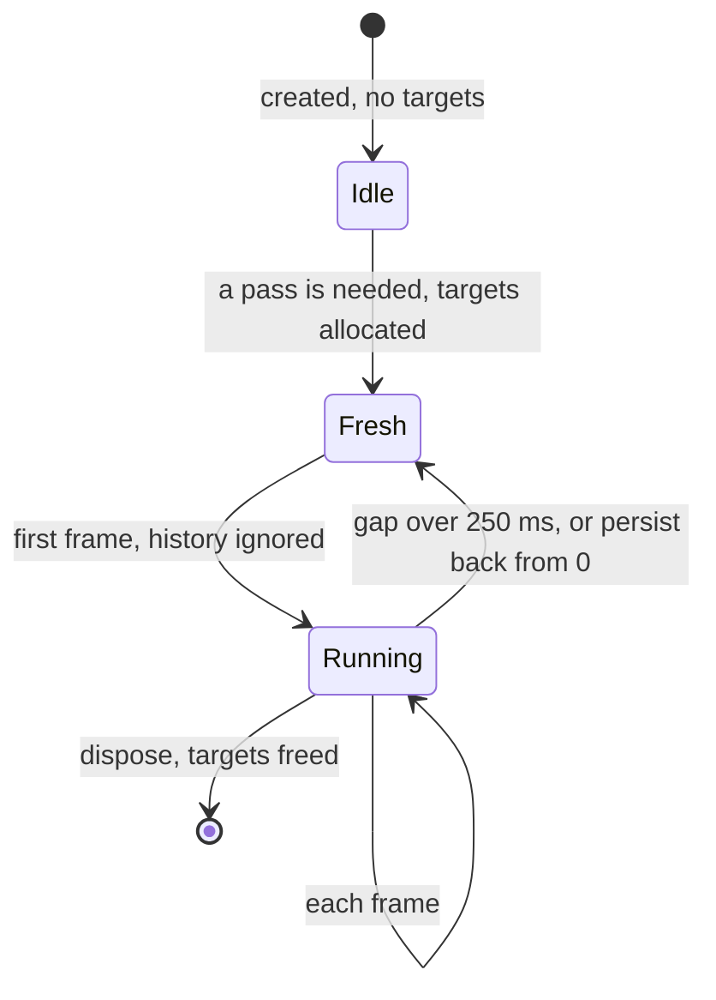
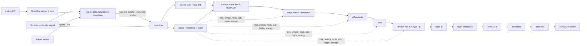
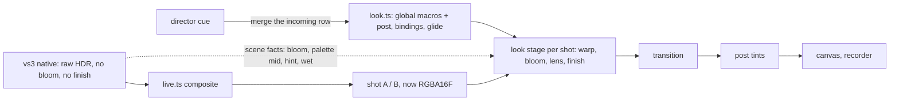
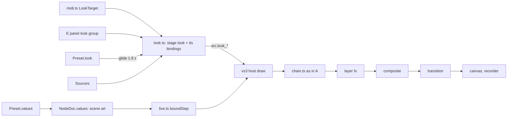

# Design: vs3 engine: macros, post chain, palettes, full presets

## TL;DR
- Three variants for where the donor chain (mirror → feedback → bloom → lens → finish) and its knobs live. **A**: inside the vs3 host, state per layer, knobs = inputs of the vs3 native. **B**: a look stage in `gl/engine.ts`, one global look, scenes opt in. **C**: A's chain plus one global store for the donor keys that persist across scenes.
- Recommended: **A**. The knobs are native inputs, so presets, the 1.8 s morph, bindings, undo, the E panel and analysis-off work with no new concept and no SceneDoc change.
- One chain module in every variant: at most 2 new passes (warp = mirror + feedback in one pass; lens), each skipped at zero. Estimate: +0.25–0.4 ms GPU at 1080p for a typical preset; a lens adds 0.3–1.5 ms.
- Top risks: the vs3 built-ins change look when the legacy layer fx leave; flash at knob extremes (heat × bloom); the budget at a 3456×2234 stage.
- The artifact is 11 part files (each write ≤ 5 KB; this run has no append tool). Read them in name order.

## Freshness
- 2026-11-21, system-designer, source commit `a4554bf` (branch `dev`).
- Inputs: `thoughts/spec_vs3_engine.md` (whole); `agents/research/research_donor_vs3_ui.md` TL;DR, §2, §3, §4, §5; `agents/STATE.md` HEAD; the code and donor ranges of the brief.
- Path keys: `K/` = `donor/vs3/visual_kit/src/`, `O/` = `donor/vs3/visual_system_3/renderer/` (as the research). Ours, under `web/src/`: `host.ts` = `vs3/host.ts`; `live.ts`, `engine.ts`, `post.ts`, `bloom.ts` = `gl/…`; `builtin.ts` = `scenes/builtin.ts`.
- Read outside the brief's ranges, with the reason:
  - `host.ts:30-95, 120-171`: the `Signal` type and `signal()` that the chain reads.
  - `live.ts:60-185, 388-499, 566-580`: the toy limiter, `boundStep` with `analysis.off`, the one-node glide.
  - `engine.ts:96-118`: target formats (`renderTarget`, `shots`, `temps`).
  - `bloom.ts:1-75`, `builtin.ts:1826-1934`, `doc.ts:7-15`, `fx/types.ts:7-17`, `gl/scene.ts:9-20`, `midi.ts:1-12, 59, 75`, `web/scripts/vs3-presets.mjs:1-70`, `agents/hardening.md:80-86`; greps of `vs3/kit/scenes`, `audio/vs3.ts`; the file names in `fx/transitions/`: contracts, the built-ins' fx today, the preset generator, scene flags.
  - Donor, as text: `K/lib/fx.js:1-229`, `K/engine/post-shaders.js:300-462`, `K/App.jsx:22-38, 128-140`, `K/core/analyzer.js:462-488`, `O/main.js:155-161, 7780-7814, 10602-10621`.
- Not read: `thoughts/spec_veejay_wizard.md` (not in the brief). Stack and licence rules come from `CLAUDE.md` § Stack, § Constraints.
- Web: one pattern reference, pmndrs/postprocessing `EffectPass` (merged fullscreen passes), https://github.com/pmndrs/postprocessing.

## Parts (joined into this one file by the lead, 2026-11-21; the part names below are section anchors now)
Prefix: `agents/system-designer/design_vs3_engine_2026-11-21`.

| File | Sections |
|---|---|
| `.md` | TL;DR, Freshness, Parts, Constraints |
| `.p02.md` | Shared facts S1–S4: donor rules, what we have, the chain module, skip-at-zero |
| `.p03.md` | Shared facts S5–S7: lifecycle, cost per pass, safety rules |
| `.p04.md` | Variant A: summary, data flow, files, reuse |
| `.p05.md` | Variant A: contracts, state, storage, merge |
| `.p06.md` | Variant A: composition, acceptance, roadmap, risks, effort |
| `.p07.md` | Variant B |
| `.p08.md` | Variant C |
| `.p09.md` | Comparison, Research gaps |
| `.p10.md` | Step plan and ranked risks (A) |
| `.p11.md` | Decision needed, Recommendation |

## Constraints
- Scope: R1–R6 of the epic spec. Non-goals (spec § Non-goals): second-scene layer, output window, timeline lanes, 16 device macros, randomize, console skin, emblem, adaptive exposure, FXAA.
- Stack: WebGL2 on our helpers (`fullscreenProgram`, `renderTarget`); three r187 only renders the scene (host.ts:5-10). No new dependency.
- Licence: the chain shaders are ported from the friends' engine, used with permission (host.ts:1-2, :264). Each ported shader keeps a credit header (`CLAUDE.md` § Donor scanning).
- Safety (R5): at most 3 luma steps > .10 per second; light on a hit only through the gated ⚡ input (I-FL1; host.ts:13-16). Budget: a typical preset adds ≤ 2 ms GPU p95 at the stage size.
- Process: donor JS is read as text, never executed. This artifact changes no product code.

## Shared facts (all variants)

### S1 The donor's rules
- Order: scene → mirror → feedback → bloom → lens → finish (`K/engine/engine.js:65-67`).
- Macros: `drastic(p) = 4^((p − 0.5)·2)` for heat and chaos (`engine.js:150-151`); `trails` scales persist and zoom (`engine.js:177-183`); `react` scales the signal: levels × react·2, clamped (`K/core/analyzer.js:464-473`).
- Scene switch: the original assigns the scene's `FX_DEFAULTS` row into the one global `post`, except keys the user wrote during the fade (`fadeKeep`) or holds (`O/main.js:7797-7800`). The kit never merges mirror, spin, vignette (`K/App.jsx:135`): a kit shortcut, not the original rule.
- Keys outside the row (lens, lensStyle, tiles, twist, slice, hueDrift, brightness) and the 4 macros persist across scenes (`K/engine/post-shaders.js:22-23`; `applyScene` writes only the row).
- `decay` is the analyser's envelope-release scale (`post-shaders.js:25-29`), not a feedback uniform (`K/lib/fx.js:136-147`). Spec R2 lists it under feedback: gap G3.

### S2 What we have
- The host runs bloom and finish on our passes after the three.js render (host.ts:236-244), from a half-float scene target (host.ts:7).
- The rest of the chain is approximated by layer fx AFTER the finish: `isf/Mirror`, `isf/Kaleidoscope`, `own/feedback-zoom` (builtin.ts:1844, :1870, :1839). Today's order is scene → bloom → finish → mirror → feedback: the vignette and the tone map get mirrored and fed back.
- That feedback's kick push is a raw `kick` binding (`KICK_ZOOM`, builtin.ts:1837), not the gated ⚡.
- The preset generator drops `post.*` and `macros.*`: no input takes them (`vs3-presets.mjs:58`).

### S3 The chain module (the same in A, B, C)
One module on our GL helpers; shaders ported from the donor text.
- **warp**: mirror and feedback in ONE pass. The shader applies the donor mirror's uv transform (slice → tiles → twist → fold, `fx.js:75-129`), samples the scene through it, then takes `max(cur, history · persist · tint · edge)` (`fx.js:157-175`). Its output is the new history. Exact: the donor's feedback reads the mirror's output at the same pixel. Precedent: pmndrs/postprocessing `EffectPass` merges fullscreen effects into one pass.
- **bloom**: `gl/bloom.ts` `createBloom(gl, 8, 0.3)`, as today (host.ts:194, :240).
- **lens**: one pass, 7 styles (`post-shaders.js:303-459`). 3 taps; anamorphic adds 24; melt adds noise and 6 plume slots.
- **finish**: the existing `FINISH` (host.ts:91-103) plus `uGain` (brightness; a literal 1.4 at host.ts:99 today) and the donor grain (`post-shaders.js:250`).
- **hue drift**: no pass. The host writes the 5 palette colours per draw (host.ts:211-228); it rotates their hue by a phase that grows `hueDrift · dt · 0.035` turns (`K/App.jsx:92`).
- **wiring** `frame()`: the donor's per-frame uniform maths (`engine.js:150-243`) and its state machines `stepSym` (0.5 s fold fade) and `stepTiles` (`post-shaders.js:162-198`), with the state passed in. Pure, so Vitest covers it without a browser, like `gl/post.ts`.

### S4 Skip-at-zero (R2)
| Pass | Skipped when | Source |
|---|---|---|
| warp, mirror part | no fold and no fold fade; tiles ≤ 1.0001; \|twist\| ≤ .001; slice ≤ .001 | `engine.js:168-171` |
| warp, feedback part | effective persist ≤ 0 (trails 0, or persist 0 without `LATE_TRAILS`) | `engine.js:176-179` |
| warp pass | both parts off; bloom then reads the scene target, as today | |
| bloom | strength ≤ 0 | host.ts:240 |
| lens | lens ≤ .01 or wet ≤ .001 | `engine.js:199` |
| finish | never (today's cost) | host.ts:243 |

Difference from the donor: at persist 0 it still copies the frame into the history (`fx.js:203-213`). We copy nothing; the history is marked stale and the first fed-back frame ignores it. Cost: one frame of trail delay.

### S5 Chain lifecycle (per chain instance)

In `Fresh` the fold fade and the tile glide snap to their targets. The gap test is the palette's (host.ts:106, :207).

### S6 Cost per pass (estimates)
Anchor: the donor notes that a plain copy pass costs "about 1 ms a frame at 4K" (`engine.js:166-167`), about 0.12 ms per megapixel. ⚠️ Assumption, needs confirmation: that was its reference GPU (M2 Pro, research §3) and the user's GPU is of that class (gap G2). 1080p = 2.07 MP. Our measurement stage is 1728×1117 @2 = 3456×2234 = 7.7 MP (builtin.ts:1833).

| Pass | New | Taps | ms @1080p | ms @7.7 MP | Targets (RGBA16F, 8 B/px) |
|---|---|---|---|---|---|
| warp | yes | 2 (4 in a fold fade) | 0.25–0.4 | 0.9–1.5 | history pair, `renderTarget(true, true)` |
| bloom | no | 8 levels | paid today | paid today | its chain + out (bloom.ts:51-52) |
| lens: ribs, fan, glitch, pixels, fly eye | yes | 3 | 0.3–0.4 | 1.1–1.5 | one scratch |
| lens: melt | yes | 3 + noise | 0.5–0.7 | 1.9–2.6 | the scratch |
| lens: anamorphic | yes | 27 | 1.0–1.5 | 3.7–5.6 | the scratch |
| finish | no | 3 | paid today | paid today | none |
| hue drift | yes | CPU, 5 colours | 0 | 0 | none |

- Typical preset (lens 0, as every `FX_DEFAULTS` row leaves it): at most one warp pass. Where a built-in runs `own/feedback-zoom` or `isf/Mirror` today the net is about 0: two 8-bit fx passes leave, one 16-bit pass comes.
- R5 (≤ +2 ms): holds at 1080p except anamorphic with warp (≈ 2). At 7.7 MP it holds for warp alone and fails with a lens on. The governor lowers the internal size under load (research §5).
- Memory, new, per vs3 layer: history pair 16 B/px (33 MB at 1080p, 124 MB at 7.7 MP), + 8 B/px scratch with a lens or a mirror without feedback. Two layers during a transition. Targets belong to the chain (a shared scratch would be re-fitted between the stage and a library tile each frame). They are allocated on first use, freed on dispose, and 8-bit where half-float is not renderable (engine.ts:100). `persistent` keeps trails across a governor step (engine.ts:96-98).

### S7 Safety rules (all variants)
- **F1** Every kick term reads the Signal's `kick` (the gated ⚡ `hit` through `heatStep`, host.ts:220) and `onKick` (its rise, host.ts:45): feedback zoom push, bloom kick, lens `uKick`, lens re-seats (`engine.js:210-222`), aberration kick. Re-seats and lamp pulses are ≤ 3 per second by the shared budget (`flashOnsets`, live.ts:81).
- **F2** `heat` scales the bloom strength up to 4×; our glow is `9·k²` (host.ts:240), so up to 16× the stock kick glow. The chain reads `heat` through a rise slew (knob `HEAT_RISE`, start 0.5 s) and a cap (knob `HEAT_CAP`, start 4): a bound `heat` swells, it cannot step. Both are tuned on the flash harness.
- **F3** `brightness` and `bloomMul` are `bindable: false`, like `palette` (host.ts:265-267). `react` clamps `kick` at 1 (the donor: 1.2, `analyzer.js:466`).
- **F4** A mirror change fades 0.5 s, tiles glide, the history resets after a gap.
- **F5** Toy limiter: unchanged. It limits toys and `native/video`; a native's light is gated at its ⚡ inputs (live.ts:139-144).
- **F6** Analysis off: `boundStep(…, analysis.off)` gives 0 for a ⚡ input and the stored value for any other (post.ts:72-73; live.ts:490). Kick terms rest; level terms read the idle levels (STATE, analysis-off).
- Ceilings: the slews run on the layer's clock (host.ts:202-203, :220). A user binding of `lens` or of a light scene row to raw audio is existing debt (`agents/hardening.md:83`).

## Variant A: the chain inside the vs3 host

The simplest variant that meets R1–R6.

### Summary
The 4 macros and the post keys become inputs of every `native/vs3-*`. The host runs the chain between its scene render and its finish. Chain state is per layer. The engine, `live.ts` and the SceneDoc do not change.

### Data flow


### Files (under `web/src/` unless noted)
| File | Change |
|---|---|
| `vs3/look.json` (new, generated) | `base` (BASE_POST), `ranges` (POST_RANGES), `scenes` (the 32 FX_DEFAULTS rows under our native names), `lateTrails`, `lensStyles`. The preset script writes it from the donor text with the literal reader it has (`vs3-presets.mjs:26-43`). One source for the host and the script. |
| `vs3/chain.ts` (new) + test | S3: `frame()` (pure) and `createChain(gl)` (warp, lens, their targets). |
| `vs3/host.ts` | `vs3()` appends the look inputs (host.ts:267). `Look` keeps palette, mid, filter, pointer; its 3 numbers (host.ts:176, :295-300) come from `look.json`. `draw()` applies react to the Signal, hue drift to the palette, then the chain. `FINISH` gets `uGain` and grain. `Scene` (host.ts:142) gains `fxHint`, `fxWet`, `grain`. |
| `web/scripts/vs3-presets.mjs` | Emits `look.json`. Maps `post.*` and `macros.*` onto the inputs of the same name; line 58 drops them today. |
| `scenes/builtin.ts` | The legacy fx leave the vs3 docs (`fx: []`): `isf/Mirror`, `isf/Kaleidoscope`, `own/feedback-zoom`, `BASE_FX` (builtin.ts:1839-1934). |
| `midi.ts` + test | `ParamTarget.scene` may be `'*'`: the scene on stage (R1, part p06). |
| library load (gap G5) | `stripLegacyVs3Fx(doc)`: a user copy must not run the old fx and the chain together. |

No change: `gl/engine.ts`, `gl/live.ts`, `gl/post.ts`, `doc.ts`, `presets.ts`.

### Reuse
- `gl/bloom.ts` `createBloom` (ours, written from the technique, bloom.ts:1-2) and the host's `FINISH`: kept, now driven by inputs.
- Donor: the mirror, feedback and lens shaders and the wiring, ported from the friends' engine, used with permission (host.ts:1-2); three.js r187, MIT (host.ts:264). No new dependency.
- The preset model, `Live.glide`, `between`, `ease` (presets.ts:34-59): unchanged. The look knobs sit on the same node as the scene rows, so the one-node glide (live.ts:577) carries a whole preset.
- Our layer effects stay for other scenes and for user layers: `isf/Mirror`, `isf/Kaleidoscope`, `isf/Kaleidoscope Tile`, `own/polar`, `own/feedback-zoom`, `own/td-feedback`, `own/trails`, `own/diff-feedback`, `isf/Long Exposure`, `isf/Comet Tails`, `own/bloom`, `isf/Chromatic Aberration` (research §4). They are not reused inside the chain: they run after the finish on 8-bit targets (engine.ts:118), and one preset would then span several nodes.

### Contracts (A)
```ts
// vs3/chain.ts
export const drastic = (p: number) => 4 ** ((p - 0.5) * 2) // .25x at 0, 1x at .5, 4x at 1

/** The look knobs, named as the donor's macros and post keys. They are the native's inputs. */
export interface LookValues {
  react: number; chaos: number; trails: number; heat: number // 0..1, .5 = stock
  mirror: number; tiles: number; twist: number; slice: number; spin: number
  persist: number; zoom: number; bloomMul: number
  lens: number; lensStyle: number // index into look.json lensStyles
  aber: number; vignette: number; brightness: number; hueDrift: number
}
/** What the scene object tells the chain (the donor scene contract, research §2). */
export interface SceneFacts {
  bloom?: { strength: number; gain: number; kick?: number }
  hint?: { mirror?: number; persist?: number; steady?: boolean } | null // signal.js only
  wet: number // fxWet(), limitless only; else 1
  grain: number // 0 on lasers, morphogen2; else 1
  lateTrails: number; filter: boolean
}
/** Per-layer state as plain data, so frame() is pure. */
export interface ChainState {
  angle: number; drift: number; seed: number; hue: number; heat: number; fresh: boolean
  sym: { from: number; to: number | null; w: number; next: number | null }
  tiles: { y: number | null; v: number }
  rips: Float32Array; rip: number // melt: 6 plume slots
}
type Uniforms = Record<string, number | readonly number[] | Float32Array>
/** One frame: which passes run, and their uniforms. */
export interface ChainFrame {
  mirror: boolean; feedback: boolean; warp: Uniforms
  bloom: number // strength after heat; 0 = skip
  lens: Uniforms | null
  finish: { uAber: number; uVig: number; uGain: number; uGrain: number }
}
export function frame(v: LookValues, sc: SceneFacts, s: Signal, st: ChainState, palMid: readonly number[], dt: number, t: number, aspect: number): ChainFrame
export function createChain(gl: WebGL2RenderingContext): {
  /** src (w x h, HDR) through warp, bloom, lens. Returns the texture the finish reads; leaves its own target bound. */
  apply(src: WebGLTexture, w: number, h: number, f: ChainFrame, bloom: ReturnType<typeof createBloom>): WebGLTexture
  dispose(): void
}
```
Inputs (host.ts): 18 rows, `group: 'look'`; default `{ ...look.base, ...look.scenes[name] }`; range from `look.ranges`. `mirror` and `lensStyle` are `long`: the glide switches them at its midpoint (presets.ts:54) and the fold fade smooths the mirror. `brightness`, `bloomMul`: `bindable: false`. ⚠️ Assumption, needs confirmation: the ranges of `persist` (0..1), `zoom` (0.9..1.3), `bloomMul` (0..3), `aber` (0..4). The donor has no slider for these four (`O/main.js:10602-10606`); the ranges only contain every `FX_DEFAULTS` value (gap G1).

### Where the state lives (A)
- Pass state (`ChainState`, the history pair): per vs3 layer, in `start()` beside `bloom` (host.ts:194).
- Knob values: `NodeDoc.values` of the vs3 node (doc.ts:11); a doc holds only what differs from the defaults (live.ts:361).
- No global look, no scene-level state.

### How a SceneDoc and a preset store post + macros (A)
- SceneDoc: unchanged, `v: 1`. Example node: `{ ref: 'native/vs3-ink', values: { heat: 0.3, lens: 0.6, lensStyle: 4 } }`.
- Preset: unchanged `Preset { name, values }` on ref `native/vs3-<name>` (presets.ts:11). A factory preset gains the look keys its donor entry carries. A key the entry lacks is not written: the pick leaves that knob as it is, as a custom palette does today (`vs3-presets.mjs:50-55`; gap G6). `layer*`, `quality`, `decay` stay dropped and counted.
- Save as preset: `savable()` (presets.ts:28) keeps every value-bearing input, so user presets carry the look.

### How FX_DEFAULTS merge on a scene switch (A)
- No global `post` exists, so nothing merges at run time. Each native's defaults are BASE_POST overlaid with the scene's `FX_DEFAULTS` row; the scene's doc holds the user's overrides. A switch shows the incoming scene with its own values.
- For the 7 row keys the result equals the original's `applyScene` (`O/main.js:7797-7800`).
- Difference: the keys the donor keeps across scenes (S1: macros, lens, tiles, twist, slice, hueDrift, brightness) are per scene here. `fadeKeep` / FADE_KEYS has no meaning: no write races a scene's defaults.
- If the macros must follow across scenes later: at the cue, copy 4 live values from the outgoing to the incoming vs3 node with `Live.set` (live.ts:38). About 10 lines; not built now.

### Composition (A)
- Per-layer effects: a user's fx after the vs3 node read the finished 8-bit picture, as today (live.ts:397-408). Order: scene → warp → bloom → lens → finish → layer fx → composite. Other layers (text, frame, camera cut-out) stay clean on top.
- The 13 transitions: each scene renders into its own shot (engine.ts:235-236); the transition mixes two finished pictures (engine.ts:240). Each vs3 layer owns its chain state, so the outgoing scene keeps its trails while it fades and the incoming one starts `Fresh`. No new code. Two chains run for the transition's length, as two scenes do today.
- Preset morph: one node, so the existing glide carries scene rows, palette and look together.
- Flash gate, toy limiter, analysis-off: S7 as written. A adds no gate: the chain reads the Signal the scene reads.

### Acceptance (A)
| ID | How |
|---|---|
| R1 | 4 float inputs `react`, `chaos`, `trails`, `heat` (0..1, default .5). Bindable in the existing binding UI. Carried by `Preset.values`. Glided as floats (live.ts:578). MIDI: a CC maps to one scene's input (midi.ts:7-8) and one control has one target (midi.ts:75), so 4 knobs would serve one scene. Change: a look input is learned with `scene: '*'` and resolves to `app.scene()` (midi.ts:59). |
| R2 | S3, S4; defaults from `look.json`. `react` scales the Signal as `analyzer.js:464-473`; its onset-threshold half (`:483-488`) stays global (gap G8). `decay`: gap G3. |
| R3 | 24 palettes stay. Hue drift: S3. The morph covers both. Custom palette: optional step 9 (5 `color` inputs + a 25th select entry `custom`; the image picker is deferred). |
| R4 | The script maps `post.*` and `macros.*`; the glide needs no change. |
| R5 | S7 F1–F6; measured in steps 8a, 8b. |
| R6 | `group: 'look'` rows in the E panel beside the scene's folders (host.ts:152, :162 use `group` today). ⚠️ Assumption, needs confirmation: the panel folds a group and draws a `long` without labels as a stepped slider (gap G4). |
| Triggers | Melody sources: no built-in use. Every look knob but two is a bindable input, so the user can bind `hueDrift` or `twist` to `tonal` or `pitch` in the existing UI. |

### Roadmap check (A)
- Timeline lanes, device macros, randomize: they address inputs; the look knobs are inputs.
- Second-scene layer: a SceneDoc holds up to 4 layers (research TL;DR); each vs3 layer has its own chain.
- Adaptive exposure: one more factor on `uGain`. FXAA: one more pass before the warp. Neither is built.
- The chain for non-vs3 scenes (the brief's unknown). Proposal, not assumed: a filter native `native/look` that wraps `chain.ts` (a `NativeDef` of kind `filter`, gl/scene.ts:20), added to any layer in the L editor. Small, because `createChain` takes a texture and plain values. Build it only when the user asks for the lens rack on MilkDrop or our scenes.
- Electron: WebGL2 only; no browser-specific API is added.

### Risks (A)
1. Look change on every vs3 built-in with trails: they now sit under the bloom and the tone map. Ink, mandala, synapse, oracle, anemone, spacetime and the `BASE_FX` scenes swap their fx for the chain; the scenes whose short persist was left out (builtin.ts:1831-1832) gain it. Mitigation: stills A/B per scene on the user's tracks before the merge.
2. Flash at knob extremes (S7 F2; anamorphic flares and the pixels lamps at lens 1 on bright scenes). Mitigation: the flash harness on all full-look presets plus a stress row (heat 1, lens 1).
3. Budget at 7.7 MP with a lens on (S6).
4. User copies with the legacy fx double the trails. Mitigation: `stripLegacyVs3Fx` removes them only where they equal the shipped legacy list.
5. GL state: the new passes must run inside the host's guarded window (`glState` … `restore`, host.ts:236-244), as the bloom does.
6. A lens style switches at the glide's midpoint: a visible cut of the material. Fix if seen: duck the lens amount around the switch.
7. `react` does not move onset thresholds; `decay` is not wired.

### Effort (A)
M. About 7 files, 1 new module, no data-model change.

## Variant B: a look stage in the engine, one global look

### Summary
The chain runs in `gl/engine.ts` on a whole scene. One global look (macros + post) lives in an app store. A SceneDoc opts in; the vs3 built-ins opt in by default; a MilkDrop or own scene may too. This is the donor's model.

### Where the stage sits
- After the transition (the donor's place, `K/engine/engine.js:65-67`): one chain on the mixed frame. It fails on our transitions: several are spatial (`CircleOpen`, `DirectionalWipe`, `PerlinDissolve` in `fx/transitions/`), and the stage's wet is one number per frame, so a wipe between an opted-in scene and another grades both sides alike. Rejected.
- Per shot, before the transition: the form of B designed here. Values are global; pass state (history) is per shot.

### Data flow


### Contracts (B)
```ts
// doc.ts: opt-in, optional field, v stays 1
export interface SceneDoc { /* ... */ look?: { post?: Partial<LookValues>; bind?: Record<string, Binding> } }
// look.ts (new): the app's one look, stored as vjw.look
export interface GlobalLook { values: LookValues; bind: Record<string, Binding> }
export function cue(incoming: SceneDoc): void // values <- values + the incoming row, except keys written during the fade
export function step(src: Sources, dt: number, t: number): LookValues // glide, boundStep, its own flashGate
// gl/scene.ts: the stage needs the scene's facts from the native
export interface Native { /* ... */ facts?(): SceneFacts & { palMid: readonly number[] } }
// presets.ts: a preset spans the node and the global look
export interface Preset { name: string; values: Record<string, Value>; look?: Partial<LookValues> }
// midi.ts
export interface LookTarget { kind: 'look'; key: keyof LookValues; lo: number; hi: number }
```

### Answers (B)
- State: values global; history per shot; scene art in `SceneDoc.look`.
- FX_DEFAULTS merge: at the director's cue, by the original's rule with `fadeKeep` (`O/main.js:7797-7800`). During the transition both shots read the same global values, so the outgoing scene takes the incoming scene's persist, zoom, bloomMul and mirror while it is still visible. The donor hides this under a 240 ms dip (research §3); our transition lasts a bar or 2 s (research §5).
- Per-layer effects and other layers: the stage runs after the layer composite, so a text layer, a frame and a camera cut-out get mirrored, smeared and vignetted. The donor added `textClean` and `emblemClean` passes for this (research §4).
- HDR: `shots` and `temps` are 8-bit (engine.ts:116-118). The vs3 layer must hand over raw HDR, so they become RGBA16F for every scene (+16 B/px over 4 targets), and the host's bloom and finish move out of the native.
- Flash gate: the stage needs its own gated kick (a `FlashState` on the shared `flashOnsets`, live.ts:81), because the native's ⚡ `hit` is a node value. Analysis-off: the stage must apply `analysis.off` itself; `live.ts` does it per bound input (live.ts:490).
- Toy limiter: it runs per node before the composite; unchanged.
- Cost: the passes of S6, per shot. Memory: at most 2 history pairs.

### Acceptance (B)
R1–R4 are met with new parts: global bindings, a second glide, `Preset.look`, a MIDI target kind, a panel group on a store. R5: new gate code. R6: met.

### Roadmap, risks, effort (B)
- Serves any scene by a flag: its one gain over A.
- Risks: (1) every scene composites in RGBA16F: all built-ins need a look and frame-time recheck; (2) the look snap during transitions; (3) text and camera layers under the chain; (4) a saved scene is not reproducible without a look snapshot in its doc; (5) a second home for bindings, glide and MIDI.
- Effort: L. About 12 files: engine, doc model, host, presets, MIDI, panel.

## Variant C: hybrid: A's chain per layer, one global stage look

### Summary
The chain runs per vs3 layer as in A. The knobs split in two by the donor's own rule (S1):
- **Scene art**: the 7 `FX_DEFAULTS` keys (mirror, persist, zoom, spin, bloomMul, aber, vignette). Inputs of the vs3 native, per scene, as in A.
- **Stage look**: the keys the donor keeps across scenes (react, chaos, trails, heat, lens, lensStyle, tiles, twist, slice, hueDrift, brightness). ONE global store that every vs3 layer reads.

A scene switch then behaves as in the donor: the row keys change with the scene, the rest stays under the user's hands.

### Data flow


### Contracts (C)
```ts
// look.ts (new): the stage look, stored as vjw.look
export interface StageLook {
  react: number; chaos: number; trails: number; heat: number
  lens: number; lensStyle: number; tiles: number; twist: number; slice: number
  hueDrift: number; brightness: number
}
export const stageLook: {
  values: StageLook
  bind: Partial<Record<keyof StageLook, Binding>>
  set(k: keyof StageLook, v: number): void
  glide(to: Partial<StageLook>): void // glideTo, between (presets.ts:42-59)
  /** Once per frame: the glide, then boundStep per bound key; writes src.look_<key>. */
  step(src: Sources, dt: number, t: number, off: boolean): void
}
// presets.ts
export interface Preset { name: string; values: Record<string, Value>; look?: Partial<StageLook> }
// midi.ts
export interface LookTarget { kind: 'look'; key: keyof StageLook; lo: number; hi: number }
// doc.ts: a saved scene keeps the look it was saved under, else it is not reproducible
export interface SceneDoc { /* ... */ look?: Partial<StageLook> }
```
The values ride the `Sources` object every native already gets (host.ts:196). ⚠️ Assumption, needs confirmation: a library tile's sources lack these fields, so a tile reads BASE_POST and its thumb does not follow the live knobs.

### Answers (C)
- State: pass state per layer; scene art per scene (node inputs); stage look global.
- Storage: scene art in `NodeDoc.values`; stage look in `vjw.look`, in `Preset.look` and, as a snapshot, in `SceneDoc.look`.
- FX_DEFAULTS merge: none at run time for the row keys (as A). The stage look persists across switches: the donor's result. During a transition both scenes read the same stage look, and it is the same before and after the switch: no snap.
- Transitions, per-layer effects, flash gate, toy limiter: as A (the chain is A's). Analysis-off: `step()` takes `analysis.off` and hands it to `boundStep`.
- Cost and memory: as A.

### Acceptance (C)
- R1: the macros are global knobs. One MIDI learn serves every vs3 scene, and the knobs hold their place across scenes. Binding a macro needs a global binding list and the binding UI on a store.
- R2, R3, R5: as A. R4: the script writes `values` (scene rows, palette, scene art) and `look`; a pick runs two glides.
- R6: the scene's folders hold the scene art; the compact look group holds the stage look. This matches R6's wording best.

### Roadmap, risks, effort (C)
- Leaves open: the stage look as a binding source for any scene (`look_heat` is a Sources field).
- Risks: (1) two homes for one look: a user asks why the lens did not save with the scene, or why it changed a scene they did not touch; (2) a set-list cue or a saved scene with a `look` snapshot overwrites the live knobs: who wins needs a rule; (3) the SceneDoc and Preset formats grow (import, export, bake, mirror); (4) a second glide and a second binding evaluator to keep in step with `live.ts`.
- Effort: L. A's 7 files plus about 6: store, panel group, binding UI adapter, presets, MIDI, doc.

## Comparison
| | A: in the host | B: engine stage | C: hybrid |
|---|---|---|---|
| Pass state | per vs3 layer | per shot | per vs3 layer |
| Knob values | node inputs | global store + `SceneDoc.look` | scene art: node inputs; stage look: global store |
| SceneDoc / Preset format | no change | both change | both change |
| FX_DEFAULTS on a switch | native defaults; no merge | merge at the cue; the outgoing scene snaps | native defaults; stage look persists |
| Macros across scenes | per scene (carry: 10 lines, later) | persist | persist |
| Transitions | two finished pictures; no new code | per shot; values snap | as A |
| Text, frame, camera layers | clean | under the chain | clean |
| HDR input | yes, inside the native | RGBA16F shots for every scene | yes |
| Flash gate | the scene's own gated Signal | a new gate in the stage | as A |
| Analysis-off | no new code | new code | one flag into `step()` |
| Bindings, morph, MIDI | existing (+ MIDI `'*'`) | new, on a store | new, on a store |
| Non-vs3 scenes | later: `native/look` filter | yes, by a flag | later: `native/look` filter |
| New GPU cost | S6 | S6 + 16-bit shots | S6 |
| Files | about 7 | about 12 | about 13 |
| Effort | M | L | L |
| Top risk | built-ins change look | every scene rechecked | two homes for one look |

Considered and dropped: the chain as separate layer fx nodes (mirror, feedback, bloom, lens, finish as five effects). One preset would span five nodes while the glide moves one (live.ts:577); each macro would fan out over several nodes; the bloom needs the scene object's `bloom` field (host.ts:237).

## Research gaps
- **G1** The key and value histogram of `post.*` and `macros.*` over the 34 factory presets that carry them (`agents/hardening.md:86`). The script already counts them (`vs3-presets.mjs:58`). Needed for: the ranges of persist, zoom, bloomMul, aber; whether `decay`, `quality`, `layer*` appear; the highest `heat` and `lens` for the flash matrix.
- **G2** The user's laptop GPU and the stage size in pixels at which R5 is judged. S6 scales from the donor's 4K remark.
- **G3** `decay`: spec R2 lists it under feedback. In the donor it scales the analyser's envelope release (`post-shaders.js:25-29`); our vs3 core fixes it at stock (`audio/vs3.ts:5`). My pick: not in this epic; an audio-dsp item if G1 shows presets that depend on it.
- **G4** How the E panel draws `Input.group` and a `long` without labels (`ui/Panel.tsx` was not read).
- **G5** Where user SceneDocs load (`library.ts` was not read), and whether user or visitor copies of vs3 scenes with the legacy fx exist.
- **G6** What the donor does with a preset that has no `post` or `macros`: keeps the current look, or resets it. The preset apply in `O/main.js` was not read. A and C assume it keeps.
- **G7** Whether a library tile's `Sources` object lacks unknown fields (C's rule for thumbs).
- **G8** `react` in the donor also moves the onset thresholds (`analyzer.js:483-488`). Ours cannot per scene: the analyser is global. Accepted in all variants unless the lead routes it to audio-dsp.
- **G9** `thoughts/spec_veejay_wizard.md` §3, §4, §6, §7 were not in the brief. The roadmap check uses `CLAUDE.md` § Stack and the epic's Non-goals.

## Step plan sketch (Variant A)
Each step merges alone. An input ships in the step that wires it, so no dead slider reaches the panel. Before step 1 the lead prints G1 from the script's drop counts and notes the stage size (G2).

| # | Step | Test idea |
|---|---|---|
| 1 | `look.json` from the donor text. Inputs `bloomMul`, `aber`, `vignette`, `brightness` on every vs3 native, wired into the existing bloom and `FINISH` (`uGain`). `Look`'s 3 numbers leave host.ts. | Vitest: every native's defaults = base overlaid with its row, and equal today's inline numbers (host.ts:295-300). The picture is unchanged. |
| 2 | `chain.ts`, pure part: `drastic`, `stepSym`, `stepTiles`, `frame()`. No GL. | Vitest against the donor formulas: persist with and without `LATE_TRAILS`; zoom = pow(…, dt); the mirror skip predicate; a re-seat only on `onKick` > 0; at most 3 seeds per second for a 10 Hz hit through `flashGate`. |
| 3 | Warp pass in the host, with its inputs (mirror, tiles, twist, slice, spin, persist, zoom) and the macros `trails`, `chaos`, `heat`, `react`. The legacy fx leave `builtin.ts`. | Vitest: no warp draw at mirror 0 and persist 0; `Fresh` after a gap. Browser: stills A/B on ink, mandala, synapse; GPU ms from `gpuMs` (engine.ts:171-172). |
| 4 | `stripLegacyVs3Fx` where user docs load. | Vitest: a copy with the shipped legacy list loses it; an edited list stays. |
| 5 | Lens pass, 7 styles, inputs `lens`, `lensStyle`. | Browser: GPU ms per style; the flash harness on pixels and anamorphic at lens 1. |
| 6 | Grain in `FINISH`; hue drift on the palette, input `hueDrift`. | Vitest: the hue phase rate. Browser: a still with grain 0 equals step 5's. |
| 7 | Script: `post.*` and `macros.*` into `presets.json`. MIDI `scene: '*'` for look inputs. | Vitest: every factory preset's keys are inputs of its native and inside their ranges; a `'*'` mapping reaches the scene on stage. |
| 8 | Lead: (a) billed-p95 A/B per scene at the stage size (SDLC §7); (b) the flash harness on every full-look preset plus the stress row. The coder tunes `HEAT_RISE` and `HEAT_CAP`. | Runner evidence for R5. |
| 9 | Optional: custom palette as 5 `color` inputs and a select entry `custom`. | Vitest: a preset with custom colours keeps them. |

## Risks ranked (Variant A)
| # | Risk | Level | Mitigation |
|---|---|---|---|
| 1 | The built-ins change look when the chain replaces the legacy fx | HIGH | stills A/B per scene on real tracks; step 3 is its own merge |
| 2 | Flash at knob extremes: heat × bloom (glow ∝ k²), anamorphic flares, pixels lamps | HIGH | S7 F1–F3; step 8b; the two knobs |
| 3 | Over 2 ms at 7.7 MP with a lens on | MED | skip-at-zero; the merged warp; the governor; step 8a |
| 4 | Memory: +124 MB per vs3 layer at 7.7 MP, two in a transition | MED | allocate on first use; free on dispose |
| 5 | A user copy runs the old fx and the chain | MED | step 4, before any push to master |
| 6 | GL state leaks from the new passes into three.js | MED | run inside the host's guarded window (host.ts:236-244) |
| 7 | The cost anchor is one donor remark, not our measurement | MED | step 3 reads `gpuMs`; step 8a decides |
| 8 | Lens style cut at the glide's midpoint | LOW | duck the lens amount if seen |
| 9 | `react` without onset thresholds; `decay` not wired | LOW | G3, G8 |
| 10 | Grain raises the REC bitrate | LOW | `uGrain` 0 while recording; the donor holds its grain during a take (research §4) |

## Decision needed
The lead picks the variant (a technical gate). The choices behind the pick:
1. **A look per scene (A), or a look that persists across scenes (C, B).** The user did not say. A ships the presets' full look soonest; under A the macro carry is a small later step (part p05, last bullet).
2. **Should non-vs3 scenes get the chain?** The brief's unknown. Proposal: not now. Under A or C a `native/look` filter adds it on request; B has it by design.
3. **`decay`** (gap G3): drop from this epic (my pick), or route to audio-dsp.
4. **Custom palette** (step 9): in or out. The image picker is out in both cases.
5. **Legacy fx in user copies** (step 4): strip where they equal the shipped list (my pick), or leave the copies as they are.

The user's gate (creative): the stills A/B of the built-ins after step 3, since their look changes (risk 1).

## Recommendation
**Variant A.** It is the only variant that adds no concept. The look knobs are inputs of the node that presets, the glide, bindings, undo and the panel already address, so R1, R4 and R6 follow from R2's inputs; MIDI needs one wildcard. The chain runs where the HDR picture and the scene's own facts are (host.ts:236-244), so the donor order is exact, and text or camera layers stay clean. The transitions and analysis-off need no code. B pays for its global stage with 16-bit shots for every scene, a new flash gate, and a look snap during our bar-long transitions. C reproduces the donor's cross-scene persistence exactly, but at about twice the size and with two homes for one look. A does not block C: `chain.ts` takes plain values, so a later store can feed the same keys. A's cost is the per-scene look: a knob set on one scene does not follow to the next until the carry step is asked for.
