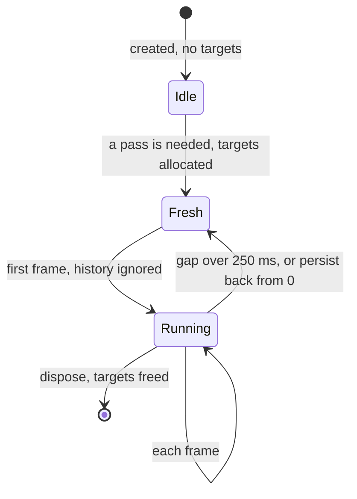
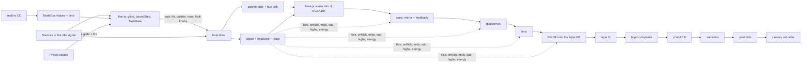
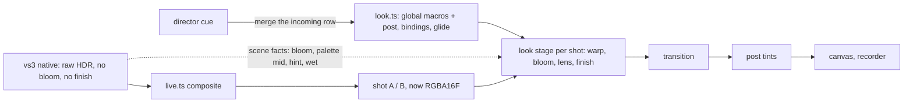
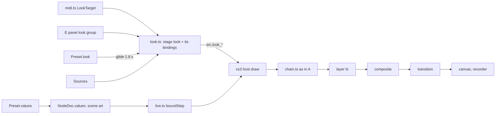

# Design: vs3 engine: macros, post chain, palettes, full presets

## TL;DR
- Three variants for where the donor chain (mirror → feedback → bloom → lens → finish) and its knobs live. **A**: inside the vs3 host, state per layer, knobs = inputs of the vs3 native. **B**: a look stage in `gl/engine.ts`, one global look, scenes opt in. **C**: A's chain plus one global store for the donor keys that persist across scenes.
- Recommended: **A**. The knobs are native inputs, so presets, the 1.8 s morph, bindings, undo, the E panel and analysis-off work with no new concept and no SceneDoc change.
- One chain module in every variant: at most 2 new passes (warp = mirror + feedback in one pass; lens), each skipped at zero. Estimate: +0.25–0.4 ms GPU at 1080p for a typical preset; a lens adds 0.3–1.5 ms.
- Top risks: the vs3 built-ins change look when the legacy layer fx leave; flash at knob extremes (heat × bloom); the budget at a 3456×2234 stage.
- The artifact is 11 part files (each write ≤ 5 KB; this run has no append tool). Read them in name order.

## Freshness
- 2026-11-21, system-designer, source commit `a4554bf` (branch `dev`).
- Inputs: `thoughts/spec_vs3_engine.md` (whole); `agents/research/research_donor_vs3_ui.md` TL;DR, §2, §3, §4, §5; `agents/STATE.md` HEAD; the code and donor ranges of the brief.
- Path keys: `K/` = `donor/vs3/visual_kit/src/`, `O/` = `donor/vs3/visual_system_3/renderer/` (as the research). Ours, under `web/src/`: `host.ts` = `vs3/host.ts`; `live.ts`, `engine.ts`, `post.ts`, `bloom.ts` = `gl/…`; `builtin.ts` = `scenes/builtin.ts`.
- Read outside the brief's ranges, with the reason:
  - `host.ts:30-95, 120-171`: the `Signal` type and `signal()` that the chain reads.
  - `live.ts:60-185, 388-499, 566-580`: the toy limiter, `boundStep` with `analysis.off`, the one-node glide.
  - `engine.ts:96-118`: target formats (`renderTarget`, `shots`, `temps`).
  - `bloom.ts:1-75`, `builtin.ts:1826-1934`, `doc.ts:7-15`, `fx/types.ts:7-17`, `gl/scene.ts:9-20`, `midi.ts:1-12, 59, 75`, `web/scripts/vs3-presets.mjs:1-70`, `agents/hardening.md:80-86`; greps of `vs3/kit/scenes`, `audio/vs3.ts`; the file names in `fx/transitions/`: contracts, the built-ins' fx today, the preset generator, scene flags.
  - Donor, as text: `K/lib/fx.js:1-229`, `K/engine/post-shaders.js:300-462`, `K/App.jsx:22-38, 128-140`, `K/core/analyzer.js:462-488`, `O/main.js:155-161, 7780-7814, 10602-10621`.
- Not read: `thoughts/spec_veejay_wizard.md` (not in the brief). Stack and licence rules come from `CLAUDE.md` § Stack, § Constraints.
- Web: one pattern reference, pmndrs/postprocessing `EffectPass` (merged fullscreen passes), https://github.com/pmndrs/postprocessing.

## Parts (joined into this one file by the lead, 2026-11-21; the part names below are section anchors now)
Prefix: `agents/system-designer/design_vs3_engine_2026-11-21`.

| File | Sections |
|---|---|
| `.md` | TL;DR, Freshness, Parts, Constraints |
| `.p02.md` | Shared facts S1–S4: donor rules, what we have, the chain module, skip-at-zero |
| `.p03.md` | Shared facts S5–S7: lifecycle, cost per pass, safety rules |
| `.p04.md` | Variant A: summary, data flow, files, reuse |
| `.p05.md` | Variant A: contracts, state, storage, merge |
| `.p06.md` | Variant A: composition, acceptance, roadmap, risks, effort |
| `.p07.md` | Variant B |
| `.p08.md` | Variant C |
| `.p09.md` | Comparison, Research gaps |
| `.p10.md` | Step plan and ranked risks (A) |
| `.p11.md` | Decision needed, Recommendation |

## Constraints
- Scope: R1–R6 of the epic spec. Non-goals (spec § Non-goals): second-scene layer, output window, timeline lanes, 16 device macros, randomize, console skin, emblem, adaptive exposure, FXAA.
- Stack: WebGL2 on our helpers (`fullscreenProgram`, `renderTarget`); three r187 only renders the scene (host.ts:5-10). No new dependency.
- Licence: the chain shaders are ported from the friends' engine, used with permission (host.ts:1-2, :264). Each ported shader keeps a credit header (`CLAUDE.md` § Donor scanning).
- Safety (R5): at most 3 luma steps > .10 per second; light on a hit only through the gated ⚡ input (I-FL1; host.ts:13-16). Budget: a typical preset adds ≤ 2 ms GPU p95 at the stage size.
- Process: donor JS is read as text, never executed. This artifact changes no product code.

## Shared facts (all variants)

### S1 The donor's rules
- Order: scene → mirror → feedback → bloom → lens → finish (`K/engine/engine.js:65-67`).
- Macros: `drastic(p) = 4^((p − 0.5)·2)` for heat and chaos (`engine.js:150-151`); `trails` scales persist and zoom (`engine.js:177-183`); `react` scales the signal: levels × react·2, clamped (`K/core/analyzer.js:464-473`).
- Scene switch: the original assigns the scene's `FX_DEFAULTS` row into the one global `post`, except keys the user wrote during the fade (`fadeKeep`) or holds (`O/main.js:7797-7800`). The kit never merges mirror, spin, vignette (`K/App.jsx:135`): a kit shortcut, not the original rule.
- Keys outside the row (lens, lensStyle, tiles, twist, slice, hueDrift, brightness) and the 4 macros persist across scenes (`K/engine/post-shaders.js:22-23`; `applyScene` writes only the row).
- `decay` is the analyser's envelope-release scale (`post-shaders.js:25-29`), not a feedback uniform (`K/lib/fx.js:136-147`). Spec R2 lists it under feedback: gap G3.

### S2 What we have
- The host runs bloom and finish on our passes after the three.js render (host.ts:236-244), from a half-float scene target (host.ts:7).
- The rest of the chain is approximated by layer fx AFTER the finish: `isf/Mirror`, `isf/Kaleidoscope`, `own/feedback-zoom` (builtin.ts:1844, :1870, :1839). Today's order is scene → bloom → finish → mirror → feedback: the vignette and the tone map get mirrored and fed back.
- That feedback's kick push is a raw `kick` binding (`KICK_ZOOM`, builtin.ts:1837), not the gated ⚡.
- The preset generator drops `post.*` and `macros.*`: no input takes them (`vs3-presets.mjs:58`).

### S3 The chain module (the same in A, B, C)
One module on our GL helpers; shaders ported from the donor text.
- **warp**: mirror and feedback in ONE pass. The shader applies the donor mirror's uv transform (slice → tiles → twist → fold, `fx.js:75-129`), samples the scene through it, then takes `max(cur, history · persist · tint · edge)` (`fx.js:157-175`). Its output is the new history. Exact: the donor's feedback reads the mirror's output at the same pixel. Precedent: pmndrs/postprocessing `EffectPass` merges fullscreen effects into one pass.
- **bloom**: `gl/bloom.ts` `createBloom(gl, 8, 0.3)`, as today (host.ts:194, :240).
- **lens**: one pass, 7 styles (`post-shaders.js:303-459`). 3 taps; anamorphic adds 24; melt adds noise and 6 plume slots.
- **finish**: the existing `FINISH` (host.ts:91-103) plus `uGain` (brightness; a literal 1.4 at host.ts:99 today) and the donor grain (`post-shaders.js:250`).
- **hue drift**: no pass. The host writes the 5 palette colours per draw (host.ts:211-228); it rotates their hue by a phase that grows `hueDrift · dt · 0.035` turns (`K/App.jsx:92`).
- **wiring** `frame()`: the donor's per-frame uniform maths (`engine.js:150-243`) and its state machines `stepSym` (0.5 s fold fade) and `stepTiles` (`post-shaders.js:162-198`), with the state passed in. Pure, so Vitest covers it without a browser, like `gl/post.ts`.

### S4 Skip-at-zero (R2)
| Pass | Skipped when | Source |
|---|---|---|
| warp, mirror part | no fold and no fold fade; tiles ≤ 1.0001; \|twist\| ≤ .001; slice ≤ .001 | `engine.js:168-171` |
| warp, feedback part | effective persist ≤ 0 (trails 0, or persist 0 without `LATE_TRAILS`) | `engine.js:176-179` |
| warp pass | both parts off; bloom then reads the scene target, as today | |
| bloom | strength ≤ 0 | host.ts:240 |
| lens | lens ≤ .01 or wet ≤ .001 | `engine.js:199` |
| finish | never (today's cost) | host.ts:243 |

Difference from the donor: at persist 0 it still copies the frame into the history (`fx.js:203-213`). We copy nothing; the history is marked stale and the first fed-back frame ignores it. Cost: one frame of trail delay.

### S5 Chain lifecycle (per chain instance)

In `Fresh` the fold fade and the tile glide snap to their targets. The gap test is the palette's (host.ts:106, :207).

### S6 Cost per pass (estimates)
Anchor: the donor notes that a plain copy pass costs "about 1 ms a frame at 4K" (`engine.js:166-167`), about 0.12 ms per megapixel. ⚠️ Assumption, needs confirmation: that was its reference GPU (M2 Pro, research §3) and the user's GPU is of that class (gap G2). 1080p = 2.07 MP. Our measurement stage is 1728×1117 @2 = 3456×2234 = 7.7 MP (builtin.ts:1833).

| Pass | New | Taps | ms @1080p | ms @7.7 MP | Targets (RGBA16F, 8 B/px) |
|---|---|---|---|---|---|
| warp | yes | 2 (4 in a fold fade) | 0.25–0.4 | 0.9–1.5 | history pair, `renderTarget(true, true)` |
| bloom | no | 8 levels | paid today | paid today | its chain + out (bloom.ts:51-52) |
| lens: ribs, fan, glitch, pixels, fly eye | yes | 3 | 0.3–0.4 | 1.1–1.5 | one scratch |
| lens: melt | yes | 3 + noise | 0.5–0.7 | 1.9–2.6 | the scratch |
| lens: anamorphic | yes | 27 | 1.0–1.5 | 3.7–5.6 | the scratch |
| finish | no | 3 | paid today | paid today | none |
| hue drift | yes | CPU, 5 colours | 0 | 0 | none |

- Typical preset (lens 0, as every `FX_DEFAULTS` row leaves it): at most one warp pass. Where a built-in runs `own/feedback-zoom` or `isf/Mirror` today the net is about 0: two 8-bit fx passes leave, one 16-bit pass comes.
- R5 (≤ +2 ms): holds at 1080p except anamorphic with warp (≈ 2). At 7.7 MP it holds for warp alone and fails with a lens on. The governor lowers the internal size under load (research §5).
- Memory, new, per vs3 layer: history pair 16 B/px (33 MB at 1080p, 124 MB at 7.7 MP), + 8 B/px scratch with a lens or a mirror without feedback. Two layers during a transition. Targets belong to the chain (a shared scratch would be re-fitted between the stage and a library tile each frame). They are allocated on first use, freed on dispose, and 8-bit where half-float is not renderable (engine.ts:100). `persistent` keeps trails across a governor step (engine.ts:96-98).

### S7 Safety rules (all variants)
- **F1** Every kick term reads the Signal's `kick` (the gated ⚡ `hit` through `heatStep`, host.ts:220) and `onKick` (its rise, host.ts:45): feedback zoom push, bloom kick, lens `uKick`, lens re-seats (`engine.js:210-222`), aberration kick. Re-seats and lamp pulses are ≤ 3 per second by the shared budget (`flashOnsets`, live.ts:81).
- **F2** `heat` scales the bloom strength up to 4×; our glow is `9·k²` (host.ts:240), so up to 16× the stock kick glow. The chain reads `heat` through a rise slew (knob `HEAT_RISE`, start 0.5 s) and a cap (knob `HEAT_CAP`, start 4): a bound `heat` swells, it cannot step. Both are tuned on the flash harness.
- **F3** `brightness` and `bloomMul` are `bindable: false`, like `palette` (host.ts:265-267). `react` clamps `kick` at 1 (the donor: 1.2, `analyzer.js:466`).
- **F4** A mirror change fades 0.5 s, tiles glide, the history resets after a gap.
- **F5** Toy limiter: unchanged. It limits toys and `native/video`; a native's light is gated at its ⚡ inputs (live.ts:139-144).
- **F6** Analysis off: `boundStep(…, analysis.off)` gives 0 for a ⚡ input and the stored value for any other (post.ts:72-73; live.ts:490). Kick terms rest; level terms read the idle levels (STATE, analysis-off).
- Ceilings: the slews run on the layer's clock (host.ts:202-203, :220). A user binding of `lens` or of a light scene row to raw audio is existing debt (`agents/hardening.md:83`).

## Variant A: the chain inside the vs3 host

The simplest variant that meets R1–R6.

### Summary
The 4 macros and the post keys become inputs of every `native/vs3-*`. The host runs the chain between its scene render and its finish. Chain state is per layer. The engine, `live.ts` and the SceneDoc do not change.

### Data flow


### Files (under `web/src/` unless noted)
| File | Change |
|---|---|
| `vs3/look.json` (new, generated) | `base` (BASE_POST), `ranges` (POST_RANGES), `scenes` (the 32 FX_DEFAULTS rows under our native names), `lateTrails`, `lensStyles`. The preset script writes it from the donor text with the literal reader it has (`vs3-presets.mjs:26-43`). One source for the host and the script. |
| `vs3/chain.ts` (new) + test | S3: `frame()` (pure) and `createChain(gl)` (warp, lens, their targets). |
| `vs3/host.ts` | `vs3()` appends the look inputs (host.ts:267). `Look` keeps palette, mid, filter, pointer; its 3 numbers (host.ts:176, :295-300) come from `look.json`. `draw()` applies react to the Signal, hue drift to the palette, then the chain. `FINISH` gets `uGain` and grain. `Scene` (host.ts:142) gains `fxHint`, `fxWet`, `grain`. |
| `web/scripts/vs3-presets.mjs` | Emits `look.json`. Maps `post.*` and `macros.*` onto the inputs of the same name; line 58 drops them today. |
| `scenes/builtin.ts` | The legacy fx leave the vs3 docs (`fx: []`): `isf/Mirror`, `isf/Kaleidoscope`, `own/feedback-zoom`, `BASE_FX` (builtin.ts:1839-1934). |
| `midi.ts` + test | `ParamTarget.scene` may be `'*'`: the scene on stage (R1, part p06). |
| library load (gap G5) | `stripLegacyVs3Fx(doc)`: a user copy must not run the old fx and the chain together. |

No change: `gl/engine.ts`, `gl/live.ts`, `gl/post.ts`, `doc.ts`, `presets.ts`.

### Reuse
- `gl/bloom.ts` `createBloom` (ours, written from the technique, bloom.ts:1-2) and the host's `FINISH`: kept, now driven by inputs.
- Donor: the mirror, feedback and lens shaders and the wiring, ported from the friends' engine, used with permission (host.ts:1-2); three.js r187, MIT (host.ts:264). No new dependency.
- The preset model, `Live.glide`, `between`, `ease` (presets.ts:34-59): unchanged. The look knobs sit on the same node as the scene rows, so the one-node glide (live.ts:577) carries a whole preset.
- Our layer effects stay for other scenes and for user layers: `isf/Mirror`, `isf/Kaleidoscope`, `isf/Kaleidoscope Tile`, `own/polar`, `own/feedback-zoom`, `own/td-feedback`, `own/trails`, `own/diff-feedback`, `isf/Long Exposure`, `isf/Comet Tails`, `own/bloom`, `isf/Chromatic Aberration` (research §4). They are not reused inside the chain: they run after the finish on 8-bit targets (engine.ts:118), and one preset would then span several nodes.

### Contracts (A)
```ts
// vs3/chain.ts
export const drastic = (p: number) => 4 ** ((p - 0.5) * 2) // .25x at 0, 1x at .5, 4x at 1

/** The look knobs, named as the donor's macros and post keys. They are the native's inputs. */
export interface LookValues {
  react: number; chaos: number; trails: number; heat: number // 0..1, .5 = stock
  mirror: number; tiles: number; twist: number; slice: number; spin: number
  persist: number; zoom: number; bloomMul: number
  lens: number; lensStyle: number // index into look.json lensStyles
  aber: number; vignette: number; brightness: number; hueDrift: number
}
/** What the scene object tells the chain (the donor scene contract, research §2). */
export interface SceneFacts {
  bloom?: { strength: number; gain: number; kick?: number }
  hint?: { mirror?: number; persist?: number; steady?: boolean } | null // signal.js only
  wet: number // fxWet(), limitless only; else 1
  grain: number // 0 on lasers, morphogen2; else 1
  lateTrails: number; filter: boolean
}
/** Per-layer state as plain data, so frame() is pure. */
export interface ChainState {
  angle: number; drift: number; seed: number; hue: number; heat: number; fresh: boolean
  sym: { from: number; to: number | null; w: number; next: number | null }
  tiles: { y: number | null; v: number }
  rips: Float32Array; rip: number // melt: 6 plume slots
}
type Uniforms = Record<string, number | readonly number[] | Float32Array>
/** One frame: which passes run, and their uniforms. */
export interface ChainFrame {
  mirror: boolean; feedback: boolean; warp: Uniforms
  bloom: number // strength after heat; 0 = skip
  lens: Uniforms | null
  finish: { uAber: number; uVig: number; uGain: number; uGrain: number }
}
export function frame(v: LookValues, sc: SceneFacts, s: Signal, st: ChainState, palMid: readonly number[], dt: number, t: number, aspect: number): ChainFrame
export function createChain(gl: WebGL2RenderingContext): {
  /** src (w x h, HDR) through warp, bloom, lens. Returns the texture the finish reads; leaves its own target bound. */
  apply(src: WebGLTexture, w: number, h: number, f: ChainFrame, bloom: ReturnType<typeof createBloom>): WebGLTexture
  dispose(): void
}
```
Inputs (host.ts): 18 rows, `group: 'look'`; default `{ ...look.base, ...look.scenes[name] }`; range from `look.ranges`. `mirror` and `lensStyle` are `long`: the glide switches them at its midpoint (presets.ts:54) and the fold fade smooths the mirror. `brightness`, `bloomMul`: `bindable: false`. ⚠️ Assumption, needs confirmation: the ranges of `persist` (0..1), `zoom` (0.9..1.3), `bloomMul` (0..3), `aber` (0..4). The donor has no slider for these four (`O/main.js:10602-10606`); the ranges only contain every `FX_DEFAULTS` value (gap G1).

### Where the state lives (A)
- Pass state (`ChainState`, the history pair): per vs3 layer, in `start()` beside `bloom` (host.ts:194).
- Knob values: `NodeDoc.values` of the vs3 node (doc.ts:11); a doc holds only what differs from the defaults (live.ts:361).
- No global look, no scene-level state.

### How a SceneDoc and a preset store post + macros (A)
- SceneDoc: unchanged, `v: 1`. Example node: `{ ref: 'native/vs3-ink', values: { heat: 0.3, lens: 0.6, lensStyle: 4 } }`.
- Preset: unchanged `Preset { name, values }` on ref `native/vs3-<name>` (presets.ts:11). A factory preset gains the look keys its donor entry carries. A key the entry lacks is not written: the pick leaves that knob as it is, as a custom palette does today (`vs3-presets.mjs:50-55`; gap G6). `layer*`, `quality`, `decay` stay dropped and counted.
- Save as preset: `savable()` (presets.ts:28) keeps every value-bearing input, so user presets carry the look.

### How FX_DEFAULTS merge on a scene switch (A)
- No global `post` exists, so nothing merges at run time. Each native's defaults are BASE_POST overlaid with the scene's `FX_DEFAULTS` row; the scene's doc holds the user's overrides. A switch shows the incoming scene with its own values.
- For the 7 row keys the result equals the original's `applyScene` (`O/main.js:7797-7800`).
- Difference: the keys the donor keeps across scenes (S1: macros, lens, tiles, twist, slice, hueDrift, brightness) are per scene here. `fadeKeep` / FADE_KEYS has no meaning: no write races a scene's defaults.
- If the macros must follow across scenes later: at the cue, copy 4 live values from the outgoing to the incoming vs3 node with `Live.set` (live.ts:38). About 10 lines; not built now.

### Composition (A)
- Per-layer effects: a user's fx after the vs3 node read the finished 8-bit picture, as today (live.ts:397-408). Order: scene → warp → bloom → lens → finish → layer fx → composite. Other layers (text, frame, camera cut-out) stay clean on top.
- The 13 transitions: each scene renders into its own shot (engine.ts:235-236); the transition mixes two finished pictures (engine.ts:240). Each vs3 layer owns its chain state, so the outgoing scene keeps its trails while it fades and the incoming one starts `Fresh`. No new code. Two chains run for the transition's length, as two scenes do today.
- Preset morph: one node, so the existing glide carries scene rows, palette and look together.
- Flash gate, toy limiter, analysis-off: S7 as written. A adds no gate: the chain reads the Signal the scene reads.

### Acceptance (A)
| ID | How |
|---|---|
| R1 | 4 float inputs `react`, `chaos`, `trails`, `heat` (0..1, default .5). Bindable in the existing binding UI. Carried by `Preset.values`. Glided as floats (live.ts:578). MIDI: a CC maps to one scene's input (midi.ts:7-8) and one control has one target (midi.ts:75), so 4 knobs would serve one scene. Change: a look input is learned with `scene: '*'` and resolves to `app.scene()` (midi.ts:59). |
| R2 | S3, S4; defaults from `look.json`. `react` scales the Signal as `analyzer.js:464-473`; its onset-threshold half (`:483-488`) stays global (gap G8). `decay`: gap G3. |
| R3 | 24 palettes stay. Hue drift: S3. The morph covers both. Custom palette: optional step 9 (5 `color` inputs + a 25th select entry `custom`; the image picker is deferred). |
| R4 | The script maps `post.*` and `macros.*`; the glide needs no change. |
| R5 | S7 F1–F6; measured in steps 8a, 8b. |
| R6 | `group: 'look'` rows in the E panel beside the scene's folders (host.ts:152, :162 use `group` today). ⚠️ Assumption, needs confirmation: the panel folds a group and draws a `long` without labels as a stepped slider (gap G4). |
| Triggers | Melody sources: no built-in use. Every look knob but two is a bindable input, so the user can bind `hueDrift` or `twist` to `tonal` or `pitch` in the existing UI. |

### Roadmap check (A)
- Timeline lanes, device macros, randomize: they address inputs; the look knobs are inputs.
- Second-scene layer: a SceneDoc holds up to 4 layers (research TL;DR); each vs3 layer has its own chain.
- Adaptive exposure: one more factor on `uGain`. FXAA: one more pass before the warp. Neither is built.
- The chain for non-vs3 scenes (the brief's unknown). Proposal, not assumed: a filter native `native/look` that wraps `chain.ts` (a `NativeDef` of kind `filter`, gl/scene.ts:20), added to any layer in the L editor. Small, because `createChain` takes a texture and plain values. Build it only when the user asks for the lens rack on MilkDrop or our scenes.
- Electron: WebGL2 only; no browser-specific API is added.

### Risks (A)
1. Look change on every vs3 built-in with trails: they now sit under the bloom and the tone map. Ink, mandala, synapse, oracle, anemone, spacetime and the `BASE_FX` scenes swap their fx for the chain; the scenes whose short persist was left out (builtin.ts:1831-1832) gain it. Mitigation: stills A/B per scene on the user's tracks before the merge.
2. Flash at knob extremes (S7 F2; anamorphic flares and the pixels lamps at lens 1 on bright scenes). Mitigation: the flash harness on all full-look presets plus a stress row (heat 1, lens 1).
3. Budget at 7.7 MP with a lens on (S6).
4. User copies with the legacy fx double the trails. Mitigation: `stripLegacyVs3Fx` removes them only where they equal the shipped legacy list.
5. GL state: the new passes must run inside the host's guarded window (`glState` … `restore`, host.ts:236-244), as the bloom does.
6. A lens style switches at the glide's midpoint: a visible cut of the material. Fix if seen: duck the lens amount around the switch.
7. `react` does not move onset thresholds; `decay` is not wired.

### Effort (A)
M. About 7 files, 1 new module, no data-model change.

## Variant B: a look stage in the engine, one global look

### Summary
The chain runs in `gl/engine.ts` on a whole scene. One global look (macros + post) lives in an app store. A SceneDoc opts in; the vs3 built-ins opt in by default; a MilkDrop or own scene may too. This is the donor's model.

### Where the stage sits
- After the transition (the donor's place, `K/engine/engine.js:65-67`): one chain on the mixed frame. It fails on our transitions: several are spatial (`CircleOpen`, `DirectionalWipe`, `PerlinDissolve` in `fx/transitions/`), and the stage's wet is one number per frame, so a wipe between an opted-in scene and another grades both sides alike. Rejected.
- Per shot, before the transition: the form of B designed here. Values are global; pass state (history) is per shot.

### Data flow


### Contracts (B)
```ts
// doc.ts: opt-in, optional field, v stays 1
export interface SceneDoc { /* ... */ look?: { post?: Partial<LookValues>; bind?: Record<string, Binding> } }
// look.ts (new): the app's one look, stored as vjw.look
export interface GlobalLook { values: LookValues; bind: Record<string, Binding> }
export function cue(incoming: SceneDoc): void // values <- values + the incoming row, except keys written during the fade
export function step(src: Sources, dt: number, t: number): LookValues // glide, boundStep, its own flashGate
// gl/scene.ts: the stage needs the scene's facts from the native
export interface Native { /* ... */ facts?(): SceneFacts & { palMid: readonly number[] } }
// presets.ts: a preset spans the node and the global look
export interface Preset { name: string; values: Record<string, Value>; look?: Partial<LookValues> }
// midi.ts
export interface LookTarget { kind: 'look'; key: keyof LookValues; lo: number; hi: number }
```

### Answers (B)
- State: values global; history per shot; scene art in `SceneDoc.look`.
- FX_DEFAULTS merge: at the director's cue, by the original's rule with `fadeKeep` (`O/main.js:7797-7800`). During the transition both shots read the same global values, so the outgoing scene takes the incoming scene's persist, zoom, bloomMul and mirror while it is still visible. The donor hides this under a 240 ms dip (research §3); our transition lasts a bar or 2 s (research §5).
- Per-layer effects and other layers: the stage runs after the layer composite, so a text layer, a frame and a camera cut-out get mirrored, smeared and vignetted. The donor added `textClean` and `emblemClean` passes for this (research §4).
- HDR: `shots` and `temps` are 8-bit (engine.ts:116-118). The vs3 layer must hand over raw HDR, so they become RGBA16F for every scene (+16 B/px over 4 targets), and the host's bloom and finish move out of the native.
- Flash gate: the stage needs its own gated kick (a `FlashState` on the shared `flashOnsets`, live.ts:81), because the native's ⚡ `hit` is a node value. Analysis-off: the stage must apply `analysis.off` itself; `live.ts` does it per bound input (live.ts:490).
- Toy limiter: it runs per node before the composite; unchanged.
- Cost: the passes of S6, per shot. Memory: at most 2 history pairs.

### Acceptance (B)
R1–R4 are met with new parts: global bindings, a second glide, `Preset.look`, a MIDI target kind, a panel group on a store. R5: new gate code. R6: met.

### Roadmap, risks, effort (B)
- Serves any scene by a flag: its one gain over A.
- Risks: (1) every scene composites in RGBA16F: all built-ins need a look and frame-time recheck; (2) the look snap during transitions; (3) text and camera layers under the chain; (4) a saved scene is not reproducible without a look snapshot in its doc; (5) a second home for bindings, glide and MIDI.
- Effort: L. About 12 files: engine, doc model, host, presets, MIDI, panel.

## Variant C: hybrid: A's chain per layer, one global stage look

### Summary
The chain runs per vs3 layer as in A. The knobs split in two by the donor's own rule (S1):
- **Scene art**: the 7 `FX_DEFAULTS` keys (mirror, persist, zoom, spin, bloomMul, aber, vignette). Inputs of the vs3 native, per scene, as in A.
- **Stage look**: the keys the donor keeps across scenes (react, chaos, trails, heat, lens, lensStyle, tiles, twist, slice, hueDrift, brightness). ONE global store that every vs3 layer reads.

A scene switch then behaves as in the donor: the row keys change with the scene, the rest stays under the user's hands.

### Data flow


### Contracts (C)
```ts
// look.ts (new): the stage look, stored as vjw.look
export interface StageLook {
  react: number; chaos: number; trails: number; heat: number
  lens: number; lensStyle: number; tiles: number; twist: number; slice: number
  hueDrift: number; brightness: number
}
export const stageLook: {
  values: StageLook
  bind: Partial<Record<keyof StageLook, Binding>>
  set(k: keyof StageLook, v: number): void
  glide(to: Partial<StageLook>): void // glideTo, between (presets.ts:42-59)
  /** Once per frame: the glide, then boundStep per bound key; writes src.look_<key>. */
  step(src: Sources, dt: number, t: number, off: boolean): void
}
// presets.ts
export interface Preset { name: string; values: Record<string, Value>; look?: Partial<StageLook> }
// midi.ts
export interface LookTarget { kind: 'look'; key: keyof StageLook; lo: number; hi: number }
// doc.ts: a saved scene keeps the look it was saved under, else it is not reproducible
export interface SceneDoc { /* ... */ look?: Partial<StageLook> }
```
The values ride the `Sources` object every native already gets (host.ts:196). ⚠️ Assumption, needs confirmation: a library tile's sources lack these fields, so a tile reads BASE_POST and its thumb does not follow the live knobs.

### Answers (C)
- State: pass state per layer; scene art per scene (node inputs); stage look global.
- Storage: scene art in `NodeDoc.values`; stage look in `vjw.look`, in `Preset.look` and, as a snapshot, in `SceneDoc.look`.
- FX_DEFAULTS merge: none at run time for the row keys (as A). The stage look persists across switches: the donor's result. During a transition both scenes read the same stage look, and it is the same before and after the switch: no snap.
- Transitions, per-layer effects, flash gate, toy limiter: as A (the chain is A's). Analysis-off: `step()` takes `analysis.off` and hands it to `boundStep`.
- Cost and memory: as A.

### Acceptance (C)
- R1: the macros are global knobs. One MIDI learn serves every vs3 scene, and the knobs hold their place across scenes. Binding a macro needs a global binding list and the binding UI on a store.
- R2, R3, R5: as A. R4: the script writes `values` (scene rows, palette, scene art) and `look`; a pick runs two glides.
- R6: the scene's folders hold the scene art; the compact look group holds the stage look. This matches R6's wording best.

### Roadmap, risks, effort (C)
- Leaves open: the stage look as a binding source for any scene (`look_heat` is a Sources field).
- Risks: (1) two homes for one look: a user asks why the lens did not save with the scene, or why it changed a scene they did not touch; (2) a set-list cue or a saved scene with a `look` snapshot overwrites the live knobs: who wins needs a rule; (3) the SceneDoc and Preset formats grow (import, export, bake, mirror); (4) a second glide and a second binding evaluator to keep in step with `live.ts`.
- Effort: L. A's 7 files plus about 6: store, panel group, binding UI adapter, presets, MIDI, doc.

## Comparison
| | A: in the host | B: engine stage | C: hybrid |
|---|---|---|---|
| Pass state | per vs3 layer | per shot | per vs3 layer |
| Knob values | node inputs | global store + `SceneDoc.look` | scene art: node inputs; stage look: global store |
| SceneDoc / Preset format | no change | both change | both change |
| FX_DEFAULTS on a switch | native defaults; no merge | merge at the cue; the outgoing scene snaps | native defaults; stage look persists |
| Macros across scenes | per scene (carry: 10 lines, later) | persist | persist |
| Transitions | two finished pictures; no new code | per shot; values snap | as A |
| Text, frame, camera layers | clean | under the chain | clean |
| HDR input | yes, inside the native | RGBA16F shots for every scene | yes |
| Flash gate | the scene's own gated Signal | a new gate in the stage | as A |
| Analysis-off | no new code | new code | one flag into `step()` |
| Bindings, morph, MIDI | existing (+ MIDI `'*'`) | new, on a store | new, on a store |
| Non-vs3 scenes | later: `native/look` filter | yes, by a flag | later: `native/look` filter |
| New GPU cost | S6 | S6 + 16-bit shots | S6 |
| Files | about 7 | about 12 | about 13 |
| Effort | M | L | L |
| Top risk | built-ins change look | every scene rechecked | two homes for one look |

Considered and dropped: the chain as separate layer fx nodes (mirror, feedback, bloom, lens, finish as five effects). One preset would span five nodes while the glide moves one (live.ts:577); each macro would fan out over several nodes; the bloom needs the scene object's `bloom` field (host.ts:237).

## Research gaps
- **G1** The key and value histogram of `post.*` and `macros.*` over the 34 factory presets that carry them (`agents/hardening.md:86`). The script already counts them (`vs3-presets.mjs:58`). Needed for: the ranges of persist, zoom, bloomMul, aber; whether `decay`, `quality`, `layer*` appear; the highest `heat` and `lens` for the flash matrix.
- **G2** The user's laptop GPU and the stage size in pixels at which R5 is judged. S6 scales from the donor's 4K remark.
- **G3** `decay`: spec R2 lists it under feedback. In the donor it scales the analyser's envelope release (`post-shaders.js:25-29`); our vs3 core fixes it at stock (`audio/vs3.ts:5`). My pick: not in this epic; an audio-dsp item if G1 shows presets that depend on it.
- **G4** How the E panel draws `Input.group` and a `long` without labels (`ui/Panel.tsx` was not read).
- **G5** Where user SceneDocs load (`library.ts` was not read), and whether user or visitor copies of vs3 scenes with the legacy fx exist.
- **G6** What the donor does with a preset that has no `post` or `macros`: keeps the current look, or resets it. The preset apply in `O/main.js` was not read. A and C assume it keeps.
- **G7** Whether a library tile's `Sources` object lacks unknown fields (C's rule for thumbs).
- **G8** `react` in the donor also moves the onset thresholds (`analyzer.js:483-488`). Ours cannot per scene: the analyser is global. Accepted in all variants unless the lead routes it to audio-dsp.
- **G9** `thoughts/spec_veejay_wizard.md` §3, §4, §6, §7 were not in the brief. The roadmap check uses `CLAUDE.md` § Stack and the epic's Non-goals.

## Step plan sketch (Variant A)
Each step merges alone. An input ships in the step that wires it, so no dead slider reaches the panel. Before step 1 the lead prints G1 from the script's drop counts and notes the stage size (G2).

| # | Step | Test idea |
|---|---|---|
| 1 | `look.json` from the donor text. Inputs `bloomMul`, `aber`, `vignette`, `brightness` on every vs3 native, wired into the existing bloom and `FINISH` (`uGain`). `Look`'s 3 numbers leave host.ts. | Vitest: every native's defaults = base overlaid with its row, and equal today's inline numbers (host.ts:295-300). The picture is unchanged. |
| 2 | `chain.ts`, pure part: `drastic`, `stepSym`, `stepTiles`, `frame()`. No GL. | Vitest against the donor formulas: persist with and without `LATE_TRAILS`; zoom = pow(…, dt); the mirror skip predicate; a re-seat only on `onKick` > 0; at most 3 seeds per second for a 10 Hz hit through `flashGate`. |
| 3 | Warp pass in the host, with its inputs (mirror, tiles, twist, slice, spin, persist, zoom) and the macros `trails`, `chaos`, `heat`, `react`. The legacy fx leave `builtin.ts`. | Vitest: no warp draw at mirror 0 and persist 0; `Fresh` after a gap. Browser: stills A/B on ink, mandala, synapse; GPU ms from `gpuMs` (engine.ts:171-172). |
| 4 | `stripLegacyVs3Fx` where user docs load. | Vitest: a copy with the shipped legacy list loses it; an edited list stays. |
| 5 | Lens pass, 7 styles, inputs `lens`, `lensStyle`. | Browser: GPU ms per style; the flash harness on pixels and anamorphic at lens 1. |
| 6 | Grain in `FINISH`; hue drift on the palette, input `hueDrift`. | Vitest: the hue phase rate. Browser: a still with grain 0 equals step 5's. |
| 7 | Script: `post.*` and `macros.*` into `presets.json`. MIDI `scene: '*'` for look inputs. | Vitest: every factory preset's keys are inputs of its native and inside their ranges; a `'*'` mapping reaches the scene on stage. |
| 8 | Lead: (a) billed-p95 A/B per scene at the stage size (SDLC §7); (b) the flash harness on every full-look preset plus the stress row. The coder tunes `HEAT_RISE` and `HEAT_CAP`. | Runner evidence for R5. |
| 9 | Optional: custom palette as 5 `color` inputs and a select entry `custom`. | Vitest: a preset with custom colours keeps them. |

## Risks ranked (Variant A)
| # | Risk | Level | Mitigation |
|---|---|---|---|
| 1 | The built-ins change look when the chain replaces the legacy fx | HIGH | stills A/B per scene on real tracks; step 3 is its own merge |
| 2 | Flash at knob extremes: heat × bloom (glow ∝ k²), anamorphic flares, pixels lamps | HIGH | S7 F1–F3; step 8b; the two knobs |
| 3 | Over 2 ms at 7.7 MP with a lens on | MED | skip-at-zero; the merged warp; the governor; step 8a |
| 4 | Memory: +124 MB per vs3 layer at 7.7 MP, two in a transition | MED | allocate on first use; free on dispose |
| 5 | A user copy runs the old fx and the chain | MED | step 4, before any push to master |
| 6 | GL state leaks from the new passes into three.js | MED | run inside the host's guarded window (host.ts:236-244) |
| 7 | The cost anchor is one donor remark, not our measurement | MED | step 3 reads `gpuMs`; step 8a decides |
| 8 | Lens style cut at the glide's midpoint | LOW | duck the lens amount if seen |
| 9 | `react` without onset thresholds; `decay` not wired | LOW | G3, G8 |
| 10 | Grain raises the REC bitrate | LOW | `uGrain` 0 while recording; the donor holds its grain during a take (research §4) |

## Decision needed
The lead picks the variant (a technical gate). The choices behind the pick:
1. **A look per scene (A), or a look that persists across scenes (C, B).** The user did not say. A ships the presets' full look soonest; under A the macro carry is a small later step (part p05, last bullet).
2. **Should non-vs3 scenes get the chain?** The brief's unknown. Proposal: not now. Under A or C a `native/look` filter adds it on request; B has it by design.
3. **`decay`** (gap G3): drop from this epic (my pick), or route to audio-dsp.
4. **Custom palette** (step 9): in or out. The image picker is out in both cases.
5. **Legacy fx in user copies** (step 4): strip where they equal the shipped list (my pick), or leave the copies as they are.

The user's gate (creative): the stills A/B of the built-ins after step 3, since their look changes (risk 1).

## Recommendation
**Variant A.** It is the only variant that adds no concept. The look knobs are inputs of the node that presets, the glide, bindings, undo and the panel already address, so R1, R4 and R6 follow from R2's inputs; MIDI needs one wildcard. The chain runs where the HDR picture and the scene's own facts are (host.ts:236-244), so the donor order is exact, and text or camera layers stay clean. The transitions and analysis-off need no code. B pays for its global stage with 16-bit shots for every scene, a new flash gate, and a look snap during our bar-long transitions. C reproduces the donor's cross-scene persistence exactly, but at about twice the size and with two homes for one look. A does not block C: `chain.ts` takes plain values, so a later store can feed the same keys. A's cost is the per-scene look: a knob set on one scene does not follow to the next until the carry step is asked for.

## Skeptic response (system-designer, 2026-11-21; joined by the lead from 12 parts, headings demoted one level)
### TL;DR
- All 12 findings are accepted; none is rebutted. Variant A stands with amendments. No variant changes.
- C1, C2 and C6 close with one light limiter in `frame()`: real time, both directions, after every writer. It limits `uGain`, the glow, `uVig`, the lens amount, the react gain and the fall of persist. At stock values it returns its targets, so today's picture does not change.
- Worst case per 60 fps frame: `uGain` or the glow's follow ≤ .0064 frame-mean luma; vignette ≤ .013 × its range; lens ≤ 1/30 of its whole effect. A hot preset's kick adds the stock scene's glow step, not ×14.
- C3 gets a washout gate in step 3 and a GPU-only exposure servo as step 3b (τ 2.5 s, range .6–1.35). I expect the gate to fail and 3b to ship.
- Plan: the limiter lands before the first light knob (old steps 1 and 2 swap). H2 runs in steps 3, 5 and 7. GPU cost is judged at 5.09 MP and also measured at 1.93 MP.

### Freshness
- 2026-11-21, system-designer (Fable 5.2), response round. Source commit `af2cbfb` (branch `dev`).
- Inputs: `agents/architecture-skeptic/skeptic_vs3_engine_2026-11-21.md` lines 1-105 (TL;DR, §1 C1–C12, §2, §3). `agents/system-designer/design_vs3_engine_2026-11-21.md` lines 1-46, 112-265, 418-458. `agents/STATE.md` HEAD.
- Code: `web/src/vs3/host.ts:172-260`, `web/src/gl/post.ts:80-105`, `web/src/midi.ts:1-80`.
- Read outside the brief's ranges, with the reason:
  - the design's S1–S6 (lines 47-111) and Research gaps (407-417): the row keys for C8, the per-megapixel rates for the cost table, the next gap number;
  - `host.ts:86-107` (the `FINISH` shader): the gain, tone-map and vignette formulas behind the limiter's luma arithmetic.
- Not read: `director.ts`, `library.ts`, `ui/Midi.tsx`, `gl/live.ts`, the donor. Facts about them come from the skeptic's citations and are cited as such.
- No product code and no existing artifact was changed. A section marked `rev 2` replaces the design section it names.
- This run has no append tool. The response is 12 files: `.response.md`, then `.response2.md` to `.response12.md`. Join them in number order. Under `## Skeptic response`, demote every heading one level.

### Lead's pre-picks, folded in
| Pick | Where it lands |
|---|---|
| Variant A | every section below |
| Per-scene macros; persistence across scenes later | C9 |
| `decay` dropped | the script keeps dropping and counting it; gap G3 closes |
| Custom palette from an image: out | old step 9 leaves the plan |
| C8: `trails 0` / `mirror 0` written at load | C8, step 4 |
| C7: `'*'` MIDI targets only on vs3 natives | C7, step 7 |
| Fix 1: one real-time light limiter | Amendment 1 |
| Fix 2: H2 in steps 3, 5, 7 with a stress row | Gates |
| Fix 3: step-3 washout check, servo as a contingency | Amendment 2 |

### Three designer's additions (beyond the skeptic's text)
1. The limiter also covers the react gain, the fall of persist and a lens style change. They are the same class as C2: one frame, whole-frame light, set by a click, an undo or a MIDI CC.
2. The limiter must merge before the first light knob. Otherwise one merge ships C2.
3. Gate W also runs on the pre-step build, because vs3 scenes already read ≈ 2 × their thumbs today (`hardening.md:80`, as the skeptic cites it).

### Findings: verdict and amendment
| ID | Sev | Verdict | Amendment (details in the section named) |
|---|---|---|---|
| C1 | HIGH | accepted | The light limiter caps the glow's per-frame move at the stock scene's own move plus a follow of ×4 per second. `HEAT_RISE` and `HEAT_CAP` are deleted. H2 runs in steps 3, 5, 7. See Amendment 1, Gates. |
| C2 | HIGH | accepted | The limiter sits after every writer (undo, slider click, MIDI, glide, binding). `uGain` moves ≤ ×4 per second. Vignette, lens amount and react gain cross their range in ≥ 0.5 s. See Amendment 1. |
| C3 | HIGH | accepted | Washout gate W in step 3: share of pixels > .85 ≤ .30 and mean ≤ 1.4 × the thumb's, at 5, 15 and 30 s. A failing row makes step 3b ship: a GPU-only exposure servo, τ 2.5 s, range .6–1.35. See Amendment 2. |
| C4 | MED | accepted | R5 is judged at 5.09 MP (this MacBook Air, fullscreen, 60-adaptive). The harness column is 1.93 MP. See C4, Cost table rev 2, Gates. |
| C5 | MED | accepted | New step 0: a cue to the scene on stage starts no fade. See C5. |
| C6 | MED | accepted | Every light slew reads `dtl`: real seconds, capped at 1/60. Motion keeps the layer's dt. See Amendment 1. |
| C7 | MED | accepted (lead's pick) | A `'*'` target resolves only on a `native/vs3-*` node, and only for a look key. See C7. |
| C8 | MED | changed (lead's pick) | `stripLegacyVs3Fx` leaves. A legacy user copy keeps its fx and gets `trails: 0, mirror: 0` at load. See C8. |
| C9 | MED | accepted as a recorded trade-off (lead's pick) | Per-scene macros stay. The `Live.set` carry is deleted from the design. The later path is one stored global of 4 numbers. See C9. |
| C10 | LOW | accepted | NaN/Inf guard ported verbatim; `uTint` ≤ 1; hue drift by `Color.offsetHSL`. See C10. |
| C11 | LOW | accepted | Each pass owns its draw target: the warp writes the history, the lens writes its own target. See C11. |
| C12 | LOW | accepted | The chain programs compile in vs3 `warm()`. `start()` awaits them and allocates the chain's 3 targets. See C12. |

### Amendment 1: the light limiter (C1, C2, C6)
Rev 2 of S7 F2, S7 "Ceilings" and Contracts (A).

#### Terms
- **`dtl`**: real seconds since this layer's last draw, from `performance.now()` (host.ts:199, :210), capped at 1/60 s. A longer frame gets one 60 fps frame's allowance. That is the toy limiter's rule (post.ts:85-87).
- **stock**: the same scene at heat .5, react .5, its row's `bloomMul` and the base brightness (`look.base.brightness`; the literal 1.4 at host.ts:99). It is today's picture.
- **strength**: the number the host gives `bloom.apply`, 9k² (host.ts:237-240).
- **glow**: `uGain × strength`. It multiplies the bloom picture ahead of the tone map (host.ts:99-100). For a filter, glow = strength, because a filter's finish skips the grade (host.ts:101).
- **react gain**: react × 2 (design S1). It is 1 at stock.
- **rest**: `b.strength`, or 0 for a filter. **kick**: `b.kick ?? 0.35` (host.ts:237).

#### Why the glow needs its own rule
- The glow's light is additive ahead of the tone map: a pixel reads `uGain × (scene + strength × bloom picture)`.
- Heat, bloomMul and brightness multiply the strength. A kick's increment then grows by the same factor, squared for heat (9k²).
- A plain rate limit in strength units cannot be right for 38 scenes: their strengths differ by more than 3× (bloomMul 1 against 1.85).
- So the rule takes its allowance from the stock scene itself: the stock glow is computed beside the real one, every frame, from the same signal.

#### The rule (pure, inside `frame()`, once per draw)
```
x    = LIGHT_X ** dtl                       // 1.0234 at 60 fps
a    = dtl / KNOB_S                         // 1/30 of a range at 60 fps

hot     = heatStep(hot, hit, dtl)           // post.ts:105, now on real time
react   moves toward v.react * 2      by at most a * REACT_MAX
gain    = clamp(v.brightness, gain / x, gain * x)
vig     moves toward v.vignette       by at most a * range(vignette)
lens    moves toward v.lens * sc.wet  by at most a       // toward 0 while v.lensStyle is not the drawn style
persist rises freely; falls by at most a                 // the value after `trails` and LATE_TRAILS

k      = (rest + reacted(s.energy, react) * b.gain + reacted(hot, react) * kick) * v.bloomMul * drastic(v.heat)
k0     = (rest + s.energy * b.gain + hot * kick) * sc.bloomRow        // the stock scene, raw signal
target = gain * 9 * k * k
stock  = sc.gainBase * 9 * k0 * k0
r      = stockPrev > 0 ? min(1, glow / stockPrev) : 1
dyn    = DYN * (stock - stockPrev) * r                                 // the stock scene's own move this frame
foll   = (x - 1) * max(glow, GLOW_SEED)
glow   = clamp(target, glow + min(dyn, 0) - foll, glow + max(dyn, 0) + foll)
strength = glow / gain                      // under 1e-3: 0, so the bloom pass skips
```
- `reacted(level, gain) = min(1, level * gain)`.
- For a filter, `gain` and `sc.gainBase` are 1 in the `target`, `stock` and `strength` lines.
- The drawn lens style changes only while the limited lens amount is ≤ .01. A style change therefore ducks the amount to 0, swaps the style, and returns. The design's risk "lens style cut at the glide's midpoint" closes.
- First frame, or a gap over 250 ms (S5 `Fresh`): every limited value takes its target.
- S4's skip tests read the limited values, so a pass finishes its ramp before it skips.

In words: the glow may move by what the stock scene's glow moved in this frame, plus a follow of at most ×4 per second. Under the stock level it moves in proportion (`r`), so a dim preset keeps its small kick exactly.

#### Knobs (constants in `chain.ts`, tuned on H2)
| Knob | Start | Meaning |
|---|---|---|
| `LIGHT_X` | 4 | `uGain` and the glow follow their targets by at most ×4 or ÷4 per second |
| `KNOB_S` | 0.5 s | least time for vignette, lens amount, react gain and the fall of persist to cross their range |
| `DYN` | 1 | share of the stock glow's own move that any setting may add per frame |
| `GLOW_SEED` | 1 | glow level from which a zeroed glow grows back (a stock resting glow is ≈ 3 at k = .5) |
| `DT_MAX` | 1/60 s | cap of `dtl` |
| `REACT_MAX` | 2 | ceiling of the react gain (the donor's) |

#### Caps
- The input ranges stay the absolute caps: heat ≤ 1, so `drastic` ≤ 4; brightness ≤ its range top (2.4 is the presets' highest); lens ≤ 1.
- Reacted kick and energy clamp at 1 (the donor: 1.2 and 1.1, `analyzer.js:466-472`).
- `HEAT_RISE` and `HEAT_CAP` are deleted. The skeptic is right that the cap capped nothing. The glow rule bounds a bound `heat` as it bounds a clicked one.
- No cap on the glow's level is added. The level is C3's subject (gate W, step 3b). The limiter bounds moves.

#### Times a user feels (60 fps)
| Action | Without the limiter | With it |
|---|---|---|
| undo of brightness 2.4 → 1.36 | 1 frame | 0.41 s |
| undo of heat .98 → .5 (glow ÷ 14.3) | 1 frame | 1.9 s |
| heat .5 → 1 by hand in 0.5 s (glow × 16) | follows the hand | 2.0 s |
| slider click, lens 0 → 1 | 1 frame | 0.5 s |
| a zeroed glow back to a stock level of 3, at rest | 1 frame | ≈ 1.5 s |
| vignette, lens or react turned by hand over ≥ 0.5 s; the 1.8 s glide of brightness | as drawn | as drawn: the limiter does not engage |

#### Contracts (A), rev 2: changed lines only
```ts
// vs3/chain.ts
export const LIGHT_X = 4, KNOB_S = 0.5, DYN = 1, GLOW_SEED = 1, DT_MAX = 1 / 60, REACT_MAX = 2 // knobs, tuned on H2
/** The limiter's last drawn values. */
export interface Light { glow: number; stock: number; gain: number; vig: number; lens: number; persist: number; react: number }
export interface SceneFacts { /* as before, plus */ bloomRow: number; gainBase: number } // look.json: the row's bloomMul, base.brightness
export interface ChainState { /* `heat` leaves; plus */ hot: number; style: number; light: Light | null } // light null: the next frame takes its targets
export interface ChainFrame { /* as before, plus */ kick: number; react: number } // `hot` on dtl; the limited react gain
export const reacted = (level: number, gain: number) => Math.min(1, level * gain)
/** `s`: the raw Signal. `dt`: the layer's clock, for motion. `dtl`: real seconds, at most DT_MAX, for `hot` and the limiter. */
export function frame(v: LookValues, sc: SceneFacts, s: Signal, hit: number, st: ChainState, palMid: readonly number[], dt: number, dtl: number, t: number, aspect: number): ChainFrame
```
Host `draw` (host.ts:196-245):
- `dtl = min((now − seen) / 1000, DT_MAX)`, read before `seen = now` (host.ts:199, :210). A gap over `GAP_MS` sets `st.light = null`.
- `frame()` runs before `sc.update` (host.ts:231). The host then writes `s.kick = reacted(cf.kick, cf.react)`, `s.energy = reacted(s.energy, cf.react)` and the other levels that `analyzer.js:464-473` scales.
- `cf.bloom` (the strength), `finish.uGain`, `finish.uVig`, the lens amount and the warp's persist are the limited values. The lens and the aberration read the reacted kick.
- `onKick` stays the raw rise of the gated hit (host.ts:45, :220). Re-seats keep the flash gate's ≤ 3 per second.
- `hot` moves from the host's closure (host.ts:191, :220) into `ChainState`, so the pure function owns every light slew and Vitest covers C6 without a browser.

#### What the limiter guarantees
The finish curve on luma is out = x / (1 + .9x) (host.ts:100). So x·f′(x) ≤ 1/3.6: a pixel moves by at most Δln(x) / 3.6. This is the skeptic's bound in C2. At 60 fps:

| Leg | Per frame | Worst frame-mean luma step | Per second |
|---|---|---|---|
| `uGain` | × or ÷ 1.0234 | .0064 | .385 |
| glow, follow part | × or ÷ 1.0234 | .0064; a filter .023 (its finish is linear, host.ts:101) | .385; a filter 1.39 |
| glow, seed ramp (glow under `GLOW_SEED`) | + .023 | .023 × the bloom picture's mean | |
| glow, stock part | the stock's own move × `DYN` | the stock scene's own step (next section) | |
| vignette | range / 30 | .4 × Δvig, so .013 × range (host.ts:102: the mean of 2.4·d² over the frame is .4) | .8 × range |
| lens amount | 1 / 30 | 1/30 of the lens's whole effect | |
| react gain | 2 / 30 | 1/30 of react's whole effect on the scene's own light | |
| persist, fall | 1 / 30 | ≤ 12 % of the trail field (.97 → 0 takes 29 frames) | |

Sum of the content-free legs when one undo moves everything at once, vignette range 1, lens effect .5 luma: .0064 + .013 + .017 = .036 per frame. H2's step is .10.

#### Why those bounds hold
- **Stock part.** In one frame the glow adds at most the linear light the stock scene adds. Under the stock level it adds at most the stock's relative step. Where the picture is at least as bright as the stock's, the concave curve gives every pixel a step no larger than the stock scene's. Brightness is inside the rule, because `glow` carries `uGain`.
- **Transparent at stock.** With stock values `target` equals `stock`, and the allowance always contains the stock's own move. The rule returns its target on every frame. The defaults' picture does not change.
- **Dim settings pass exactly.** Let C = (gain / gainBase) × (bloomMul × drastic(heat) / bloomRow)². When C ≤ 1 and react ≤ .5, the target's relative step is at most the stock's, and `r` grants exactly that. Example: at brightness 1.92 every heat ≤ .44 passes. 106 of 173 presets have heat < .5 (skeptic §2).
- **No flash rate from a knob.** Under .385 luma per second, at most 1.9 opposite swings of .10 fit into one second. Undo spam or a MIDI fader cannot make 3 flashes per second through `uGain` or the glow's follow.
- **The 1.8 s glide.** Brightness peaks at an ln-rate of .5 per second, under ln 4 = 1.39: untouched. A glide of heat from .5 to 1 peaks at 2.4 per second: its glow arrives ≈ 0.4 s after the glide ends.
- **Slow frames.** `dtl` is capped, so a 30 fps frame or a 100 ms frame gets a 60 fps frame's allowance. `hot` gains the same cap: its first-frame share stays 34 % (today 57 % at 30 fps).
- **Layer speed (C6).** A layer at speed 3 changes nothing: no light slew reads the layer's dt.
- **Side effect.** A raw-audio binding of `lens` (`hardening.md:83`) is now slewed to a full range in ≥ 0.5 s.

Outside the limiter: the scene's own light under a doubled react or under a higher static gain. The curve bound still holds per pixel, but the frame can come closer to it. Rows S-stress and L-stress measure it. Levers, in order: `REACT_MAX` down, then step 3b.

#### Cost to the look (for the stills gate)
- At heat ≥ .75 the glow level rises as the donor's does (×4 to ×16), but a kick adds the stock scene's glow step. The pump is smaller against the level. 11 of 173 presets are in that range (`g1b.txt`).
- `DYN` is the lever: raise it while H2 holds.
- A fast throw of heat or bloomMul settles in up to 2 s (`LIGHT_X`).

#### S7 Safety rules, rev 2 (changed rules only)
- **F1** (added) The lens, the warp's zoom push and the aberration read the reacted kick: `hot` on `dtl`, times the limited react gain, clamped at 1.
- **F2** (replaced) The light limiter. Every scalar that sets the frame's light passes it after every writer: the glow, `uGain`, `uVig`, the lens amount, the react gain, the fall of persist.
- **F3** `brightness` and `bloomMul` stay `bindable: false` for audio. Reacted kick and energy clamp at 1.
- **F4** (added) A lens style change ducks the lens amount to 0 first.
- **F5** (added) A vs3 filter over a limited toy: the filter's glow is under the limiter (the skeptic's caveat in §2).
- **F6** (added) Analysis off: the stock glow is constant, so only the follow acts. Knob jumps stay slewed.
- **Ceilings** (replaced) Light slews run on `dtl`. Motion stays on the layer's clock: zoom, spin, `stepSym`, `stepTiles`, the palette fade.

#### Last resort, not planned
If H2 still fails with every lever used: the toy limiter's GPU pattern on the vs3 layer. It measured ≈ +1.5 ms p50 on toys (STATE, `ai-live-shader`), so it would break R5. It needs the lead's decision.

### Amendment 2: washout gate and exposure servo (C3)
Rev 2 of Roadmap check (A) "Adaptive exposure" and of Risks (A) 1.

#### Gate W (step 3, lead-run, browser)
- Rows: the defaults of vs3 Ink, Synapse and Mandala, plus the 5 value sets with the highest persist × bloomMul × brightness among the 173 presets. They are set as values; presets load by name only from step 7.
- Run: 30 s of Kanine per row. At 5, 15 and 30 s the harness logs the frame-mean luma, the share of pixels > .85, and the mean of the scene's thumb. (.85 on the output is x > 3.6 ahead of the tone map, host.ts:100.)
- **W1**: share ≤ .30 at all three times. It is the donor's own washout line (`O/main.js:2580`).
- **W2**: mean ≤ 1.4 × the thumb's mean at all three times.
- The 3 default rows also run on the pre-step build. That separates the chain's effect from today's level.
- Verdict: a row failing W1 or W2 makes step 3b ship before step 5 and before the stills go to the user. With every row passing, the gate record says "3b not needed".
- Designer's expectation: W2 fails. The thumbs come from the original, which ran the servo. Our scenes already sit at ≈ 2 × their thumbs. The presets' brightness (median 1.92) is a servo target in the original, not a gain (skeptic C3). Plan the slot for 3b.

#### Step 3b: the exposure servo (GPU-only, per vs3 layer; a filter has none)
| Item | Value | Source |
|---|---|---|
| Place | a factor `e` on the gain in `FINISH`: `raw × uGain × e` (host.ts:99) | skeptic C3 |
| Time constant | τ = 2.5 s, on `dtl` | `O/main.js:2361-2375` |
| Range | `e` in .6–1.35 | `O/main.js:2588` |
| Target | frame-mean luma .19 × brightness / 1.4 | `O/main.js:2576` |
| Law | `e ← clamp(e × (target / max(mean, .01)) ^ (dtl / τ), .6, 1.35)` | ours: a first-order lag in log gain |
| Rate cap | `e` moves by at most × `LIGHT_X ** dtl` per frame | binds only when mean > 32 × target |

Passes, in this order on every frame:
1. **Probe.** The `FINISH` program draws into a 64×64 target with a `uProbe` switch and the current `e`. It writes the output luma and `step(.85, luma)`. `generateMipmap` makes the top level hold the mean and the share.
2. **Update.** A 1×1 half-float pair holds `e`. One fragment applies the law. On a `Fresh` frame it takes the clamped `target / mean` at once, so a scene never starts with a drift.
3. **Finish.** The full-size `FINISH` samples the 1×1 texture.

Properties:
- No readback, no CPU stall, no dependence on the stage size: about 4 100 fragments per frame.
- No flash path. The servo's steepest move is ln(target / mean) / τ. At a 10× error that is ×1.015 per frame: .004 luma by the curve bound.
- State is per layer, like the chain's. Analysis off: it keeps running; it reads the picture, not the audio.
- With the servo on, `uGain` stays the limited brightness. Inside the range .6–1.35 the mean settles on the target whatever the static gain is.
- ⚠️ Assumption, needs confirmation: a 64×64 linear-filtered sample is accurate enough for a τ 2.5 s servo. Test: against a full readback mean on 3 stills, within ±.02.
- Gap G10: the original's exact wiring is not in my inputs: how `brightness` and the servo gain combine in its last pass, and what the share > .30 clause does (`O/main.js:2552-2588`). The coder of 3b reads those lines as text. The values in the table stay.

Acceptance of 3b: gate W passes on every row; H2 row S-all does not rise; the probe test passes.

Not in 3b: FXAA and a servo on non-vs3 scenes. The spec's non-goal "adaptive exposure" is lifted only for this step, and only if gate W fails. That lift is the lead's call under the accepted fix 3.

### Amendments 3: C4 to C12

#### C4: where R5 is judged (rev 2 of S6's first paragraph and of gap G2)
- Judging point: this host, a MacBook Air 15" M4, fullscreen at UI 3008×1692 in 60-adaptive = **5.09 MP**.
- The harness renders 1728×1118 = **1.93 MP**. The design's 7.7 MP column was 60-full of the old stage. It is no judging point.
- A harness delta scales by pixel count: × 2.64 for this host. R5's 2.0 ms at 5.09 MP is **0.76 ms at the harness**.
- Steps 3 and 5 measure both sizes (Gates, P). Gap G11: the show output's size and mode, the second judging point the skeptic names.

#### C5: a cue to the scene on stage (new step 0)
- Root cause (skeptic: `director.ts:70-78`, `gl/live.ts:644-651`): `begin` starts a fade to the scene already on stage, and the one cached Live then draws twice per frame.
- Fix: in `director.begin`, a target equal to the scene on stage starts no fade; `shot.to` stays null. The preset glide is the transition (`app.ts:568-575`).
- One guard in the shared function covers every caller: set-list cues, ← / →, the autopilot.
- Not chosen: drawing once in `render()`. It keeps a fade that mixes a picture with itself.
- Test: `createDirector` over cues [A, A]: after the bar line `shot.to === null`. Over [A, B] the fade still starts.
- The bug predates this epic and is independent of it, so the step merges first.

#### C7: MIDI `'*'` (rev 2 of Acceptance (A) R1)
```ts
// midi.ts
export interface ParamTarget { /* as before, but */ scene: SceneId | '*' }
// createMidi's `app` gains one reader:
ref(layer: number, node: ParamTarget['node']): string | null // the ref of that node in the scene on stage
```
- Learn arms `'*'` only for an input of `group: 'look'`.
- A `'*'` CC reaches `app.param` only when `app.ref(layer, node)` starts with `native/vs3-`. Otherwise the message is dropped: no write, no dirty flag, no undo step.
- Trust boundary (`mappingsOf`, midi.ts:46-55): a stored `'*'` target is valid only when its `input` is one of the 18 look keys.
- Tests: with a fake app whose stage node is `native/video`, a `'*'` CC for `zoom` does not reach `app.param`; on `native/vs3-ink` it does; a stored `'*'` target for a scene row is left out.

#### C8: legacy user copies (rev 2 of Files (A) "library load", Risks (A) 4, old step 4)
- `stripLegacyVs3Fx` leaves the design. New: `chainOffForLegacy(doc)`, called where user docs load (`library.ts:205-212`, `own()`, per the skeptic).
- Rule, per layer. Condition: the gen's ref starts with `native/vs3-`; its fx hold `isf/Mirror`, `isf/Kaleidoscope` or `own/feedback-zoom`; its values carry neither `trails` nor `mirror`. Action: write `trails: 0, mirror: 0` into the gen's values. The fx stay.
- Why these two keys: a row sets mirror and persist (design S1, S2). `trails: 0` switches the feedback off on every scene (S4). `mirror: 0` switches the fold off. Tiles, twist and slice are not row keys (S1). ⚠️ Assumption, needs confirmation: `look.base` leaves those three off; the last test below proves it.
- Idempotent: after the write both keys exist. The rule never fires on that doc again, and a later edit of either knob sticks.
- `ponytail:` ceiling: a doc saved after this epic that adds one of the three fx to a vs3 layer, with both knobs at their defaults, is read as legacy at its next load. One knob edit restores it. Upgrade path: a `v: 2` stamp when the SceneDoc format next changes.
- Tests: a copy with an edited feedback-zoom keeps its fx and gets both zeros; a copy with `trails: 0.4` is untouched; a second run changes nothing; a non-vs3 doc is untouched; for a migrated copy `frame()` returns `mirror: false, feedback: false`.

#### C9: per-scene macros (rev 2 of "How FX_DEFAULTS merge (A)", last bullet)
- The lead's pick stands: the macros and the other look keys are per scene in this epic.
- Deleted from the design: the `Live.set` carry. It writes live uniforms only (`live.ts:556-567`), while the panel and `presetOf` read the doc (skeptic C9).
- Recorded later path, not built: one stored global of 4 numbers (react, chaos, trails, heat) that the host reads in place of the node's values. It is Variant C's store cut down to the macros.
- The step-3 stills note tells the user the trade-off in one line: a macro set on one scene does not follow to the next.
- The jump the skeptic describes after a scene switch (a MIDI fader far from the new scene's value) is slewed by the limiter.

#### C10: warp guards (rev 2 of S3 "warp" and "hue drift")
- The warp ports the donor's NaN/Inf drop verbatim (`K/lib/fx.js:172-174`), with its comment and the credit header. GLSL ES 3.00 has `isnan` and `isinf`.
- `frame()` clamps the tint per channel: `min(1, .88 + .12 × palMid)` (`K/engine/engine.js:188`). With persist ≤ .975 the history then always decays.
- Hue drift: the host writes each palette slot as `L.PAL[slot].copy(c).offsetHSL(hue, 0, 0)` at host.ts:228. The source colours `pal[]` stay unrotated, so nothing accumulates, and three keeps the result in gamut.
- Tests: the warp source contains `isnan` and `isinf`; `frame()` returns every `uTint` channel ≤ 1 for `palMid` = [1.3, 1, 1]; each of the 24 palettes × 5 slots stays in [0, 1] over a full turn in 36 steps.

#### C11: who writes which target (rev 2 of S6's memory bullet)
- The chain owns three half-float targets: `hist[0]`, `hist[1]` and `lensRT`.
- The warp always writes `hist[w]`. It reads the scene target and, with feedback on, `hist[1 − w]`. Without feedback the history is marked stale (S4).
- The lens always writes `lensRT`. It reads the bloom's output, or `hist[w]`, or the scene target.
- The bloom writes its own targets (`bloom.ts:51-52`). The finish writes the layer's framebuffer.
- So no pass can sample its own draw target, with the bloom skipped or not.
- Test (the skeptic's): `createChain.apply` on a recording fake GL over all 16 on/off combinations of mirror, feedback, bloom and lens. In no draw is a sampled texture the bound draw target's.

#### C12: no compile and no big allocation on a visible frame (rev 2 of S5)
- vs3 `warm()` compiles the warp and the lens programs with `programAsync`, and 3b's update program if 3b ships. ⚠️ Assumption, needs confirmation: `programAsync` is our existing helper; the skeptic names it.
- `start()` awaits them beside `compileAsync` (host.ts:192). It allocates `hist[0]`, `hist[1]` and `lensRT` at the layer's size. Nothing is allocated on first use.
- S5's lifecycle loses `Idle`: a chain is created with its targets and starts `Fresh`. It returns to `Fresh` after a gap over 250 ms, or when persist comes back from 0.
- Memory is then fixed per vs3 layer: 24 B/px (Cost table). That is inside the total the skeptic checked (≈ 47 B/px per layer, §2).
- A resize (the governor's step) re-fits the targets on that frame, as three's target and the bloom's do today (host.ts:226).
- Tests: the governor's drops counter on the first vs3 cue of a fresh session, chain on against chain off: no extra dropped frame. On a recording GL, a glide that turns the warp on makes no `texStorage2D` and no `texImage2D` call after `start()`.

### Cost table, rev 2 (replaces S6's table)
These are estimates until steps 3 and 5 measure. The rates per megapixel come from S6's 1080p column (2.07 MP). The anchor is unchanged: one donor remark, ≈ 0.12 ms per MP for a plain copy (`engine.js:166-167`).

| Pass | ms per MP | 1.93 MP (harness) | 5.09 MP (this host, fullscreen) |
|---|---|---|---|
| warp (mirror + feedback in one pass) | .12–.19 | .23–.37 | .61–.98 |
| lens, 3 taps: ribs, fan, glitch, pixels, fly eye | .15–.19 | .28–.37 | .74–.98 |
| lens, melt | .24–.34 | .47–.65 | 1.23–1.72 |
| lens, anamorphic (27 taps) | .48–.72 | .93–1.40 | 2.46–3.69 |
| bloom, finish | paid today | paid today | paid today |
| light limiter | CPU, ≈ 40 float operations | 0 | 0 |
| servo (step 3b): 64×64 probe, 1×1 update | fixed size | < .02 | < .02 |

| Preset class | Presets of 173 | 1.93 MP | 5.09 MP | R5 (≤ +2 ms) at 5.09 MP |
|---|---|---|---|---|
| **warp only** (lens 0; every row's default) | 151 | **.23–.37** | **.61–.98** | holds with room |
| **warp + 3-tap lens** (glitch 10, ribs 5, fan 4, water 1 as ribs, fly eye 1) | 21 | **.51–.75** | **1.35–1.96** | at the line |
| warp + melt | 1 | .70–1.03 | 1.85–2.70 | exceeds by estimate |
| warp + anamorphic (a user's pick only) | 0 | 1.17–1.77 | 3.07–4.67 | exceeds |

- Where a built-in runs `own/feedback-zoom` or `isf/Mirror` today the net is lower: those 8-bit fx passes leave when the warp comes.
- C5's fix removes a whole second scene draw per frame during a same-scene fade.
- The host is fanless (`backlog.md:34`). The figures are before throttling. Step 8 runs 10 minutes and judges R5 on the last 2.
- The governor lowers the internal size under load, as today. Melt and anamorphic rely on it at 5.09 MP.

| Memory per vs3 layer | B/px | 1.93 MP | 5.09 MP |
|---|---|---|---|
| history pair `hist[0..1]`, RGBA16F | 16 | 31 MB | 81 MB |
| `lensRT`, RGBA16F | 8 | 15 MB | 41 MB |
| chain total, always allocated (C12) | 24 | 46 MB | 122 MB |
| layer total with three's target and the bloom (skeptic §2) | ≈ 47 | 91 MB | 240 MB |
| two layers during a fade | ≈ 94 | 182 MB | 480 MB |

- The servo adds a 64×64 target and a 1×1 pair: under 0.1 MB.
- 60-full on this host's display would be 20.4 MP and ≈ 1.9 GB in a fade (skeptic §2). It is not a supported judging point.

### Step plan, rev 2 (Variant A)
- Each step merges alone into `dev`. An input ships in the step that wires it.
- The limiter ships before the first light knob, so old steps 1 and 2 swap.
- Gates H2, W and P are defined in the next section. Properties L1–L6 follow the table.
- Old step 9 (custom palette) is out. Tests are Vitest unless marked.

| # | Step | Tests | Acceptance |
|---|---|---|---|
| 0 | C5: `director.begin` starts no fade to the scene on stage. | cues [A, A] and [A, B] | `shot.to === null` for [A, A]; [A, B] fades |
| 1 | `chain.ts`, pure part: `drastic`, `stepSym`, `stepTiles`, `reacted`, `frame()` with the light limiter. No GL. | the donor formulas of old step 2 (persist with and without `LATE_TRAILS`, zoom, the mirror skip, re-seats only on `onKick`, ≤ 3 seeds per s for a 10 Hz hit); L1–L6; `uTint` ≤ 1 | L1–L6 hold |
| 2 | `look.json` from the donor text. Inputs `bloomMul`, `aber`, `vignette`, `brightness`, wired through `frame()`'s limited values. `dtl` in the host; `hot` moves into the chain state. `Look`'s 3 numbers leave host.ts. | every native's defaults = base overlaid with its row = today's inline numbers (host.ts:295-300) | lead: the 15 s frame-mean luma of 3 scenes at defaults is within ±.01 of the pre-step build's |
| 3 | Warp pass in the host with its inputs (mirror, tiles, twist, slice, spin, persist, zoom) and the macros `trails`, `chaos`, `heat`, `react`. C10 guards, C11 targets, C12 warm and allocation. The legacy fx leave `builtin.ts`. | no warp draw at mirror 0 and persist 0; `Fresh` after a gap; the C10, C11 and C12 tests | H2 rows S-all, S-stress, S-jump, S-cut pass. Gate W is run and decides 3b. P: warp only ≤ 2.0 ms at 5.09 MP and ≤ 0.76 ms at 1.93 MP. Then the stills A/B go to the user. |
| 3b | Exposure servo. Built only if gate W fails on a row. | the law as a pure function; the probe mean within ±.02 of a readback on 3 stills | gate W passes on every row; S-all does not rise |
| 4 | C8: `chainOffForLegacy` where user docs load. On `dev` before any push to master. | C8's five tests | all green |
| 5 | Lens pass, 7 styles, inputs `lens`, `lensStyle`; the limited lens amount with the style duck; `lensRT`. | the C11 test with the lens on; skip at lens ≤ .01; a style change swaps only at amount ≤ .01 | H2 rows L-styles, L-stress, L-jump pass. P: warp + glitch ≤ 2.0 ms at 5.09 MP; the other styles are reported. |
| 6 | Grain in `FINISH`. Hue drift by `offsetHSL`, input `hueDrift`. | the hue phase rate; the C10 gamut test | a still with grain 0 equals step 5's |
| 7 | Script: `post.*` and `macros.*` into `presets.json`; 'water' maps to style 0. MIDI `'*'` (C7). | every factory preset's keys are inputs of its native and inside their ranges; C7's three tests | H2 row P-hot passes; gate W passes on the 5 brightest presets by name |
| 8 | Lead: (a) P per scene at both sizes, plus the 10-minute run; (b) H2 over all 173 presets. The coder tunes `LIGHT_X`, `KNOB_S`, `DYN`. | runner evidence | R5 PASS or FAIL per preset class, with the commit, the command and the exit code |

Order notes:
- Steps 0 and 1 have no dependency on each other. They can run as two lanes.
- Step 3 is the user's creative gate. Steps 5 to 7 wait for "ok" on the stills; step 4 does not.
- Step 3b, if built, comes before the stills go out, so the user judges the picture that will ship.

#### Limiter properties (step 1; `dtl` = 1/60 unless said)
- **L1** Stock values, a 600-frame synthetic signal: the strength equals 9k0² within 1e-6 relative on every frame.
- **L2** Dim values (heat .2, react .3, brightness = base, bloomMul = row): the strength equals 9k² within 1e-6 relative.
- **L3** Hot values (heat 1, react 1, brightness 2.4): on every frame the glow's move is inside `dyn` ± `foll`.
- **L4** C2's case, brightness 2.4 → 1.36 and heat .98 → .36 between two frames: `uGain` ≥ 2.345 after the frame (2.4 / 1.0234); the glow falls by ≤ 2.34 % plus the stock's own move; vignette, lens and react gain move by ≤ 1/30 of their range.
- **L5** C6's case, hit 0 → 1: `kick` after one frame is .34 with the layer's dt at 3/60, and .34 when the real frame took 100 ms.
- **L6** `light: null`: every limited value equals its target on that frame.

### Gates (lead-run; evidence = commit, command, exit code, path under `scratchpad/vs3-engine/`)

#### H2: flash harness
- Metric: frame-mean luma steps > .10 between frames, counted per second. It is the run behind tag `vs3-look-analyser`.
- Track: Kanine from 52 s, 15 s per row.
- Pass, every row: (a) no second holds more than 3 steps; (b) the row's total is not above its baseline's. A baseline is the larger of two runs.

| Row | Step | What runs | Baseline |
|---|---|---|---|
| S-all | 3, 3b | every vs3 built-in at its defaults | the same scene on the pre-step build |
| S-stress | 3 | heat 1, react 1, brightness 2.4 on the 8 scenes of the `vs3-look-analyser` run plus Ink, Synapse, Mandala; once more with bloomMul at its range top | the same scene at defaults |
| S-jump | 3 | two value sets swapped every 250 ms (4 jumps per s): heat .98 / .36, brightness 2.4 / 1.36, bloomMul and vignette at range top / bottom; 3 scenes | the same scene held at the brighter set |
| S-cut | 3 | trails .97 ↔ 0 every 250 ms on Ink, Synapse, Mandala | the same scene held at .97 |
| L-styles | 5 | each of the 7 lens styles at lens 1 on 3 bright scenes | the same scene at lens 0 |
| L-stress | 5 | the brief's stress row: heat 1, react 1, brightness 2.4, lens 1; anamorphic, then pixels | the same scene at defaults |
| L-jump | 5 | lens 0 ↔ 1 and glitch ↔ anamorphic every 250 ms | the same scene held at lens 1 |
| P-hot | 7 | by name: the 11 presets with heat ≥ .75 and the 19 with react ≥ .9 (`g1b.txt`); plus L-stress | the same scene at defaults |
| all | 8b | all 173 presets | rule (a) only |

- A failing row blocks the step's merge.
- Levers, one per rerun (SDLC §7): `DYN` down, `LIGHT_X` down, `KNOB_S` up, `REACT_MAX` down. For S-all: step 3b.

#### W: washout
Amendment 2. It runs in steps 3 and 3b, and in step 7 on the 5 brightest presets by name.

#### P: GPU cost
- Method: billed-p95 A/B, chain on against chain off, from `gpuMs` (engine.ts:171-172).
- Sizes: the harness viewport 1728×1117 @2 (1.93 MP) and 3008×1692 @2 on this host (5.09 MP), both in 60-adaptive.
- ⚠️ Assumption, needs confirmation: the headless harness runs the second viewport on this host's GPU. If it does not, the 5.09 MP figure is the 1.93 MP delta × 2.64, plus one fullscreen run by the user.
- Step 3: warp only, 2 minutes per size. Pass: delta ≤ 2.0 ms at 5.09 MP and ≤ 0.76 ms at 1.93 MP.
- Step 5: warp + glitch lens, the same pass lines. Every other style is reported.
- Step 8: 10 minutes at 5.09 MP with warp + glitch. R5 is judged on the last 2 minutes; the first 2 are reported beside them.

### Files (A), rev 2: changed rows
| File | Change |
|---|---|
| `vs3/chain.ts` + test | plus the light limiter inside `frame()`, the three owned targets (C11), programs made in `warm()` (C12) |
| `vs3/host.ts` | plus `dtl`, `frame()` before `sc.update`, `hot` in the chain state, chain targets in `start()`; in 3b the probe and the 1×1 state |
| `director.ts` + test | step 0 (C5) |
| `midi.ts`, `ui/Midi.tsx` + test | `'*'` with the vs3 check; the app's `ref` reader (C7) |
| `library.ts` + test | `chainOffForLegacy` in place of `stripLegacyVs3Fx` (C8) |

Still no change: `gl/engine.ts`, `gl/live.ts`, `gl/post.ts`, `doc.ts`, `presets.ts`. Effort: M, about 10 files, plus step 3b if gate W fails.

### Risks ranked, rev 2 (Variant A)
| # | Risk | Level | Mitigation |
|---|---|---|---|
| 1 | The built-ins change look when the chain replaces the legacy fx | HIGH (creative) | stills A/B per scene on real tracks; the user's gate after step 3 |
| 2 | Washout: trails under the bloom; brightness as a static gain | HIGH until gate W passes | gate W in step 3; step 3b |
| 3 | Flash at knob extremes | MED (was HIGH) | the light limiter; H2 in steps 3, 5, 7, 8b |
| 4 | The scene's own light under react × 2 or a high static gain is outside the limiter | MED | rows S-stress, L-stress; `REACT_MAX`; step 3b |
| 5 | Hot presets pump less than the donor's (`DYN` 1) | MED (creative) | shown at the stills gate; raise `DYN` while H2 holds |
| 6 | Warp + lens sits at the 2 ms line at 5.09 MP; the host throttles | MED | gate P at both sizes; the 10-minute run; the governor |
| 7 | The cost anchor is one donor remark | MED | gate P measures in steps 3 and 5 |
| 8 | A fast throw of heat or bloomMul settles in up to 2 s | LOW | `LIGHT_X` |
| 9 | C8's rule misreads a new doc with a hand-added legacy fx | LOW | one knob edit restores it; `v: 2` later |

Unchanged from the design: GL state inside the guarded window; `react` without onset thresholds; grain and the REC bitrate. Closed: the lens style cut (the duck); `decay` (dropped).

### Research gaps (added)
- **G10** The original's exposure wiring (`O/main.js:2552-2588`): how `brightness` and the servo gain combine, and what the share > .30 clause does. Only step 3b needs it.
- **G11** The show output's size and mode: the second R5 judging point (C4).
- **G12** The ranges of `vignette`, `lens` and `brightness` in `look.ranges`. The limiter's legs scale by them; the luma figures above take vignette ≤ 1.
- **G13** The names of the 8 scenes in the `vs3-look-analyser` H2 run (row S-stress).
- Closed: G2 (skeptic: this host, 5.09 MP), G3 (lead: `decay` dropped), G5 (skeptic: `library.ts:205-212`).

### Decision needed
The lead's pre-picks are folded in. Four points are new:
1. **Three extra limiter legs**: react gain, the fall of persist, the lens style duck. My pick: keep. Each is one or two lines in the same function.
2. **Plan order**: the limiter (step 1) before the first light knob (step 2). My pick: yes.
3. **Step 3b**: built only if gate W fails, as picked. It lifts the spec's non-goal "adaptive exposure" for vs3 layers. I expect the gate to fail.
4. **`DYN` = 1**: hot presets keep the stock kick step. It is a look trade-off; the user sees it in the step-3 stills.

The user's gate (creative) is unchanged: the stills A/B after step 3, with the per-scene macro note (C9) and, if 3b ships, with the servo on.

### Recommendation, rev 2
**Variant A, with this response's amendments.** The three HIGHs close inside A without a new concept. One pure limiter in `frame()` bounds every light scalar on real time and in both directions; it is exact at stock values, so today's picture stays. The washout gets a measured gate, and a servo that costs two passes on a 64×64 target. The gates sit where the light arrives: H2 in steps 3, 5 and 7, W in step 3, cost at 1.93 MP and at this host's 5.09 MP. B shares the chain, so C1–C3 and C10–C12 apply to it too, and it adds 16-bit shots and a second flash gate. C is the path only if the macros must follow across scenes; the lead picked per-scene macros, and A leaves C's 4-number store open. Effort stays M: about 10 files, one new module, no data-model change, and one more step if gate W fails.

