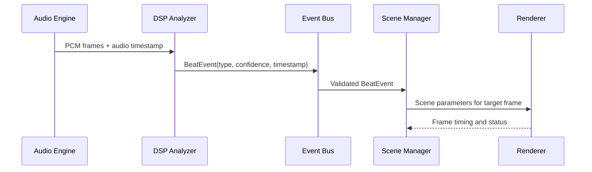
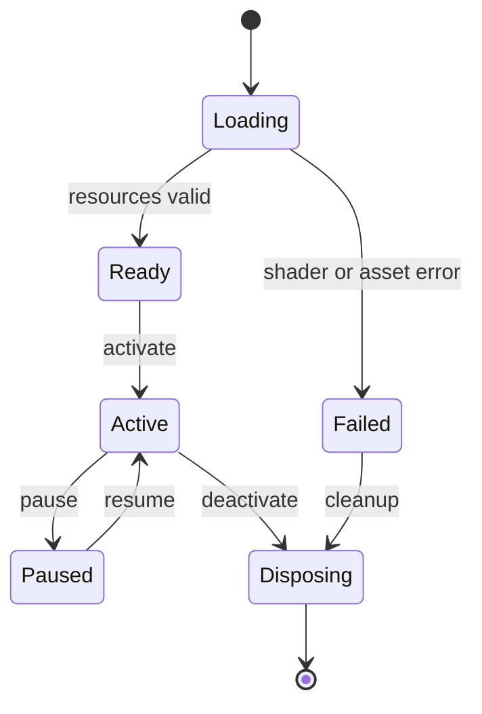

# Creative Engineering SDLC — Audio-Reactive Web Visualizer

**Version:** 1.2  
**Scope:** Existing HTML/JS audio-reactive application with custom engine, electronic music / drum & bass analysis, multiple scenes, GLSL shaders and TouchDesigner-derived concepts.  
**Status:** Proposed operating procedure; adapt to the actual repository and runtime.

## 1. Operating principles

1. A technically correct scene can still be artistically unsuccessful. **Engineering acceptance** and **creative acceptance** are separate gates.
2. Do not rewrite the existing engine before measuring its actual bottlenecks and documenting its contracts.
3. Separate audio feature extraction from scene rendering; scenes consume stable, timestamped features/events rather than depend on a specific detector implementation.
4. Prototype high-risk visual ideas *before* committing to full integration.
5. Automated runners execute tests and benchmarks; LLM agents create plans, code and interpretations. No agent may claim PASS without runner evidence.
6. Keep full logs, recordings, screenshots, profiling traces and patches in artifact storage; exchange compact references and failure summaries between agents.
7. Use a deterministic audio replay harness and reproducible visual snapshots to compare revisions.
8. Shader provenance and licensing must be reviewed before incorporating third-party work. A TouchDesigner-inspired technique is not automatically free of licensing constraints.

## 2. Roles and activation

| Role | Responsibility | When required |
|---|---|---|
| Team Lead / Orchestrator | Classify task, route agents, enforce gates, consolidate evidence | Always |
| Codebase Researcher | Inspect current engine, dependencies, contracts, affected code and existing tests | Any nontrivial task |
| Audio/DSP Specialist | Evaluate kick/snare/hat/bass/onset/tempo detection, timing and confidence | Audio analysis changes |
| Visual R&D Researcher | Search technical references, shader techniques, examples and licenses; report sources | New visual technique or shader |
| Creative Director | Write scene brief, style, rhythm mapping, transitions, aesthetic acceptance | New scene or major visual change |
| System Designer | Define interfaces, threading, data flow, resource lifecycle, fallback paths | Cross-module/architectural changes |
| Shader/Graphics Engineer | GLSL/WebGL/WebGPU, GPU memory, rendering effects, frame timing | Rendering changes |
| Architecture Skeptic (independent) | Challenge assumptions, complexity, timing, memory, fallback and failure modes; issue blocking findings | Before prototype for substantial designs |
| Test Architect (independent) | Design test matrix, fixtures, expected outcomes and testability requirements; does not certify own work | Before prototype for new scenes/audio features |
| Creative QA / Devil’s Advocate | Critique prototype for musicality, repetitiveness, flicker, poor event mapping and perceptual failures | After prototype, before full implementation |
| Planner | Atomic tasks, dependencies, tests, risks and ownership | Implementation tasks |
| Coders | Implement small diffs and add tests | Implementation tasks |
| Test Runner / CI (non-LLM) | Run scripts, tests, capture traces, screenshots, metrics and machine-readable reports | Every code change |
| Independent AV QA | Validate acceptance, musical sync, scene behavior, visual defects and edge cases | New scene and major audio/render changes |
| Human Creative Approver | Approve subjective aesthetics and musical fit | Before shipping creative changes |

Roles are callable capabilities, **not permanent separate agents**. Combine roles on small changes; avoid expensive parallel deliberation without a concrete question.

## 3. Main workflow: New scene / audio-reactive feature

### Stage 0 — Intake and classification
**Owner:** Team Lead.  
Input: user request, example track, target device, performance constraints.  
Output: `brief.md` with desired mood, scenes, musical triggers, non-goals, acceptance criteria, browser/device matrix.  
Gate: the request can be demonstrated and evaluated.

### Stage 1 — Parallel research
**Codebase Researcher:** map existing scene API, shader loading, render loop, event bus, audio analyzer, test harness, resource disposal. Deliver `codebase-map.md` with file references and verified facts.  
**Audio/DSP Specialist:** determine required signals (kick, snare, hats, bass, onset strength, tempo, beat phase, section energy) and what current detector can actually provide. Deliver `audio-feasibility.md`.  
**Visual R&D Researcher:** gather examples, shader algorithms, performance trade-offs, provenance and license status. Deliver `visual-references.md` with URLs and allowed use; do not blindly copy code.  
Gate: unresolved risks explicitly tracked; no invented API assumptions.

### Stage 2 — Dual design
**Creative Director:** `creative-spec.md` defining scene narrative, color, motion vocabulary, kick/snare/hat mapping, energy response, transitions, randomness constraints, what must *not* happen.  
**System Designer:** `technical-design.md` defining data contract, audio-to-render timing, scene lifecycle, GPU budget, shader uniforms, fallbacks, error handling, instrumentation, compatibility.  
**Architecture Skeptic — mandatory independent design challenge:** read the original brief, codebase evidence and both design artifacts; identify unjustified abstractions, duplicated subsystems, event-timing drift, excessive GPU/CPU allocations, context-loss handling, race conditions, fragile fallbacks and unproven assumptions. Deliver `architecture-challenge.md` with finding ID, severity, evidence, proposed falsification and recommended change. BLOCKER/HIGH findings require resolution or explicit human risk acceptance before proceeding. The designer must respond in `design-decisions.md`; the skeptic rechecks evidence rather than simply accepting prose.  
**Test Architect — before implementation:** write `test-strategy.md` and `test-matrix.yaml`: requirement ID → test ID → layer (unit/contract/integration/browser/visual/performance/manual) → fixture → expected result → runner command → thresholds → owner. Include kick/snare/hat discrimination, silence, double hits, tempo changes, break/drop transitions, audio-to-visual latency, shader compile, scene lifecycle, GPU context loss, browser compatibility and resource cleanup. Define deterministic audio event recordings, clock/seed, baseline screenshots and repeatable device profiles. Ensure tests can fail on known bad inputs.  
**Human checkpoint:** approve direction for large visual changes only after skeptic and test architect gates.

### Stage 3 — Visual spike / proof of concept
Build the smallest isolated scene using recorded audio features or a short test track. Render a 15–30 second reproducible clip. Record FPS/frame-time, event-to-visual latency and short preview. Do **not** build all effects yet.  
**Creative QA / Devil’s Advocate:** independently review the rendered preview against `creative-spec.md`, raw event timeline and audio fixtures. File timestamped findings: repetitive pulsing, false positives, missing snare accents, excessive flashing, loss of musical phrasing, incoherent transitions, distracting randomness and accessibility concerns. Propose counterexample tracks and stress scenes. Deliver `prototype-critique.md` with annotated video timestamps, severity and evidence.  
**Prototype test gate:** Test Runner executes a small test matrix (DSP fixtures, event timing, shader compile, FPS smoke, scene teardown); Test Architect checks missing cases and traceability.  
Gate: technical feasibility + independent creative critique resolved + human visual direction accepted. If failed, return to design or spike, not directly to full implementation.

### Stage 4 — Implementation plan
**Planner:** `implementation-plan.md`: atomic tasks, affected files, interface changes, explicit test IDs from `test-matrix.yaml`, dependency order, ownership, rollback, definition of done. Test Architect reviews coverage of every acceptance criterion; no untested implementation tasks without documented exception.  
Gate: each acceptance criterion maps to an automated check or an explicit human creative review.

### Stage 5 — Implementation
**Coders + Shader Engineer:** isolated branches/worktrees; one cohesive change per diff; unit and integration tests alongside code; shader compilation and cleanup checks; deterministic seed and clock injection for test mode.  
Gate: targeted CI checks PASS before integration.

### Stage 6 — Automated validation
**Runner:** lint/typecheck/build; DSP fixture tests; event contract tests; shader compile/link checks; scene lifecycle and resource cleanup; browser smoke; screenshot/video capture; frame-time benchmark; memory/leak checks. Store raw artifacts, send summary only.  
**Independent AV QA:** assess against original brief and fixtures, not coder's self-report. Failed cases become concrete issues with timestamps and artifact references. **Test Architect** reviews the coverage report and can demand missing tests; **Architecture Skeptic** is recalled only for design drift, new cross-module dependencies or unresolved architectural risks.  
Gate: engineering acceptance PASS, or documented exceptions approved by owner.

### Stage 7 — Creative acceptance
Human reviews A/B preview using identical track, seed, timestamps and device profile. Evaluate perceived synchronization, visual clarity, repetitiveness, transitions, aesthetics, and responsiveness to musical sections.  
Gate: explicit creative approval; a green CI cannot substitute.

### Stage 8 — Release and observation
Gradual rollout if feasible, production smoke test, monitor FPS, crashes, audio interruptions, GPU memory, context loss and user reports. Maintain rollback and previous scene versions.


## 3A. Independent review and test ownership contract

- **Test Architect writes test specifications, not claims of success.** Coders implement unit/integration tests from approved specs; independent QA may add adversarial tests. A deterministic, non-LLM Test Runner actually executes them and signs results with commit SHA, environment, command and exit code.
- **Architecture Skeptic cannot approve its own fixes.** It must cite file locations or design clauses, describe falsifiable failure scenarios and assign severity. Team Lead arbitrates disputes; human approval is required to waive high-risk findings.
- **Creative QA cannot substitute for technical QA.** A beautiful scene can fail timing or resource checks; a technically correct scene can fail creative review. Both gates must pass.
- **Token economy:** send between agents only changed-file list, diff reference, test IDs, pass/fail counts, brief failure excerpts, timestamps for visual defects and artifact URIs. Store raw traces, screenshots and video outside prompts; retrieve narrow slices on demand.
- **Failure routing:** design finding → System Designer; missing test → Test Architect / Coder; failed automated test → Coder; failed creative prototype → Creative Director / Shader Engineer; performance regression → Graphics Engineer; acceptance dispute → Team Lead / human. Re-run affected checks after each fix and the required regression suite before release.
- **Gate record:** `gate-decisions.json` contains stage, status (PASS/FAIL/BLOCKED/UNKNOWN), reviewer, findings, evidence URIs and human waiver reference when applicable. UNKNOWN never means PASS.

## 4. Specialized workflow: Audio detector improvement

1. Define target class and annotation protocol (kick, snare, hat, bass onset, etc.). Distinguish transient detection from source separation and semantic classification.
2. Curate diverse, legally usable test tracks and stems, including hard negatives, silence, distorted mixes, varying tempos and dynamic range.
3. Freeze a versioned `audio-fixtures` dataset with expected events and tolerances; document human annotation uncertainty.
4. Baseline current algorithm: precision/recall/F1 where labels exist, event timing error, false triggers, runtime CPU, latency and stability.
5. Audio specialist proposes signal-processing change; designer checks event contract compatibility.
6. Coder implements and runner evaluates **the same dataset** plus streaming stress tests.
7. AV QA checks that improved numerical metrics actually improve perceived visuals; avoid optimizing one metric at the expense of musicality.
8. Roll out behind a detector version/flag; compare before and after.

**Important:** Kick/snare recognition in a full mixed track is probabilistic. Do not label confidence scores as ground truth; ambiguous cases should be reported explicitly.

## 5. Specialized workflow: New shader or scene effect

1. Creative brief + visual references + provenance/license audit.
2. GPU/render feasibility spike: shader compile, worst-case resolutions, fill rate, overdraw, texture budget, frame-time.
3. Define uniform contract: `time`, `deltaTime`, `resolution`, `audioFeatures`, `beatPhase`, `seed` and versioned extension fields.
4. Implement with deterministic test mode and explicit allocation/disposal.
5. Runner validates compile/link, output not blank/NaN, context-loss handling, screenshot snapshots and performance profile.
6. Independent AV QA + human creative review.
7. Register in scene catalog with metadata, preview, compatibility and known limitations.

## 6. Specialized workflow: Bugfix

1. Triage observed/expected, severity, track/device/browser, reproduction steps and evidence.
2. Reproduce with frozen audio events and fixed scene seed; if issue is live-input-only, capture event stream and environment metadata.
3. Write regression test that fails on baseline; runner records RED evidence (or explain why automation is infeasible).
4. Researcher identifies root cause; System Designer only for architectural/cross-module defects.
5. Minimal fix, runner verifies GREEN, targeted regression, browser smoke and visual comparison.
6. Independent QA verifies original defect plus adjacent cases; Team Lead reviews diff; release and observe.

## 7. Specialized workflow: Performance

1. Define budgets **per target device** (e.g. 60 FPS target means ~16.7 ms/frame total; actual thresholds must be measured/approved).
2. Collect baseline: p50/p95/p99 frame-time, dropped frames, GPU/CPU utilization where measurable, allocations, GC pauses, audio underruns, event-to-visual latency.
3. Profile representative scenes and heavy tracks; isolate DSP vs rendering vs UI overhead.
4. Make one optimization hypothesis per change; test under controlled, repeatable load.
5. Compare distributions, not one FPS reading. Require functional and visual regression PASS.
6. Canary, observe and rollback if performance or visual quality regresses.

## 8. Specialized workflow: Security and licensing

- Threat-model microphone/file permissions, user-uploaded audio, external shader content, browser storage, unsafe dynamic code, dependencies and network boundaries.
- Runner performs dependency/secret/static checks; agents triage findings and write tests.
- Restrict arbitrary shader execution and untrusted inputs according to actual threat model.
- Preserve shader source attribution, license, modification history and provenance; request legal review when unclear.
- Security review does not replace visual/architectural refactoring.

## 9. Required test harnesses

### A. Deterministic audio replay
Inputs: fixture ID, audio track hash, sample rate, detector version, event timeline, timestamps and confidence.  
Outputs: versioned JSON/NDJSON event stream; optional raw audio reference.  
Modes: (1) recorded feature playback, isolating graphics; (2) full audio pipeline replay, testing DSP + graphics. Do not confuse the two.

### B. Deterministic rendering
Inject virtual clock, seeded RNG, fixed viewport/device pixel ratio, scene config and shader version. Capture frames at fixed times. For unstable GPU snapshots, use controlled environment, tolerances and semantic checks instead of strict pixel equality.

### C. Performance harness
Fixed workload, browser/GPU/driver, warmup, repeated samples, scene/track ID. Store percentile distributions and raw traces. CI machine results are not directly comparable with production GPUs without calibration.

### D. AV review harness
A/B synchronized clips, overlayed event markers, visible frame timestamps, a brief scorecard for sync, dynamics, transitions, readability, variety and overall artistic quality. The scorecard is advisory; human makes subjective acceptance decision.

## 10. Artifact exchange and token economy

**Store full artifacts outside the LLM context:**
- `artifacts/<task-id>/<commit>/research.md`
- `.../design.md`, `.../plan.md`, `.../diff.patch`
- `.../junit.xml`, `.../metrics.json`, `.../screenshots/`, `.../preview.mp4`, `.../trace.json`
- `.../manifest.json` with hashes and environment metadata

**Send only compact machine summaries to other agents:**

```json
{
  "task_id": "AV-142",
  "commit": "<sha>",
  "stage": "visual-regression",
  "status": "FAIL",
  "environment": "chromium-linux-gpu-profile-A",
  "failed_checks": ["scene-pulse-at-00:12.500"],
  "metrics": {"p95_frame_ms": 19.4},
  "artifacts": {
    "diff": "artifacts://AV-142/diff.patch",
    "report": "artifacts://AV-142/report.json",
    "preview": "artifacts://AV-142/preview.mp4"
  },
  "error_excerpt": "Kick pulse is absent at the annotated event"
}
```

Rules: `UNKNOWN` ≠ `PASS`; include commit SHA, exact environment and runner exit status; snippets bounded; agents fetch only relevant log ranges or frames; summaries are regenerated on each new commit. Avoid passing entire codebase, full videos or repeated research between agents. Cache by content hash and tool version. A failure goes back with test IDs, not full conversation history.

## 11. Quality gates matrix

| Gate | Feature / scene | Bugfix | DSP | Shader | Performance |
|---|---|---|---|---|---|
| Verified requirements | Required | Required | Required | Required | Required |
| Reproduction RED | If fixing defect | Required when feasible | For defect | For defect | Baseline required |
| Unit / integration | Required | Targeted + regression | Required | Contract + lifecycle | Regression |
| Deterministic replay | Required for audio-reactive work | Required where applicable | Required | Required | Required |
| Visual snapshots | Required | Impacted scenes | Representative scenes | Required | Required |
| Frame-time budget | Required | No regression | No regression | Required | Core criterion |
| Creative review | Required | If visual impact | If visual impact | Required | If perceptual impact |
| Human approval | Major creative change | High risk | Major behavior change | Major visual change | Trade-off decisions |

## 12. Suggested initial implementation order

**P0:** document current engine and scene API; create 5–10 representative audio fixtures; add replay harness; implement CI artifact manifest and compact summaries.  
**P1:** scene preview capture and visual review; deterministic rendering; DSP baseline tests; browser smoke.  
**P2:** automated frame-time profiling, GPU/resource lifecycle checks, shader catalog with provenance; per-device budgets.  
**P3:** advanced musical structure analysis, richer creative scorecards and scene selection experiments.

## 13. Definition of Done

A change is complete only if: requirements and scope are traceable; code diff is reviewed; machine-run tests have verifiable evidence; no unresolved blocking regression exists; performance meets approved target; provenance is documented for imported shaders; the appropriate human has approved visual quality; release/rollback is ready.

## 14. Technical references

- MDN — Web Audio AnalyserNode: https://developer.mozilla.org/en-US/docs/Web/API/AnalyserNode
- MDN — AudioWorklet: https://developer.mozilla.org/en-US/docs/Web/API/Web_Audio_API/Using_AudioWorklet
- Playwright — Visual comparisons: https://playwright.dev/docs/test-snapshots

These are technical reference points, not proof that the existing project uses these APIs.

## 15. Controlled technical language: ASD-STE100-inspired policy (v1.2)

**Scope and caveat.** ASD-STE100 is a controlled-English specification. Russian communication can adopt its clarity principles but cannot be certified as ASD-STE100 compliant. Targets below are *internal review targets*, not formal STE certification or percentage of English words.

- **Human-facing: target >=80%** of applicable clarity checks in technical briefs, decisions, approvals and failure reports. Preserve natural language for creative ideation, artistic critique and informal discussion.
- **Agent-to-agent: target >=90%** of applicable clarity checks in specifications, task handoffs, test instructions and decision records. Prefer machine-readable schemas over prose for deterministic fields.
- **Checklist and measurement:** sample requirements/statements; score each applicable item for one action per instruction, consistent terminology, explicit subject and object, unambiguous condition, measurable acceptance, short sentences, defined abbreviations, and no hidden assumptions. Score = passed applicable checks / total applicable checks. Record sample size, reviewer and failures. A threshold is a quality target; do not claim formal ASD-STE100 compliance.
- **Controlled vocabulary:** define canonical names for AudioFeature, BeatEvent, SceneState, RenderFrame, Timestamp, Confidence and SceneTransition. Avoid synonyms for the same entity in technical contracts.
- **No loss of precision:** keep code identifiers, exact API names, units, timing constraints and protocol keys unchanged. If clarity conflicts with technical correctness, preserve correctness and explain terminology.
- **Exception path:** creative dialogue, quotes, legal text and original external specifications may be exempt; document exception reason rather than distort content.

### Required handoff template

```yaml
artifact_id: AV-123
producer_role: SystemDesigner
consumer_role: Planner
source_commit: '<sha>'
objective: 'Make scene react to confirmed snare events.'
inputs: ['BeatEvent schema v2']
outputs: ['scene-design.md', 'sequence.mmd']
constraints: ['visual onset delay <= approved budget']
acceptance_criteria: ['Runner verifies event-to-frame timing on fixture DNB-03']
unknowns: ['GPU timing variance on target device']
evidence_refs: ['artifacts://AV-123/']
review_status: PENDING
```

## 16. Architecture diagrams as code (Mermaid)

**Designers MUST use Mermaid diagrams for relevant architectural changes.** Store `.mmd` source in version control; generate previews in CI; reviewers inspect both source and rendered output. Diagram type is conditional, not every diagram on every ticket.

| Diagram | Required when | Review focus |
|---|---|---|
| C4 Context | New external integration or changed system boundary | Actors, external systems, trust boundary |
| C4 Container | New/changed runtime, worker, service or major subsystem | Ownership, protocols, deployment boundary |
| C4 Component | Cross-module redesign or new engine component | Interfaces, dependencies, coupling |
| Sequence | Audio event timing, asynchronous flow, scene transitions | Ordering, timestamps, errors, backpressure |
| State | Scene lifecycle or mode changes | Legal transitions, cleanup, failure states |
| Flowchart | Complex algorithms or control flow | Branches, error handling |
| Data-flow | DSP pipeline, buffers, feature/event routing | Units, clock domain, latency, ownership |

Mermaid supports C4 diagram syntax with implementation limitations; if the team's Mermaid renderer cannot represent a required C4 view accurately, use a supported diagram-as-code alternative and retain the same review gate. Check rendering against the pinned Mermaid version.

### Example: audio-to-visual sequence



### Example: scene state machine



## 17. Independent challenge and test gates

1. **Before prototype:** System Designer submits design + relevant Mermaid diagrams. Independent Architecture Skeptic issues `architecture-review.json` with severity, evidence and alternative. Test Architect produces `test-matrix.yaml`, fixture list, expected outcomes, timing tolerances and visual review rubric. Blocking findings return to Designer.
2. **Prototype:** Prototype Engineers implement a bounded spike; runner executes replay fixtures and captures video/screenshots/metrics. Creative QA critiques actual captures, not a textual description. Human approves direction or requests revision.
3. **Before implementation:** Planner maps each acceptance criterion to test ID, runner command, artifact path and owning role. Independent Test Architect checks coverage and negative cases; Planner cannot self-approve.
4. **Implementation:** Coders add unit/integration/regression tests. Non-LLM runner executes tests, stores raw output and sends only structured summaries and references to agents.
5. **Before release:** Independent AV QA validates recorded evidence, visual behavior, DSP accuracy, performance, browser compatibility and regressions. Architecture Skeptic reopens review only if implementation diverges from approved design.
6. **After fixes:** re-run affected tests and mandatory release suite; no PASS by agent assertion. Release requires approved human creative gate for major scene changes.

**Cost controls:** only invoke a critic on relevant risk thresholds; use concise review findings; avoid re-sending full diagrams or logs when unchanged; cache by artifact hash; keep raw captures outside the LLM context.

## 18. Change log

- **v1.2:** ASD-STE100-inspired communication targets, measurable clarity checks, required conditional Mermaid/C4/sequence/state/data-flow diagrams, independent design and test gates.
